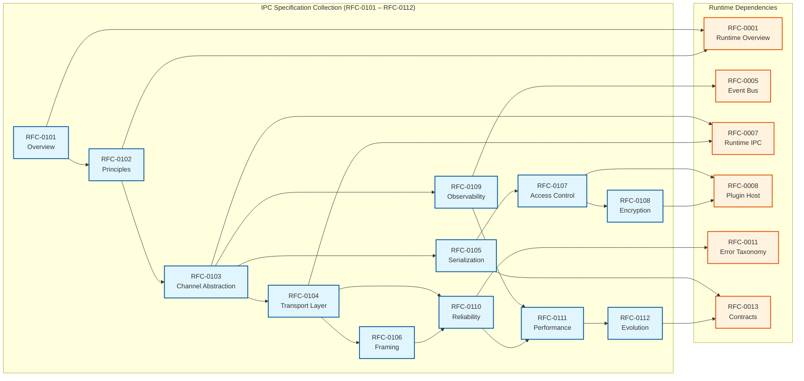
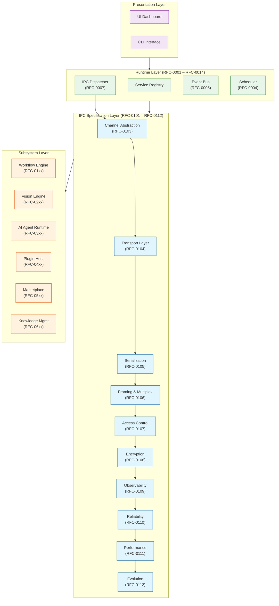
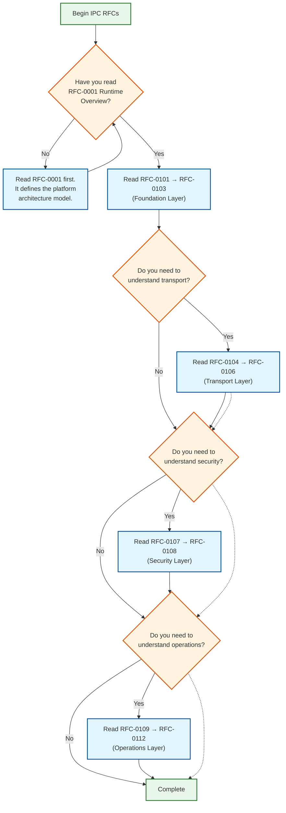

# Specifications: IPC

> **Purpose**: Navigation document for the IPC specification collection (RFC-0101 through RFC-0112).  
> **Last Updated**: 2026-06-30  
> **Owner**: Atlas Specification Committee  

---

## Normative Status

This document is normative. Every Atlas implementation that participates in inter-process communication MUST conform to the specifications and constraints defined herein. Whenever an implementation conflicts with this specification, this specification takes precedence. Any deviation from this specification requires formal Architecture Decision Record (ADR) approval by the Core Architecture Group.

This specification is subordinate to the Atlas Development System (ADS) Constitution and all active ADRs.

---

## Table of Contents

1. [Overview](#1-overview)
2. [Reading Order](#2-reading-order)
3. [Dependency Graph](#3-dependency-graph)
4. [Relationship with Runtime RFCs](#4-relationship-with-runtime-rfcs)
5. [Relationship with Plugin RFCs](#5-relationship-with-plugin-rfcs)
6. [Relationship with Workflow RFCs](#6-relationship-with-workflow-rfcs)
7. [Relationship with Vision RFCs](#7-relationship-with-vision-rfcs)
8. [Relationship with AI RFCs](#8-relationship-with-ai-rfcs)
9. [Architecture Map](#9-architecture-map)
10. [RFC Dependency Table](#10-rfc-dependency-table)
11. [Reading Order Flowchart](#11-reading-order-flowchart)
12. [Glossary](#12-glossary)

---

## 1 Overview

The Atlas Inter-Process Communication (IPC) specification defines the message-routing, channel-management, and protocol-layer standards that enable every Atlas subsystem to exchange data across process boundaries. IPC RFCs cover transport abstraction, serialization contracts, channel lifecycle, message validation, access control, and observability hooks.

All IPC specifications are implementation-independent: they define logical interfaces, message formats, and behavioral constraints without prescribing any programming language, framework, library, or operating system.

The IPC specification collection consists of twelve documents, RFC-0101 through RFC-0112, organized across four layers:

| Layer | RFCs | Focus |
|---|---|---|
| Foundation | RFC-0101, RFC-0102, RFC-0103 | Overview, scope, and core principles |
| Transport | RFC-0104, RFC-0105, RFC-0106 | Channel types, serialization, and framing |
| Security | RFC-0107, RFC-0108 | Access control, encryption, and auditing |
| Operations | RFC-0109 through RFC-0112 | Observability, reliability, performance, and evolution |

---

## 2 Reading Order

New contributors MUST read the IPC RFCs in the following sequence. Later RFCs reference concepts established earlier; reading out of order will cause gaps in comprehension.

1. **RFC-0101** — IPC Overview: Establishes the purpose, scope, and architectural position of IPC within the Atlas platform.
2. **RFC-0102** — IPC Principles: Defines the governing design principles (transport independence, contract-first, zero-trust).
3. **RFC-0103** — Channel Abstraction: Introduces the channel model that all subsequent RFCs build upon.
4. **RFC-0104** — Transport Layer: Describes the transport abstraction and its conformance requirements.
5. **RFC-0105** — Serialization Contract: Specifies message encoding rules and schema validation.
6. **RFC-0106** — Framing and Multiplexing: Details how multiple logical streams share a single transport.
7. **RFC-0107** — Access Control: Defines authentication, authorization, and channel-permission classes.
8. **RFC-0108** — Encryption and Key Management: Specifies confidentiality requirements and rotation policies.
9. **RFC-0109** — Observability: Covers tracing, correlation IDs, and audit logging.
10. **RFC-0110** — Reliability: Addresses delivery guarantees, dead-letter queues, and retry semantics.
11. **RFC-0111** — Performance: Defines throughput targets, backpressure, and throttling rules.
12. **RFC-0112** — Evolution and Versioning: Explains version negotiation, deprecation, and migration paths.

**Minimum viable reading path** (for quick onboarding): RFC-0101 → RFC-0103 → RFC-0107 → RFC-0109.

---

## 3 Dependency Graph

The following Mermaid diagram shows the dependency relationships among all IPC RFCs, plus their external dependencies on Runtime RFCs.

---

## 4 Relationship with Runtime RFCs

The IPC specification operates as the communication substrate for the entire Atlas platform. Its relationship with individual Runtime RFCs is summarized below.

### RFC-0001 (Runtime Overview)
RFC-0101 inherits the platform scope and layered-architecture model from RFC-0001. The IPC overview positions IPC as the Communication Layer within the Runtime's four-layer model (Foundation → Core → Execution → Communication).

### RFC-0002 (Runtime Lifecycle)
IPC channels MUST align with Runtime lifecycle phases. Channels opened during the `Initializing` phase MUST be validated before the Runtime reaches `Ready`. Channels associated with terminated processes MUST be closed deterministically.

### RFC-0003 (Runtime Service Model)
Every IPC channel connects two Service endpoints registered in the Service Registry. RFC-0103 (Channel Abstraction) uses the Service Contract model from RFC-0003 to define which services may open which channel types.

### RFC-0005 (Runtime Event Bus)
The Event Bus is one consumer of the IPC transport layer. RFC-0109 (Observability) specifies that event-bus messages flowing through IPC channels MUST carry correlation IDs compatible with the Event Bus trace model defined in RFC-0005.

### RFC-0007 (Runtime IPC Architecture)
RFC-0007 defines the Runtime's internal IPC dispatcher, token allocation, and channel classification. The IPC specification RFCs (RFC-0101 through RFC-0112) extend RFC-0007 by specifying the protocol-level details that the dispatcher enforces. RFC-0104 (Transport Layer) and RFC-0106 (Framing) are direct refinements of the transport-abstraction principles introduced in RFC-0007.

### RFC-0013 (Runtime Contracts)
RFC-0105 (Serialization Contract) derives its schema-validation rules from the Contract model in RFC-0013. Every IPC message payload MUST be validated against a registered contract before the dispatcher forwards it to the target service.

---

## 5 Relationship with Plugin RFCs

Plugins are the primary IPC consumers in the Atlas platform. RFC-0401 through RFC-0405 (Plugin System) define how plugins are discovered, loaded, and sandboxed. The IPC specification interacts with the Plugin RFCs as follows:

- **RFC-0404 (Plugin Security Boundaries)** mandates that every plugin communicates with the Runtime exclusively through IPC channels. RFC-0107 (Access Control) defines the permission classes that enforce this boundary.
- **RFC-0403 (Plugin Lifecycle)** requires that plugin-loaded channels follow the same lifecycle rules as Runtime services. RFC-0103 (Channel Abstraction) specifies the channel states that plugins MUST observe.
- **RFC-0405 (Plugin Marketplace)** depends on RFC-0112 (Evolution and Versioning) to negotiate protocol compatibility between marketplace-published plugins and the Runtime.

The IPC specification does not define plugin loading mechanisms; it only defines the communication contract that every plugin MUST satisfy.

---

## 6 Relationship with Workflow RFCs

Workflows (RFC-0101 through RFC-0107 in the Workflow subsystem) are DAG-based automation sequences that execute across multiple Atlas services. IPC is the transport layer through which workflow steps communicate:

- **RFC-0103 (Workflow Schema)** sends step-definition payloads through IPC channels defined in RFC-0104 (Transport Layer).
- **RFC-0105 (Workflow Conditional Logic)** relies on RFC-0110 (Reliability) to ensure conditional branches receive messages with guaranteed delivery semantics.
- **RFC-0106 (Workflow Trigger Mechanics)** uses RFC-0109 (Observability) to trace trigger events across process boundaries.
- **RFC-0107 (Workflow Validation)** depends on RFC-0105 (Serialization Contract) to validate that workflow state updates conform to registered IPC schemas.

The IPC specification is agnostic to workflow semantics; it provides the transport, security, and observability primitives that workflow RFCs consume.

---

## 7 Relationship with Vision RFCs

The Vision Engine (RFC-0201 through RFC-0206) captures frames, performs template matching, OCR, and object detection. Vision RFCs generate high-bandwidth binary payloads that traverse IPC channels:

- **RFC-0202 (Frame Capture)** sends raw frame data through the framing layer defined in RFC-0106 (Framing and Multiplexing), which handles multiplexing multiple capture streams over a single transport.
- **RFC-0204 (OCR)** and **RFC-0205 (Object Detection)** depend on RFC-0105 (Serialization Contract) for schema-validated result payloads.
- **RFC-0206 (Video Frame Pipeline)** uses RFC-0111 (Performance) to enforce throughput targets and backpressure thresholds appropriate for continuous video streams.
- **RFC-0203 (Template Matching)** relies on RFC-0108 (Encryption) when matching templates against confidential workspace data.

The IPC specification defines maximum frame sizes, compression requirements, and latency budgets that Vision RFCs MUST respect.

---

## 8 Relationship with AI RFCs

AI subsystems (RFC-0301 through RFC-0307) coordinate agent execution, provider interoperability, tool calling, and memory management. IPC is the backbone of AI agent coordination:

- **RFC-0302 (AI Provider Interoperability)** uses RFC-0107 (Access Control) to authenticate provider connections and enforce scope-limited channel access.
- **RFC-0304 (Agent Execution Engine)** depends on RFC-0110 (Reliability) for at-least-once delivery of agent commands across sandbox boundaries.
- **RFC-0306 (Agent Planner)** relies on RFC-0109 (Observability) to trace multi-step reasoning chains across IPC hops.
- **RFC-0307 (Tool Calling Abstraction)** uses RFC-0105 (Serialization Contract) to validate tool-input and tool-output payloads against registered schemas.
- **RFC-0305 (Agent Memory)** depends on RFC-0108 (Encryption) for confidentiality of stored context vectors transmitted over IPC.

The IPC specification provides the message-routing and schema-validation primitives that enable AI agents to operate safely across process boundaries.

---

## 9 Architecture Map

The following Mermaid diagram positions the IPC subsystem within the broader Atlas architecture, showing how IPC RFCs map onto platform layers and interact with Runtime, Plugin, Workflow, Vision, and AI subsystems.

---

## 10 RFC Dependency Table

The table below lists every IPC RFC with its category, layer, dependencies, and dependent RFCs.

| RFC ID | Title | Category | Layer | Depends On | Depended On By |
|---|---|---|---|---|---|
| RFC-0101 | IPC Overview | Foundation | Core | RFC-0001, RFC-0007 | RFC-0102 |
| RFC-0102 | IPC Principles | Foundation | Core | RFC-0101 | RFC-0103 |
| RFC-0103 | Channel Abstraction | Foundation | Core | RFC-0101, RFC-0102, RFC-0007 | RFC-0104, RFC-0105, RFC-0109 |
| RFC-0104 | Transport Layer | Transport | Protocol | RFC-0103, RFC-0007 | RFC-0106, RFC-0110 |
| RFC-0105 | Serialization Contract | Transport | Protocol | RFC-0103, RFC-0013 | RFC-0107 |
| RFC-0106 | Framing and Multiplexing | Transport | Protocol | RFC-0104 | RFC-0110, RFC-0111 |
| RFC-0107 | Access Control | Security | Enforcement | RFC-0105, RFC-0008 | RFC-0108 |
| RFC-0108 | Encryption and Key Management | Security | Enforcement | RFC-0107, RFC-0008 | RFC-0109 |
| RFC-0109 | Observability | Operations | Monitoring | RFC-0103, RFC-0108, RFC-0005 | RFC-0111 |
| RFC-0110 | Reliability | Operations | Guarantees | RFC-0104, RFC-0106, RFC-0011 | RFC-0111 |
| RFC-0111 | Performance | Operations | Optimization | RFC-0109, RFC-0110 | RFC-0112 |
| RFC-0112 | Evolution and Versioning | Operations | Governance | RFC-0111, RFC-0013 | None |

**Legend:**
- **Category**: The thematic grouping of the RFC.
- **Layer**: The architectural layer the RFC governs.
- **Depends On**: RFCs that this document references for foundational definitions.
- **Depended On By**: RFCs that reference this document.

---

## 11 Reading Order Flowchart

The following Mermaid diagram visualizes the recommended reading order as a decision flow.

---

## 12 Glossary

Terms specific to the IPC specification collection. For platform-wide terms, refer to [glossary.md](../glossary.md).

| Term | Definition |
|---|---|
| **Channel** | A logical communication pathway between two endpoints, identified by a unique channel descriptor. Channels are the primary abstraction in the IPC model. |
| **Transport** | The physical or logical medium over which channel data flows. The IPC specification is transport-agnostic; any medium that satisfies the transport contract MAY be used. |
| **Framing** | The process of encapsulating serialized messages into discrete units suitable for transmission over a multiplexed channel. |
| **Multiplexing** | The sharing of a single transport connection among multiple logical channels, each carrying independent message streams. |
| **Serialization Contract** | A registered schema that defines the structure, types, and constraints of an IPC message payload. Every message MUST conform to a serialization contract before transmission. |
| **Correlation ID** | A unique identifier attached to every IPC message that enables end-to-end tracing across process boundaries. |
| **Access Class** | A permission tier (Public, Internal, Restricted, Confidential) that determines which processes MAY open a channel and what operations they MAY perform. |
| **Backpressure** | A flow-control mechanism that signals a sender to reduce its transmission rate when the receiver's queue approaches capacity. |
| **Dead Letter Channel** | A dedicated channel for messages that failed delivery after all retry attempts. Messages in the dead letter channel MUST be auditable and recoverable. |
| **Version Negotiation** | The handshake process by which two endpoints determine the highest mutually supported IPC protocol version before exchanging application data. |
| **Protocol Epoch** | A versioned period during which a specific set of IPC RFCs remains stable. Transitions between epochs are governed by RFC-0112. |
| **Message Window** | The maximum duration an IPC message MAY remain in transit from emission to delivery before it is considered stale and discarded. |

---

## Changelog

| Version | Date | Author | Description |
|---|---|---|---|
| 1.0.0 | 2026-06-30 | Atlas Specification Committee | Initial navigation document for the IPC specification collection. |

---

## IPC Compliance Checklist

Implementors MUST verify all items below before claiming IPC conformance. Each checkbox represents a mandatory verification point.

### Core Compliance

- [ ] **Message Validation**: All incoming messages are validated against registered schemas before processing.
- [ ] **Authentication**: All IPC connections require valid authentication tokens or certificates.
- [ ] **Authorization**: All IPC operations enforce access control based on Security Levels (L0-L4).
- [ ] **Encryption**: Sensitive data is encrypted in transit according to Security Level requirements.
- [ ] **Serialization**: All payloads conform to registered schema versions with proper version negotiation.

### Routing & Delivery

- [ ] **Routing**: Messages are routed according to registered routing rules and channel definitions.
- [ ] **Retry**: Retryable errors trigger automatic retries with exponential backoff and jitter.
- [ ] **Ordering**: Ordered channels preserve message sequence within sessions.
- [ ] **Dead Letter**: Undeliverable messages are moved to the Dead Letter Queue with audit logging.

### Observability & Security

- [ ] **Metrics**: Latency, throughput, error rate, and queue depth metrics are collected and exposed.
- [ ] **Tracing**: End-to-end trace IDs are propagated across all IPC hops.
- [ ] **Audit Trail**: All security-relevant events are recorded in the immutable audit log.
- [ ] **Recovery**: Failed connections are automatically recovered within defined SLA windows.
- [ ] **Health Checks**: Continuous health monitoring detects degraded and failed states.

### Extension Compliance

- [ ] **Capability Discovery**: Plugins query the Capability Registry at startup.
- [ ] **Extension Validation**: All extensions pass the conformance test suite before activation.
- [ ] **Manifest Compliance**: Extension manifests declare all required fields and dependencies.
- [ ] **Version Compatibility**: Extensions operate within declared protocol epoch boundaries.

### Catalog Compliance

- [ ] **Interface Registry**: All IPC communications reference Interface IDs from catalog/interfaces.md.
- [ ] **Message Registry**: All standard messages use Message IDs from catalog/messages.md.
- [ ] **Channel Registry**: All channels use Channel IDs from catalog/channels.md.
- [ ] **Error Code Registry**: All errors use fixed Error Codes from catalog/errors.md.
- [ ] **Security Levels**: All processes are assigned Security Levels from catalog/security-levels.md.
- [ ] **Capability Registry**: All extensions advertise capabilities from catalog/capabilities.md.

---

## Cross-Reference Matrix

This section maps IPC RFCs to their corresponding Runtime, Plugin, Workflow, Vision, and AI RFCs.

| IPC RFC | Runtime RFC | Plugin RFC | Workflow RFC | Vision RFC | AI RFC |
|---|---|---|---|---|---|
| RFC-0101 Overview | RFC-0001, RFC-0007 | RFC-0401 | RFC-0501 | RFC-0601 | RFC-0701 |
| RFC-0102 Message Model | RFC-0013 Contracts | RFC-0403 | RFC-0503 | RFC-0603 | RFC-0703 |
| RFC-0103 Transport | RFC-0007 IPC | RFC-0402 | RFC-0502 | RFC-0602 | RFC-0702 |
| RFC-0104 Routing | RFC-0005 EventBus | RFC-0404 | RFC-0504 | RFC-0604 | RFC-0704 |
| RFC-0105 Channel | RFC-0003 Service Model | RFC-0401 | RFC-0501 | RFC-0601 | RFC-0701 |
| RFC-0106 Serialization | RFC-0013 Contracts | RFC-0403 | RFC-0503 | RFC-0603 | RFC-0703 |
| RFC-0107 Security | RFC-0008 Plugin Security | RFC-0405 | RFC-0505 | RFC-0605 | RFC-0705 |
| RFC-0108 Reliability | RFC-0002 Lifecycle | RFC-0402 | RFC-0502 | RFC-0602 | RFC-0702 |
| RFC-0109 Lifecycle | RFC-0002 Lifecycle | RFC-0401 | RFC-0501 | RFC-0601 | RFC-0701 |
| RFC-0110 Observability | RFC-0001 Overview | RFC-0406 | RFC-0506 | RFC-0606 | RFC-0706 |
| RFC-0111 Error Model | RFC-0011 Errors | RFC-0407 | RFC-0507 | RFC-0607 | RFC-0707 |
| RFC-0112 Extension | RFC-0012 Capabilities | RFC-0408 | RFC-0508 | RFC-0608 | RFC-0708 |

---

## ADR Cross-References

| ADR | Title | IPC RFC Impact |
|---|---|---|
| ADR-0008 | Security Architecture | RFC-0107 Security |
| ADR-0010 | IPC and Runtime Architecture | RFC-0101 Overview |
| ADR-0012 | Contract-First Specification | RFC-0102 Message Model, RFC-0106 Serialization |
| ADR-0015 | Plugin Isolation Model | RFC-0105 Channel, RFC-0107 Security |
| ADR-0020 | Event-Driven Architecture | RFC-0103 Transport, RFC-0104 Routing |
| ADR-0025 | Observability Framework | RFC-0110 Observability |
| ADR-0030 | Error Handling Strategy | RFC-0111 Error Model |

---

## IPC Architecture Freeze Declaration

Upon acceptance of this specification collection, the IPC Architecture is hereby frozen.

- **Freeze Date**: 2026-06-30
- **Frozen Components**: Message Model, Transport Abstraction, Routing Engine, Channel Model, Security Levels, Error Codes, Interface IDs, Channel IDs, Message IDs, Capability IDs
- **Allowed Changes**: Wording corrections, typo fixes, clarification updates
- **Prohibited Changes**: New interface IDs, new channel types, new security levels, new error code categories, changes to RFC2119 normative requirements
- **Override Authority**: Atlas Architecture Board only, requires 2/3 majority vote
- **Review Cycle**: Annual review on June 30; emergency reviews require Architecture Board approval

All future IPC work MUST operate within the frozen architecture. New capabilities MUST be added through the extension mechanism defined in RFC-0112. New message types MUST conform to the catalog defined in catalog/messages.md. New channels MUST use IDs from catalog/channels.md. New errors MUST use codes from catalog/errors.md.

---

## Catalog Index

The IPC subsystem uses centralized catalogs for all identifiers. All RFCs reference these catalogs instead of defining IDs inline.

| Catalog | File | Contents |
|---|---|---|
| Interface Catalog | catalog/interfaces.md | IPC-IF-001 through IPC-IF-015 |
| Message Catalog | catalog/messages.md | MSG-0001 through MSG-0040 |
| Channel Catalog | catalog/channels.md | CH-SYSTEM through CH-INTERNAL |
| Error Code Catalog | catalog/errors.md | IPC-1001 through IPC-1030 |
| Capability Registry | catalog/capabilities.md | CAP-IPC-STREAM through CAP-IPC-RECONNECT |
| Security Level Catalog | catalog/security-levels.md | L0 (Public) through L4 (Core Runtime) |

---

*This document is part of the Atlas Specification hierarchy. For the complete RFC index, see [RFC_INDEX.md](../RFC_INDEX.md).*

