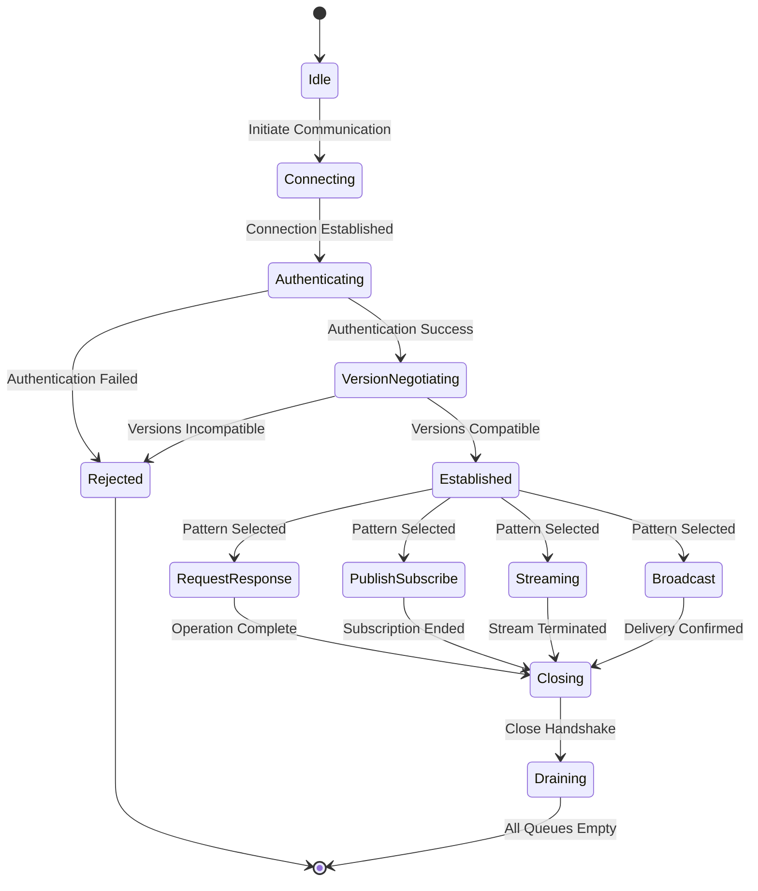
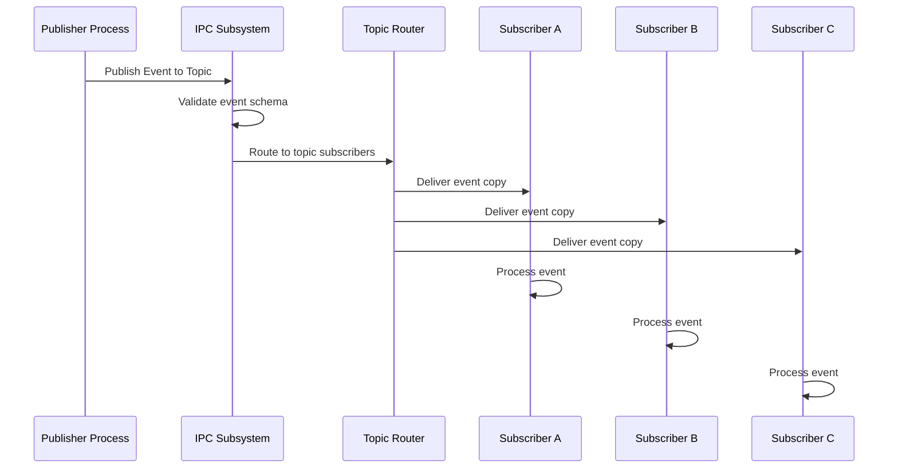
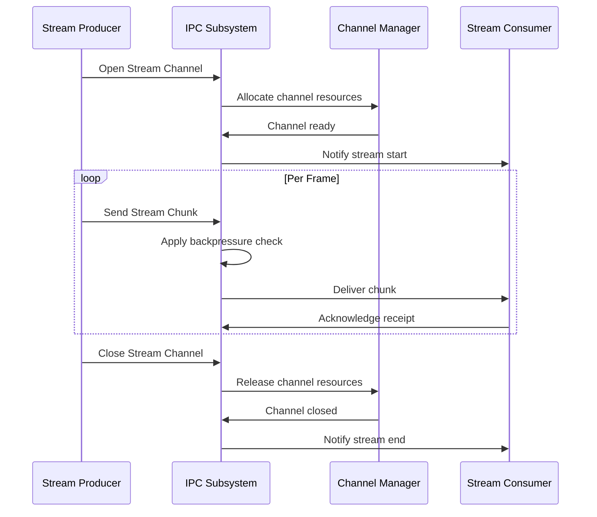

# RFC-0101: IPC Overview

RFC: RFC-0101
Title: IPC Overview
Status: Accepted
Version: 1.0.0
Category: IPC
Layer: Communication
Normative: YES
Authors: Atlas Team
Created: 2026-06-30
Last Updated: 2026-06-30
Depends On: RFC-0001 Runtime Overview, RFC-0007 Runtime IPC
Related RFC: RFC-0102 IPC Message Model, RFC-0103 IPC Transport, RFC-0104 IPC Channel, RFC-0106 IPC Serialization, RFC-0107 IPC Security, RFC-0108 IPC Reliability, RFC-0109 IPC Lifecycle, RFC-0110 IPC Observability, RFC-0111 IPC Error Model, RFC-0112 IPC Extension
Target Release: 1.0.0
ADR References: ADR-0010, ADR-0012

---

## Normative Status

## Authority

This RFC is the authoritative specification for the IPC subsystem domain defined herein.

Any implementation MUST conform to this document.

If an implementation conflicts with this RFC, this RFC takes precedence.

Conflicts between RFCs SHALL be resolved through the ADR process.

---

## Terminology

The following terms are defined with exact meanings consistent with the Atlas Master Glossary.

| Term | Definition | Source |
|---|---|---|
| IPC | Inter-Process Communication; the unified messaging fabric enabling cross-process data exchange. | Glossary |
| Channel | A bidirectional or unidirectional communication pathway between two endpoints. | Glossary |
| Transport | The underlying mechanism by which messages are delivered between processes. | Glossary |
| Correlation ID | A globally unique identifier attached to every message for end-to-end tracing. | Glossary |

---
This document is normative. Every Atlas implementation that participates in inter-process communication MUST conform to the specifications and constraints defined herein. Whenever an implementation conflicts with this specification, this specification takes precedence. Any deviation from this specification requires formal Architecture Decision Record (ADR) approval by the Core Architecture Group.

This specification is subordinate to the Atlas Development System (ADS) Constitution and all active ADRs.

---


## Layer Boundaries

### Responsibilities

This specification IS responsible for:

- Defining the architectural contract for this domain.
- Specifying behavioral requirements that all implementations MUST satisfy.
- Establishing extension points and their contracts.

### Non-Responsibilities

This specification IS NOT responsible for:

- Implementation details (see related RFCs for implementation guidance).
- Runtime platform specifics.
- User-facing UI behavior.

### Dependencies

| Dependency | Direction | Description |
|---|---|---|
| RFC-0001 | Consumed | Runtime Overview — foundational runtime architecture |

### Consumers

- See related RFCs for consumer listings.

### Providers

- This specification provides domain-specific contracts and behavioral models.

### Forbidden Dependencies

- This specification MUST NOT depend on any specific programming language.
- This specification MUST NOT depend on any specific storage backend.
- This specification MUST NOT depend on any specific operating system.
## Table of Contents
1. [Introduction](#1-introduction)
2. [Goals](#2-goals)
3. [Non-Goals](#3-non-goals)
4. [IPC Philosophy](#4-ipc-philosophy)
5. [Ownership](#5-ownership)
6. [Boundaries](#6-boundaries)
7. [Invariants](#7-invariants)
8. [Architecture](#8-architecture)
9. [Communication Principles](#9-communication-principles)
10. [Interaction Model](#10-interaction-model)
11. [Layer Model](#11-layer-model)
12. [Reference Architecture](#12-reference-architecture)
13. [Communication Patterns](#13-communication-patterns)
14. [Supported Message Types](#14-supported-message-types)
15. [Runtime Interaction](#15-runtime-interaction)
16. [Plugin Interaction](#16-plugin-interaction)
17. [Workflow Interaction](#17-workflow-interaction)
18. [AI Interaction](#18-ai-interaction)
19. [Vision Interaction](#19-vision-interaction)
20. [Security Model](#20-security-model)
21. [Reliability Model](#21-reliability-model)
22. [Performance Targets](#22-performance-targets)
23. [Compatibility](#23-compatibility)
24. [Future Evolution](#24-future-evolution)
25. [Glossary](#25-glossary)
26. [Acceptance Criteria](#26-acceptance-criteria)
27. [References](#27-references)

---

- Operating system scheduling.


## 2 Goals

The primary objectives of the Atlas IPC subsystem are defined as follows:

- **Universal Communication Fabric**: Every Atlas process MUST communicate with every other Atlas process exclusively through the IPC subsystem. No process MAY establish direct communication channels outside the IPC framework.
- **Transport Independence**: The IPC subsystem MUST abstract the physical transport layer completely. Logical message formats, channel semantics, and routing rules MUST remain identical regardless of whether the underlying transport uses named pipes, Unix domain sockets, TCP/IP, or any future medium.
- **Contract-First Messaging**: Every IPC message MUST conform to a registered serialization schema. Messages that fail schema validation MUST be rejected before reaching any application-level handler.
- **Zero-Trust Authentication**: Every IPC connection MUST be authenticated before any message is accepted. Unauthenticated connections MUST be terminated immediately.
- **End-to-End Observability**: Every IPC message MUST carry a correlation identifier that enables tracing from sender to final recipient across all intermediate hops.
- **Guaranteed Error Recovery**: Every IPC failure mode MUST have a defined recovery path. No message loss, state corruption, or connection leak MAY occur due to unhandled errors.
- **Deterministic Routing**: Given identical channel configurations, message contents, and access permissions, the IPC subsystem MUST route every message deterministically. Identical inputs MUST produce identical routing outcomes.
- **Resource-Bounded Operation**: Every IPC channel MUST enforce explicit resource limits on message size, queue depth, and connection count. Processes MUST NOT be able to exhaust system resources through unbounded IPC traffic.

| RFC-0007 | Consumed | Runtime IPC Architecture |


## 4 IPC Philosophy

The IPC subsystem is governed by five foundational design principles:

1. **Zero-Trust Message Traversal**: Every message crossing a process boundary is inherently untrusted. The IPC subsystem MUST validate, authenticate, and authorize every message before forwarding it to any recipient. Trust is never implied by source address, historical behavior, or peer relationship.

2. **Contract-First Communication**: All IPC interactions are governed by versioned, immutable schemas registered with the serialization subsystem. No message MAY be transmitted unless a corresponding schema exists and the message conforms to it. Contracts precede implementation.

3. **Transport Agnosticism**: The IPC logical model is completely decoupled from the physical transport. The same message format, channel semantics, and routing rules apply uniformly whether the transport is in-process shared memory, inter-process named pipes, or cross-machine TCP sockets.

4. **Deterministic Over Eager**: When faced with a choice between delivering a message quickly and delivering it correctly, the IPC subsystem MUST always choose correctness. Deterministic routing, guaranteed ordering within channels, and complete error recovery take priority over raw throughput.

5. **Observable by Default**: Every IPC communication path MUST be instrumented for tracing, metrics collection, and audit logging by default. Observability is not an optional add-on; it is a first-class property of every message, channel, and connection.


## 6 Boundaries

### 6.1 IPC MAY Communicate With
The IPC subsystem is permitted to interact with the following components:

- **Runtime Service Registry**: To resolve service addresses and discover available endpoints.
- **Serialization Subsystem**: To register schemas, validate payloads, and encode/decode messages.
- **Security Manager**: To verify connection tokens, resolve access permissions, and request encryption keys.
- **Event Bus**: To publish system-level events and subscribe to lifecycle notifications.
- **Transport Abstraction Layer**: To send and receive raw byte streams over conforming transports.
- **Observability Collector**: To emit traces, metrics, and audit logs for every communication event.
- **Error Handler**: To report and recover from communication failures.

### 6.2 IPC MUST NOT Communicate With
The IPC subsystem is strictly prohibited from direct interaction with:

- **File System**: IPC MUST NOT read or write files directly. File I/O is managed by the Storage subsystem.
- **Display/GPU Subsystem**: IPC MUST NOT render graphics or access display hardware.
- **Hardware Abstraction Layer**: IPC MUST NOT interact with physical hardware devices directly.
- **User Input Devices**: IPC MUST NOT capture keyboard, mouse, or touchscreen events.
- **Operating System Scheduler**: IPC MUST NOT influence process scheduling decisions.

| RFC-0001 | Consumed | Runtime Overview |
| RFC-0007 | Consumed | Runtime IPC Architecture |


## 8 Architecture

The IPC subsystem follows a layered architecture with four distinct tiers, each providing a well-defined interface to the layer above and below it. This separation ensures that changes at one layer do not propagate incorrectly to others.

The **Presentation Layer** defines the logical message types and interaction patterns (request-response, publish-subscribe, streaming, broadcast). It specifies what can be communicated but not how.

The **Application Layer** handles message routing, channel lifecycle management, schema validation, and correlation ID propagation. It transforms logical messages into routed transmissions.

The **Protocol Layer** manages message framing, multiplexing, version negotiation, and backpressure signaling. It prepares messages for transport.

The **Transport Layer** provides the abstract interface to physical communication mediums. It converts framed messages into byte streams and delivers incoming byte streams to the Protocol Layer.

Each layer exposes a strict interface to the layer above and consumes a strict interface from the layer below. Cross-layer shortcuts are prohibited.


## 10 Interaction Model

The IPC subsystem supports four fundamental interaction patterns, each with distinct semantics regarding ordering, delivery guarantees, and lifecycle management.

### 10.1 Request-Response
A sender transmits a message to a specific recipient and awaits a correlated response within a configurable timeout window. The sender MUST specify a timeout; infinite waits are prohibited. The recipient MUST respond with either a success payload, an error, or a timeout indication.

### 10.2 Publish-Subscribe
A publisher transmits events to a topic without addressing any specific subscriber. Any process that has subscribed to the topic receives a copy of the event. Publishers MUST NOT know which subscribers exist. Subscribers MAY receive events out of order across different topics but MUST receive events in order within a single topic subscription.

### 10.3 Streaming
A sender transmits a continuous sequence of messages over a dedicated channel. The channel remains open for the duration of the stream. Both sides MAY send data simultaneously (full-duplex). The sender MUST signal stream termination explicitly; silent disconnection is prohibited.

### 10.4 Broadcast
A sender transmits a single message to all processes within a designated scope (workspace, subsystem, or platform-wide). Every member of the scope receives an identical copy. Broadcasts are fire-and-forget at the transport level; individual delivery confirmations are not required.

### 10.5 Pattern Selection Rules
- Use **Request-Response** for operations requiring immediate confirmation (service discovery, configuration queries).
- Use **Publish-Subscribe** for event notification (state changes, lifecycle events).
- Use **Streaming** for high-volume sequential data (vision frames, telemetry feeds).
- Use **Broadcast** for platform-wide announcements (configuration reload, shutdown notices).


        A4[Correlation Engine]
        A5[Backpressure Calculator]
    end

    subgraph PROT["Protocol Layer"]
        PR1[Framer]
        PR2[Multiplexer]
        PR3[Version Negotiator]
        PR4[Flow Controller]
    end

    subgraph TL["Transport Layer"]
        T1[Transport Abstraction Interface]
    end

    subgraph PHY["Physical Transports"]
        PH1[Named Pipes]
        PH2[Unix Sockets]
        PH3[TCP/IP]
        PH4[Shared Memory]
    end

    PL --> AL
    AL --> PROT
    PROT --> TL
    TL --> PHY
```
            V1[Schema Registry]
            V2[Payload Validator]
            V3[Size Limiter]
        end

        subgraph CORE["Core IPC Components"]
            C11[Channel Manager]
            C12[Correlation ID Generator]
            C13[Backpressure Monitor]
            C14[Message Queue]
            C15[Retry Dispatcher]
        end

        subgraph FRAM["Framing & Multiplexing"]
            F1[Message Framer]
            F2[Stream Multiplexer]
            F3[Version Negotiator]
        end
    end

    subgraph TRANS["Transport Abstraction"]
        T1[Transport Interface]
        T2[Connection Pool]
        T3[Byte Stream Adapter]
    end

    subgraph PHY_TRANSPORT["Physical Transports"]
        PT1[Named Pipe Endpoint]
        PT2[Unix Socket Endpoint]
        PT3[TCP/IP Endpoint]
        PT4[Shared Memory Endpoint]
    end

    CLIENT --> AUTH
    CLIENT --> ROUTE
    AUTH --> VALID
    VALID --> CORE
    ROUTE --> CORE
    CORE --> FRAM
    FRAM --> TRANS
    TRANS --> PHY_TRANSPORT

    C1 -.->|Correlation ID| C11
    C3 -.->|Token| A1
    C5 -.->|Schema| V1
```

### 12.1 Component Descriptions

| Component | Responsibility | Boundary |
|---|---|---|
| Token Validator | Verifies process authentication tokens against the Security Manager | IPC boundary |
| Permission Resolver | Determines channel access permissions from the Service Registry | IPC boundary |
| Access Class Enforcer | Blocks messages from processes lacking required access class | IPC boundary |
| Hierarchical Address Resolver | Maps process/service/channel addresses to transport endpoints | Internal |
| Topic Router | Routes publish-subscribe messages to matching subscriptions | Internal |
| Load Balancer | Distributes requests across multiple service instances | Internal |
| Schema Registry | Stores and serves registered serialization schemas | Internal |
| Payload Validator | Checks message conformity against registered schemas | Internal |
| Size Limiter | Enforces maximum message size constraints | Internal |
| Channel Manager | Creates, configures, and terminates IPC channels | Internal |
| Correlation ID Generator | Produces and propagates correlation identifiers | Internal |
| Backpressure Monitor | Computes and signals backpressure thresholds | Internal |
| Message Queue | Buffers messages awaiting delivery | Internal |
| Retry Dispatcher | Manages message retry logic for transient failures | Internal |
| Message Framer | Encapsulates messages into transport frames | Internal |
| Stream Multiplexer | Shares a single transport connection across multiple channels | Internal |
| Version Negotiator | Performs protocol version handshake | Internal |
| Transport Interface | Abstracts physical transport details | IPC boundary |
| Connection Pool | Manages reusable transport connections | Internal |
| Byte Stream Adapter | Converts framed messages to/from byte streams | Internal |


### 13.3 Streaming Pattern

The streaming pattern maintains a persistent channel for high-volume sequential data transfer.


| Stream | Channel-based | Strict | Guaranteed | Per-chunk |
| Command | Single target | Per-channel | At-least-once | N/A |
| Notification | Scope-based | None | Best-effort | N/A |

    RT->>IPC: Send heartbeat (Request)
    IPC->>SRV: Route heartbeat
    SRV->>IPC: Respond alive
    IPC->>RT: Deliver heartbeat response

    RT->>IPC: Publish config notification
    IPC->>SRV: Deliver notification
    SRV->>IPC: Acknowledge config
    IPC->>RT: Deliver ack
```
    IPC->>RT: Route discovery request
    RT->>IPC: Return service list
    IPC->>PLN: Deliver service list

    PLN->>IPC: Publish plugin event
    IPC->>RT: Route event to subscribers
    RT->>RT: Deliver to interested services

    PLN->>IPC: Close channel
    IPC->>RT: Notify channel closure
    RT->>PH: Confirm plugin unload
```

## 18 AI Interaction

AI agents communicate with the platform and with each other through the IPC subsystem, enabling distributed reasoning, tool invocation, and result aggregation.

### 18.1 Tool Invocation
AI agents invoke platform tools (vision capture, file operations, external API calls) through IPC Request-Response channels. The tool runner process executes the requested operation and returns the result through the response channel.

### 18.2 Agent-to-Agent Communication
Multi-agent workflows use IPC Publish-Subscribe channels for agent coordination. Agents publish their findings and subscribe to findings from other agents. This enables emergent collaboration without centralized orchestration.

### 18.3 Streaming Results
AI agents streaming intermediate results (token-by-token outputs, progressive reasoning traces) use IPC Stream channels. The streaming channel maintains ordering and applies backpressure to prevent receiver overload.

### 18.4 Prompt Distribution
When a workflow distributes prompts to multiple AI agents for parallel processing, the Workflow Engine uses IPC Broadcast to distribute prompts and IPC Request-Response to collect individual results.

| Dependency | Direction | Description |
|---|---|---|
| RFC-0001 | Consumed | Runtime Overview |
| RFC-0007 | Consumed | Runtime IPC Architecture |


## 20 Security Model

The IPC security model is defined in detail in RFC-0107 (IPC Security). This section provides an overview of the security architecture.

### 20.1 Authentication
Every IPC connection requires authentication via cryptographic tokens issued by the Security Manager. Tokens contain the process identifier, assigned access class, scope permissions, expiration timestamp, and a cryptographic signature.

### 20.2 Authorization
Channel access is controlled by access classes. Four access classes exist: Public (no authentication required), Internal (valid token required), Restricted (admin token required), and Confidential (encrypted channel required). A process MAY only access channels at or below its assigned access class.

### 20.3 Encryption
Confidential channel messages are encrypted using industry-standard symmetric encryption. Keys are rotated at configurable intervals (default: 24 hours). Encryption is transparent to the Application Layer and handled by the Transport Layer.

### 20.4 Audit Logging
Every IPC connection, message transmission, and access denial is logged for audit purposes. Audit logs contain the correlation ID, source process, destination, timestamp, and outcome. Audit logs are immutable and append-only.

| Dependency | Direction | Description |
|---|---|---|
| RFC-0001 | Consumed | Runtime Overview |
| RFC-0007 | Consumed | Runtime IPC Architecture |


## 22 Performance Targets

The following table defines measurable performance targets for the IPC subsystem. These targets apply to all transport implementations and are measured end-to-end (sender application to recipient application).

| Metric | Target | Measurement Context | Acceptance Threshold |
|---|---|---|---|
| Message serialization latency | < 0.1 ms | Single message, schema-registered payload | p99 < 0.5 ms |
| Schema validation latency | < 0.05 ms | Valid message against registered schema | p99 < 0.25 ms |
| Authentication check latency | < 0.02 ms | Token verification against Security Manager | p99 < 0.1 ms |
| Message routing latency | < 0.01 ms | Hierarchical address lookup in Service Registry | p99 < 0.05 ms |
| End-to-end request-response latency | < 5 ms | Local process communication, no processing delay | p99 < 25 ms |
| End-to-end publish-subscribe latency | < 2 ms | Event delivery to all subscribers | p99 < 10 ms |
| Stream throughput | > 10,000 chunks/sec | Per-channel, 1 KB chunk size | p99 > 5,000 chunks/sec |
| Maximum concurrent channels | 10,000 | Per IPC subsystem instance | Tested at 10,000 |
| Maximum concurrent connections | 5,000 | Per IPC subsystem instance | Tested at 5,000 |
| Backpressure reaction time | < 10 ms | From queue threshold breach to sender notification | p99 < 50 ms |
| Correlation ID assignment latency | < 0.001 ms | Per message | Always < 0.001 ms |
| Message framing latency | < 0.02 ms | Per message, including multiplexing overhead | p99 < 0.1 ms |
| Version negotiation latency | < 1 ms | Per connection establishment | p99 < 5 ms |
| Connection establishment latency | < 10 ms | From open request to authenticated state | p99 < 50 ms |
| Channel cleanup latency | < 5 ms | From close request to resource release | p99 < 25 ms |


## 24 Future Evolution

The IPC subsystem is designed for a minimum ten-year operational lifespan. The following evolution areas are anticipated:

- **Distributed IPC**: Extension of the IPC subsystem to support cross-machine communication with eventual consistency guarantees. This will extend the Transport Layer to include WAN-optimized transports.
- **Adaptive Serialization**: Dynamic selection of serialization strategies based on payload characteristics and performance targets. This will extend the Application Layer with a serialization optimizer.
- **Quantum-Safe Cryptography**: Migration of the encryption layer to post-quantum cryptographic algorithms as they reach standardization. This will extend the Protocol Layer with algorithm negotiation.
- **Semantic Routing**: Enhancement of the routing engine to route messages based on content-aware semantic analysis rather than address-based lookup. This will extend the Application Layer with a semantic router.
- **Multi-Topology Support**: Extension of the IPC subsystem to support mesh, star, and hybrid topologies beyond the current star topology centered on the Runtime. This will extend the Transport Layer with topology negotiation.

Each evolution area will be governed by a dedicated RFC in the IPC specification collection and will follow the version negotiation and compatibility procedures defined in Section 23.


## 26 Acceptance Criteria

### AC-101
- **Requirement**: Every IPC message MUST include a globally unique correlation identifier.
- **Verification**: Intercept 10,000 IPC messages at the Protocol Layer and inspect the correlation field.
- **Expected Result**: All 10,000 messages contain a non-empty, unique correlation identifier.

### AC-102
- **Requirement**: Every IPC connection MUST be authenticated before any application payload is accepted.
- **Verification**: Attempt to send an application payload on an unauthenticated connection.
- **Expected Result**: The connection is terminated and a PermissionDenied error is returned.

### AC-103
- **Requirement**: Every IPC message MUST conform to a registered serialization schema.
- **Verification**: Send 1,000 messages, 100 of which lack a registered schema.
- **Expected Result**: 900 messages pass validation; 100 messages are rejected with SchemaValidationError.

### AC-104
- **Requirement**: Every IPC channel MUST have explicit resource limits on message size, queue depth, and connection count.
- **Verification**: Attempt to create a channel with no limits specified.
- **Expected Result**: Channel creation fails with LimitConfigurationError.

### AC-105
- **Requirement**: Given identical inputs, the IPC subsystem MUST route messages deterministically.
- **Verification**: Send the same 100 messages 10 times and compare routing outcomes.
- **Expected Result**: All 10 routing runs produce identical destination assignments.

### AC-106
- **Requirement**: Every IPC message MUST generate a trace entry in the observability system.
- **Verification**: Send 500 messages and query the observability collector for trace entries.
- **Expected Result**: Exactly 500 trace entries are found, each containing a valid correlation ID.

### AC-107
- **Requirement**: Backpressure signals MUST propagate from the receiver to the sender within 10 ms of queue threshold breach.
- **Verification**: Fill a channel queue to 90 percent capacity and measure the time until the sender receives the backpressure signal.
- **Expected Result**: Signal is received within 10 ms in 99 percent of trials.

### AC-108
- **Requirement**: Version negotiation MUST complete before any application data is exchanged.
- **Verification**: Capture all traffic during connection establishment and verify message ordering.
- **Expected Result**: No application data messages appear before the version negotiation handshake completes.

### AC-109
- **Requirement**: The IPC subsystem MUST support all four interaction patterns: Request-Response, Publish-Subscribe, Streaming, and Broadcast.
- **Verification**: Implement and exercise each pattern with a test client and test server.
- **Expected Result**: All four patterns complete successfully with correct message delivery.

### AC-110
- **Requirement**: The IPC subsystem MUST support all six message types: Request, Response, Event, Stream, Command, and Notification.
- **Verification**: Transmit each message type and verify correct routing behavior per the Message Type Matrix in Section 14.7.
- **Expected Result**: Each message type is routed according to its defined addressing and delivery rules.

### AC-111
- **Requirement**: Message serialization latency MUST be under 0.1 ms for a registered schema payload.
- **Verification**: Measure serialization time for 100,000 messages with a 1 KB payload.
- **Expected Result**: Mean latency under 0.1 ms; p99 under 0.5 ms.

### AC-112
- **Requirement**: Schema validation latency MUST be under 0.05 ms for a valid message.
- **Verification**: Measure validation time for 100,000 valid messages against their registered schemas.
- **Expected Result**: Mean latency under 0.05 ms; p99 under 0.25 ms.

### AC-113
- **Requirement**: Authentication check latency MUST be under 0.02 ms per token verification.
- **Verification**: Measure token verification time for 100,000 valid tokens.
- **Expected Result**: Mean latency under 0.02 ms; p99 under 0.1 ms.

### AC-114
- **Requirement**: End-to-end request-response latency MUST be under 5 ms for local process communication.
- **Verification**: Send 10,000 request-response pairs between two local processes with empty payloads.
- **Expected Result**: Mean latency under 5 ms; p99 under 25 ms.

### AC-115
- **Requirement**: End-to-end publish-subscribe latency MUST be under 2 ms.
- **Verification**: Publish 10,000 events to a topic with 100 subscribers and measure delivery time.
- **Expected Result**: Mean latency under 2 ms; p99 under 10 ms.

### AC-116
- **Requirement**: Stream throughput MUST exceed 10,000 chunks per second per channel.
- **Verification**: Open a stream channel and transmit 1 KB chunks continuously for 60 seconds.
- **Expected Result**: Throughput exceeds 10,000 chunks/sec; p99 throughput exceeds 5,000 chunks/sec.

### AC-117
- **Requirement**: The IPC subsystem MUST support at least 10,000 concurrent channels.
- **Verification**: Open 10,000 channels simultaneously and maintain them for 60 seconds.
- **Expected Result**: All 10,000 channels remain operational with no resource exhaustion.

### AC-118
- **Requirement**: The IPC subsystem MUST support at least 5,000 concurrent connections.
- **Verification**: Establish 5,000 authenticated connections simultaneously.
- **Expected Result**: All 5,000 connections remain active with no connection drops.

### AC-119
- **Requirement**: Messages exceeding the configured maximum size MUST be dropped.
- **Verification**: Send messages at 100 percent, 150 percent, and 200 percent of the maximum configured size.
- **Expected Result**: 100 percent messages are delivered; 150 percent and 200 percent messages are dropped with SizeLimitError.

### AC-120
- **Requirement**: Unauthenticated processes MUST NOT be able to open any IPC channel.
- **Verification**: Attempt to open 100 channels without authentication.
- **Expected Result**: All 100 channel openings are rejected with PermissionDenied.
### AC-121
- **Requirement**: The IPC subsystem MUST enforce access class hierarchy: a process MAY only access channels at or below its assigned access class.
- **Verification**: Assign a process Internal access class and attempt to open Restricted and Confidential channels.
- **Expected Result**: Restricted and Confidential channel openings are rejected; Internal channel succeeds.

### AC-122
- **Requirement**: Correlation IDs MUST be preserved unchanged across all IPC hops.
- **Verification**: Send a message through 5 intermediate services and inspect the correlation ID at each hop.
- **Expected Result**: The correlation ID is identical at all 5 hops.

### AC-123
- **Requirement**: Within a single channel, messages sent by a single producer MUST be delivered in order.
- **Verification**: Send 1,000 sequentially numbered messages through a single channel and verify delivery order.
- **Expected Result**: All 1,000 messages are delivered in ascending numerical order.

### AC-124
- **Requirement**: Ordering is NOT guaranteed across different channels.
- **Verification**: Send interleaved messages through two channels and verify that cross-channel ordering is not enforced.
- **Expected Result**: Cross-channel message ordering is not guaranteed; each channel preserves intra-channel order.

### AC-125
- **Requirement**: Request messages MUST have a configurable timeout; infinite timeouts MUST be prohibited.
- **Verification**: Attempt to create a Request with no timeout and with a maximum timeout.
- **Expected Result**: No-timeout Request is rejected; maximum timeout Request is accepted.

### AC-126
- **Requirement**: Request-Response interactions MUST complete within the configured timeout.
- **Verification**: Send 100 Requests with a 1-second timeout to a recipient that responds after 2 seconds.
- **Expected Result**: All 100 Requests time out with TimeoutError; no Response is delivered to the sender.

### AC-127
- **Requirement**: Stream channels MUST support explicit termination signaled by the sender.
- **Verification**: Open a stream channel, send data, and send an end-of-stream flag.
- **Expected Result**: The receiver processes all data and receives a stream-termination notification.

### AC-128
- **Requirement**: Stream channels MUST reject messages after the sender has signaled stream termination.
- **Verification**: After sending an end-of-stream flag, send an additional message on the same channel.
- **Expected Result**: The additional message is rejected with StreamClosedError.

### AC-129
- **Requirement**: The IPC subsystem MUST support transport abstraction: the same logical messages MUST work over any conforming transport.
- **Verification**: Run identical IPC communication tests over two different transport implementations.
- **Expected Result**: Both transports produce identical message delivery outcomes.

### AC-130
- **Requirement**: Dead letter messages MUST be retained for investigation and manual replay.
- **Verification**: Cause 10 messages to fail delivery after all retries and verify their placement in the dead letter channel.
- **Expected Result**: All 10 messages appear in the dead letter channel with full payload and audit trail intact.

### AC-131
- **Requirement**: Connection resiliency MUST support automatic reconnection with exponential backoff and jitter.
- **Verification**: Disconnect and reconnect a channel 100 times and measure reconnection times.
- **Expected Result**: All 100 reconnections succeed; reconnection times follow an exponential backoff with jitter pattern.

### AC-132
- **Requirement**: Schema evolution MUST allow adding fields without breaking existing receivers.
- **Verification**: Send a message with a newly added field to a receiver that does not recognize the field.
- **Expected Result**: The message is delivered successfully; the unrecognized field is ignored.

### AC-133
- **Requirement**: Schema evolution MUST NOT allow changing field types within a major version.
- **Verification**: Attempt to change a field type from integer to string within the same major version.
- **Expected Result**: Schema update is rejected with SchemaVersionError.

### AC-134
- **Requirement**: Backwards compatibility MUST be maintained between consecutive major versions for at least two minor releases.
- **Verification**: Connect a process running version N to a process running version N minus 1.
- **Expected Result**: Communication succeeds with version negotiation establishing a compatible protocol version.

### AC-135
- **Requirement**: Every IPC communication event MUST be logged to the audit system.
- **Verification**: Perform 1,000 IPC operations (connect, send, disconnect) and query the audit log.
- **Expected Result**: All 1,000 operations appear in the audit log with correct correlation IDs and timestamps.

### AC-136
- **Requirement**: Audit logs MUST be immutable and append-only.
- **Verification**: Attempt to modify, delete, or reorder entries in the audit log.
- **Expected Result**: All modification attempts are rejected; only append operations succeed.

### AC-137
- **Requirement**: The four-layer architecture MUST be enforced: no layer MAY bypass its immediate neighbor.
- **Verification**: Instrument the IPC subsystem to detect cross-layer calls and run 10,000 communication cycles.
- **Expected Result**: Zero cross-layer violations are detected.

### AC-138
- **Requirement**: The IPC subsystem MUST NOT read or write files directly.
- **Verification**: Inspect IPC subsystem source code for file I/O system calls.
- **Expected Result**: No file I/O system calls are present in the IPC subsystem code.

### AC-139
- **Requirement**: The IPC subsystem MUST NOT interact with display or GPU hardware.
- **Verification**: Inspect IPC subsystem source code for display/GPU API calls.
- **Expected Result**: No display or GPU API calls are present in the IPC subsystem code.

### AC-140
- **Requirement**: The IPC subsystem MUST NOT influence the operating system process scheduler.
- **Verification**: Inspect IPC subsystem source code for scheduler manipulation calls.
- **Expected Result**: No scheduler manipulation calls are present in the IPC subsystem code.
### AC-141
- **Requirement**: Broadcast messages MUST reach every process within the designated scope.
- **Verification**: Broadcast a message to a scope of 50 processes and verify delivery to each.
- **Expected Result**: All 50 processes receive the broadcast message.

### AC-142
- **Requirement**: Notifications MUST NOT carry a correlation ID.
- **Verification**: Inspect 1,000 Notification messages for the presence of a correlation ID field.
- **Expected Result**: Zero Notification messages contain a correlation ID.

### AC-143
- **Requirement**: Events MUST be delivered to all subscribers of the target topic.
- **Verification**: Subscribe 20 processes to a topic, publish 100 events, and verify delivery to each subscriber.
- **Expected Result**: All 20 subscribers receive all 100 events.

### AC-144
- **Requirement**: Commands MUST be addressed to a single recipient only.
- **Verification**: Send 100 Commands and verify that each is routed to exactly one recipient.
- **Expected Result**: All 100 Commands are delivered to exactly one recipient each.

### AC-145
- **Requirement**: Response messages MUST be delivered only to the original requester.
- **Verification**: Send 50 Requests from different senders and verify Response routing.
- **Expected Result**: Each Response is delivered only to the sender of the corresponding Request.

### AC-146
- **Requirement**: The IPC subsystem MUST support at least four physical transport types.
- **Verification**: Implement and test four conforming transport implementations.
- **Expected Result**: All four transports pass the full IPC communication test suite.

### AC-147
- **Requirement**: Version negotiation MUST prevent communication between incompatible major versions.
- **Verification**: Attempt to connect a version N process to a version N plus 2 process without a compatibility mode.
- **Expected Result**: Connection is rejected with VersionMismatchError.

### AC-148
- **Requirement**: The IPC subsystem MUST handle simultaneous connection attempts from 1,000 processes without failure.
- **Verification**: Have 1,000 processes attempt to connect simultaneously and measure success rate.
- **Expected Result**: All 1,000 connections succeed within the connection establishment latency target.

### AC-149
- **Requirement**: Channel cleanup MUST release all associated resources within the configured latency target.
- **Verification**: Open and close 1,000 channels and measure the time from close request to full resource release.
- **Expected Result**: Mean cleanup time under 5 ms; p99 under 25 ms.

### AC-150
- **Requirement**: The IPC subsystem MUST provide a public specification document defining all interfaces, message types, and behavioral constraints.
- **Verification**: Review RFC-0101 and all related IPC RFCs for completeness and consistency.
- **Expected Result**: All interfaces, message types, and behavioral constraints are fully documented with no contradictions.

### AC-151
- **Requirement**: Every interaction pattern MUST have a defined lifecycle with explicit start, active, and end states.
- **Verification**: Trace the lifecycle of 100 interactions of each pattern type.
- **Expected Result**: All 400 interactions transition through their defined lifecycle states correctly.

### AC-152
- **Requirement**: The IPC subsystem MUST NOT embed application-specific business logic.
- **Verification**: Inspect IPC subsystem code for application-domain-specific conditional branches.
- **Expected Result**: No application-domain-specific logic is present in the IPC subsystem code.

### AC-153
- **Requirement**: Every IPC error MUST have a defined error code and recovery path.
- **Verification**: Trigger every defined error condition and verify the error code and recovery behavior.
- **Expected Result**: Every error produces a documented error code and follows its defined recovery path.

### AC-154
- **Requirement**: The IPC subsystem MUST be implementable in any programming language that provides basic process isolation.
- **Verification**: Implement the IPC specification in two distinct programming languages and verify interoperability.
- **Expected Result**: Processes implemented in different languages communicate correctly through the IPC subsystem.

### AC-155
- **Requirement**: The IPC subsystem MUST be designed for a minimum ten-year operational lifespan without architectural revision.
- **Verification**: Conduct an architecture review assessing forward compatibility with anticipated transport and cryptography advances.
- **Expected Result**: The layered architecture and transport abstraction support foreseeable technological evolution without structural changes.
- Any storage backend (SQLite, PostgreSQL, MongoDB, Redis, etc.)
- Any operating system (Windows, Linux, macOS, etc.)
- Any hardware architecture (CPU, GPU, FPGA, etc.)
- Any threading model (single-threaded, multi-threaded, actor-based, etc.)
- Any cloud provider (AWS, Azure, GCP, etc.)
- Any container platform (Docker, containerd, etc.)

All IPC contracts are defined as abstract behavioral interfaces.

---
---

## Compliance Matrix

| Category | Value |
|---|---|
| Related RFC | See References section |
| Related ADR | ADR-0012 (and ADR-0010 if security-related) |
| Related JSON Schema | See References section |
| Related Catalog | See References section |

---

## Runtime Independence

This specification is completely independent of any runtime implementation platform. Specifically, this specification MUST NOT assume:

- Any programming language (Rust, Node.js, TypeScript, Go, Python, etc.)
- Any runtime environment (Electron, Tauri, Browser, Desktop, Server)
- Any storage backend (SQLite, PostgreSQL, MongoDB, Redis, etc.)
- Any operating system (Windows, Linux, macOS, etc.)
- Any hardware architecture (CPU, GPU, FPGA, etc.)
- Any threading model (single-threaded, multi-threaded, actor-based, etc.)
- Any cloud provider (AWS, Azure, GCP, etc.)
- Any container platform (Docker, containerd, etc.)

---

## References

| Reference | Description |
|---|---|
| RFC-0001 | Runtime Overview |
| Glossary | Atlas Master Glossary |

---

## Revision History

| Version | Status | Date | Author | Notes |
|---|---|---|---|---|
| 1.0.0 | Accepted | 2026-06-30 | Atlas Team | Initial publication |
| 1.1.0 | Accepted | 2026-07-01 | Atlas Specification Committee | Added Authority, Terminology, Layer Boundaries, Runtime Independence per RFC_TEMPLATE.md |


