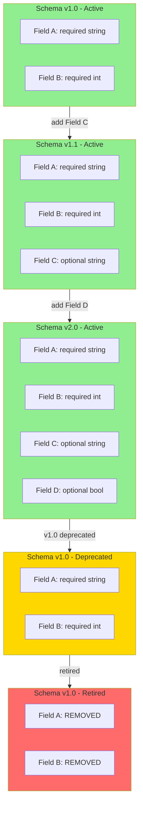

# RFC-0102: IPC Message Model

RFC: RFC-0102
Title: IPC Message Model
Status: Accepted
Version: 1.0.0
Category: IPC
Layer: Communication
Normative: YES
Authors: Atlas Team
Created: 2026-06-30
Last Updated: 2026-06-30
Depends On: RFC-0101 IPC Overview
Related RFC: RFC-0103 Transport, RFC-0106 Serialization
Target Release: 1.0.0
Supersedes: None
Superseded By: None
Required By:
  - RFC-0103 Transport
  - RFC-0106 Serialization
  - RFC-0105 Message Queue
ADR References:
  - ADR-0010 IPC Architecture
  - ADR-0012 Contract-First Specification
Constitution References:
  - Section 3.5 IPC Isolation
Audience: Systems Engineers
Compatibility: Compatible with Spec 1.x
Review Cycle: Core Architecture Board

---

## Normative Status

## Authority

This RFC is the authoritative specification for the IPC subsystem domain defined herein.

Any implementation MUST conform to this document.

If an implementation conflicts with this RFC, this RFC takes precedence.

Conflicts between RFCs SHALL be resolved through the ADR process.

---

## Terminology

The following terms are defined with exact meanings consistent with the Atlas Master Glossary.

| Term | Definition | Source |
|---|---|---|
| IPC | Inter-Process Communication; the unified messaging fabric enabling cross-process data exchange. | Glossary |
| Channel | A bidirectional or unidirectional communication pathway between two endpoints. | Glossary |
| Transport | The underlying mechanism by which messages are delivered between processes. | Glossary |
| Correlation ID | A globally unique identifier attached to every message for end-to-end tracing. | Glossary |

---
This specification is Normative. Every Atlas IPC implementation MUST conform to the message envelope structures, header field definitions, payload schemas, metadata models, validation rules, state machines, and lifecycle protocols defined herein. Any deviation MUST be approved through the formal Architecture Decision Record (ADR) process.

This specification is subordinate to the Atlas Development System (ADS) Constitution and all active ADRs.

---


## Layer Boundaries

### Responsibilities

This specification IS responsible for:

- Defining the architectural contract for this domain.
- Specifying behavioral requirements that all implementations MUST satisfy.
- Establishing extension points and their contracts.

### Non-Responsibilities

This specification IS NOT responsible for:

- Implementation details (see related RFCs for implementation guidance).
- Runtime platform specifics.
- User-facing UI behavior.

### Dependencies

| Dependency | Direction | Description |
|---|---|---|
| RFC-0001 | Consumed | Runtime Overview — foundational runtime architecture |

### Consumers

- See related RFCs for consumer listings.

### Providers

- This specification provides domain-specific contracts and behavioral models.

### Forbidden Dependencies

- This specification MUST NOT depend on any specific programming language.
- This specification MUST NOT depend on any specific storage backend.
- This specification MUST NOT depend on any specific operating system.
## Table of Contents
1. [Introduction](#1-introduction)
2. [Goals](#2-goals)
3. [Non-Goals](#3-non-goals)
4. [Message Envelope Structure](#4-message-envelope-structure)
5. [Header Fields](#5-header-fields)
6. [Payload Structure](#6-payload-structure)
7. [Metadata Model](#7-metadata-model)
8. [Message Validation](#8-message-validation)
9. [Message Ordering](#9-message-ordering)
10. [Message Versioning](#10-message-versioning)
11. [Schema Evolution](#11-schema-evolution)
12. [Message State Machine](#12-message-state-machine)
13. [Message Lifecycle](#13-message-lifecycle)
14. [Priority System](#14-priority-system)
15. [TTL and Expiration](#15-ttl-and-expiration)
16. [Compression and Encryption Flags](#16-compression-and-encryption-flags)
17. [Routing Metadata](#17-routing-metadata)
18. [Mermaid Diagrams](#18-mermaid-diagrams)
19. [Glossary](#19-glossary)
20. [Acceptance Criteria](#20-acceptance-criteria)
21. [References](#21-references)
22. [Changelog](#22-changelog)

---

| RFC-0001 | Consumed | Runtime Overview |
| RFC-0007 | Consumed | Runtime IPC Architecture |


## 2 Goals

The primary goals of the Atlas IPC Message Model are:

- **Uniform Envelope**: Every IPC message MUST conform to a single envelope structure with well-defined header, payload, and metadata regions.
- **Traceability**: Every message MUST carry identifiers sufficient to reconstruct its full journey across process boundaries, including correlation, request, trace, and session identifiers.
- **Quality of Service**: Messages MUST support priority classification, time-to-live enforcement, and ordering guarantees to meet diverse service-level requirements.
- **Schema Enforcement**: All payloads MUST be validated against registered schemas before delivery, preventing malformed data from reaching consumers.
- **Extensibility**: The metadata model MUST support arbitrary extension fields without breaking existing consumers or requiring envelope format changes.
- **Lifecycle Clarity**: Every message MUST follow a deterministic state machine from creation through final disposition.
- **Version Independence**: The message model MUST support version negotiation and schema evolution without requiring coordinated platform-wide upgrades.
- **Security Awareness**: Messages MUST carry flags and metadata that signal compression and encryption requirements without exposing sensitive transformation details in the header.

---

| RFC-0001 | Consumed | Runtime Overview |
| RFC-0007 | Consumed | Runtime IPC Architecture |


## 4 Message Envelope Structure

### 4.1 Overview
Every IPC message consists of exactly three regions arranged in hierarchical order:

1. **Header** - Control and routing information required by every message.
2. **Payload** - The application data carried by the message.
3. **Metadata** - Supplementary information that augments the header and payload.

The envelope is logically immutable once a message enters the Delivered state. Modifications to the header or payload after delivery are prohibited; only metadata MAY be appended during processing.

### 4.2 Envelope Invariants

| Invariant | Rule |
|---|---|
| Mandatory Header | Every message MUST contain a Header region. |
| Optional Payload | A message MAY have an empty payload, but the payload region MUST always be present. |
| Optional Metadata | A message MAY have an empty metadata map, but the metadata region MUST always be present. |
| Immutable Header | Once a message transitions to Delivered, the Header MUST NOT be modified. |
| Size Limit | The total envelope size MUST NOT exceed the transport-defined maximum (see RFC-0103). |
| Encoding Independence | The envelope structure is defined independently of any serialization format. |

### 4.3 Envelope Composition

The envelope is composed as follows:

```
+--------------------------------------------------+
|                   Envelope                       |
|  +-----------+--------+------------------------+ |
|  |   Header  | Payload|      Metadata          | |
|  | (fixed    | (typed |  (extensible           | |
|  |  fields)  |  blob) |   key-value map)       | |
|  +-----------+--------+------------------------+ |
+--------------------------------------------------+
```

---

- **Format**: UUID v4
- **Purpose**: Identifies the logical session to which the message belongs. Enables session-scoped routing and state.
- **Rule**: MUST be present for session-bound communication. MAY be absent for fire-and-forget messages.
- **Default**: Empty (optional).

#### 5.1.5 Sequence Number
- **Type**: Unsigned 64-bit integer
- **Purpose**: Provides per-session message ordering. Monotonically increasing within a session.
- **Rule**: MUST start at 1 for each new session. MUST increment by exactly 1 for each subsequent message in the same session from the same sender.
- **Default**: 1 (for first message in session).

#### 5.1.6 Priority
- **Type**: Unsigned 8-bit integer
- **Purpose**: Determines scheduling order among pending messages.
- **Rule**: Values 0-2 are reserved for system use. Values 3-15 are available for application use. See Section 14 for full priority semantics.
- **Default**: 4 (normal).

#### 5.1.7 Time-To-Live (TTL)
- **Type**: Unsigned 32-bit integer
- **Unit**: Milliseconds
- **Purpose**: Maximum duration a message MAY remain in the system before expiration.
- **Rule**: MUST be set by the sender. MUST be enforced by every intermediary. A TTL of 0 indicates infinite lifetime. See Section 15 for expiration semantics.
- **Default**: 0 (infinite).

#### 5.1.8 Compression Flag
- **Type**: Boolean
- **Purpose**: Indicates whether the payload region has been compressed.
- **Rule**: MUST be set to true if and only if the payload bytes have undergone a lossless compression transformation. The compression algorithm is NOT indicated in this field; it is determined by the serialization format (see RFC-0106).
- **Default**: false.

#### 5.1.9 Encryption Flag
- **Type**: Boolean
- **Purpose**: Indicates whether the payload region has been encrypted.
- **Rule**: MUST be set to true if and only if the payload bytes have undergone an encryption transformation. The encryption scheme is NOT indicated in this field; it is determined by the transport security layer.
- **Default**: false.

#### 5.1.10 Message Type
- **Type**: String (enumerated)
- **Purpose**: Classifies the semantic role of the message.
- **Allowed Values**: request, response, notification, error, acknowledgment, heartbeat.
- **Rule**: MUST be set by the message creator. MUST be consistent with the message content and direction.
- **Default**: None (mandatory).

#### 5.1.11 Source Address
- **Type**: String
- **Purpose**: Identifies the originating process or service.
- **Rule**: MUST use the canonical service identifier as registered in the Service Registry.
- **Default**: None (mandatory).

#### 5.1.12 Destination Address
- **Type**: String
- **Purpose**: Identifies the target process or service.
- **Rule**: MAY be a wildcard pattern for broadcast messages. MUST be resolved to a concrete address before delivery.
- **Default**: None (mandatory for unicast).

#### 5.1.13 Version
- **Type**: String
- **Format**: Semantic versioning (MAJOR.MINOR.PATCH)
- **Purpose**: Declares the message model version used by the sender.
- **Rule**: MUST conform to the version negotiated during connection establishment. See Section 10.
- **Default**: None (mandatory).

### 5.2 Reserved Header Fields

The following header fields are reserved for future use. Implementations MUST ignore unrecognized fields. New fields MAY be added in future versions without breaking existing implementations, provided they follow the extensibility rules in Section 7.

| Field | Type | Status |
|---|---|---|
| retry_count | Unsigned 8-bit integer | Reserved |
| original_timestamp | Unsigned 64-bit integer (epoch ms) | Reserved |
| hop_count | Unsigned 8-bit integer | Reserved |
| class_of_service | String | Reserved |

---


| Constraint | Rule |
|---|---|
| Maximum size | Defined by transport (see RFC-0103). MUST NOT exceed the per-envelope limit. |
| Mutability | Payloads MUST be treated as immutable by intermediaries. |
| Visibility | Encrypted payloads MUST NOT be inspected by intermediaries. |
| Null payloads | A null payload is represented as an empty binary blob, not an absent field. |

---

- Keys MUST NOT collide with standard field names.
- Unknown keys MUST be preserved by all intermediaries.
- Keys MUST be at most 128 characters in length.
- Values MUST be strings, numbers, booleans, or nested maps.

### 7.4 Metadata Immutability

- The metadata region MAY be appended to during message processing.
- Existing metadata keys MUST NOT be modified after the message enters the Delivered state.
- New metadata keys MAY be added by any processing node.
- The timestamp_modified field MUST be updated on every metadata mutation.

---

- **At routing**: Before forwarding to the next hop.
- **At delivery**: Immediately before delivery to the target consumer.

---

### 9.4 Ordering Violations

When an ordering violation is detected:

- The out-of-order message MUST be buffered until preceding messages are delivered.
- If buffering exceeds the TTL, the message MUST transition to Expired.
- An OrderingViolation event MUST be emitted to the observability system.

---


## 11 Schema Evolution

### 11.1 Forward Compatibility

New schema versions MUST be forward compatible with the immediately preceding version. Consumers of the older version MUST be able to process messages from the newer version by ignoring unknown fields.

Forward compatibility rules:

- New fields MAY be added to a schema version.
- New fields MUST be optional in the schema definition.
- Existing field types MUST NOT be changed.
- Existing field names MUST NOT be renamed.
- Enumerations MAY have new values added; consumers MUST ignore unknown enum values.

### 11.2 Backward Compatibility

Older schema versions MUST be backward compatible with the immediately preceding version. Producers using the newer version MUST be able to generate messages consumable by older versions.

Backward compatibility rules:

- Fields MUST NOT be removed without a deprecation period.
- Field types MUST NOT be narrowed.
- Required fields MUST NOT be changed to optional without coordination.
- Enumerations MUST NOT remove existing values.

### 11.3 Deprecation Policy

Schema fields and message types follow this deprecation lifecycle:

| Phase | Duration | Action |
|---|---|---|
| Active | Indefinite | Fully supported. |
| Deprecated | 2 MAJOR releases | Supported but discouraged. New usage generates warnings. |
| Retired | After deprecation period | Removed. Messages using retired fields are rejected. |

### 11.4 Schema Registry

All schemas MUST be registered in the Schema Registry before use. The registry tracks:

- Schema name and namespace.
- Current and historical versions.
- Compatibility status.
- Deprecation date and retirement date.
- Referencing message types.

---

- Delivered to Acknowledged: Consumer acknowledged.
- Delivered to Failed: Delivery confirmed but processing failed.
- Acknowledged to Terminal: Message lifecycle complete.
- Failed to Dead-Lettered: Retry budget exhausted.
- Expired to Terminal: Message discarded.
- Dead-Lettered to Terminal: Message archived or discarded.

### 12.3 Terminal States

The following states are terminal - no further transitions are permitted:

- Acknowledged
- Expired
- Dead-Lettered

---

If a message remains unacknowledged beyond its TTL, it transitions to Expired. The expiration timer is evaluated at each state transition point.

### 13.7 Failure and Dead-Lettering

If delivery fails after the configured retry budget is exhausted, the message transitions to Failed and then to Dead-Lettered. Dead-lettered messages are persisted in the Dead Letter Queue for investigation.

### 13.8 Destruction

Messages in terminal states are eligible for destruction:

- Acknowledged messages are destroyed after the acknowledgment retention period.
- Expired messages are destroyed after the expiration retention period.
- Dead-Lettered messages are retained according to the archival policy.

---

- Preempted messages retain their original priority and sequence number.
- Preemption MUST NOT cause priority-0-2 messages to expire.

---

- If the inherited TTL is zero or negative, the child message is created with a default TTL.
- The ttl_remaining metadata field tracks the current remaining TTL.

---

| true | true | Compressed then encrypted payload. |

---

- `*.admin` matches any admin service.

Wildcard routing is subject to access control policies.

---

    }
    class Payload {
        +bytes data
        +string type
        +string schemaRef
        +getSize() uint64
        +conformsToSchema() bool
    }
    class MetadataMap {
        +map~string,Value~ fields
        +get(key) Value
        +set(key, value) void
        +has(key) bool
        +remove(key) void
        +getExtensionKeys() string[]
    }
    class Value {
        <<union>>
        +string strVal
        +int numVal
        +bool boolVal
        +MetadataMap mapVal
    }
    MessageEnvelope --> Header : contains
    MessageEnvelope --> Payload : contains
    MessageEnvelope --> MetadataMap : contains
    MetadataMap --> Value : holds
```

### 18.2 Message State Transitions

```mermaid
stateDiagram-v2
    [*] --> Pending
    Pending --> Validated : Validation passed
    Pending --> Expired : TTL exceeded
    Pending --> Failed : Structural validation error

    Validated --> Routing : Dispatched
    Validated --> Expired : TTL exceeded in queue

    Routing --> Delivered : Arrived at destination
    Routing --> Expired : TTL exceeded during routing
    Routing --> Failed : No routable destination

    Delivered --> Acknowledged : Consumer acknowledged
    Delivered --> Failed : Processing failed

    Failed --> Dead-Lettered : Retry budget exhausted
    Failed --> Expired : TTL exceeded during retry

    Acknowledged --> [*] : Lifecycle complete
    Expired --> [*] : Lifecycle complete
    Dead-Lettered --> [*] : Archived or discarded
```

### 18.3 Header/Payload/Metadata Structure

```mermaid
graph TD
    E[MessageEnvelope] --> H[Header Region]
    E --> P[Payload Region]
    E --> M[Metadata Region]

    H --> H1[correlationId: UUID]
    H --> H2[requestId: UUID]
    H --> H3[traceId: UUID]
    H --> H4[sessionId: UUID]
    H --> H5[sequenceNumber: uint64]
    H --> H6[priority: uint8 0-15]
    H --> H7[ttl: uint32 ms]
    H --> H8[compressionFlag: bool]
    H --> H9[encryptionFlag: bool]
    H --> H10[messageType: enum]
    H --> H11[sourceAddress: string]
    H --> H12[destinationAddress: string]
    H --> H13[version: semver]

    P --> P1[data: bytes]
    P --> P2[type: enum]
    P --> P3[schemaRef: string]

    M --> M1[standardFields: map]
    M --> M2[extensionFields: map]

    M1 --> M1a[timestamp_created]
    M1 --> M1b[timestamp_modified]
    M1 --> M1c[schema_ref]
    M1 --> M1d[delivery_attempts]
    M1 --> M1e[routing_hint]
    M1 --> M1f[consumer_group]

    M2 --> M2a[org.component.field]
    M2 --> M2b[org.component.flag]
```



### 18.4 Schema Evolution Timeline



---

This specification IS NOT responsible for:
- User input device handling.
- Hardware abstraction.
- Operating system scheduling.


## 20 Acceptance Criteria

### AC-001
- **Requirement**: Every message envelope MUST contain a Header, Payload, and Metadata region.
- **Verification**: Inspect the envelope structure of a freshly created message.
- **Expected Result**: All three regions are present and non-null.

### AC-002
- **Requirement**: The Correlation ID field MUST be a valid UUID v4 string.
- **Verification**: Parse the Correlation ID from a message and validate its format.
- **Expected Result**: The value matches the UUID v4 regex pattern.

### AC-003
- **Requirement**: The Request ID field MUST be a valid UUID v4 string.
- **Verification**: Parse the Request ID from a request-type message and validate its format.
- **Expected Result**: The value matches the UUID v4 regex pattern.

### AC-004
- **Requirement**: The Trace ID field MUST be a valid UUID v4 string.
- **Verification**: Parse the Trace ID from a message and validate its format.
- **Expected Result**: The value matches the UUID v4 regex pattern.

### AC-005
- **Requirement**: The Session ID field MUST be a valid UUID v4 string when present.
- **Verification**: Parse the Session ID from a session-bound message and validate its format.
- **Expected Result**: The value matches the UUID v4 regex pattern, or the field is absent for fire-and-forget messages.

### AC-006
- **Requirement**: The Sequence Number MUST start at 1 for each new session.
- **Verification**: Create two messages in a new session and inspect their sequence numbers.
- **Expected Result**: Both messages have sequence number 1 if sent by different senders, or the first message has sequence number 1.

### AC-007
- **Requirement**: Sequence numbers MUST increment by exactly 1 for consecutive messages from the same sender in the same session.
- **Verification**: Send 10 messages from the same sender in the same session and inspect sequence numbers.
- **Expected Result**: Sequence numbers are 1 through 10 in order.

### AC-008
- **Requirement**: The Priority field MUST be an unsigned 8-bit integer in the range 0-15.
- **Verification**: Attempt to set the Priority field to values outside the valid range.
- **Expected Result**: Values outside 0-15 are rejected with a validation error.

### AC-009
- **Requirement**: Priority levels 0-2 MUST be reserved for system-critical messages.
- **Verification**: Inspect the priority of system-generated heartbeats and shutdown signals.
- **Expected Result**: System-critical messages have priority values in the range 0-2.

### AC-010
- **Requirement**: The default Priority value MUST be 4 (normal).
- **Verification**: Create a message without explicitly setting the Priority field.
- **Expected Result**: The Priority field is set to 4.

### AC-011
- **Requirement**: The TTL field MUST be an unsigned 32-bit integer in milliseconds.
- **Verification**: Inspect the TTL field of a message with a 5-second lifetime.
- **Expected Result**: The TTL field equals 5000.

### AC-012
- **Requirement**: A TTL of 0 MUST indicate infinite lifetime.
- **Verification**: Create a message with TTL set to 0 and observe its behavior.
- **Expected Result**: The message does not expire regardless of elapsed time.

### AC-013
- **Requirement**: The Compression Flag MUST be false by default.
- **Verification**: Create a message without compression and inspect the flag.
- **Expected Result**: The Compression Flag is false.

### AC-014
- **Requirement**: The Encryption Flag MUST be false by default.
- **Verification**: Create a message without encryption and inspect the flag.
- **Expected Result**: The Encryption Flag is false.

### AC-015
- **Requirement**: The Message Type field MUST be one of the six enumerated values.
- **Verification**: Attempt to set the Message Type to an unrecognized value.
- **Expected Result**: The setter rejects the value with a TypeError.

### AC-016
- **Requirement**: The Source Address field MUST conform to the canonical service identifier format.
- **Verification**: Set the Source Address to a valid registered service identifier.
- **Expected Result**: The address is accepted and logged.

### AC-017
- **Requirement**: The Destination Address field MUST be resolvable before delivery.
- **Verification**: Set the Destination Address to an unregistered service identifier and attempt delivery.
- **Expected Result**: Delivery fails with a routing error.

### AC-018
- **Requirement**: The Version field MUST conform to semantic versioning format.
- **Verification**: Set the Version field to 1.2.3 and invalid.
- **Expected Result**: 1.2.3 is accepted; invalid is rejected.

### AC-019
- **Requirement**: Payload type MUST be one of the seven defined types.
- **Verification**: Attempt to set the payload type to an undefined value.
- **Expected Result**: The setter rejects the value with a validation error.

### AC-020
- **Requirement**: Schema-bound payload types MUST include a schema_ref in metadata.
- **Verification**: Create a structured payload without a schema_ref.
- **Expected Result**: Validation fails with SchemaViolationError.

### AC-021
- **Requirement**: The schema_ref format MUST be namespace:schema_name:version.
- **Verification**: Set the schema_ref to various formats and validate.
- **Expected Result**: Only the correct colon-separated format is accepted.

### AC-022
- **Requirement**: The timestamp_created metadata field MUST be set at message creation.
- **Verification**: Inspect the metadata of a newly created message.
- **Expected Result**: The timestamp_created field contains a valid epoch millisecond value.

### AC-023
- **Requirement**: The timestamp_modified metadata field MUST be updated on every mutation.
- **Verification**: Mutate the metadata twice and inspect timestamp_modified after each mutation.
- **Expected Result**: The timestamp increases after each mutation.

### AC-024
- **Requirement**: Unknown metadata keys MUST be preserved by all intermediaries.
- **Verification**: Add a custom metadata key and forward the message through one intermediary.
- **Expected Result**: The custom metadata key is present in the forwarded message.

### AC-025
- **Requirement**: Metadata keys MUST use dot-separated namespace notation.
- **Verification**: Attempt to set a metadata key without dot notation.
- **Expected Result**: The setter rejects the key with a validation error.

### AC-026
- **Requirement**: Metadata key length MUST NOT exceed 128 characters.
- **Verification**: Attempt to set a metadata key of 129 characters.
- **Expected Result**: The setter rejects the key with a validation error.

### AC-027
- **Requirement**: Messages MUST pass structural validation before entering the Validated state.
- **Verification**: Create a message missing a mandatory header field and submit it.
- **Expected Result**: The message transitions to Failed.

### AC-028
- **Requirement**: Messages MUST pass schema validation before delivery.
- **Verification**: Submit a message whose payload violates its declared schema.
- **Expected Result**: The message is rejected with SchemaViolationError.

### AC-029
- **Requirement**: Messages exceeding the maximum envelope size MUST be rejected.
- **Verification**: Create a message exceeding the transport-defined size limit.
- **Expected Result**: The message is rejected with SizeLimitExceededError.

### AC-030
- **Requirement**: Messages with mismatched type and payload semantics MUST be rejected.
- **Verification**: Submit a notification-type message with a request payload.
- **Expected Result**: The message is rejected with TypeError.

### AC-031
- **Requirement**: Expired messages MUST transition to the Expired state.
- **Verification**: Create a message with a 1ms TTL and wait for expiration.
- **Expected Result**: The message enters the Expired state.

### AC-032
- **Requirement**: Access control policies MUST be enforced at validation time.
- **Verification**: Submit a message from an unauthorized sender to a restricted destination.
- **Expected Result**: The message is rejected with PermissionDeniedError.

### AC-033
- **Requirement**: Within a session, messages MUST be delivered in sequence-number order.
- **Verification**: Send 5 messages with sequence numbers 1-5 and verify delivery order.
- **Expected Result**: Messages are delivered in order 1 through 5.

### AC-034
- **Requirement**: Out-of-order messages MUST be buffered until preceding messages arrive.
- **Verification**: Send messages with sequence numbers 3, 1, 2 and verify delivery.
- **Expected Result**: Messages are delivered in order 1, 2, 3.

### AC-035
- **Requirement**: Causal dependencies MUST be enforced across sessions.
- **Verification**: Send a response before its correlated request and verify ordering.
- **Expected Result**: The response is buffered until the request is delivered.

### AC-036
- **Requirement**: Version negotiation MUST reject connections with incompatible MAJOR versions.
- **Verification**: Connect a v1 producer to a v2 consumer with no shared MAJOR version.
- **Expected Result**: The connection is rejected with a VersionMismatchError.

### AC-037
- **Requirement**: Schema additions MUST be forward compatible with the preceding version.
- **Verification**: Add an optional field to a schema and deliver a message to a consumer using the old schema.
- **Expected Result**: The consumer processes the message successfully, ignoring the new field.

### AC-038
- **Requirement**: Schema removals MUST NOT occur during the deprecation period.
- **Verification**: Attempt to remove a field from a schema within the deprecation window.
- **Expected Result**: The removal is rejected with a deprecation policy error.

### AC-039
- **Requirement**: Deprecated schemas MUST generate warnings on new usage.
- **Verification**: Create a message using a deprecated schema version.
- **Expected Result**: A deprecation warning is emitted to the observability system.

### AC-040
- **Requirement**: Retired schemas MUST cause message rejection.
- **Verification**: Create a message using a retired schema version.
- **Expected Result**: The message is rejected with a SchemaRetiredError.

### AC-041
- **Requirement**: The message state machine MUST follow only the defined transitions.
- **Verification**: Attempt a transition not defined in Section 12.2.
- **Expected Result**: The transition is rejected with a StateMachineError.

### AC-042
- **Requirement**: Terminal states MUST not permit further transitions.
- **Verification**: Attempt to transition a message from Acknowledged to any other state.
- **Expected Result**: The transition is rejected; the message remains in Acknowledged.

### AC-043
- **Requirement**: Expired messages MUST be removed from all queues.
- **Verification**: Expire a message and inspect all active queues.
- **Expected Result**: The message is absent from all queues.

### AC-044
- **Requirement**: Dead-lettered messages MUST be persisted in the Dead Letter Queue.
- **Verification**: Exhaust retries on an undeliverable message and inspect the DLQ.
- **Expected Result**: The message is present in the Dead Letter Queue.

### AC-045
- **Requirement**: TTL inheritance MUST subtract elapsed time at spawn.
- **Verification**: Spawn a child message 100ms after the parent with a 1000ms parent TTL.
- **Expected Result**: The child inherits a TTL of 900ms.

### AC-046
- **Requirement**: Priority-preempted messages MUST retain their original priority.
- **Verification**: Preempt a priority-10 message and inspect its priority field.
- **Expected Result**: The priority field remains 10.

### AC-047
- **Requirement**: Wildcard destinations MUST be subject to access control.
- **Verification**: Send a broadcast message from an unauthorized process.
- **Expected Result**: The message is rejected with PermissionDeniedError.

### AC-048
- **Requirement**: The header MUST be immutable after the message enters the Delivered state.
- **Verification**: Attempt to modify a header field of a delivered message.
- **Expected Result**: The modification is rejected with an ImmutabilityError.

### AC-049
- **Requirement**: The metadata region MAY be appended to during processing.
- **Verification**: Add a metadata key during message processing and deliver the message.
- **Expected Result**: The metadata key is present in the delivered message.

### AC-050
- **Requirement**: Both compression and encryption flags MAY be set simultaneously.
- **Verification**: Create a message with both flags set to true.
- **Expected Result**: The message is accepted and the payload is treated as compressed-then-encrypted.

### AC-051
- **Requirement**: The correlation ID MUST be preserved across all routing hops.
- **Verification**: Send a message through 3 intermediary nodes and inspect the correlation ID at each hop.
- **Expected Result**: The correlation ID is identical at every hop.

### AC-052
- **Requirement**: The trace ID MUST link child messages back to the parent trace context.
- **Verification**: Create a child message from a parent and inspect the trace ID linkage.
- **Expected Result**: The child trace ID contains a reference to the parent trace ID.

### AC-053
- **Requirement**: A null payload MUST be represented as an empty binary blob.
- **Verification**: Create a message with a null payload and inspect the payload data.
- **Expected Result**: The payload data is an empty byte array, not null.

### AC-054
- **Requirement**: Schema validation MUST occur at ingestion, routing, and delivery stages.
- **Verification**: Inject a schema-violating payload at each stage and verify rejection.
- **Expected Result**: The message is rejected at the injection stage with SchemaViolationError.

### AC-055
- **Requirement**: Ordering violations MUST emit an event to the observability system.
- **Verification**: Deliver messages out of order and inspect observability logs.
- **Expected Result**: An OrderingViolation event is present in the logs.

### AC-056
- **Requirement**: Consumer group messages MUST be delivered to exactly one group member.
- **Verification**: Publish a message with a consumer group to a group of 3 members.
- **Expected Result**: Exactly 1 member receives the message.

### AC-057
- **Requirement**: Messages without a consumer group MUST be broadcast to all subscribers.
- **Verification**: Publish a message without a consumer group to 3 subscribers.
- **Expected Result**: All 3 subscribers receive the message.

### AC-058
- **Requirement**: The envelope size limit MUST be enforced by the transport layer.
- **Verification**: Send an envelope exceeding the transport limit and measure the transport response.
- **Expected Result**: The transport rejects the envelope with a SizeLimitExceededError.

### AC-059
- **Requirement**: Intermediaries MUST NOT decompress or decrypt payload data.
- **Verification**: Inspect an intermediary node access to compressed-and-encrypted payload.
- **Expected Result**: The intermediary handles only the opaque byte array without transformation.

### AC-060
- **Requirement**: Every message MUST have a deterministic terminal state.
- **Verification**: Run 1000 messages through the state machine under varied conditions.
- **Expected Result**: Every message reaches exactly one terminal state (Acknowledged, Expired, or Dead-Lettered).

---

- Operating system scheduling.


## 22 Changelog

| Version | Date | Author | Description |
|---|---|---|---|
| 1.0.0 | 2026-06-30 | Atlas Team | Initial release. Defined message envelope, header fields, payload structure, metadata model, validation pipeline, ordering guarantees, versioning, schema evolution, state machine, lifecycle, priority system, TTL semantics, compression/encryption flags, and routing metadata.


---


- **Rule GAP-01**: Receivers MUST detect gaps in sequence numbers exceeding 1.
- **Rule GAP-02**: A gap of 1 or more missing sequences MUST trigger a NACK (Negative Acknowledgment) to the sender.
- **Rule GAP-03**: NACKs MUST include the missing sequence range.
- **Rule GAP-04**: Senders MUST retransmit missing messages within 50ms of receiving a NACK.
- **Rule GAP-05**: If retransmission fails after 3 attempts, the message MUST be moved to the Dead Letter Queue.
- **Rule GAP-06**: Gap detection windows MUST be configurable per channel, defaulting to 1000 sequences.
- **Rule GAP-07**: Receivers MUST maintain a sliding window of received sequence numbers.
- **Rule GAP-08**: Duplicate sequences within the window MUST be silently discarded.

### 18.5 Replay Detection

- **Rule REPLAY-01**: Receivers MUST reject any message with a sequence number less than or equal to the last accepted sequence.
- **Rule REPLAY-02**: Replay detection windows MUST be maintained per sender per channel.
- **Rule REPLAY-03**: Window size MUST be configurable, defaulting to 10,000 sequences.
- **Rule REPLAY-04**: Messages outside the window MUST be evaluated against the audit trail for replay confirmation.
- **Rule REPLAY-05**: Confirmed replays MUST trigger immediate security alerts and connection termination.
- **Rule REPLAY-06**: Sequence number prediction resistance MUST be maintained through random initialization.
- **Rule REPLAY-07**: All replay detection events MUST be logged with sender identity, channel, and sequence range.

### 18.6 Sequence ID Distribution

- **Rule SEQ-DIST-01**: Sequence IDs MUST be embedded in the message header, not the payload.
- **Rule SEQ-DIST-02**: Sequence numbers MUST be transmitted in network byte order (big-endian).
- **Rule SEQ-DIST-03**: Sequence ID fields MUST be 8 bytes in length.
- **Rule SEQ-DIST-04**: Receivers MUST validate sequence ID field presence before processing.
- **Rule SEQ-DIST-05**: Missing or malformed sequence IDs MUST cause immediate message rejection.

### 18.7 Sequence ID Performance

- **Rule SEQ-PERF-01**: Sequence ID assignment MUST complete within 1 microsecond per message.
- **Rule SEQ-PERF-02**: Sequence ID validation MUST complete within 2 microseconds per message.
- **Rule SEQ-PERF-03**: Gap detection overhead MUST not exceed 5% of total message processing time.
- **Rule SEQ-PERF-04**: Replay detection MUST use hash-based window indexing for O(1) lookups.

### 18.8 Sequence ID Security

- **Rule SEQ-SEC-01**: Sequence counters MUST be stored in memory-only storage, never persisted.
- **Rule SEQ-SEC-02**: Sequence counter values MUST be cleared from memory upon session termination.
- **Rule SEQ-SEC-03**: Sequence ID fields MUST be integrity-protected using message authentication codes.
- **Rule SEQ-SEC-04**: Tampered sequence IDs MUST be treated as security events.
- **Rule SEQ-SEC-05**: Sequence counter state MUST NOT be transmitted over the wire except as the sequence number itself.

### 18.9 Sequence ID Recovery

- **Rule SEQ-REC-01**: Upon connection recovery, receivers MUST request sequence state from senders.
- **Rule SEQ-REC-02**: Senders MUST provide the last acknowledged sequence number within 10ms.
- **Rule SEQ-REC-03**: Any messages between the last acknowledged and current sequence MUST be retransmitted.
- **Rule SEQ-REC-04**: Recovery MUST complete within 1 second for channels with fewer than 10,000 pending messages.
- **Rule SEQ-REC-05**: Channels exceeding 10,000 pending messages MUST enter degraded mode during recovery.

### 18.10 Sequence ID Monitoring

- **Rule SEQ-MON-01**: Sequence generation rate MUST be monitored per sender per channel.
- **Rule SEQ-MON-02**: Deviations exceeding 20% from baseline generation rate MUST trigger alerts.
- **Rule SEQ-MON-03**: Sequence gaps per minute MUST be tracked and reported in observability metrics.
- **Rule SEQ-MON-04**: Replay attempts per minute MUST be tracked and reported in security metrics.
- **Rule SEQ-MON-05**: Sequence counter utilization MUST be monitored to predict overflow events.

---

## Runtime Independence

This specification is completely independent of any runtime implementation platform. Specifically, this specification MUST NOT assume:

- Any programming language (Rust, Node.js, TypeScript, Go, Python, etc.)
- Any runtime environment (Electron, Tauri, Browser, Desktop, Server)
- Any storage backend (SQLite, PostgreSQL, MongoDB, Redis, etc.)
- Any operating system (Windows, Linux, macOS, etc.)
- Any hardware architecture (CPU, GPU, FPGA, etc.)
- Any threading model (single-threaded, multi-threaded, actor-based, etc.)
- Any cloud provider (AWS, Azure, GCP, etc.)
- Any container platform (Docker, containerd, etc.)

All IPC contracts are defined as abstract behavioral interfaces.

---
---

## Compliance Matrix

| Category | Value |
|---|---|
| Related RFC | See References section |
| Related ADR | ADR-0012 (and ADR-0010 if security-related) |
| Related JSON Schema | See References section |
| Related Catalog | See References section |

---

## References

| Reference | Description |
|---|---|
| RFC-0001 | Runtime Overview |
| Glossary | Atlas Master Glossary |

---

## Revision History

| Version | Status | Date | Author | Notes |
|---|---|---|---|---|
| 1.0.0 | Accepted | 2026-06-30 | Atlas Team | Initial publication |
| 1.1.0 | Accepted | 2026-07-01 | Atlas Specification Committee | Added Authority, Terminology, Layer Boundaries, Runtime Independence per RFC_TEMPLATE.md |


