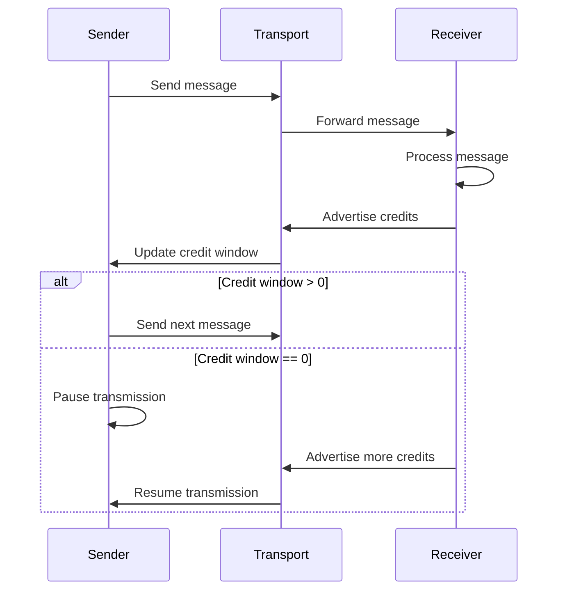
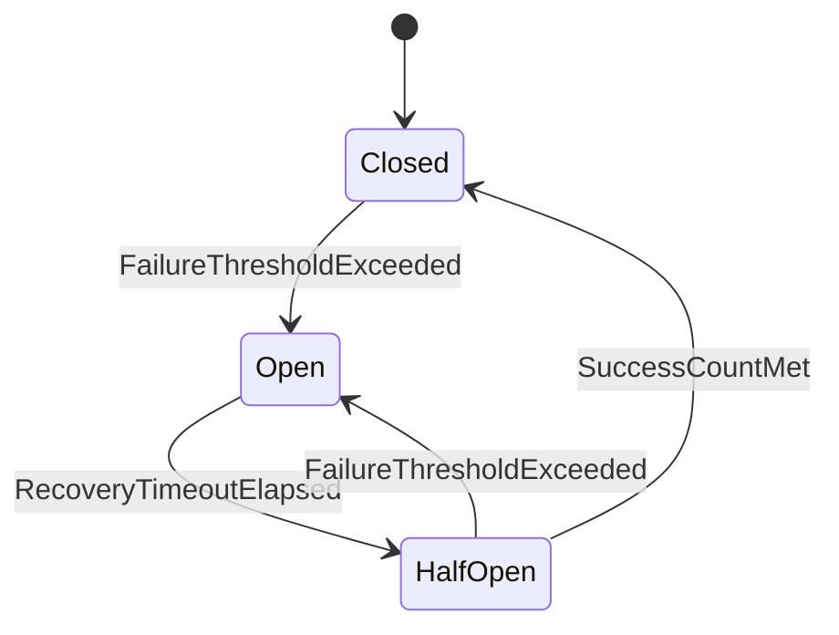

# RFC-0103: IPC Transport

RFC: RFC-0103
Title: IPC Transport
Status: Accepted
Version: 1.0.0
Category: IPC
Layer: Transport
Normative: YES
Authors: Atlas Team
Created: 2026-06-30
Last Updated: 2026-06-30
Depends On: RFC-0101 IPC Overview, RFC-0102 Message Model
Related RFC: RFC-0105 Channel, RFC-0108 Reliability
Target Release: 1.0.0
Supersedes: None
Superseded By: None
Required By:
  - RFC-0105 Channel
  - RFC-0108 Reliability
ADR References:
  - ADR-0010 IPC Architecture
  - ADR-0012 Contract-First Specification
Constitution References:
  - Section 3.5 IPC Isolation
Audience: Systems Engineers
Compatibility: Compatible with Spec 1.x
Review Cycle: Core Architecture Board

---

## Normative Status

## Authority

This RFC is the authoritative specification for the IPC subsystem domain defined herein.

Any implementation MUST conform to this document.

If an implementation conflicts with this RFC, this RFC takes precedence.

Conflicts between RFCs SHALL be resolved through the ADR process.

---

## Terminology

The following terms are defined with exact meanings consistent with the Atlas Master Glossary.

| Term | Definition | Source |
|---|---|---|
| IPC | Inter-Process Communication; the unified messaging fabric enabling cross-process data exchange. | Glossary |
| Channel | A bidirectional or unidirectional communication pathway between two endpoints. | Glossary |
| Transport | The underlying mechanism by which messages are delivered between processes. | Glossary |
| Correlation ID | A globally unique identifier attached to every message for end-to-end tracing. | Glossary |

---
This specification is Normative. Every Atlas IPC implementation MUST conform to the transport abstractions, connection lifecycle protocols, pooling strategies, streaming semantics, request-response patterns, broadcast mechanisms, backpressure and congestion controls, timeout and heartbeat policies, health monitoring, reconnect strategies, and metrics defined herein. Any deviation MUST be approved through the formal Architecture Decision Record (ADR) process.

This specification is subordinate to the Atlas Development System (ADS) Constitution and all active ADRs.

---


## Layer Boundaries

### Responsibilities

This specification IS responsible for:

- Defining the architectural contract for this domain.
- Specifying behavioral requirements that all implementations MUST satisfy.
- Establishing extension points and their contracts.

### Non-Responsibilities

This specification IS NOT responsible for:

- Implementation details (see related RFCs for implementation guidance).
- Runtime platform specifics.
- User-facing UI behavior.

### Dependencies

| Dependency | Direction | Description |
|---|---|---|
| RFC-0001 | Consumed | Runtime Overview — foundational runtime architecture |

### Consumers

- See related RFCs for consumer listings.

### Providers

- This specification provides domain-specific contracts and behavioral models.

### Forbidden Dependencies

- This specification MUST NOT depend on any specific programming language.
- This specification MUST NOT depend on any specific storage backend.
- This specification MUST NOT depend on any specific operating system.
## Table of Contents
1. [Introduction](#1-introduction)
2. [Goals](#2-goals)
3. [Non-Goals](#3-non-goals)
4. [Transport Abstraction](#4-transport-abstraction)
5. [Connection Lifecycle](#5-connection-lifecycle)
6. [Connection Pooling](#6-connection-pooling)
7. [Streaming](#7-streaming)
8. [Request-Response Transport](#8-request-response-transport)
9. [Broadcast Transport](#9-broadcast-transport)
10. [Backpressure Mechanisms](#10-backpressure-mechanisms)
11. [Timeout Management](#11-timeout-management)
12. [Heartbeat](#12-heartbeat)
13. [Connection Health Monitoring](#13-connection-health-monitoring)
14. [Reconnect Strategy](#14-reconnect-strategy)
15. [Transport Metrics](#15-transport-metrics)
16. [Congestion Control](#16-congestion-control)
17. [Flow Control](#17-flow-control)
18. [Glossary](#18-glossary)
19. [Acceptance Criteria](#19-acceptance-criteria)
20. [References](#20-references)
21. [Changelog](#21-changelog)

---

|---|---|---|
| RFC-0001 | Consumed | Runtime Overview |
| RFC-0007 | Consumed | Runtime IPC Architecture |


## 2 Goals

The primary goals of the Atlas IPC Transport layer are:

- **Transport Independence**: The transport abstraction MUST be independent of any specific inter-process communication mechanism, operating system, or physical medium.
- **Connection Lifecycle Management**: Every connection MUST follow a deterministic state machine from idle through connected to closed, with explicit draining support for graceful shutdown.
- **Connection Pooling**: Implementations MUST support connection pooling to reduce establishment overhead and enable efficient resource reuse under sustained communication loads.
- **Streaming Support**: The transport MUST support both bidirectional and unidirectional streaming, with optional stream multiplexing over a single physical connection.
- **Request-Response Semantics**: Synchronous request-response communication MUST be supported with proper correlation, timeout handling, and response routing.
- **Broadcast Delivery**: Multicast and broadcast message delivery MUST be supported for event-driven communication patterns.
- **Backpressure and Flow Control**: The transport MUST provide mechanisms to prevent sender overwhelm, including credit-based flow control and congestion avoidance.
- **Health Monitoring**: Connection health MUST be continuously monitored through heartbeats, liveness probes, and circuit breaking.
- **Resilient Reconnection**: Failed connections MUST be automatically re-established using configurable retry strategies with exponential backoff and jitter.
- **Operational Observability**: Comprehensive metrics MUST be emitted for latency, throughput, error rates, and connection counts to enable monitoring and alerting.

---


## 4 Transport Abstraction

### 4.1 The Transport Interface

The Transport layer exposes a uniform abstract interface that all concrete implementations MUST adhere to. This interface insulates upper layers from the specifics of the underlying inter-process communication mechanism.

Every Transport implementation MUST provide the following operations:

| Operation | Direction | Description |
|---|---|---|
| `Open` | Local | Establish a new connection to a target endpoint. |
| `Close` | Local | Terminate a connection and release all associated resources. |
| `Send` | Local | Transmit a serialized message over an active connection. |
| `Receive` | Local | Receive a serialized message from an active connection. |
| `StreamOpen` | Local | Open a bidirectional or unidirectional stream on an existing connection. |
| `StreamSend` | Stream | Transmit a message over a specific stream. |
| `StreamReceive` | Stream | Receive a message from a specific stream. |
| `StreamClose` | Stream | Close a specific stream, releasing its resources. |
| `BroadcastSend` | Local | Transmit a message to all subscribers of a broadcast channel. |
| `HealthCheck` | Local | Probe the liveness of a connection. |
| `GetMetrics` | Local | Retrieve current transport metrics. |

### 4.2 Transport Independence Principle

The Transport layer MUST NOT assume any specific characteristics of the underlying communication substrate. An implementation MUST be able to swap the physical transport mechanism without requiring changes to upper-layer code.

The following principles enforce transport independence:

1. **No Platform-Specific Types**: The transport interface MUST use abstract types for endpoints, handles, and buffers. Concrete types tied to operating system primitives MUST NOT appear in the abstract interface.
2. **No Hardcoded Limits**: Maximum message sizes, connection timeouts, and buffer capacities MUST be configurable parameters, not constants embedded in the transport logic.
3. **No Direct I/O Calls**: The transport interface MUST NOT invoke operating system calls directly. All I/O operations MUST be routed through abstracted I/O handlers provided by the implementation.
4. **Uniform Error Reporting**: All errors MUST be reported through a consistent error taxonomy defined in the transport error model. OS-specific error codes MUST be mapped to abstract error types.

### 4.3 Endpoint Abstraction

An endpoint represents a logical communication destination. Endpoints are opaque to the transport layer and are resolved by the Service Registry. The transport interface accepts and returns endpoints as abstract handles.

```
Endpoint = {
  identifier: string,
  metadata: map<string, string>,
  protocol: ProtocolType
}

ProtocolType = {
  name: string,
  version: integer
}
```

### 4.4 Transport Error Model

All transport operations MUST report errors using a consistent taxonomy:

| Error Type | Condition |
|---|---|
| `ConnectionRefused` | The target endpoint actively rejected the connection. |
| `ConnectionTimeout` | The connection attempt exceeded the configured timeout. |
| `SendTimeout` | The send operation exceeded the configured timeout. |
| `ReceiveTimeout` | The receive operation exceeded the configured timeout. |
| `StreamClosed` | A stream was closed before the operation completed. |
| `MessageTooLarge` | The message exceeds the maximum allowed size. |
| `BackpressureExceeded` | The sender exceeded the available credit window. |
| `CircuitOpen` | The circuit breaker is open; operations are rejected. |
| `HealthCheckFailed` | The connection failed a health check probe. |
| `PoolExhausted` | All pooled connections are in use and no new connections may be created. |
| `InvalidState` | The operation is invalid in the current connection state. |
| `NotImplemented` | The requested transport feature is not supported by this implementation. |

### 5.3 State Definitions and Rules

#### 5.3.1 Idle State
A connection in the `Idle` state has no active transport channel. It MAY be created eagerly or lazily. No messages MAY be sent or received in this state. The only valid operation is `Open`, which transitions the connection to `Connecting`.

#### 5.3.2 Connecting State
A connection in the `Connecting` state is performing the handshake protocol to establish the physical transport channel. During this state:

- The connection MUST respect the connection timeout (see Section 11.1).
- If the handshake succeeds, the connection transitions to `Connected`.
- If the handshake fails, the connection transitions back to `Idle` or `Closed`, depending on the failure type.
- The connection MUST NOT accept send or receive operations.

#### 5.3.3 Connected State
A connection in the `Connected` state is fully operational and MAY accept send and receive operations. During this state:

- The connection MUST be subject to health monitoring (see Section 13).
- The connection MAY be placed into `Draining` state for graceful shutdown.
- The connection MAY be closed immediately via `Close`.
- If the connection loses its transport channel unexpectedly, it MUST transition to `Closed` and emit a `ConnectionLost` event.

#### 5.3.4 Draining State
A connection in the `Draining` state is performing a graceful shutdown. During this state:

- New send operations MUST be rejected with `InvalidState`.
- In-flight messages MUST continue to be delivered.
- Once all in-flight messages are acknowledged or expired, the connection transitions to `Closed`.
- The drain operation MUST respect a configurable drain timeout. If the timeout expires before all in-flight messages complete, the connection MUST be force-closed.

#### 5.3.5 Closed State
A connection in the `Closed` state has no active transport channel and no resources allocated. All pending operations MUST be aborted. The connection object MUST be discarded or reset to `Idle` through a fresh `Open` call.

### 5.4 Connection State Transitions Matrix

| From State | Open | Close | Send | StartDrain | HealthCheck |
|---|---|---|---|---|---|
| Idle | Connecting | InvalidState | InvalidState | InvalidState | InvalidState |
| Connecting | InvalidState | InvalidState | InvalidState | InvalidState | InvalidState |
| Connected | InvalidState | Closed | Success | Draining | Success |
| Draining | InvalidState | Closed | InvalidState | InvalidState | Success |
| Closed | Idle | InvalidState | InvalidState | InvalidState | InvalidState |

```mermaid
stateDiagram-v2
    [*] --> PoolIdle
    PoolIdle --> PoolActive : Acquire(min > 0)
    PoolActive --> PoolIdle : AllReleased
    PoolActive --> PoolDraining : ShrinkRequested
    PoolDraining --> PoolIdle : AllEvicted
    PoolIdle --> PoolActive : Expand(max > 0)
```




### 6.4 Connection Reuse Policy

When a connection is released back to the pool:

1. The pool MUST validate the connection using `HealthCheck`. If the health check fails, the connection MUST be evicted and replaced.
2. The pool MUST record the release timestamp. Connections exceeding `idleTimeout` MUST be evicted during the next prune cycle.
3. Connections MUST be selected for reuse using a round-robin strategy across healthy idle connections. Least-loaded selection MAY be used as an optimization.
4. A released connection MUST NOT be reused if it has been marked as degraded (see Section 13.3).

### 6.5 Pool Sizing Guidelines

Implementations SHOULD size pools according to the following formula:

```
recommendedMaxConnections = ceil(activeThreadCount * avgMessageLatency / avgMessageProcessingTime)
```

Where:
- `activeThreadCount` is the number of concurrent senders or receivers.
- `avgMessageLatency` is the measured average round-trip latency.
- `avgMessageProcessingTime` is the measured average time to process a single message.

Pools MUST enforce `maxConnections` strictly. When the limit is reached, `Acquire` operations MUST either queue (respecting `acquireTimeout`) or fail with `PoolExhausted`.

### 6.6 Pool Metrics

Every pool MUST expose the following metrics:

| Metric | Type | Description |
|---|---|---|
| `pool.active_connections` | Gauge | Number of connections currently in use. |
| `pool.idle_connections` | Gauge | Number of idle connections available for reuse. |
| `pool.total_created` | Counter | Total number of connections created since pool initialization. |
| `pool.total_destroyed` | Counter | Total number of connections destroyed since pool initialization. |
| `pool.acquire_wait_time` | Histogram | Time spent waiting for an available connection. |
| `pool.eviction_count` | Counter | Number of connections evicted due to health check failures. |


1. Each stream MUST have a unique stream identifier assigned at creation.
2. Messages from different streams MUST be interleaved at the wire level and demultiplexed by the receiver using stream identifiers.
3. Backpressure on one stream MUST NOT block messages on other streams sharing the same connection (per-stream flow control, see Section 17.2).
4. The maximum number of concurrent streams per connection MUST be configurable.
5. Stream identifiers MUST be allocated sequentially within each direction of a connection.

### 7.4 Stream Flow Control

Each stream MUST support independent flow control. The receiver of a stream MUST be able to adjust the send rate per stream without affecting other streams on the same connection. Credit-based flow control (see Section 10.3) MUST be applied per stream.

### 7.5 Stream Closure Semantics

- A unidirectional stream MAY be half-closed by the sender, allowing the receiver to continue sending if the connection supports bidirectional communication.
- A bidirectional stream MUST be fully closed before the underlying connection is closed.
- Stream closure MUST be graceful: in-flight messages MUST be delivered before the stream transitions to `Closed`.

1. Correlation identifiers MUST be globally unique within the scope of a single connection.
2. The transport MUST maintain a pending request table mapping correlation identifiers to awaiting senders.
3. Responses MUST arrive within the configured operation timeout (see Section 11.2). If a response does not arrive within the timeout, the pending request MUST be cancelled and a `SendTimeout` error returned.
4. The pending request table MUST be cleaned up when the connection is closed or when the correlation identifier expires.

### 8.4 Request-Response Ordering

Within a single connection, request-response pairs MUST be processed in the order they were sent unless out-of-order delivery is explicitly enabled by configuration. Out-of-order delivery MAY introduce additional latency due to reordering buffers.

### 8.5 Concurrent Requests

A single connection MUST support multiple concurrent outstanding requests, each with its own correlation identifier. The maximum number of concurrent requests per connection MUST be configurable. When the limit is reached, new requests MUST queue or fail with `PoolExhausted`.

### 8.6 Request-Timeout Handling

When a request times out:

1. The pending request entry MUST be removed from the correlation table.
2. A `RequestTimeout` event MUST be emitted to the observability system.
3. The sender MUST be notified of the timeout via the `SendTimeout` error.
4. The request MUST NOT be silently dropped; the upper layer MUST decide whether to retry or abort.

### 9.4 Broadcast Delivery Flow

1. A publisher sends a message to a broadcast channel name.
2. The transport resolves the channel to its subscriber set.
3. The message is delivered to each subscriber independently.
4. If a subscriber is unavailable, the delivery follows the configured semantic (drop for at-most-once, retry for at-least-once).
5. Delivery failures MUST be reported to the observability system.

### 9.5 Broadcast Backpressure

Broadcast operations MUST be subject to backpressure. If any subscriber's receive buffer is full, the broadcast MUST either:

- Pause delivery to all subscribers until backpressure clears (global backpressure).
- Continue delivery to unaffected subscribers while buffering or dropping for the affected subscriber (per-subscriber backpressure).

The backpressure strategy MUST be configurable per channel.


When backpressure is applied:

1. The receiver MUST signal the sender by advertising zero or reduced credits.
2. The sender MUST pause new transmissions on the affected connection or stream.
3. In-flight messages MUST continue to be delivered.
4. The sender MUST NOT buffer messages beyond the configured backlog limit. Excess messages MUST be dropped or rejected with `BackpressureExceeded`.
5. When the receiver replenishes credits, the sender MUST resume transmission.

### 10.5 Backpressure Detection

Both the sender and receiver MUST detect backpressure conditions:

| Indicator | Sender Action | Receiver Action |
|---|---|---|
| Send buffer exceeds 80% capacity | Reduce send rate by 50%. | Process messages to free buffer space. |
| Receive buffer exceeds 90% capacity | N/A | Advertise zero credits. |
| Credit window reaches zero | Halt all transmissions. | Prioritize message processing. |
| Drain timeout approaching | N/A | Force-close non-critical streams. |

### 10.6 Backpressure Flow Diagram




| Parameter | Default | Description |
|---|---|---|
| `idleTimeout` | 60 seconds | Maximum duration of no message activity before closing. |
| `idleGracePeriod` | 5 seconds | Additional time to allow in-flight messages to complete. |

If a connection remains idle for longer than `idleTimeout` plus `idleGracePeriod`, it MUST be closed and the connection returned to the pool or evicted. Idle timeouts MUST NOT apply to streaming connections that are actively transferring data.

### 11.4 Timeout Hierarchy

Timeouts form a hierarchy where shorter timeouts are nested within longer ones:

```
connectTimeout < operationTimeout < idleTimeout
```

This ensures that individual operations complete well before the connection itself is considered idle. Implementations MAY configure timeouts outside this hierarchy if the specific transport mechanism requires it, but the default relationship SHOULD be maintained.

|---|---|
| **Internal** | Embedded heartbeat mechanism described in Section 12.3. |
| **External** | Signal observable by an external monitoring system through a dedicated endpoint. |
| **Composite** | Combination of internal heartbeat status and resource availability (memory, file descriptors). |

Liveness probe results MUST be exposed through the transport metrics interface (see Section 15).

### 12.5 Heartbeat Failure Detection

When heartbeat failure is detected:

1. The connection MUST transition to a degraded state.
2. A `HeartbeatFailure` event MUST be emitted to the observability system.
3. The reconnect strategy (see Section 14) MUST be triggered.
4. In-flight requests on the connection MUST be retried on a new connection if they have not yet timed out.


Circuit breaking prevents the transport from repeatedly attempting to use connections that are known to be failing. The circuit breaker operates with three states:



| State | Behavior |
|---|---|
| **Closed** | Normal operation. Failures are counted. |
| **Open** | All requests are rejected immediately with `CircuitOpen`. No probes are sent. |
| **Half-Open** | A limited number of probe requests are allowed. Successful probes transition to Closed; failures transition back to Open. |

### 13.5 Circuit Breaker Parameters

| Parameter | Default | Description |
|---|---|---|
| `failureThreshold` | 5 | Number of consecutive failures to trip the circuit. |
| `recoveryTimeout` | 30 seconds | Duration the circuit remains open before transitioning to half-open. |
| `halfOpenMaxRequests` | 3 | Maximum probe requests allowed in half-open state. |
| `successThreshold` | 2 | Number of successful probe requests needed to close the circuit. |

### 13.6 Health Score

Each connection maintains a health score computed from the weighted sum of the following factors:

| Factor | Weight | Range |
|---|---|---|
| Latency percentile | 0.30 | 0.0 to 1.0 |
| Error rate | 0.25 | 0.0 to 1.0 |
| Heartbeat success rate | 0.20 | 0.0 to 1.0 |
| Credit utilization | 0.15 | 0.0 to 1.0 |
| Reconnection frequency | 0.10 | 0.0 to 1.0 |

The health score MUST be normalized to a range of 0.0 (unhealthy) to 1.0 (healthy). Connections with a health score below 0.3 MUST be considered critically degraded. Connections with a health score below 0.5 MUST be considered degraded.


Jitter is applied to prevent thundering herd problems when multiple connections reconnect simultaneously. The jittered delay is calculated as:

```
jitteredDelay = min(maxRetryDelay, initialRetryDelay * backoffMultiplier^attemptNumber * (1 + random(-jitterFactor, +jitterFactor)))
```

Where `attemptNumber` is zero-indexed and `random(a, b)` produces a uniform random value in the range `[a, b]`.

### 14.5 Reconnect Events

Every reconnect attempt MUST emit an event:

| Event | Condition |
|---|---|
| `ReconnectAttempted` | A reconnect attempt is initiated. |
| `ReconnectSucceeded` | A reconnect attempt successfully establishes a connection. |
| `ReconnectFailed` | A reconnect attempt fails. |
| `ReconnectMaxRetriesExceeded` | The maximum number of retries has been reached. |
| `ReconnectCircuitBreakerActive` | The circuit breaker is suppressing reconnect attempts. |

### 15.4 Error Rate Metrics

| Metric | Type | Description |
|---|---|---|
| `transport.errors_total` | Counter | Total number of transport errors by type. |
| `transport.error_rate` | Gauge | Error rate as a fraction of total operations. |
| `transport.timeout_errors_total` | Counter | Total timeout errors. |
| `transport.connection_errors_total` | Counter | Total connection-related errors. |
| `transport.backpressure_errors_total` | Counter | Total backpressure-related errors. |

### 15.5 Connection Count Metrics

| Metric | Type | Description |
|---|---|---|
| `transport.active_connections` | Gauge | Number of connections in the `Connected` state. |
| `transport.idle_connections` | Gauge | Number of connections in the `Idle` state. |
| `transport.connecting_connections` | Gauge | Number of connections in the `Connecting` state. |
| `transport.closed_connections_total` | Counter | Total connections closed since initialization. |
| `transport.reconnect_attempts_total` | Counter | Total reconnect attempts since initialization. |
| `transport.reconnect_successes_total` | Counter | Total successful reconnects since initialization. |

### 15.6 Pool Metrics

| Metric | Type | Description |
|---|---|---|
| `transport.pool.size` | Gauge | Current pool size (active + idle connections). |
| `transport.pool.max_size` | Gauge | Configured maximum pool size. |
| `transport.pool.wait_time_ms` | Histogram | Time spent waiting for pool acquisition. |
| `transport.pool.evictions_total` | Counter | Total pool evictions. |

### 15.7 Streaming Metrics

| Metric | Type | Description |
|---|---|---|
| `transport.streams_active` | Gauge | Number of active streams across all connections. |
| `transport.streams_created_total` | Counter | Total streams created since initialization. |
| `transport.streams_closed_total` | Counter | Total streams closed since initialization. |
| `transport.multiplexed_streams_per_connection` | Histogram | Number of streams multiplexed per connection. |


### 16.4 Rate Limiting

In addition to window-based congestion control, the transport MUST support rate limiting:

| Parameter | Default | Description |
|---|---|---|
| `messagesPerSecond` | Unlimited | Maximum messages sent per second. |
| `bytesPerSecond` | Unlimited | Maximum bytes sent per second. |
| `burstSize` | 10 messages | Maximum burst of messages allowed above the rate limit. |

Rate limiting MUST be implemented using a token bucket algorithm. Tokens are replenished at the configured rate, and each message consumes tokens proportional to its size class.

### 16.5 Congestion Signaling

The transport MUST respond to the following congestion signals:

| Signal | Source | Action |
|---|---|---|
| Backpressure advertisement | Receiver | Reduce send rate proportionally to credit reduction. |
| Heartbeat timeout | Internal | Reduce window and initiate reconnect. |
| Connection error | Internal | Reduce window and trigger fast recovery. |
| Explicit congestion notification | External | Reduce window immediately. |
| Pool exhaustion | Internal | Queue new sends or reject with `PoolExhausted`. |

Global flow control provides an upper bound on the total send rate across all channels and connections. This prevents the transport layer from consuming all available system resources.

| Parameter | Scope | Description |
|---|---|---|
| `globalMessageRate` | Global | Maximum messages per second across the entire transport. |
| `globalByteRate` | Global | Maximum bytes per second across the entire transport. |
| `globalConnectionLimit` | Global | Maximum total connections across all pools. |

Global flow control MUST be enforced even when per-connection and per-channel limits permit higher rates.

### 17.5 Flow Control Composition

The effective send rate for any single message is the minimum of all applicable flow control limits:

```
effectiveRate = min(connectionRate, channelRate, globalRate)
```

When any limit reaches zero, message transmission MUST pause until the limiting factor is relieved.

- Defining the requirements for this IPC subsystem component.
- Establishing the boundaries between IPC layers.


## 19 Acceptance Criteria

### AC-301
- **Requirement**: The transport layer MUST expose a uniform abstract interface independent of the underlying communication substrate.
- **Verification**: Swap the physical transport mechanism and verify that upper-layer code requires no modifications.
- **Expected Result**: The same application code operates correctly over both transport implementations.

### AC-302
- **Requirement**: Every connection MUST progress through the five defined states: Idle, Connecting, Connected, Draining, Closed.
- **Verification**: Instrument a connection lifecycle and assert state transitions.
- **Expected Result**: All five states are visited in a valid sequence during a complete lifecycle.

### AC-303
- **Requirement**: Invalid state transitions MUST result in an InvalidState error.
- **Verification**: Attempt a send operation from the Idle state.
- **Expected Result**: The operation fails with InvalidState and no message is transmitted.

### AC-304
- **Requirement**: The Connecting state MUST respect the configured connection timeout.
- **Verification**: Configure a connection timeout of 100 ms and attempt to connect to an unreachable endpoint.
- **Expected Result**: The connection transitions to Closed within 100 ms with a ConnectionTimeout error.

### AC-305
- **Requirement**: The Draining state MUST reject new send operations while delivering in-flight messages.
- **Verification**: Enter Draining state with 5 in-flight messages and attempt a new send.
- **Expected Result**: The new send is rejected with InvalidState; all 5 in-flight messages are delivered.

### AC-306
- **Requirement**: A connection pool MUST enforce the configured maxConnections limit.
- **Verification**: Acquire connections from a pool until maxConnections is reached, then attempt one more acquisition.
- **Expected Result**: The additional acquisition fails with PoolExhausted or queues within acquireTimeout.

### AC-307
- **Requirement**: Idle connections in a pool MUST be evicted after exceeding idleTimeout.
- **Verification**: Create a pool with idleTimeout of 1 second and acquire a connection, release it, and wait 2 seconds.
- **Expected Result**: The released connection is evicted; acquiring a new connection creates a fresh one.

### AC-308
- **Requirement**: Pool connections MUST be validated via health check before reuse.
- **Verification**: Mark a pooled connection as unhealthy and acquire from the pool.
- **Expected Result**: The unhealthy connection is evicted and a new healthy connection is returned.

### AC-309
- **Requirement**: Bidirectional streaming MUST allow both endpoints to send messages independently.
- **Verification**: Open a bidirectional stream and send messages concurrently from both ends.
- **Expected Result**: Messages from both directions are delivered correctly and in order.

### AC-310
- **Requirement**: Unidirectional streaming MUST allow the sender to close the write half independently.
- **Verification**: Open a unidirectional stream, send messages, then close the write half and verify the read half remains open.
- **Expected Result**: The receiver continues to receive messages until the stream is fully closed.

### AC-311
- **Requirement**: Stream multiplexing MUST allow multiple logical streams over a single physical connection.
- **Verification**: Open 10 streams over one connection and send messages interleaved across streams.
- **Expected Result**: All 10 streams deliver messages correctly without cross-contamination.

### AC-312
- **Requirement**: Backpressure on one stream MUST NOT block other streams on the same multiplexed connection.
- **Verification**: Apply backpressure to stream A while sending on stream B over the same connection.
- **Expected Result**: Stream B continues to deliver messages while stream A is paused.

### AC-313
- **Requirement**: Request-response transport MUST correlate requests and responses using correlation identifiers.
- **Verification**: Send 10 concurrent requests with distinct correlation IDs and verify each response matches.
- **Expected Result**: All 10 responses are correctly matched to their corresponding requests.

### AC-314
- **Requirement**: The request-response transport MUST support concurrent outstanding requests on a single connection.
- **Verification**: Send 100 concurrent requests on one connection and verify all responses arrive.
- **Expected Result**: All 100 responses are delivered within the configured requestTimeout.

### AC-315
- **Requirement**: A timed-out request MUST be cancelled and the pending entry removed from the correlation table.
- **Verification**: Send a request with a 1-second timeout to a non-responsive endpoint.
- **Expected Result**: The request returns SendTimeout after 1 second and no orphaned correlation entry remains.

### AC-316
- **Requirement**: Broadcast transport MUST deliver a message to all subscribers of a channel.
- **Verification**: Create a broadcast channel with 5 subscribers and publish one message.
- **Expected Result**: All 5 subscribers receive the message.

### AC-317
- **Requirement**: Broadcast transport MUST support at-least-once delivery semantics.
- **Verification**: Publish a message and simulate a transient receiver failure during delivery.
- **Expected Result**: The message is retried and eventually delivered to the affected subscriber.

### AC-318
- **Requirement**: Broadcast transport MUST support multicast to a subset of subscribers.
- **Verification**: Create a channel with 10 subscribers, 3 of which belong to a group, and broadcast to the group.
- **Expected Result**: Only the 3 group members receive the message.

### AC-319
- **Requirement**: Credit-based flow control MUST prevent the sender from exceeding the receiver's advertised credit window.
- **Verification**: Advertise a credit window of 5 and attempt to send 10 messages.
- **Expected Result**: Only 5 messages are sent; the remaining 5 are blocked until credits are replenished.

### AC-320
- **Requirement**: The sender MUST halt transmission when the credit window reaches zero.
- **Verification**: Exhaust all credits and attempt to send an additional message.
- **Expected Result**: The send operation blocks or returns BackpressureExceeded.

### AC-321
- **Requirement**: The receiver MUST replenish credits after processing messages.
- **Verification**: Send messages until credits are exhausted, process them, and verify subsequent sends succeed.
- **Expected Result**: Credits are replenished and the sender resumes transmission.

### AC-322
- **Requirement**: Connection timeout MUST default to 5 seconds.
- **Verification**: Check the default value of connectTimeout.
- **Expected Result**: The default is 5 seconds.

### AC-323
- **Requirement**: Operation timeout MUST be configurable independently for send, receive, and request-response operations.
- **Verification**: Set sendTimeout, receiveTimeout, and requestTimeout to different values and verify enforcement.
- **Expected Result**: Each operation type respects its own timeout value.

### AC-324
- **Requirement**: Idle timeout MUST close connections that exceed the configured idle period.
- **Verification**: Configure idleTimeout to 1 second and leave a connection idle for 2 seconds.
- **Expected Result**: The connection is closed and an idle timeout event is emitted.

### AC-325
- **Requirement**: Heartbeat probes MUST be sent at the configured heartbeatInterval.
- **Verification**: Set heartbeatInterval to 5 seconds and measure the time between probes.
- **Expected Result**: Probes are sent at 5-second intervals with a tolerance of 100 ms.

### AC-326
- **Requirement**: A connection MUST be declared unhealthy after heartbeatMaxMissed consecutive missed heartbeats.
- **Verification**: Block heartbeat responses and count missed probes.
- **Expected Result**: The connection is declared unhealthy after 3 consecutive misses.

### AC-327
- **Requirement**: Heartbeat failures MUST trigger the reconnect strategy.
- **Verification**: Cause a heartbeat failure and verify the reconnect sequence initiates.
- **Expected Result**: A reconnect attempt is initiated within the configured retry delay.

### AC-328
- **Requirement**: Health checks MUST be performed periodically, on events, on demand, and before pool reuse.
- **Verification**: Trigger each health check category and verify execution.
- **Expected Result**: All four health check categories execute successfully.

### AC-329
- **Requirement**: A connection with P99 latency exceeding 3x baseline MUST be marked as degraded.
- **Verification**: Artificially inflate latency to 3x baseline and measure the degradation detection time.
- **Expected Result**: The connection is marked as degraded within the configured evaluation window.

### AC-330
- **Requirement**: Degraded connections MUST not receive new requests from the pool.
- **Verification**: Mark a connection as degraded and attempt to acquire it from the pool.
- **Expected Result**: The degraded connection is skipped and a healthy connection is returned.

### AC-331
- **Requirement**: The circuit breaker MUST transition from Closed to Open after failureThreshold consecutive failures.
- **Verification**: Cause 5 consecutive connection failures with failureThreshold set to 5.
- **Expected Result**: The circuit breaker enters the Open state.

### AC-332
- **Requirement**: The circuit breaker MUST reject all requests with CircuitOpen when in the Open state.
- **Verification**: Send a request while the circuit breaker is Open.
- **Expected Result**: The request is rejected with CircuitOpen and no reconnection attempt is made.

### AC-333
- **Requirement**: The circuit breaker MUST transition to Half-Open after recoveryTimeout elapses.
- **Verification**: Trip the circuit breaker and wait for recoveryTimeout to elapse.
- **Expected Result**: The circuit transitions to Half-Open and probe requests are allowed.

### AC-334
- **Requirement**: A successful probe in Half-Open state MUST close the circuit after successThreshold successes.
- **Verification**: Trip the circuit, enter Half-Open, and send successThreshold successful probes.
- **Expected Result**: The circuit transitions to Closed.

### AC-335
- **Requirement**: A failed probe in Half-Open state MUST reopen the circuit.
- **Verification**: Trip the circuit, enter Half-Open, and send a failed probe.
- **Expected Result**: The circuit transitions back to Open.

### AC-336
- **Requirement**: The reconnect strategy MUST use exponential backoff with a configurable multiplier.
- **Verification**: Set backoffMultiplier to 2.0 and measure delays between 3 consecutive reconnect attempts.
- **Expected Result**: Delays follow the sequence: initialDelay, initialDelay*2, initialDelay*4.

### AC-337
- **Requirement**: Jitter MUST be applied to each reconnect delay to prevent thundering herd.
- **Verification**: Initiate 10 simultaneous disconnections and measure the spread of reconnect timestamps.
- **Expected Result**: Reconnect timestamps are distributed with a standard deviation consistent with the configured jitterFactor.

### AC-338
- **Requirement**: Reconnect attempts MUST not exceed maxRetries without circuit breaker intervention.
- **Verification**: Set maxRetries to 3 and cause persistent connection failures.
- **Expected Result**: After 3 failed attempts, the circuit breaker suppresses further retries.

### AC-339
- **Requirement**: Transport metrics MUST include latency histograms, throughput counters, error rate gauges, and connection count gauges.
- **Verification**: Query GetMetrics and verify all four metric categories are present.
- **Expected Result**: All four metric categories are present with valid numerical values.

### AC-340
- **Requirement**: Latency metrics MUST report P50, P95, and P99 percentiles.
- **Verification**: Send a known number of messages with controlled delays and inspect latency metrics.
- **Expected Result**: P50, P95, and P99 values are reported and consistent with the controlled delays.

### AC-341
- **Requirement**: Throughput metrics MUST report both message count and byte count.
- **Verification**: Send messages of varying sizes and verify both counters increment correctly.
- **Expected Result**: Message counter equals the number of messages; byte counter equals the sum of message sizes.

### AC-342
- **Requirement**: Error rate metrics MUST classify errors by type.
- **Verification**: Cause each error type and verify the corresponding counter increments.
- **Expected Result**: timeout_errors_total, connection_errors_total, and backpressure_errors_total all increment correctly.

### AC-343
- **Requirement**: Pool metrics MUST report active, idle, and total connection counts.
- **Verification**: Acquire and release connections and inspect pool metrics.
- **Expected Result**: active_connections and idle_connections reflect the current pool state accurately.

### AC-344
- **Requirement**: Streaming metrics MUST report active stream count and stream creation/closure totals.
- **Verification**: Create and close streams and verify metrics.
- **Expected Result**: streams_active reflects current streams; streams_created_total and streams_closed_total increment correctly.

### AC-345
- **Requirement**: The congestion control algorithm MUST implement slow start, congestion avoidance, fast recovery, and congestion detection phases.
- **Verification**: Simulate each phase and verify window size changes match the expected behavior.
- **Expected Result**: Window doubles during slow start, increases linearly during congestion avoidance, halves during fast recovery, and resets to minWindow during congestion detection.

### AC-346
- **Requirement**: The congestion window MUST respect the configured maxWindow and minWindow bounds.
- **Verification**: Drive the window above maxWindow and below minWindow through simulated conditions.
- **Expected Result**: The window is clamped to maxWindow at the upper bound and minWindow at the lower bound.

### AC-347
- **Requirement**: Rate limiting MUST be implemented using a token bucket algorithm.
- **Verification**: Send messages rapidly and verify that the burst is limited by burstSize and the steady rate by messagesPerSecond.
- **Expected Result**: Exactly burstSize messages are sent immediately, then messagesPerSecond messages per second thereafter.

### AC-348
- **Requirement**: Per-connection flow control MUST operate independently from per-channel and global flow control.
- **Verification**: Apply per-connection backpressure while channel and global limits are unrestricted.
- **Expected Result**: Only the affected connection is throttled; other connections continue at full rate.

### AC-349
- **Requirement**: Per-channel flow control MUST regulate the aggregate rate across all connections in the channel.
- **Verification**: Open 5 connections to the same channel and measure the aggregate send rate.
- **Expected Result**: The aggregate rate does not exceed channelMessageRate.

### AC-350
- **Requirement**: Global flow control MUST enforce an upper bound across all channels and connections.
- **Verification**: Open connections across multiple channels and measure the total transport send rate.
- **Expected Result**: The total send rate does not exceed globalMessageRate.

### AC-351
- **Requirement**: The effective send rate MUST be the minimum of all applicable flow control limits.
- **Verification**: Set connection, channel, and global limits to different values and measure the actual send rate.
- **Expected Result**: The actual send rate equals the lowest of the three limits.

### AC-352
- **Requirement**: Flow control composition MUST pause transmission when any limit reaches zero.
- **Verification**: Set globalMessageRate to zero and attempt to send messages.
- **Expected Result**: All transmissions are paused until the global limit is increased above zero.

### AC-353
- **Requirement**: The transport interface MUST define all twelve required operations: Open, Close, Send, Receive, StreamOpen, StreamSend, StreamReceive, StreamClose, BroadcastSend, HealthCheck, GetMetrics.
- **Verification**: Inspect the transport interface definition and verify all twelve operations are present.
- **Expected Result**: All twelve operations are defined with correct signatures.

### AC-354
- **Requirement**: The transport error model MUST define all twelve error types listed in Section 4.4.
- **Verification**: Trigger each error condition and verify the correct error type is returned.
- **Expected Result**: Each error condition produces the corresponding error type from the taxonomy.

### AC-355
- **Requirement**: The connection state transition matrix MUST be fully validated for all state-operation combinations.
- **Verification**: Test every cell in the state transition matrix defined in Section 5.4.
- **Expected Result**: All 25 state-operation combinations produce the expected result (Success, InvalidState, or state transition).

### AC-356
- **Requirement**: The health score MUST be computed from all five weighted factors with the specified weights.
- **Verification**: Manually set each factor to a known value and verify the computed health score.
- **Expected Result**: The health score equals the weighted sum with weights 0.30, 0.25, 0.20, 0.15, and 0.10.

### AC-357
- **Requirement**: Critically degraded connections (score below 0.3) MUST be excluded from pool reuse.
- **Verification**: Set all factors to produce a health score below 0.3 and attempt pool acquisition.
- **Expected Result**: The critically degraded connection is excluded from the available pool.

### AC-358
- **Requirement**: The jittered delay formula MUST produce delays within the configured bounds.
- **Verification**: Generate 1000 jittered delays and verify all fall within [initialDelay * multiplier^attempt * (1-jitterFactor), initialDelay * multiplier^attempt * (1+jitterFactor)].
- **Expected Result**: 100% of generated delays fall within the calculated bounds.

### AC-359
- **Requirement**: Reconnect events MUST be emitted for all six event types defined in Section 14.5.
- **Verification**: Cause each event condition and verify the corresponding event is emitted.
- **Expected Result**: All six event types are emitted under the correct conditions.

### AC-360
- **Requirement**: The glossary MUST define all twenty terms listed in Section 18.
- **Verification**: Count the number of glossary entries.
- **Expected Result**: Exactly twenty glossary entries are present covering all defined terms.

---

- Hardware abstraction.
- Operating system scheduling.


## 21 Changelog

| Version | Date | Author | Description |
|---|---|---|---|
| 1.0.0 | 2026-06-30 | Atlas Team | Initial release. Defined transport abstraction, connection lifecycle, pooling, streaming, request-response, broadcast, backpressure, timeouts, heartbeat, health monitoring, reconnect strategy, metrics, congestion control, and flow control.


---


### 18.3 Pattern Transitions

- **Rule PAT-TRANS-01**: Patterns MUST NOT be switched mid-session without explicit renegotiation.
- **Rule PAT-TRANS-02**: Pattern renegotiation MUST complete within 100ms.
- **Rule PAT-TRANS-03**: During pattern transition, all pending messages MUST be drained.
- **Rule PAT-TRANS-04**: Pattern transition events MUST be recorded in the audit trail.

### 18.4 Pattern Metrics

- **Rule PAT-MET-01**: Each pattern MUST expose latency, throughput, and error rate metrics.
- **Rule PAT-MET-02**: Pattern utilization MUST be tracked per channel.
- **Rule PAT-MET-03**: Pattern-specific SLA compliance MUST be monitored continuously.
- **Rule PAT-MET-04**: Pattern degradation events MUST trigger observability alerts.

---

## Runtime Independence

This specification is completely independent of any runtime implementation platform. Specifically, this specification MUST NOT assume:

- Any programming language (Rust, Node.js, TypeScript, Go, Python, etc.)
- Any runtime environment (Electron, Tauri, Browser, Desktop, Server)
- Any storage backend (SQLite, PostgreSQL, MongoDB, Redis, etc.)
- Any operating system (Windows, Linux, macOS, etc.)
- Any hardware architecture (CPU, GPU, FPGA, etc.)
- Any threading model (single-threaded, multi-threaded, actor-based, etc.)
- Any cloud provider (AWS, Azure, GCP, etc.)
- Any container platform (Docker, containerd, etc.)

All IPC contracts are defined as abstract behavioral interfaces.

---
---

## Compliance Matrix

| Category | Value |
|---|---|
| Related RFC | See References section |
| Related ADR | ADR-0012 (and ADR-0010 if security-related) |
| Related JSON Schema | See References section |
| Related Catalog | See References section |

---

## References

| Reference | Description |
|---|---|
| RFC-0001 | Runtime Overview |
| Glossary | Atlas Master Glossary |

---

## Revision History

| Version | Status | Date | Author | Notes |
|---|---|---|---|---|
| 1.0.0 | Accepted | 2026-06-30 | Atlas Team | Initial publication |
| 1.1.0 | Accepted | 2026-07-01 | Atlas Specification Committee | Added Authority, Terminology, Layer Boundaries, Runtime Independence per RFC_TEMPLATE.md |


