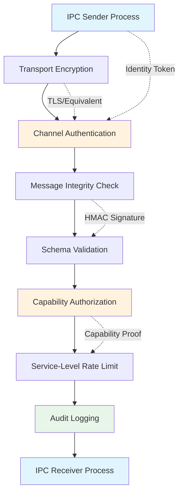
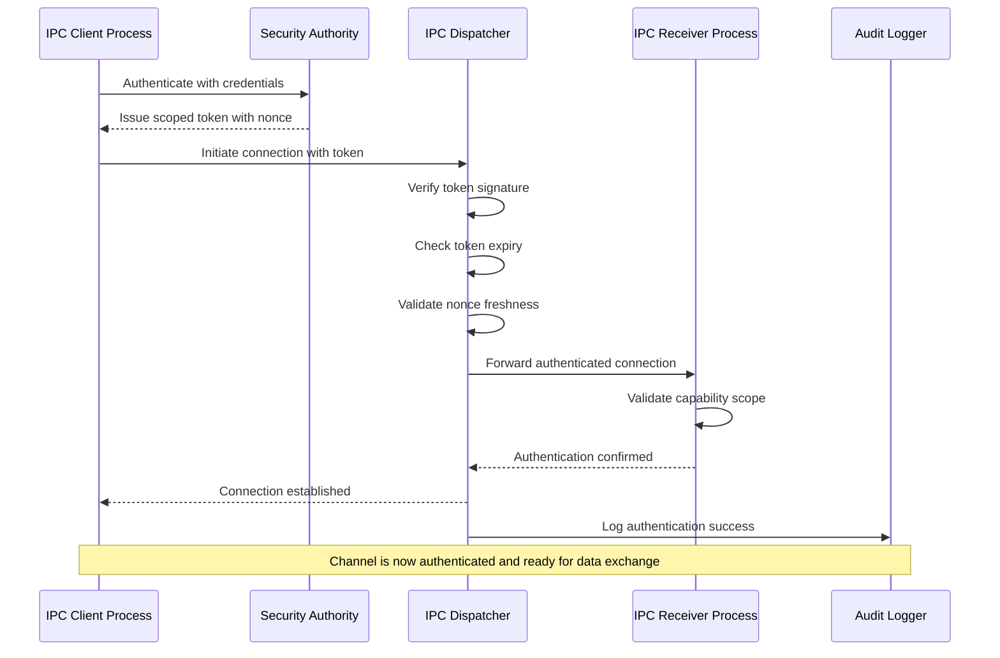
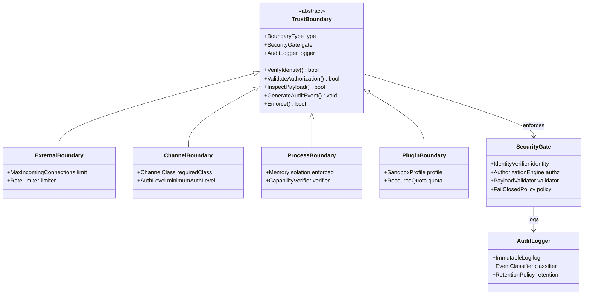

RFC: RFC-0107
Title: IPC Security
Status: Accepted
Category: Standard
Owner: Security Team
Authors: Atlas Team
Created: 2026-06-30
Updated: 2026-07-01
ADS Version: 1.0.0
Spec Version: 1.0.0
Normative: YES
Depends On:
  - RFC-0101 IPC Overview
  - RFC-0007 Runtime IPC Architecture
Supersedes: None
Superseded By: None
Related ADR:
  - ADR-0010 Security Architecture
Audience: All Subsystem Teams
Target Release: 1.0.0
Review Cycle: Annual
Compatibility: Compatible with Spec 1.0

---

## Normative Status

This specification is normative. Every IPC security implementation MUST conform to the security requirements defined herein. Any deviation MUST be approved through the formal Architecture Decision Record (ADR) process.

This specification is subordinate to the Atlas Development System (ADS) Constitution and ADR-0010.

---

## Authority

This RFC is the authoritative specification for IPC security within the Atlas platform.

Any implementation MUST conform to this document.

If an implementation conflicts with this RFC, this RFC takes precedence.

Conflicts between RFCs SHALL be resolved through the ADR process.

---

## Terminology

The following terms are defined with exact meanings consistent with the Atlas Master Glossary.

| Term | Definition | Source |
|---|---|---|
| Security | Protection against unauthorized access, tampering, and attacks. | This RFC |
| Authentication | Verifying the identity of a communicating process. | This RFC |
| Authorization | Granting or denying access based on declared capabilities. | This RFC |
| Encryption | Transforming data to prevent unauthorized reading. | This RFC |
| Audit | Recording security-relevant events for compliance and investigation. | This RFC |
| Threat Model | A structured analysis of potential security threats. | This RFC |
| Sandbox | An isolated execution process or virtual machine context restricting OS access. | Glossary |
| Zero Trust | A security model requiring explicit verification for every request. | This RFC |
| Defense in Depth | Security strategy using multiple layered controls. | This RFC |

---

## Layer Boundaries

### Responsibilities

This specification IS responsible for:

- Defining the architectural contract for this domain.
- Specifying behavioral requirements that all implementations MUST satisfy.
- Establishing extension points and their contracts.

### Non-Responsibilities

This specification IS NOT responsible for:

- Implementation details (see related RFCs for implementation guidance).
- Runtime platform specifics.
- User-facing UI behavior.

### Dependencies

| Dependency | Direction | Description |
|---|---|---|
| RFC-0001 | Consumed | Runtime Overview — foundational runtime architecture |

### Consumers

- See related RFCs for consumer listings.

### Providers

- This specification provides domain-specific contracts and behavioral models.

### Forbidden Dependencies

- This specification MUST NOT depend on any specific programming language.
- This specification MUST NOT depend on any specific storage backend.
- This specification MUST NOT depend on any specific operating system.
## 1 Introduction

### 1.1 Purpose
The Atlas platform operates across multiple independent processes, each running in separate memory contexts. The Inter-Process Communication (IPC) layer serves as the sole conduit for data exchange between these processes. RFC-0107 establishes the comprehensive security framework governing every message, connection, and channel within the Atlas IPC ecosystem.

### 1.2 Rationale
Without rigorous IPC security controls, a compromised process can escalate privileges, exfiltrate sensitive data, inject malicious payloads, or disrupt the entire platform. The defense-in-depth model defined herein ensures that no single point of failure can undermine the security posture of the Atlas platform. Each IPC interaction is subject to layered protections spanning authentication, authorization, encryption, validation, and audit.

### 1.3 Scope
This specification covers all IPC traffic within the Atlas workspace boundary, including but not limited to:
- Process-to-process communication across all Atlas subsystems.
- Plugin-to-runtime message exchanges.
- External service integrations that traverse the IPC boundary.
- Administrative control channels and diagnostic interfaces.

---

## 2 Goals

- **Zero-Trust IPC**: Every IPC message MUST be treated as untrusted until verified through authentication, authorization, and validation. No implicit trust exists between any two processes.
- **Defense in Depth**: Multiple independent security controls MUST operate at every IPC boundary, ensuring that compromise of one layer does not result in total system breach.
- **Cryptographic Assurance**: All IPC channels carrying sensitive data MUST employ strong encryption with algorithm agility, enabling seamless migration to stronger primitives as computational capabilities evolve.
- **Complete Auditability**: Every IPC event MUST produce an immutable audit record, enabling forensic reconstruction of any security incident.
- **Threat Mitigation**: The specification MUST address all six categories of the STRIDE threat model (Spoofing, Tampering, Repudiation, Information Disclosure, Denial of Service, Elevation of Privilege).
- **Least Privilege**: Every process MUST operate with the minimum permissions necessary for its function, enforced through capability-based authorization.

---

## 3 Non-Goals

- **Operating System Kernel Security**: This specification does not govern OS-level security primitives, which are managed by the host platform.
- **Physical Layer Security**: Network cabling, hardware tamper resistance, and physical access controls fall outside this specification.
- **Application-Level Business Logic Validation**: Semantic correctness of IPC payloads is governed by RFC-0102 (Message Model), not by this security specification.
- **User Interface Security**: UI-layer protections, session management, and access control lists for end-user interfaces are outside this scope.

---

## 4 Security Model Overview

### 4.1 Defense-in-Depth Architecture
The Atlas IPC security model employs seven concentric layers of protection:

1. **Network Transport Layer**: Physical and link-layer encryption for IPC channels.
2. **Channel Layer**: Per-channel authentication and encryption negotiated at connection establishment.
3. **Message Layer**: Payload encryption, integrity verification, and schema validation.
4. **Process Layer**: Process identity verification and capability validation.
5. **Service Layer**: Service-level authorization and rate limiting.
6. **Data Layer**: Field-level encryption for sensitive payload attributes.
7. **Audit Layer**: Immutable logging of all security-relevant events.

Compromise of any single layer MUST NOT result in unauthorized access. Each layer operates independently, with its own credentials, validation checks, and failure modes.

### 4.2 Zero-Trust Principles
The IPC security model adheres to these zero-trust tenets:

- **Never Trust, Always Verify**: Every IPC request, regardless of origin, MUST undergo full authentication and authorization.
- **Explicit Verification**: Credentials, permissions, and data validity MUST be verified for every interaction.
- **Least Privilege Access**: Every process receives the minimum set of capabilities required for its function.
- **Assume Breach**: The security model operates under the assumption that any process, channel, or message may be compromised. Controls are designed to limit blast radius.

*Figure 1: Seven-layer IPC defense-in-depth architecture.*

---

## 5 Authentication

### 5.1 Process Authentication
Every process initiating an IPC connection MUST present a valid process credential. Process credentials contain:
- A unique process identifier assigned at registration.
- A cryptographic proof of process identity.
- An expiration timestamp.
- A digital signature from the Atlas Security Authority.

The receiving process or channel endpoint MUST verify the credential before accepting any IPC message. Expired or unsigned credentials MUST be rejected immediately.

### 5.2 Token-Based Authentication
The Atlas IPC system employs a token-based authentication mechanism. Tokens are short-lived, scoped credentials issued by the Security Authority.

Token Structure:
- **Subject**: The authenticated process identifier.
- **Issuer**: The Security Authority identifier.
- **Issued At**: Timestamp of token issuance.
- **Expires At**: Absolute timestamp after which the token is invalid.
- **Scope**: A list of permitted IPC operations and target channels.
- **Nonce**: A cryptographically random value preventing replay attacks.
- **Signature**: HMAC or digital signature over all preceding fields.

Token Lifecycle:
1. The requesting process authenticates with the Security Authority.
2. The Security Authority issues a scoped token with bounded lifetime.
3. The token is included in every IPC handshake.
4. The receiving endpoint verifies token signature, expiry, scope, and nonce freshness.
5. Upon expiry, the process MUST obtain a fresh token. Stale tokens are rejected.

### 5.3 Certificate-Based Authentication
For high-assurance IPC channels, certificate-based mutual authentication MAY be employed. Certificates follow these rules:

- Certificates MUST be X.509 v3 or an equivalent standard with comparable security properties.
- Every certificate MUST contain a subject distinguished name identifying the process or service.
- Certificate chains MUST be validated against the Atlas trust store at every connection attempt.
- Self-signed certificates are prohibited in production environments.
- Certificate revocation status MUST be checked via Online Certificate Status Protocol (OCSP) or Certificate Revocation List (CRL) at connection establishment.

### 5.4 Mutual Authentication
All restricted and confidential IPC channels MUST employ mutual authentication. Both the sender and receiver MUST authenticate each other before any data exchange occurs.

Mutual Authentication Protocol:
1. The sender initiates the connection and presents its credential.
2. The receiver validates the credential and presents its own credential.
3. The sender validates the receiver credential.
4. Only upon successful bidirectional validation does the channel transition to the authenticated state.

If either side fails validation, the connection is terminated and an audit event is recorded.

### 5.5 Authentication Failure Handling
Upon authentication failure, the system MUST:
- Immediately terminate the connection.
- Record an audit event with the failure reason, source identifier, and timestamp.
- Increment a failure counter for the offending process identifier.
- After a configurable threshold of consecutive failures, temporarily blacklist the process identifier.

### 5.6 Authentication Sequence Diagram

The following sequence illustrates the complete authentication flow for a restricted channel connection:

*Figure 4: Mutual authentication sequence for restricted IPC channels.*

---

## 6 Authorization

### 6.1 Capability-Based Authorization
Atlas employs a capability-based authorization model. A capability is an unforgeable token that confers a specific permission to perform a designated operation on a designated resource.

Capability Properties:
- **Unforgeable**: Capabilities cannot be fabricated or duplicated by unauthorized processes.
- **Non-Transferable**: Capabilities are bound to the issuing process and cannot be delegated without explicit re-issuance.
- **Scoped**: Each capability grants only the permissions explicitly enumerated.
- **Revocable**: Capabilities can be revoked at any time by the issuing authority.

Capability Enforcement: Every IPC operation MUST be accompanied by a valid capability proving the sender's right to perform that operation. The receiver's authorization engine verifies the capability before executing the requested operation.

### 6.2 Attribute-Based Access Control
In addition to capabilities, Atlas implements attribute-based access control (ABAC) for fine-grained authorization decisions. ABAC evaluates policies against a set of attributes:

- **Subject Attributes**: Process identity, role, security clearance level, geographic origin.
- **Resource Attributes**: Channel classification, data sensitivity level, ownership.
- **Action Attributes**: Read, write, execute, administer.
- **Environment Attributes**: Time of day, connection encryption strength, current threat level.

Policy Evaluation: Authorization decisions are computed by evaluating policy expressions against the relevant attributes. A positive decision requires all applicable policies to evaluate to true. A single negative evaluation results in denial.

### 6.3 Role-Based Permissions
Roles provide a coarse-grained authorization layer that maps groups of capabilities to functional identities.

Defined Roles:
| Role | Permissions | Channels |
|---|---|---|
| Observer | Read-only access to public channels | Public |
| Participant | Read and write access to internal channels | Public, Internal |
| Operator | Full operational access including diagnostics | Public, Internal, Restricted |
| Administrator | Complete access including security management | All channels |
| Auditor | Read access to audit logs and security events | Public, Internal, Restricted (read-only) |

Role Assignment: Roles are assigned by the Security Authority during process registration. A process may hold multiple roles simultaneously. Role combinations are subject to conflict detection and resolution rules.

### 6.4 Authorization Cache
To minimize latency, authorized capabilities MAY be cached at the channel endpoint. Cached authorizations MUST:
- Have a maximum lifetime of 60 seconds.
- Be invalidated immediately upon any revocation event.
- Include the full attribute set used in the authorization decision.
- Be cryptographically bound to the originating authorization decision.

---

## 7 Trust Boundaries

### 7.1 Identification of Trust Boundaries
The following trust boundaries are identified within the Atlas IPC architecture:

1. **External-to-Workspace Boundary**: The perimeter between untrusted external processes and the trusted Atlas workspace. All incoming IPC MUST be authenticated and validated at this boundary.
2. **Public-to-Internal Channel Boundary**: The transition from publicly accessible channels to internal channels. Authentication is required at this boundary.
3. **Internal-to-Restricted Channel Boundary**: The transition from internal channels to restricted channels. Mutual authentication and elevated authorization are required.
4. **Restricted-to-Confidential Channel Boundary**: The highest sensitivity boundary. Certificate-based mutual authentication and end-to-end encryption are mandatory.
5. **Process Memory Boundary**: The separation between individual process memory spaces. IPC is the sole mechanism for cross-memory data transfer.
6. **Plugin-to-Core Boundary**: The interface between sandboxed plugins and the core runtime. Plugins operate with reduced privileges.
7. **Audit Log Boundary**: The protection separating audit data from regular IPC traffic. Audit logs are write-once and tamper-evident.

### 7.2 Boundary Enforcement
Every trust boundary MUST be enforced by a dedicated security gate that performs:
- Identity verification of the crossing process.
- Authorization validation for the target channel class.
- Payload inspection and schema enforcement.
- Audit event generation.

A security gate MUST fail closed: if any verification component is unavailable, the gate MUST deny the crossing request.

*Figure 2: Trust boundary class model showing enforcement components.*

---

## 8 Sandbox Isolation

### 8.1 Sandbox Model
Processes within the Atlas IPC ecosystem are classified into sandbox tiers, each with distinct isolation guarantees:

| Tier | Isolation Level | Memory Access | IPC Permissions | Resource Limits |
|---|---|---|---|---|
| Untrusted | Maximum | No shared memory | Public channels only | Strict quotas |
| Plugin | High | Isolated heap | Public, Internal | Moderate quotas |
| Core | Standard | Process-private | All except Confidential | Standard quotas |
| Admin | Minimal | Full process access | All channels | Elevated quotas |

### 8.2 Privilege Separation
The IPC system operates with separated privileges:

- **Privileged Operations** (Admin tier only): Channel creation, security policy modification, certificate issuance, audit log access.
- **Elevated Operations** (Operator tier and above): Service discovery, diagnostic data retrieval, rate limit adjustment.
- **Standard Operations** (Participant tier and above): Message sending, message receiving, subscription management.
- **Restricted Operations** (Untrusted tier): None. Untrusted processes may only observe public channels.

### 8.3 Resource Containment
Each sandbox enforces resource limits to prevent denial-of-service conditions:

- **Message Buffer**: Maximum 1 MB per process.
- **Connection Count**: Maximum 10 concurrent IPC connections per process.
- **Throughput**: Maximum 10,000 messages per second per process.
- **Queue Depth**: Maximum 100,000 pending messages per process.
- **Memory Footprint**: Maximum 256 MB per process IPC subsystem.
- **Lifetime**: Maximum 24 hours per connection without re-authentication.

Exceeding any resource limit results in message rejection and an audit event.

---

## 9 Privilege Model

### 9.1 Privilege Levels
The Atlas IPC privilege model defines four discrete levels:

1. **Level 0 (Observer)**: Can receive messages from public channels only. Cannot send any messages.
2. **Level 1 (Participant)**: Can send and receive messages on public and internal channels. Cannot modify security policies.
3. **Level 2 (Operator)**: Full read/write access to all channels except confidential. Can manage subscriptions and rate limits.
4. **Level 3 (Administrator)**: Unrestricted access to all channels and security management functions.

### 9.2 Privilege Escalation Prevention
Privilege escalation is prevented through the following mechanisms:

- **Immutable Elevation**: Privilege levels are assigned at process registration and cannot be altered by the process itself. Only the Security Authority can modify privilege levels.
- **Escalation Audit**: Every privilege level change generates a critical-severity audit event and requires administrator confirmation.
- **Token Binding**: Authentication tokens are bound to the privilege level at issuance. A token cannot grant higher privileges than the process holds.
- **Channel Segregation**: Higher-privilege channels are physically segregated from lower-privilege channels at the dispatcher level.

### 9.3 Least Privilege Enforcement
Every IPC operation is evaluated against the principle of least privilege:

- A process MUST NOT be granted more permissions than necessary for its function.
- Default privilege level for all new processes is Level 0 (Observer).
- Privilege elevation requires explicit administrative action.
- Temporary privilege elevation MAY be granted for specific operations but MUST expire automatically.

---

## 10 Input Validation

### 10.1 Validation at Every Boundary
Every IPC message MUST pass through validation at each trust boundary it crosses:

1. **Structural Validation**: The message conforms to the expected wire format and encoding.
2. **Schema Validation**: The message payload conforms to the registered schema for the target channel and operation.
3. **Semantic Validation**: The message content is logically consistent and within expected value ranges.
4. **Size Validation**: The message does not exceed the configured maximum size for the channel class.
5. **Origin Validation**: The message source is authenticated and authorized for the target channel.

### 10.2 Schema Enforcement
IPC message schemas are versioned and registered with the Schema Registry. Validation against the schema is mandatory for all messages entering restricted or confidential channels.

Schema Validation Rules:
- Messages MUST conform to the schema version indicated in the message header.
- If the schema version is not recognized, the message MUST be rejected.
- Unknown fields in the message body MUST be rejected unless the schema permits extensibility.
- Type mismatches in any field MUST result in immediate message rejection.

### 10.3 Validation Failure Response
Upon validation failure, the system MUST:
- Discard the invalid message immediately.
- Record an audit event with the failure details.
- Return a ValidationError to the sender if the channel supports error responses.
- Increment the validation failure counter for the offending process.

---

## 11 Input Filtering

### 11.1 Content-Type Filtering
Every IPC message carries a content-type indicator. The channel endpoint MUST verify that the content type matches the expected type for the target service:

| Content Type | Allowed Channels | Description |
|---|---|---|
| Application Binary | Restricted, Confidential | Serialized binary payloads |
| Application Text | Public, Internal | Plain text or structured text |
| Application Structured | Public, Internal, Restricted | Schema-validated structured data |
| Application Event | Public, Internal | Event notifications |
| Application Control | Restricted, Confidential | Administrative commands |

Unknown or unrecognized content types MUST be rejected.

### 11.2 Size Limits
Message size limits are enforced per channel class:

| Channel Class | Maximum Message Size | Maximum Total Session Size |
|---|---|---|
| Public | 64 KB | 16 MB |
| Internal | 256 KB | 64 MB |
| Restricted | 1 MB | 256 MB |
| Confidential | 1 MB | 256 MB |

Messages exceeding size limits MUST be rejected at the channel endpoint.

### 11.3 Pattern Matching
Incoming messages are scanned against a configurable set of forbidden patterns:

- Null bytes embedded within structured data fields.
- Control characters outside of permitted ranges.
- Unicode replacement characters indicating encoding errors.
- Known exploit signatures in binary payloads.

Detection of forbidden patterns results in immediate message rejection and a critical audit event.

### 11.4 Protocol-Level Filtering
The IPC dispatcher enforces protocol-level filters:

- Messages from unauthenticated processes on restricted channels are dropped.
- Messages with expired tokens are rejected.
- Messages with mismatched schema versions are discarded.
- Messages exceeding rate limits are queued or dropped based on channel policy.

---

## 12 Replay Protection

### 12.1 Nonce Management
Every IPC message carrying a security-sensitive operation MUST include a unique nonce. Nonces are cryptographically random values with the following properties:

- **Uniqueness**: No nonce is ever reused within the same session.
- **Entropy**: Nonces contain at least 128 bits of cryptographic randomness.
- **Binding**: Nonces are bound to the specific operation and target channel.

The receiver maintains a nonce cache for the current session and rejects any message containing a previously seen nonce. The nonce cache is cleared upon session termination or token expiration.

### 12.2 Timestamp Validation
Every IPC message includes a timestamp indicating when the message was originated. Timestamp validation rules:

- Messages with timestamps more than 5 minutes in the past are rejected.
- Messages with timestamps more than 1 minute in the future are rejected.
- Clock skew tolerance is configurable but MUST NOT exceed 10 seconds in production.
- Timestamps are signed as part of the message authentication code.

### 12.3 Sequence Tracking
Ordered channels maintain a monotonically increasing sequence number for each sender. Sequence tracking rules:

- Sequence numbers MUST be contiguous with no gaps.
- Duplicate sequence numbers are rejected.
- Out-of-order messages are buffered for a maximum of 100 milliseconds, then rejected.
- Sequence number overflow wraps to zero with a session reset.

---

## 13 Tampering Detection

### 13.1 Integrity Verification
Every IPC message MUST include a message authentication code (MAC) computed over the complete message payload, header, and metadata.

MAC Requirements:
- The MAC algorithm MUST provide at least 256 bits of security.
- The MAC key is derived per-session from the channel encryption key material.
- The MAC covers all fields except the MAC itself.
- Any modification to the message after MAC computation MUST be detectable.

### 13.2 Checksums
In addition to MACs, messages on public channels MAY include a lighter-weight integrity check:

- A 128-bit CRC or hash-based checksum is computed over the message payload.
- Checksum verification is performed before schema validation.
- Checksum failure results in immediate message discard.

### 13.3 Digital Signatures
For confidential channels, every message MUST include a digital signature:

- Signatures are computed using asymmetric cryptography with keys of at least 256 bits.
- The signature covers the entire message including headers and metadata.
- Signature verification uses the sender's registered public key or certificate.
- Expired or revoked signing keys result in message rejection.

---

## 14 Spoofing Prevention

### 14.1 Origin Verification
The system prevents source address spoofing through:

- **Cryptographic Binding**: Process identities are cryptographically bound to their credentials. Impersonation requires possession of the private key or secret.
- **Channel Affinity**: Connections are bound to the authenticated process for their lifetime. A connection cannot be hijacked by another process.
- **Multi-Factor Authentication**: Restricted and confidential channels require both token-based and certificate-based authentication.

### 14.2 Destination Verification
The system prevents destination spoofing through:

- **Endpoint Authentication**: The receiving endpoint verifies its own identity and confirms it is the intended recipient.
- **Address Binding**: IPC addresses are registered with the Service Registry and cannot be claimed by unauthorized processes.
- **Channel Validation**: Messages are routed through the dispatcher, which verifies that the destination channel exists and the target service is registered.

### 14.3 Man-in-the-Middle Protection
Man-in-the-middle attacks are prevented through:

- **Encrypted Channels**: All IPC channels except public use transport-layer encryption.
- **Certificate Pinning**: Confidential channel endpoints pin the expected server certificate, preventing substitution with forged certificates.
- **Channel Binding**: Authentication tokens are bound to the specific encrypted channel, preventing token reuse on unencrypted channels.
- **Forward Secrecy**: Key exchange mechanisms MUST provide forward secrecy, ensuring that past communications remain secure even if long-term keys are compromised.

---

## 15 Encryption Abstraction

### 15.1 Encryption at Rest
Data persisted by IPC processes (message queues, audit logs, cached credentials) MUST be encrypted at rest.

Encryption at Rest Requirements:
- Data-at-rest encryption MUST use algorithms with at least 256-bit key lengths.
- Encryption keys are managed separately from the encrypted data.
- Key derivation follows established cryptographic standards.
- Encrypted data includes an authentication tag to detect tampering.

### 15.2 Encryption in Transit
All IPC channels classified as Internal, Restricted, or Confidential MUST encrypt data in transit.

Encryption in Transit Requirements:
- Transport encryption MUST provide confidentiality, integrity, and authenticity.
- Algorithms MUST be selected from the approved cipher suite (see Section 19).
- Encryption is applied end-to-end between the sending and receiving processes.
- Intermediate forwarding nodes MUST NOT decrypt messages.

### 15.3 Key Management
Encryption keys are managed according to these principles:

- **Key Hierarchy**: A master key derives channel keys, which derive message keys. Breaking one level does not compromise others.
- **Key Rotation**: Channel keys are rotated at least every 24 hours. Master keys are rotated at least every 90 days.
- **Key Storage**: Keys are stored in a protected key store accessible only to authorized security processes.
- **Key Destruction**: Compromised keys are destroyed immediately. Old keys are retained for a maximum of 30 days for decrypting historical messages, then permanently destroyed.
- **Key Backup**: Master keys are backed up to a geographically separate secure location. Channel keys are not backed up.

### 15.4 Algorithm Agility
The encryption abstraction MUST support algorithm agility, enabling seamless migration to stronger cryptographic primitives:

- Cipher suites are negotiated at channel establishment.
- Both ends MUST support a common cipher suite from the approved list.
- The preferred cipher suite is selected based on security strength and performance.
- Deprecation of a cipher suite requires a 90-day advance notice before mandatory migration.

---

## 16 Audit

### 16.1 Audit Logging
Every security-relevant IPC event MUST be recorded in the audit log. Audit events are immutable and append-only.

Audit Event Categories:
| Category | Events | Retention |
|---|---|---|
| Authentication | Login, logout, token issuance, token revocation, failed auth attempts | 1 year |
| Authorization | Permission grants, denials, role changes, capability issuance | 1 year |
| Channel | Channel creation, modification, deletion, connection events | 6 months |
| Message | Sent messages, received messages, rejected messages, size violations | 30 days |
| Security | Tampering detection, replay attempts, spoofing detection, encryption failures | 1 year |
| Administration | Configuration changes, key rotations, policy updates | 1 year |

### 16.2 Audit Trail Retention
Audit trails are retained according to the classification of the data they cover:

- **Public Channel Audit**: Retained for 30 days.
- **Internal Channel Audit**: Retained for 6 months.
- **Restricted Channel Audit**: Retained for 1 year.
- **Confidential Channel Audit**: Retained for 3 years.
- **Security Incident Audit**: Retained indefinitely.

Retention periods begin from the date of the event. Expired audit records are securely destroyed.

### 16.3 Audit Event Classification
Audit events are classified by severity:

| Severity | Description | Response |
|---|---|---|
| Critical | Successful attack detected, privilege escalation, encryption breach | Immediate investigation, alert security team |
| High | Failed authentication threshold exceeded, certificate revocation, policy violation | Investigation within 4 hours |
| Medium | Unauthorized access attempt, schema violation, rate limit exceeded | Investigation within 24 hours |
| Low | Routine authentication success, channel connection, normal message flow | Periodic review |
| Informational | Configuration changes, key rotations, system startup | No immediate action required |

---

## 17 Security Events

### 17.1 Event Taxonomy
Security events are categorized using the following taxonomy:

- **Access Events**: Authentication and authorization outcomes.
- **Integrity Events**: Tampering detection, checksum failures, signature verification.
- **Availability Events**: Denial-of-service indicators, resource exhaustion, rate limiting.
- **Configuration Events**: Security policy changes, key rotations, certificate updates.
- **Anomaly Events**: Behavioral deviations, unusual traffic patterns, unexpected source destinations.

### 17.2 Severity Classification
Each security event is assigned a severity level:

- **SEV-1 (Critical)**: Active exploitation confirmed or imminent. Requires immediate automated response.
- **SEV-2 (High)**: Strong indication of attack or policy violation. Requires investigation within 4 hours.
- **SEV-3 (Medium)**: Potential security concern. Requires investigation within 24 hours.
- **SEV-4 (Low)**: Minor security anomaly. Logged for periodic review.
- **SEV-5 (Informational)**: Normal security-relevant activity.

### 17.3 Event Correlation
Security events are correlated using the following identifiers:

- **Correlation ID**: Links all events belonging to a single IPC transaction.
- **Trace ID**: Links events across multiple IPC hops in a distributed transaction.
- **Session ID**: Links events within a single authenticated session.
- **Incident ID**: Groups correlated events into a security incident for investigation.

Automated correlation rules identify patterns indicative of attacks:
- Multiple authentication failures from the same source within 60 seconds.
- Authorization denials across multiple channels from the same process.
- Unusual message volume spikes from a single process.
- Tampering detections on consecutive messages from the same channel.

---

## 18 Threat Model

### 18.1 STRIDE Analysis

#### Spoofing Identity
An attacker impersonates a legitimate process to gain unauthorized IPC access.

- **Threat**: Process impersonation via stolen credentials.
- **Impact**: Unauthorized access to restricted or confidential channels.
- **Mitigation**: Mutual authentication, certificate-based verification, token binding, nonce-based replay protection.

#### Tampering with Data
An attacker modifies IPC messages in transit or at rest.

- **Threat**: Message payload modification, header injection, schema manipulation.
- **Impact**: Data corruption, unauthorized state changes, logic bypass.
- **Mitigation**: Message authentication codes, digital signatures, integrity checksums, schema validation.

#### Repudiation
An actor denies performing an action with no way to prove otherwise.

- **Threat**: Sender denies sending a message, receiver denies receiving a message.
- **Impact**: Inability to attribute actions, legal and compliance exposure.
- **Mitigation**: Immutable audit logs, signed messages, non-repudiation receipts for critical operations.

#### Information Disclosure
An attacker gains access to sensitive IPC data.

- **Threat**: Eavesdropping on unencrypted channels, accessing cached credentials, intercepting audit logs.
- **Impact**: Exposure of sensitive data, credential theft, security posture compromise.
- **Mitigation**: End-to-end encryption, secure key storage, audit log access controls, memory isolation.

#### Denial of Service
An attacker disrupts legitimate IPC communication.

- **Threat**: Resource exhaustion via message flooding, connection saturation, queue overflow.
- **Impact**: Service unavailability, degraded platform performance.
- **Mitigation**: Rate limiting, resource quotas, connection limits, backpressure controls.

#### Elevation of Privilege
An attacker gains higher privileges than authorized.

- **Threat**: Capability forgery, token manipulation, boundary bypass, role escalation.
- **Impact**: Full platform compromise, unrestricted data access.
- **Mitigation**: Capability-based authorization, immutable privilege assignment, sandbox isolation, privilege separation.

### 18.2 Attack Surface Enumeration

```mermaid
graph TD
    subgraph AttackSurface["IPC Attack Surface"]
        A[Authentication Layer] --> A1[Token Forgery]
        A --> A2[Credential Theft]
        A --> A3[Replay Attack]
        B[Authorization Layer] --> B1[Capability Forging]
        B --> B2[Role Escalation]
        B --> B3[Policy Bypass]
        C[Transport Layer] --> C1[Eavesdropping]
        C --> C2[Man-in-the-Middle]
        C --> C3[Connection Hijacking]
        D[Message Layer] --> D1[Payload Injection]
        D --> D2[Schema Manipulation]
        D --> D3[Overflow Attack]
        E[Audit Layer] --> E1[Log Tampering]
        E --> E2[Log Suppression]
        E --> E3[Forensic Blindness]
    end
    subgraph Defenses["Countermeasures"]
        D1 --> F1[HMAC Verification]
        D2 --> F2[Schema Registry]
        D3 --> F3[Size Limits]
        A1 --> F4[Token Signing]
        A3 --> F5[Nonce Tracking]
        C1 --> F6[Transport Encryption]
        C2 --> F7[Certificate Pinning]
        E1 --> F8[Append-Only Logs]
    end
    A1 -.-> F4
    A2 -.-> F4
    B1 -.-> F4
    B2 -.-> F4
    C1 -.-> F6
    C2 -.-> F7
    D1 -.-> F1
    D2 -.-> F2
    E1 -.-> F8
```

*Figure 3: STRIDE threat model with attack surface and countermeasure mapping.*

---

## 19 Cryptographic Protocols

### 19.1 Approved Cipher Suites
The following cipher suites are approved for use in Atlas IPC:

| Suite | Key Exchange | Authentication | Encryption | MAC | Security Level |
|---|---|---|---|---|---|
| Suite-A | ECDHE P-256 | ECDSA P-256 | AES-256-GCM | AEAD | High |
| Suite-B | ECDHE P-384 | ECDSA P-384 | AES-256-GCM | AEAD | Very High |
| Suite-C | X25519 | Ed25519 | ChaCha20-Poly1305 | AEAD | High |
| Suite-D | RSA-3072 | RSA-PSS | AES-256-GCM | AEAD | High |

Suite selection at connection establishment:
1. Both endpoints advertise their supported suites.
2. The intersection of supported suites is computed.
3. The highest-security suite in the intersection is selected.
4. If no common suite exists, the connection is rejected.

### 19.2 Key Exchange
Secure key exchange is performed using one of the following protocols:

- **ECDHE (Elliptic Curve Diffie-Hellman Ephemeral)**: Provides forward secrecy. Preferred for all channels.
- **X25519**: Modern elliptic curve key exchange with excellent performance and security properties.
- **RSA Key Transport**: Legacy support for environments where ephemeral key exchange is not available. Does not provide forward secrecy.

Key exchange parameters:
- Elliptic curves MUST be from the NIST P-256, P-384, or the X25519 curve family.
- RSA keys MUST be at least 3072 bits.
- All key exchange operations MUST be ephemeral. Static key exchange is prohibited.

### 19.3 Protocol Authentication
Protocol-level authentication occurs during channel establishment:

1. The client sends a hello message containing its supported cipher suites and a random value.
2. The server selects the best common cipher suite and responds with its certificate.
3. The client verifies the server certificate against the trust store.
4. Both parties perform the key exchange computation.
5. A key confirmation message is exchanged, signed with the derived session keys.
6. Upon successful key confirmation, the channel transitions to the authenticated state.

### 19.4 Session Establishment
Sessions follow a defined lifecycle:

- **Creation**: Initiated by the client hello message.
- **Negotiation**: Cipher suite and parameters are agreed upon.
- **Authentication**: Both parties authenticate using the selected mechanism.
- **Active**: The session is established and data exchange begins.
- **Renewal**: Sessions are renewed before expiration through re-keying.
- **Termination**: Either party may terminate the session. Remaining data is flushed.

Session parameters:
- Maximum session lifetime: 24 hours.
- Re-keying interval: 1 hour or 1 GB of transferred data, whichever comes first.
- Session resumption: Supported via session tickets with 1-hour lifetime.

---

## 20 Certificate Management

### 20.1 Certificate Lifecycle
Certificates follow a defined lifecycle from creation to destruction:

1. **Creation**: Certificates are generated by the Atlas Certificate Authority with a unique subject identifier.
2. **Issuance**: The CA signs the certificate and distributes it to the process key store.
3. **Activation**: The certificate becomes active and usable for IPC authentication.
4. **Renewal**: Certificates are renewed before expiration through a re-issuance process.
5. **Revocation**: Certificates are revoked immediately upon compromise or decommissioning.
6. **Expiration**: Certificates expire after their validity period. Expired certificates are rejected.
7. **Destruction**: Revoked and expired certificates are permanently removed from all stores.

### 20.2 Certificate Rotation
Certificate rotation ensures continuous security without service interruption:

- **Planned Rotation**: Certificates are rotated on a 90-day schedule. Old certificates remain valid during a 7-day overlap period.
- **Emergency Rotation**: Compromised certificates are rotated immediately. All sessions using the compromised certificate are terminated.
- **Algorithm Rotation**: When migrating to a stronger algorithm, both old and new certificates are accepted during a transition period of up to 30 days.

### 20.3 Revocation
Certificate revocation is handled through two complementary mechanisms:

- **Online Certificate Status Protocol (OCSP)**: Real-time revocation checking with stapling support.
- **Certificate Revocation Lists (CRL)**: Periodically distributed lists of revoked certificates.

Revocation processing:
- OCSP responses MUST be checked at every connection establishment.
- CRLs are refreshed at least every 24 hours.
- Revoked certificates are immediately rejected on all channels.
- Revocation events generate critical-severity audit entries.

### 20.4 Trust Store
The Atlas trust store contains all trusted root certificates and intermediate CA certificates:

- The trust store is distributed securely to all Atlas processes.
- Trust store updates are signed by the Atlas Security Authority.
- Processes MUST reject connections if their certificate chain cannot be validated against the trust store.
- The trust store is versioned and audited regularly.
- Self-signed certificates are excluded from the trust store in production environments.

---

## 21 Compliance

### 21.1 Regulatory Requirements
The Atlas IPC security model is designed to satisfy common regulatory frameworks:

- **Data Protection**: Encryption in transit and at rest satisfies data protection requirements for sensitive information.
- **Access Control**: Multi-factor authentication and capability-based authorization satisfy strict access control mandates.
- **Auditability**: Immutable audit logs with configurable retention satisfy regulatory audit requirements.
- **Incident Response**: Automated security event detection and correlation enable rapid incident response.

### 21.2 Certification Programs
Atlas IPC security controls are designed to support certification against:

- **ISO 27001**: Information Security Management System requirements.
- **SOC 2**: Service Organization Control reporting for security and availability.
- **NIST SP 800-53**: Security and privacy controls for information systems.

Certification readiness is maintained through continuous compliance monitoring and periodic internal audits.

### 21.3 Audit Readiness
To maintain audit readiness:

- All security policies are documented and version-controlled.
- Compliance evidence is collected automatically from audit logs.
- Security configurations are compared against baseline standards continuously.
- Deviations from baseline are flagged and remediated within defined SLAs.
- Quarterly compliance reports are generated and reviewed by the Security Architecture Board.

---

## 22 Glossary

| Term | Definition |
|---|---|
| **Capability** | An unforgeable token conferring a specific permission to perform an operation on a resource. |
| **Channel Class** | A classification of IPC channels defining their security requirements and access controls. |
| **Cipher Suite** | A named set of cryptographic algorithms for key exchange, authentication, encryption, and integrity. |
| **Correlation ID** | A unique identifier linking all events within a single IPC transaction. |
| **Defense in Depth** | A security strategy employing multiple independent layers of protection. |
| **Ephemeral Key** | A cryptographic key used for a single session and discarded thereafter. |
| **Forward Secrecy** | A property ensuring that past communications remain secure if long-term keys are compromised. |
| **HMAC** | Hash-based Message Authentication Code providing integrity and authenticity. |
| **Non-Repudiation** | A security property ensuring that an actor cannot deny having performed an action. |
| **OCSP** | Online Certificate Status Protocol for real-time certificate revocation checking. |
| **Privilege Escalation** | The act of gaining higher access rights than originally authorized. |
| **Sandbox** | An isolated execution environment with restricted permissions and resources. |
| **STRIDE** | A threat modeling methodology categorizing threats as Spoofing, Tampering, Repudiation, Information Disclosure, Denial of Service, and Elevation of Privilege. |
| **Token** | A short-lived, scoped credential used for IPC authentication. |
| **Trust Boundary** | A conceptual border between areas of differing trust levels requiring security enforcement. |
| **Zero Trust** | A security model assuming no implicit trust and requiring verification of every interaction. |

---

## 23 Acceptance Criteria

### AC-701
- **Requirement**: Every IPC connection MUST be authenticated before any message is processed.
- **Verification**: Attempt to send a message on an unauthenticated connection.
- **Expected Result**: Connection is terminated with AuthenticationRequired.

### AC-702
- **Requirement**: All messages on Restricted and Confidential channels MUST include a valid HMAC.
- **Verification**: Send a message without HMAC on a Restricted channel.
- **Expected Result**: Message is rejected with IntegrityViolation.

### AC-703
- **Requirement**: Authentication tokens MUST have a maximum lifetime of 24 hours.
- **Verification**: Present a token older than 24 hours.
- **Expected Result**: Token is rejected with TokenExpired.

### AC-704
- **Requirement**: Every IPC message MUST be validated against the registered schema before processing.
- **Verification**: Send a message violating the schema constraints.
- **Expected Result**: Message is rejected with SchemaValidationError.

### AC-705
- **Requirement**: The system MUST reject messages exceeding the channel class size limit.
- **Verification**: Send a message 10 bytes over the size limit.
- **Expected Result**: Message is dropped and a SizeLimitExceeded audit event is generated.

### AC-706
- **Requirement**: Replay attacks MUST be prevented through nonce verification.
- **Verification**: Resend a captured valid message with the same nonce.
- **Expected Result**: Message is rejected with ReplayDetected.

### AC-707
- **Requirement**: Mutual authentication MUST be enforced on all Confidential channels.
- **Verification**: Connect to a Confidential channel with only one-way authentication.
- **Expected Result**: Connection is rejected with MutualAuthRequired.

### AC-708
- **Requirement**: Audit logs MUST be append-only and tamper-evident.
- **Verification**: Attempt to modify a record in the audit log.
- **Expected Result**: Modification is detected and rejected; a Critical audit event is generated.

### AC-709
- **Requirement**: Encryption in transit MUST be enforced on all channels except Public.
- **Verification**: Attempt to send plaintext on an Internal channel.
- **Expected Result**: Connection is upgraded to encrypted or rejected with EncryptionRequired.

### AC-710
- **Requirement**: Privilege escalation MUST be prevented by immutable privilege assignment.
- **Verification**: A process attempts to increase its privilege level via IPC message.
- **Expected Result**: Request is rejected with Unauthorized and an audit event is logged.

### AC-711
- **Requirement**: Every security gate MUST fail closed when any verification component is unavailable.
- **Verification**: Disable the identity verifier and attempt IPC communication.
- **Expected Result**: All connections are denied and a Critical audit event is generated.

### AC-712
- **Requirement**: Certificate revocation MUST be checked at every connection establishment.
- **Verification**: Connect using a revoked certificate.
- **Expected Result**: Connection is rejected with CertificateRevoked.

### AC-713
- **Requirement**: Rate limiting MUST be enforced per process with a configurable threshold.
- **Verification**: Send messages exceeding the rate limit from a single process.
- **Expected Result**: Excess messages are queued or dropped; a RateLimitExceeded event is logged.

### AC-714
- **Requirement**: Session keys MUST be rotated at least every 1 hour or 1 GB of data.
- **Verification**: Monitor session key usage over time and data volume.
- **Expected Result**: Keys are rotated before either threshold is reached.

### AC-715
- **Requirement**: Forward secrecy MUST be provided by all approved key exchange mechanisms.
- **Verification**: Compromise a long-term key and attempt to decrypt past session traffic.
- **Expected Result**: Past session traffic cannot be decrypted.

### AC-716
- **Requirement**: All approved cipher suites MUST provide at least 128 bits of security.
- **Verification**: Review the configuration of each approved cipher suite.
- **Expected Result**: All suites meet or exceed the 128-bit security requirement.

### AC-717
- **Requirement**: The nonce cache MUST reject duplicate nonces within the same session.
- **Verification**: Send two messages with identical nonces in the same session.
- **Expected Result**: Second message is rejected with NonceDuplicate.

### AC-718
- **Requirement**: Timestamp validation MUST reject messages older than 5 minutes.
- **Verification**: Send a message with a timestamp 6 minutes in the past.
- **Expected Result**: Message is rejected with TimestampExpired.

### AC-719
- **Requirement**: Sequence numbers on ordered channels MUST be contiguous.
- **Verification**: Send a message with a sequence number that skips a value.
- **Expected Result**: Message is rejected with SequenceGap.

### AC-720
- **Requirement**: Audit retention periods MUST match the channel classification.
- **Verification**: Inspect the retention configuration for each audit category.
- **Expected Result**: Retention periods comply with the defined policy table.

### AC-721
- **Requirement**: Capability tokens MUST be unforgeable and non-transferable.
- **Verification**: Attempt to forge a capability token or transfer it to another process.
- **Expected Result**: Both actions are detected and rejected.

### AC-722
- **Requirement**: The trust store MUST be versioned and signed by the Security Authority.
- **Verification**: Deploy an unsigned or version-mismatched trust store.
- **Expected Result**: Trust store is rejected and the process refuses to establish secure connections.

### AC-723
- **Requirement**: Self-signed certificates MUST be prohibited in production environments.
- **Verification**: Attempt to authenticate with a self-signed certificate in production.
- **Expected Result**: Authentication is rejected with SelfSignedNotAllowed.

### AC-724
- **Requirement**: Security events MUST be correlated using correlation, trace, and session identifiers.
- **Verification**: Generate a multi-hop IPC transaction and inspect the audit logs.
- **Expected Result**: All events in the transaction share the same correlation and trace identifiers.

### AC-725
- **Requirement**: The system MUST detect and alert on multiple authentication failures within 60 seconds.
- **Verification**: Send 5 failed authentication requests within 60 seconds from the same source.
- **Expected Result**: A High-severity security event is generated and an alert is triggered.

### AC-726
- **Requirement**: All sandbox resource limits MUST be enforced at the dispatcher level.
- **Verification**: Attempt to exceed memory, connection, or throughput limits from within a sandbox.
- **Expected Result**: Exceeded resources are rejected and an audit event is generated.

### AC-727
- **Requirement**: Encryption keys MUST be derived using a hierarchical key management scheme.
- **Verification**: Inspect the key derivation chain for a Confidential channel.
- **Expected Result**: Keys follow the hierarchy: master key -> channel key -> message key.

### AC-728
- **Requirement**: Certificate rotation MUST maintain a minimum 7-day overlap period.
- **Verification**: Perform a certificate rotation and check the validity periods.
- **Expected Result**: Old and new certificates overlap by at least 7 days.

### AC-729
- **Requirement**: OCSP stapling MUST be supported for all certificate-based connections.
- **Verification**: Establish a certificate-based connection and inspect the handshake.
- **Expected Result**: OCSP response is stapled during the handshake.

### AC-730
- **Requirement**: The system MUST support algorithm agility with a 90-day deprecation notice.
- **Verification**: Deprecate a cipher suite and attempt to use it after the notice period.
- **Expected Result**: Deprecated suite is rejected after the notice period expires.

### AC-731
- **Requirement**: Input filtering MUST reject messages with forbidden patterns.
- **Verification**: Send a message containing null bytes in a structured data field.
- **Expected Result**: Message is rejected with PatternViolation and a Critical audit event is generated.

### AC-732
- **Requirement**: Content-type filtering MUST reject unrecognized content types.
- **Verification**: Send a message with an unknown content type on any channel.
- **Expected Result**: Message is rejected with UnknownContentType.

### AC-733
- **Requirement**: Man-in-the-middle protection MUST include certificate pinning on Confidential channels.
- **Verification**: Attempt a MITM attack using a forged certificate on a Confidential channel.
- **Expected Result**: Connection is rejected with CertificatePinMismatch.

### AC-734
- **Requirement**: Destination verification MUST prevent address spoofing through endpoint authentication.
- **Verification**: Attempt to impersonate a registered channel endpoint.
- **Expected Result**: Impersonation is detected and rejected with EndpointVerificationFailed.

### AC-735
- **Requirement**: Tampering detection MUST include integrity verification at every trust boundary.
- **Verification**: Modify a message payload between two trust boundaries.
- **Expected Result**: Modification is detected at the downstream boundary and the message is rejected.

### AC-736
- **Requirement**: Spoofing prevention MUST bind connections to the authenticated process identity.
- **Verification**: Attempt to hijack a connection from a different process.
- **Expected Result**: Hijacking is detected and the connection is terminated.

### AC-737
- **Requirement**: Replay protection MUST include both nonce and timestamp validation.
- **Verification**: Send a valid message with a fresh nonce but an expired timestamp.
- **Expected Result**: Message is rejected with TimestampExpired even though the nonce is valid.

### AC-738
- **Requirement**: Authentication failure handling MUST include process identifier blacklisting after threshold breaches.
- **Verification**: Exceed the configured authentication failure threshold.
- **Expected Result**: The process identifier is temporarily blacklisted and further connections are rejected.

### AC-739
- **Requirement**: The authorization cache MUST invalidate entries within 60 seconds or upon revocation.
- **Verification**: Revoke a capability and attempt to use the cached authorization within 1 second.
- **Expected Result**: Cached authorization is invalidated and the request is denied.

### AC-740
- **Requirement**: Sandbox isolation MUST enforce memory separation between all process tiers.
- **Verification**: Attempt to read another process memory from within a sandboxed tier.
- **Expected Result**: Memory access is blocked by the isolation layer.

### AC-741
- **Requirement**: Privilege model enforcement MUST prevent processes from exceeding their assigned level.
- **Verification**: A Level 1 process attempts an operation requiring Level 2.
- **Expected Result**: Operation is denied with InsufficientPrivilege.

### AC-742
- **Requirement**: Input validation MUST occur at every trust boundary, not just the entry point.
- **Verification**: Send a valid message that traverses multiple trust boundaries.
- **Expected Result**: Each boundary performs independent validation; a message passing one boundary may still be rejected by a subsequent boundary.

### AC-743
- **Requirement**: Audit events MUST include the severity classification for every security-relevant occurrence.
- **Verification**: Inspect a sample of audit events across all severity levels.
- **Expected Result**: Every audit event includes a valid severity classification matching the taxonomy.

### AC-744
- **Requirement**: The STRIDE threat model MUST be applied to all new IPC features before deployment.
- **Verification**: Review the design documentation for a new IPC feature.
- **Expected Result**: Documentation includes a STRIDE analysis with mitigations for each identified threat category.

### AC-745
- **Requirement**: Cryptographic protocol implementations MUST support all approved cipher suites.
- **Verification**: Test connection establishment using each approved cipher suite.
- **Expected Result**: All approved suites negotiate successfully and establish encrypted channels.

### AC-746
- **Requirement**: Certificate lifecycle management MUST support emergency rotation within 1 minute of a revocation request.
- **Verification**: Issue a revocation command and measure the time until affected connections are terminated.
- **Expected Result**: All connections using the revoked certificate are terminated within 1 minute.

### AC-747
- **Requirement**: Compliance monitoring MUST automatically generate quarterly reports.
- **Verification**: Inspect the automated report generation configuration.
- **Expected Result**: Reports covering security policies, audit logs, and configuration baselines are generated every quarter.

### AC-748
- **Requirement**: Event correlation MUST link at least 100 consecutive events to a single trace ID.
- **Verification**: Generate a high-volume IPC transaction and inspect the trace continuity.
- **Expected Result**: All events in the transaction share the same trace ID with no gaps.

### AC-749
- **Requirement**: Encryption at rest MUST protect all persisted IPC data including message queues and cached credentials.
- **Verification**: Inspect persisted IPC data on disk.
- **Expected Result**: All data is encrypted; no plaintext IPC data is accessible on disk.

### AC-750
- **Requirement**: The security gate MUST independently verify identity, authorization, and payload at every boundary.
- **Verification**: Disable one verification component and test boundary enforcement.
- **Expected Result**: The gate fails closed and denies all requests when any component is unavailable.

### AC-751
- **Requirement**: Key management MUST support secure destruction of old keys after the 30-day retention window.
- **Verification**: Age a channel key beyond 30 days and inspect the key store.
- **Expected Result**: The key is permanently destroyed and cannot be recovered.

### AC-752
- **Requirement**: All audit log retention periods MUST be configurable but MUST meet or exceed the minimums defined in this specification.
- **Verification**: Attempt to configure a retention period shorter than the minimum for any audit category.
- **Expected Result**: Configuration is rejected with a validation error indicating the minimum required retention.

### AC-753
- **Requirement**: The system MUST support at least 10,000 concurrent authenticated IPC sessions.
- **Verification**: Establish 10,000 simultaneous authenticated sessions and monitor stability.
- **Expected Result**: All sessions remain authenticated and operational without resource exhaustion.

### AC-754
- **Requirement**: Algorithm agility MUST allow deprecating and replacing any approved cipher suite without service interruption.
- **Verification**: Deprecate a cipher suite in use and replace it with an alternative.
- **Expected Result**: Active sessions migrate to the new suite; new sessions negotiate the replacement automatically.

### AC-755
- **Requirement**: Zero-trust enforcement MUST verify every message even from previously authenticated processes.
- **Verification**: Send an unverified message from an already authenticated process.
- **Expected Result**: The message undergoes full authentication and authorization verification before processing.

---

## 24 References

1. **RFC-0101**: IPC Overview
2. **RFC-0102**: Message Model
3. **RFC-0105**: Channel
4. **RFC-0111**: Error Model
5. **RFC-0110**: Observability
6. **ADR-0010**: IPC and Runtime Architecture
7. **ADR-0012**: Contract-First Specification
8. **NIST SP 800-57**: Recommendation for Key Management
9. **RFC 5280**: Internet X.509 Public Key Infrastructure Certificate and CRL Profile
10. **OWASP STRIDE**: Threat Modeling Methodology
11. **glossary.md**: Unified Atlas Glossary

---

## 18 Security Level Catalog

The Atlas platform defines five discrete Security Levels (L0 through L4) that classify every process and channel. This catalog is authoritative; all IPC security decisions MUST reference these levels.

### 18.1 Security Level Registry

| Level | ID | Name | Description | Auth Required | Encryption | Audit Required | Cross-Level Access |
|---|---|---|---|---|---|---|---|
| L0 | PUBLIC | Public | No authentication, no encryption | No | No | No | Can only communicate with L0-L2 |
| L1 | INTERNAL | Internal | Valid process token required | Yes (token) | No | Event only | Can communicate with L1-L3 |
| L2 | TRUSTED | Trusted | Verified process identity | Yes (certificate) | In-transit | All events | Can communicate with L2-L4 |
| L3 | PRIVILEGED | Privileged | Elevated privileges, sandboxed | Yes (mutual TLS) | End-to-end | All + integrity | Can communicate with L3-L4 |
| L4 | CORE | Core Runtime | Highest privilege, trust root | Yes (hardware-backed) | Always encrypted | Immutable chain | L4 only |

### 18.2 Security Level Rules

- **Rule SEC-LVL-01**: Processes MUST be assigned exactly one Security Level at startup.
- **Rule SEC-LVL-02**: Security Level assignment MUST be immutable for the lifetime of the process.
- **Rule SEC-LVL-03**: L4 processes MAY communicate with any Security Level.
- **Rule SEC-LVL-04**: L3 processes MAY communicate with L3 and L4 only.
- **Rule SEC-LVL-05**: L2 processes MAY communicate with L2, L3, and L4 only.
- **Rule SEC-LVL-06**: L1 processes MAY communicate with L1, L2, L3, and L4 only.
- **Rule SEC-LVL-07**: L0 processes MAY communicate with L0, L1, and L2 only.
- **Rule SEC-LVL-08**: Downward communication (higher to lower level) MUST be explicitly permitted.
- **Rule SEC-LVL-09**: Upward communication (lower to higher level) MUST require authentication.
- **Rule SEC-LVL-10**: Security Level violations MUST result in immediate connection termination.

### 18.3 Security Level Enforcement

- **Rule SEC-ENF-01**: The IPC Dispatcher MUST enforce Security Level boundaries at the transport layer.
- **Rule SEC-ENF-02**: Security Level MUST be verified before any message routing occurs.
- **Rule SEC-ENF-03**: Security Level checks MUST complete within 1 microsecond.
- **Rule SEC-ENF-04**: Security Level enforcement failures MUST be logged as critical security events.
- **Rule SEC-ENF-05**: Security Level metadata MUST be included in all audit trail entries.

### 18.4 Cross-Reference to Channel Catalog

All channel definitions in catalog/channels.md MUST include a Security Level assignment. The Security Level of a channel determines the minimum Security Level required for any process to access that channel.

| Channel ID | Assigned Security Level | Minimum Process Level |
|---|---|---|
| CH-SYSTEM | L4 | L4 |
| CH-PLUGIN | L2 | L2 |
| CH-WORKFLOW | L3 | L3 |
| CH-VISION | L3 | L2 |
| CH-AI | L3 | L2 |
| CH-STORAGE | L2 | L2 |
| CH-LOGGER | L1 | L1 |
| CH-EXTERNAL | L1 | L1 |
| CH-MARKETPLACE | L2 | L2 |
| CH-SCHEDULER | L3 | L3 |
| CH-KNOWLEDGE | L2 | L2 |
| CH-INTERNAL | L1 | L1 |

### 18.5 Security Level Escalation

- **Rule SEC-ESC-01**: Processes MUST NOT escalate their Security Level dynamically.
- **Rule SEC-ESC-02**: Temporary elevated privileges MAY be granted through capability tokens, not level changes.
- **Rule SEC-ESC-03**: Capability tokens MUST expire within 1 hour.
- **Rule SEC-ESC-04**: Capability token grants MUST be logged in the audit trail.
- **Rule SEC-ESC-05**: L0 processes MAY NEVER obtain L3 or L4 capabilities.

---

## Runtime Independence

This specification is completely independent of any runtime implementation platform. Specifically, this specification MUST NOT assume:

- Any programming language (Rust, Node.js, TypeScript, Go, Python, etc.)
- Any runtime environment (Electron, Tauri, Browser, Desktop, Server)
- Any storage backend (SQLite, PostgreSQL, MongoDB, Redis, etc.)
- Any operating system (Windows, Linux, macOS, etc.)
- Any hardware architecture (CPU, GPU, FPGA, etc.)
- Any threading model (single-threaded, multi-threaded, actor-based, etc.)
- Any cloud provider (AWS, Azure, GCP, etc.)
- Any container platform (Docker, containerd, etc.)

All IPC contracts are defined as abstract behavioral interfaces.

---
---

## Compliance Matrix

| Category | Value |
|---|---|
| Related RFC | See References section |
| Related ADR | ADR-0012 (and ADR-0010 if security-related) |
| Related JSON Schema | See References section |
| Related Catalog | See References section |

---

## Revision History

| Version | Status | Date | Author | Notes |
|---|---|---|---|---|
| 1.0.0 | Accepted | 2026-06-30 | Atlas Team | Initial publication |
| 1.1.0 | Accepted | 2026-07-01 | Atlas Specification Committee | Added Authority, Terminology, Layer Boundaries, Runtime Independence per RFC_TEMPLATE.md |

