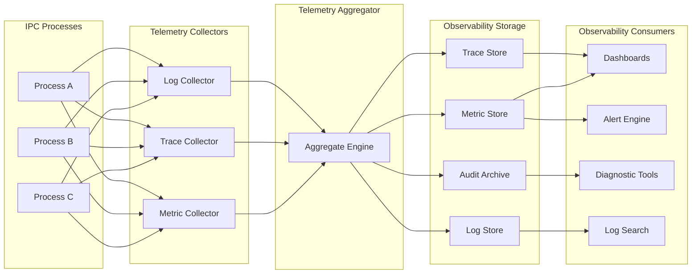
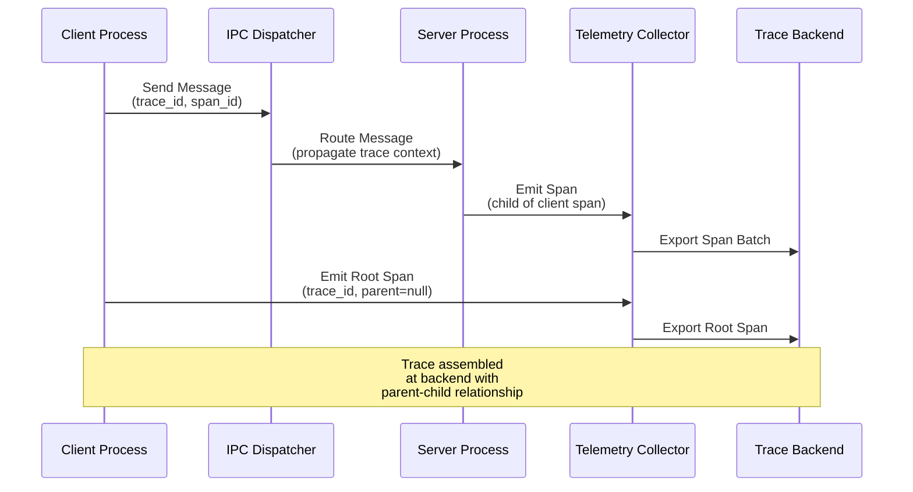
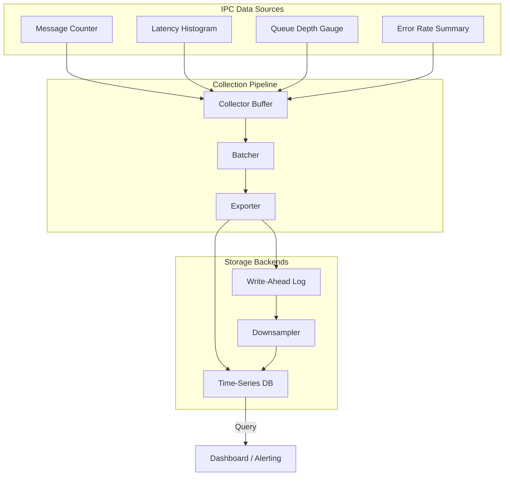

# RFC-0110: IPC Observability

RFC: RFC-0110
Title: IPC Observability
Status: Accepted
Version: 1.0.0
Category: IPC
Layer: Operations
Normative: YES
Authors: Atlas Team
Created: 2026-06-30
Last Updated: 2026-06-30
Depends On: RFC-0101 IPC Overview, RFC-0103 Transport, RFC-0105 Channel
Related RFC: RFC-0107 Security, RFC-0111 Error Model
Target Release: 1.0.0
ADR References: ADR-0010

---

## Normative Status

## Authority

This RFC is the authoritative specification for the IPC subsystem domain defined herein.

Any implementation MUST conform to this document.

If an implementation conflicts with this RFC, this RFC takes precedence.

Conflicts between RFCs SHALL be resolved through the ADR process.

---

## Terminology

The following terms are defined with exact meanings consistent with the Atlas Master Glossary.

| Term | Definition | Source |
|---|---|---|
| IPC | Inter-Process Communication; the unified messaging fabric enabling cross-process data exchange. | Glossary |
| Channel | A bidirectional or unidirectional communication pathway between two endpoints. | Glossary |
| Transport | The underlying mechanism by which messages are delivered between processes. | Glossary |
| Correlation ID | A globally unique identifier attached to every message for end-to-end tracing. | Glossary |

---
This document is normative. Every Atlas implementation that participates in inter-process communication MUST conform to the observability specifications and constraints defined herein. Whenever an implementation conflicts with this specification, this specification takes precedence. Any deviation from this specification requires formal Architecture Decision Record (ADR) approval by the Core Architecture Group.

This specification is subordinate to the Atlas Development System (ADS) Constitution and all active ADRs.

---

## Layer Boundaries

### Responsibilities

This specification IS responsible for:

- Defining the architectural contract for this domain.
- Specifying behavioral requirements that all implementations MUST satisfy.
- Establishing extension points and their contracts.

### Non-Responsibilities

This specification IS NOT responsible for:

- Implementation details (see related RFCs for implementation guidance).
- Runtime platform specifics.
- User-facing UI behavior.

### Dependencies

| Dependency | Direction | Description |
|---|---|---|
| RFC-0001 | Consumed | Runtime Overview — foundational runtime architecture |

### Consumers

- See related RFCs for consumer listings.

### Providers

- This specification provides domain-specific contracts and behavioral models.

### Forbidden Dependencies

- This specification MUST NOT depend on any specific programming language.
- This specification MUST NOT depend on any specific storage backend.
- This specification MUST NOT depend on any specific operating system.
## Table of Contents
1. [Introduction](#1-introduction)
2. [Goals](#2-goals)
3. [Non-Goals](#3-non-goals)
4. [Logging](#4-logging)
5. [Tracing](#5-tracing)
6. [Metrics](#6-metrics)
7. [Telemetry](#7-telemetry)
8. [Audit Trail](#8-audit-trail)
9. [Diagnostics](#9-diagnostics)
10. [Performance Metrics](#10-performance-metrics)
11. [Latency Analysis](#11-latency-analysis)
12. [Queue Depth](#12-queue-depth)
13. [Visualization](#13-visualization)
14. [Debugging](#14-debugging)
15. [Health](#15-health)
16. [Alerting](#16-alerting)
17. [Log Aggregation](#17-log-aggregation)
18. [Trace Retention](#18-trace-retention)
19. [Metric Storage](#19-metric-storage)
20. [Glossary](#20-glossary)
21. [Acceptance Criteria](#21-acceptance-criteria)
22. [References](#22-references)

---

## 2 Goals

The primary objectives of the Atlas IPC Observability specification are defined as follows:

- **End-to-End Visibility**: Every IPC communication path MUST be observable from origin to destination. Operators MUST be able to reconstruct the complete journey of any message across process boundaries, transport layers, and routing hops.
- **Unified Data Model**: Logging, tracing, metrics, audit, and diagnostic data MUST conform to a single coherent data model with shared identifiers (trace ID, span ID, correlation ID, channel ID, process ID) enabling cross-modal correlation.
- **Real-Time Operational Awareness**: Health scores, metric dashboards, and alerting systems MUST reflect live IPC state with bounded freshness latency, ensuring operators always see current system conditions.
- **Forensic Reconstructibility**: Audit trails and trace data MUST preserve sufficient detail to reconstruct any IPC event sequence for post-incident analysis, security investigation, and compliance verification.
- **Performance Isolation**: The observability infrastructure MUST guarantee bounded overhead. Collection and export operations MUST NOT interfere with IPC data path performance beyond defined latency budgets.
- **Multi-Dimensional Querying**: Operators MUST be able to query observability data across any combination of dimensions: time, process, channel, message type, transport, status, severity, and custom labels.

## 4 Logging

### 4.1 Structured Logging
Every IPC process MUST produce structured logs for all observable events. Logs MUST be machine-parseable, containing typed fields rather than free-text descriptions. Each log entry MUST include at minimum: timestamp, process identifier, channel identifier, event type, severity level, and correlation identifiers (trace ID and span ID).

### 4.2 Log Levels
The following log levels are defined, ordered by increasing severity:

| Level | Value | Usage |
|---|---|---|
| TRACE | 0 | Fine-grained diagnostic detail for active debugging sessions |
| DEBUG | 1 | Detailed operational flow information during development |
| INFO | 2 | Normal operational events: connection establishment, message delivery, channel lifecycle transitions |
| WARN | 3 | Anomalous but non-fatal conditions: retry attempts, degraded transport, queue depth approaching thresholds |
| ERROR | 4 | Operational failures requiring attention: message delivery failure, channel error, serialization error |
| CRITICAL | 5 | Severe failures threatening system integrity: transport disconnect, authentication failure, data corruption |

Implementations MAY suppress TRACE and DEBUG logs in production configurations. INFO and above MUST always be recorded. WARN, ERROR, and CRITICAL events MUST be recorded with full structured context.

### 4.3 Log Format
All structured logs MUST conform to the following field schema:

- **timestamp**: ISO 8601 with nanosecond precision
- **process_id**: Unique process identifier
- **channel_id**: Channel identifier
- **trace_id**: Distributed trace identifier
- **span_id**: Current span identifier
- **correlation_id**: Message correlation identifier
- **event_type**: IPC event category
- **severity**: Log level integer value
- **severity_label**: Log level name string
- **source**: Originating component name
- **message**: Human-readable event description
- **metadata**: Key-value pairs of contextual data

Timestamps MUST use ISO 8601 format with timezone information. All string identifiers MUST be UUID v7 or equivalent time-sortable format. The metadata field is extensible and MAY contain any IPC-relevant contextual data.

### 4.4 Log Retention
Log data MUST be retained according to the following minimum periods:

| Severity | Minimum Retention | Archive Required |
|---|---|---|
| TRACE, DEBUG | 24 hours | No |
| INFO | 7 days | No |
| WARN | 30 days | No |
| ERROR | 90 days | Yes |
| CRITICAL | 1 year | Yes |

Logs below WARN level MAY be compressed after initial retention. ERROR and CRITICAL logs MUST be stored in immutable storage with cryptographic integrity verification. Retention periods are measured from the log timestamp, not from ingestion time.

| Process ID | string | Yes |
| Channel ID | string | Yes |
| Status Code | enum | Yes |
| Status Description | string | Conditional |
| Attributes | map | Yes |

Span kinds are: CLIENT, SERVER, PRODUCER, CONSUMER, INTERNAL. The CLIENT span is created at the sending process. The SERVER span is created at the receiving process. The PRODUCER span is created when publishing to a queue channel. The CONSUMER span is created when consuming from a queue channel. The INTERNAL span represents work within a single process boundary.

### 5.4 Trace Sampling
Trace sampling MUST support the following strategies:

- **Head-Based Probabilistic Sampling**: Random selection at trace root with a configurable probability. Suitable for high-volume environments where approximate coverage is acceptable.
- **Tail-Based Sampling**: Complete traces are buffered and sampled after all spans are collected. Provides 100% coverage for sampled traces but requires significant buffering capacity.
- **Priority-Based Sampling**: Traces associated with ERROR or CRITICAL severity are always sampled. Traces with WARN severity are sampled at elevated probability. Normal traces follow probabilistic sampling.
- **Rate-Limited Sampling**: Maximum traces per time window, dropping excess traces deterministically by trace ID hash.

Sampling decisions MUST be recorded in the trace flags field. Tail-based sampling MUST NOT delay span completion recording; spans are recorded immediately, and trace assembly occurs asynchronously.

| ipc_connection_pool_size | Current pool capacity | process, transport |
| ipc_rate_limit_remaining | Remaining rate limit quota | process, window |

### 6.3 Histogram Metrics
Histograms capture distributions of measured values. The following IPC histograms MUST be collected:

| Histogram | Description | Buckets | Labels |
|---|---|---|---|
| ipc_message_latency_seconds | End-to-end message delivery latency | Configurable, default exponential | channel, process, message_type |
| ipc_serialization_duration_seconds | Time spent serializing messages | Configurable, default linear | process, message_type |
| ipc_deserialization_duration_seconds | Time spent deserializing messages | Configurable, default linear | process, message_type |
| ipc_connection_latency_seconds | Time to establish a connection | Configurable, default exponential | process, transport |
| ipc_batch_size | Number of messages in a batch | Configurable, default linear | channel, direction |
| ipc_payload_size_bytes | Size of serialized message payloads | Configurable, default exponential | channel, message_type |

### 6.4 Summary Metrics
Summaries provide pre-computed quantile calculations. The following IPC summaries MUST be collected:

| Summary | Description | Quantiles | Labels |
|---|---|---|---|
| ipc_request_duration_summary | Request-response round-trip time | 0.5, 0.9, 0.95, 0.99, 0.999 | channel, process |
| ipc_throughput_summary | Messages processed per second | 0.5, 0.9, 0.95, 0.99 | channel, process, window |
| ipc_error_rate_summary | Fraction of failed messages | 0.5, 0.9, 0.95 | channel, process, window |
| ipc_queue_wait_time_summary | Time waiting in queue before processing | 0.5, 0.9, 0.95, 0.99 | channel, process |

Quantile calculations MUST use the t-digest or equivalent algorithm providing sub-per-mille accuracy at extreme quantiles. Summary metrics MUST be reported at intervals not exceeding 15 seconds.

| Trace Backend | Batch protocol | At-least-once with ordering |
| Metric Store | Time-series protocol | At-least-once |
| Audit Archive | Append-only storage | Exactly-once with immutability |
| Alert Engine | Push notification | At-least-once with retry |

Export pipelines MUST implement the following reliability mechanisms:

- **Batching**: Telemetry data MUST be batched before export to reduce transmission overhead. Batch size MUST be configurable with a default upper bound of 1,000 data points per batch.
- **Deduplication**: Exported data MUST include sequence numbers enabling receivers to detect and discard duplicates caused by retry.
- **Ordering**: Within a single stream partition, telemetry data MUST be delivered in chronological order. Cross-partition ordering is not guaranteed.
- **Backpressure**: Export pipelines MUST apply backpressure to collection when downstream destinations are unavailable. Backpressure MUST propagate to the collector, which MUST buffer data up to a configurable limit before dropping oldest data.

## 9 Diagnostics

### 9.1 Diagnostic Data Collection
Diagnostic data provides deep operational insight beyond standard observability. The following diagnostic categories MUST be supported:

| Category | Contents | Collection Trigger |
|---|---|---|
| State Dump | Current IPC state: channels, connections, queues, buffers | Manual or automated |
| Flow Trace | Step-by-step message processing trace for selected correlation ID | Manual |
| Resource Profile | Memory, CPU, and I/O usage by IPC component | Automated on threshold |
| Configuration Snapshot | Current IPC configuration with effective values | Periodic or manual |
| Dependency Map | Active IPC relationships between processes | Periodic |
| Error Context | Stack traces, error chains, and failure sequences for recent errors | Automated on error |

Diagnostic data collection MUST be opt-in during normal operation. Collecting diagnostic data MUST NOT impact IPC message processing latency. Diagnostic collectors MUST use separate resource pools from IPC data processors.

### 9.2 Diagnostic Tools
The following diagnostic capabilities MUST be provided:

- **Correlation ID Lookup**: Given a correlation ID, return the complete message journey across all processes, including timestamps, status transitions, and intermediate spans.
- **Channel State Inspector**: Display the current state of all channels including active connections, queue depths, buffer utilization, and error counts.
- **Connection Graph Viewer**: Render the topology of active IPC connections between processes, showing transport types, latency measurements, and error rates per link.
- **Message Replay Simulator**: Given a captured message sequence, replay it through a diagnostic channel to reproduce observed conditions in a controlled environment.
- **Configuration Diff**: Compare current IPC configuration against a baseline, highlighting deviations and their potential impact.

### 9.3 Diagnostic Endpoints
Diagnostic capabilities MUST be exposed through uniform endpoints. Each endpoint MUST require authentication and authorization at minimum at the ADMIN level. The following endpoints MUST be defined:

| Endpoint | Method | Data Returned |
|---|---|---|
| /diagnostics/state | GET | Full IPC state snapshot |
| /diagnostics/trace/{correlation_id} | GET | Complete trace for correlation ID |
| /diagnostics/channels | GET | Channel state summary |
| /diagnostics/connections | GET | Connection graph data |
| /diagnostics/config | GET | Effective configuration |
| /diagnostics/config/diff/{baseline} | GET | Configuration differences |
| /diagnostics/resources | GET | Resource utilization profile |
| /diagnostics/errors | GET | Recent error context |

All diagnostic endpoints MUST return structured data in a consistent format. Responses MUST include a timestamp, version, and data expiration time. Diagnostic data MUST NOT be cached beyond its stated expiration.

| Authentication error | Token validation failures | Expired token renewals |
| Authorization error | Permission denied events | Policy evaluation delays |
| Timeout error | Operation deadline exceeded | Pending timeout resolutions |

Error rates MUST be reported as a percentage with 4 decimal places precision. Rolling error rates MUST be calculated over 1-minute, 5-minute, and 15-minute windows.

| Batch | 1 second | 15-minute rolling |
| Async | 10 seconds | 1-hour rolling |

Budget compliance MUST be tracked continuously. When a communication path exceeds its latency budget for more than 5% of measurements within the measurement window, the path MUST be flagged as budget-violating. Budget violations MUST trigger alerting as defined in Section 16.

| Overflow | Depth reaches 100% of maximum | Drop messages, log CRITICAL, trigger alert |
| Recovery | Depth falls below 50% of maximum | Clear overflow state, log INFO |

Overflow events MUST be recorded in the audit trail. Message drops due to overflow MUST include the drop reason, source channel, and affected message count in the structured log entry.

All charts MUST support time range selection from 5 minutes to 30 days. Charts MUST display data at native resolution when the time range permits; otherwise, data MUST be downsampled using the same aggregation method as the metric store.

### 13.3 Alert Visualization
Active alerts MUST be displayed in a prioritized list sorted by severity and time since occurrence. Each alert entry MUST show: severity badge, alert rule name, affected channel or process, current metric value, threshold value, duration, and acknowledgment status.

Alert visualization MUST support the following interactions: filtering by severity, filtering by channel, filtering by acknowledgment status, grouping by rule, and expanding to show related metrics and traces.

- Thread or goroutine stacks of IPC processing workers at collection time
- Configuration state including all effective parameters and their sources

Debug data MUST be collected atomically: all data for a single debug collection event MUST represent a consistent snapshot in time. Collections spanning more than 100 milliseconds of wall clock time MUST be flagged as potentially inconsistent.

`

Each component score is normalized to 0-100. An error rate of 0% yields 100; an error rate of 1% or above yields 0. Latency compliance percentages map linearly. Queue utilization below 50% yields 100; above 95% yields 0. Connection uptime maps linearly. Delivery rate maps linearly from 0% to 100%.

### 15.3 Health Status Reporting
Health scores MUST be mapped to status labels:

| Score Range | Status | Action |
|---|---|---|
| 90-100 | Healthy | No action required |
| 70-89 | Degraded | Monitor closely, review trends |
| 50-69 | Warning | Investigate root cause, prepare response |
| 30-49 | Critical | Immediate investigation required, alert on-call |
| 0-29 | Unhealthy | Incident response initiated, escalation triggered |

Health status MUST be reported at intervals not exceeding 10 seconds. Status transitions MUST generate audit events. Sustained unhealthy status exceeding 5 minutes MUST trigger automated alerting.

Severity levels MUST be assigned based on the impact assessment in Section 16.1. Repeated CRITICAL alerts for the same rule within 1 hour MUST escalate to EMERGENCY.

### 16.3 Alert Routing
Alerts MUST be routed to notification channels based on severity and configured routing rules. Routing rules MUST support the following dimensions:

| Dimension | Options |
|---|---|
| Severity | INFO, WARNING, CRITICAL, EMERGENCY |
| Channel Class | Real-time, Interactive, Transactional, Batch, Async |
| Workspace | Specific workspace or all workspaces |
| Component | Process, channel, transport, or subsystem |
| Time Window | Business hours, off-hours, or 24/7 |

Each routing rule MUST specify one or more notification channels: email, chat, phone, pager, webhook, or custom integration. A single alert MAY be routed to multiple channels simultaneously based on severity.

### 16.4 Alert Suppression
Alert suppression prevents notification storms by grouping related alerts and suppressing redundant notifications. The following suppression mechanisms MUST be implemented:

| Mechanism | Description | Default Duration |
|---|---|---|
| Deduplication | Identical alert conditions within suppression window generate one notification | 5 minutes |
| Grouping | Related alerts (same channel, same severity) are bundled into a single notification | 1 minute |
| Inhibition | Higher-severity alerts suppress lower-severity alerts for the same resource | Until cleared |
| Maintenance | Alerts are suppressed during scheduled maintenance windows | Configurable |
| Acknowledgment | Alerts are suppressed for acknowledged incidents | Until unacknowledged |

Suppressed alerts MUST still be recorded in the alert log with a suppression reason. Suppressed alerts contribute to trend analysis but do not generate notifications.

- Exact field matching: channel_id equal to a specific value
- Range queries: timestamp greater than a specific time
- Text search: message field containing specific keywords
- Boolean combinations: severity greater than or equal to ERROR combined with channel_id filter
- Wildcard matching: process_id with glob patterns

Search results MUST be sortable by timestamp, severity, or any indexed field. Default result size is 100 entries with pagination support. Search MUST complete within 5 seconds for queries restricted to a 1-hour time window.

| Strategy | Coverage | Overhead | Use Case |
|---|---|---|---|
| Sample all | 100 percent | Highest | Development, debugging |
| Sample 10 percent | 10 percent | Medium | Production monitoring |
| Sample 1 percent | 1 percent | Low | High-throughput production |
| Priority sample | Variable | Medium | Mixed workloads |
| Tail sample | 100 percent of sampled | Highest | Post-aggregation |

Sampling rates MUST be adjustable dynamically without restarting IPC processes. Rate changes MUST take effect within 60 seconds of configuration update. Current sampling rate MUST be recorded in every trace context for accurate volume estimation.

Downsampling algorithms MUST be deterministic: identical input data processed through the same algorithm MUST always produce identical output. Non-deterministic approximation algorithms are prohibited for metric downsampling.

- Defining the requirements for this IPC subsystem component.
- Establishing the boundaries between IPC layers.

## 21 Acceptance Criteria

### AC-1001
- **Requirement**: Every IPC message send event MUST produce a structured log entry.
- **Verification**: Send 1,000 messages across 10 channels and count log entries.
- **Expected Result**: 1,000 log entries with event_type MESSAGE_SENT are recorded.

### AC-1002
- **Requirement**: Every IPC message receive event MUST produce a structured log entry.
- **Verification**: Send 1,000 messages and verify reception at the destination.
- **Expected Result**: 1,000 log entries with event_type MESSAGE_RECEIVED are recorded.

### AC-1003
- **Requirement**: All log entries MUST include trace_id and span_id fields.
- **Verification**: Sample 100 random log entries and inspect field presence.
- **Expected Result**: 100 percent of sampled entries contain valid trace_id and span_id.

### AC-1004
- **Requirement**: Log entries MUST use ISO 8601 timestamp format with timezone.
- **Verification**: Parse timestamps from 1,000 log entries.
- **Expected Result**: All timestamps parse successfully without error.

### AC-1005
- **Requirement**: TRACE and DEBUG log levels MUST be suppressable in production.
- **Verification**: Configure production log level to INFO and generate TRACE and DEBUG events.
- **Expected Result**: No TRACE or DEBUG entries appear in the log output.

### AC-1006
- **Requirement**: INFO-level and above log entries MUST be immutable after writing.
- **Verification**: Attempt to modify and delete log entries using storage APIs.
- **Expected Result**: All modification and deletion attempts are rejected.

### AC-1007
- **Requirement**: ERROR and CRITICAL log entries MUST be stored in append-only storage.
- **Verification**: Write ERROR and CRITICAL entries and verify storage backend guarantees.
- **Expected Result**: Entries cannot be overwritten or deleted within retention period.

### AC-1008
- **Requirement**: Every IPC operation MUST generate a distributed trace span.
- **Verification**: Send messages across 5 processes and verify span creation.
- **Expected Result**: A trace containing 5 connected spans is produced.

### AC-1009
- **Requirement**: Trace context MUST propagate across all IPC boundaries.
- **Verification**: Send a message through 3 processes and inspect trace_id at each hop.
- **Expected Result**: trace_id is identical at all 3 processes.

### AC-1010
- **Requirement**: Parent-child span relationships MUST be correctly established.
- **Verification**: Inspect span_id and parent_span_id fields in a multi-hop trace.
- **Expected Result**: Each span references its predecessor as parent_span_id.

### AC-1011
- **Requirement**: Head-based probabilistic sampling MUST be configurable between 0.01 and 1.0.
- **Verification**: Set sampling rate to 0.5 and send 10,000 messages.
- **Expected Result**: Approximately 5,000 traces are sampled (within 5 percent tolerance).

### AC-1012
- **Requirement**: ERROR and CRITICAL traces MUST always be sampled regardless of rate.
- **Verification**: Set sampling rate to 0.01 and generate 100 error traces.
- **Expected Result**: All 100 error traces are sampled.

### AC-1013
- **Requirement**: Tail-based sampling MUST buffer complete traces for at least 60 seconds.
- **Verification**: Configure tail-based sampling and send a trace with 10 spans.
- **Expected Result**: All 10 spans are assembled into a complete trace.

### AC-1014
- **Requirement**: Counter metrics MUST be monotonically non-decreasing.
- **Verification**: Observe ipc_messages_sent_total over 1 hour of continuous operation.
- **Expected Result**: Value never decreases between consecutive readings.

### AC-1015
- **Requirement**: All defined counter metrics MUST be emitted per channel and per process.
- **Verification**: Query counter metrics with channel and process label filters.
- **Expected Result**: Metrics are retrievable for every active channel and process.

### AC-1016
- **Requirement**: Gauge metrics MUST reflect real-time state with staleness detection.
- **Verification**: Stop an IPC process and observe gauge metric freshness.
- **Expected Result**: Gauge is marked stale after 30 seconds without update.

### AC-1017
- **Requirement**: Histogram metrics MUST support configurable bucket boundaries.
- **Verification**: Set custom histogram buckets and verify metric output.
- **Expected Result**: Metric output reflects custom bucket boundaries exactly.

### AC-1018
- **Requirement**: Default histogram buckets MUST cover the range 0.001s to 10s.
- **Verification**: Query default histogram metrics without custom configuration.
- **Expected Result**: All default bucket boundaries are present in output.

### AC-1019
- **Requirement**: Summary metrics MUST compute quantiles using t-digest or equivalent.
- **Verification**: Generate skewed latency data and compare summary quantile values.
- **Expected Result**: Quantile error is less than 0.1 percent for p99 and p99.9.

### AC-1020
- **Requirement**: Summary metrics MUST be reported at intervals not exceeding 15 seconds.
- **Verification**: Measure time between consecutive summary metric emissions.
- **Expected Result**: Maximum interval between reports is 15 seconds.

### AC-1021
- **Requirement**: Telemetry collectors MUST operate asynchronously.
- **Verification**: Measure IPC processing latency with and without telemetry collection enabled.
- **Expected Result**: Latency difference is less than 0.1 ms per message.

### AC-1022
- **Requirement**: Telemetry export pipelines MUST implement batching with configurable batch size.
- **Verification**: Set batch size to 100 and measure export behavior.
- **Expected Result**: Data is exported in batches of up to 100 data points.

### AC-1023
- **Requirement**: Telemetry export MUST implement deduplication using sequence numbers.
- **Verification**: Simulate duplicate export delivery and verify receiver behavior.
- **Expected Result**: Duplicate entries are identified and discarded.

### AC-1024
- **Requirement**: Telemetry export MUST preserve ordering within a single stream partition.
- **Verification**: Send 10,000 telemetry records through a single partition.
- **Expected Result**: Records arrive at the receiver in submission order.

### AC-1025
- **Requirement**: Audit records MUST include a cryptographic hash of the preceding record.
- **Verification**: Generate 100 audit records and verify hash chain integrity.
- **Expected Result**: Each record contains a valid SHA-256 hash of the previous record.

### AC-1026
- **Requirement**: All audit event classes MUST be represented in audit trail data.
- **Verification**: Trigger at least one event for each of the seven audit classes.
- **Expected Result**: Seven audit records, one per class, are present in the trail.

### AC-1027
- **Requirement**: Expired audit records MUST be cryptographically sealed before archival.
- **Verification**: Wait for retention period to expire and verify archival process.
- **Expected Result**: Sealed chain with final hash is stored in cold storage.

### AC-1028
- **Requirement**: Diagnostic data collection MUST NOT impact IPC message processing.
- **Verification**: Collect diagnostics while processing messages at peak throughput.
- **Expected Result**: Message latency increases by less than 0.01 ms during collection.

### AC-1029
- **Requirement**: Correlation ID lookup MUST return data within 1 second for traces under 1,000 spans.
- **Verification**: Look up correlation IDs for traces of varying sizes.
- **Expected Result**: Lookup completes in under 1 second for all tested traces.

### AC-1030
- **Requirement**: Health check liveness endpoint MUST respond within 10 ms.
- **Verification**: Send 1,000 liveness check requests and measure response time.
- **Expected Result**: p99 response time is under 10 ms.

### AC-1031
- **Requirement**: Health check readiness endpoint MUST respond within 50 ms.
- **Verification**: Send 1,000 readiness check requests and measure response time.
- **Expected Result**: p99 response time is under 50 ms.

### AC-1032
- **Requirement**: Health score MUST be recalculated at intervals not exceeding 10 seconds.
- **Verification**: Observe health score update frequency over 5 minutes.
- **Expected Result**: Health score is updated at least once every 10 seconds.

### AC-1033
- **Requirement**: Health score weight values MUST sum to exactly 1.0.
- **Verification**: Parse health score calculation formula and sum weights.
- **Expected Result**: Sum of all component weights equals 1.0.

### AC-1034
- **Requirement**: Alert rules MUST be configurable without restarting IPC processes.
- **Verification**: Modify an alert rule and verify it takes effect.
- **Expected Result**: Modified rule is active within 60 seconds without restart.

### AC-1035
- **Requirement**: All default alert rules from Section 16.1 MUST be present in a fresh deployment.
- **Verification**: Deploy a fresh IPC subsystem and list configured alert rules.
- **Expected Result**: All 10 default rules are present and active.

### AC-1036
- **Requirement**: Identical alerts within the deduplication window MUST generate a single notification.
- **Verification**: Trigger the same alert 10 times within 5 minutes.
- **Expected Result**: Only one notification is generated for the 10 triggers.

### AC-1037
- **Requirement**: Alert suppression MUST still record suppressed alerts in the alert log.
- **Verification**: Trigger suppressed alerts and inspect the alert log.
- **Expected Result**: All suppressed alerts appear in the log with suppression_reason field populated.

### AC-1038
- **Requirement**: Log collection agents MUST implement retry with exponential backoff.
- **Verification**: Disconnect the log aggregation backend and send 100 log entries.
- **Expected Result**: All 100 entries are delivered after backend restoration.

### AC-1039
- **Requirement**: Log search MUST complete within 5 seconds for a 1-hour time window query.
- **Verification**: Execute full-text search queries restricted to 1-hour windows.
- **Expected Result**: All queries return within 5 seconds.

### AC-1040
- **Requirement**: Log search MUST support boolean combinations of field conditions.
- **Verification**: Execute queries combining AND, OR, and NOT operators.
- **Expected Result**: Query results match the boolean logic precisely.

### AC-1041
- **Requirement**: Trace storage MUST maintain hot and cold tiers with automatic migration.
- **Verification**: Store traces older than the hot retention window and verify migration.
- **Expected Result**: Traces are available in cold storage without data loss.

### AC-1042
- **Requirement**: Expired traces MUST be cryptographically erased, not soft-deleted.
- **Verification**: Attempt to retrieve traces past retention expiry.
- **Expected Result**: Retrieval fails and storage verification confirms erasure.

### AC-1043
- **Requirement**: Metric storage MUST support at least 10,000 unique label cardinalities.
- **Verification**: Generate metrics with 10,000 unique label combinations and ingest.
- **Expected Result**: All 10,000 cardinalities are stored and queryable.

### AC-1044
- **Requirement**: Metric downsampling MUST be deterministic for identical input data.
- **Verification**: Downsample the same raw metric data twice and compare results.
- **Expected Result**: Both downsampling runs produce byte-identical output.

### AC-1045
- **Requirement**: Queue depth gauge MUST update on every enqueue and dequeue event.
- **Verification**: Enqueue and dequeue 10,000 messages and verify gauge readings.
- **Expected Result**: Gauge value matches actual queue depth at every checkpoint.

### AC-1046
- **Requirement**: Queue overflow detection MUST trigger when depth exceeds 95 percent capacity.
- **Verification**: Fill a queue to 96 percent capacity and monitor alert generation.
- **Expected Result**: A CRITICAL alert is generated within 60 seconds.

### AC-1047
- **Requirement**: Latency percentiles MUST be calculated over rolling 1-minute, 5-minute, 15-minute, and 1-hour windows.
- **Verification**: Calculate p99 latency for each window and compare values.
- **Expected Result**: All four window values are present and monotonically non-decreasing with window size.

### AC-1048
- **Requirement**: Per-hop latency MUST be measurable in both request and response directions.
- **Verification**: Send a request through a 2-hop path and measure forward and reverse latency.
- **Expected Result**: Both forward and reverse latency values are recorded.

### AC-1049
- **Requirement**: Dashboard views MUST support hierarchical drilling from workspace to channel level.
- **Verification**: Drill down from workspace overview to a specific channel detail view.
- **Expected Result**: Navigation succeeds and displays correct filtered data.

### AC-1050
- **Requirement**: Every telemetry export destination MUST be independently configurable.
- **Verification**: Configure 3 export destinations with different protocols and verify operation.
- **Expected Result**: All 3 destinations receive telemetry data correctly.

### AC-1051
- **Requirement**: Debug mode activation MUST be recorded in the audit trail.
- **Verification**: Activate active debug mode and inspect audit records.
- **Expected Result**: An audit record with event_class OPERATIONAL and action DEBUG_ACTIVATED is present.

### AC-1052
- **Requirement**: Diagnostic endpoints MUST require ADMIN-level authentication.
- **Verification**: Access diagnostic endpoints with non-admin credentials.
- **Expected Result**: Access is denied with HTTP 403 Forbidden.

### AC-1053
- **Requirement**: Alert routing MUST support time-window-based rules (business hours vs. off-hours).
- **Verification**: Configure a rule that routes differently during business hours.
- **Expected Result**: Notifications follow the correct routing based on current time.

### AC-1054
- **Requirement**: Health score status transitions MUST generate audit events.
- **Verification**: Manipulate metrics to force a health score transition from Healthy to Unhealthy.
- **Expected Result**: An audit event with event_class OPERATIONAL and action HEALTH_STATUS_CHANGE is recorded.

### AC-1055
- **Requirement**: Trace sampling rate changes MUST take effect within 60 seconds.
- **Verification**: Change sampling rate from 10 percent to 50 percent and measure time until new rate is applied.
- **Expected Result**: New sampling rate is active within 60 seconds.

### AC-1056
- **Requirement**: The observability data model MUST use shared identifiers across all telemetry modalities.
- **Verification**: Query logs, traces, and metrics using the same trace_id.
- **Expected Result**: All three data types return correlated entries for the same trace.

### AC-1057
- **Requirement**: Telemetry collection MUST use separate resource pools from IPC data processing.
- **Verification**: Measure IPC throughput under full telemetry load.
- **Expected Result**: IPC throughput degradation is less than 1 percent.

### AC-1058
- **Requirement**: Audit trail hash chain integrity MUST be verifiable from any record to the genesis hash.
- **Verification**: Compute hash chain from record 50 to the genesis hash.
- **Expected Result**: Chain verification succeeds and matches the stored genesis hash.

### AC-1059
- **Requirement**: Log aggregation MUST support structured field search with exact match semantics.
- **Verification**: Search logs by exact channel_id value.
- **Expected Result**: Only logs with the exact specified channel_id are returned.

### AC-1060
- **Requirement**: Metric storage MUST support columnar encoding for storage efficiency.
- **Verification**: Compare storage size of raw metric data versus stored metric data.
- **Expected Result**: Stored data is at least 50 percent smaller than raw uncompressed data.

---

## Mermaid Diagrams

### Diagram 1: Observability Architecture

### Diagram 2: Distributed Trace Flow

### Diagram 3: Metric Collection Pipeline

### Diagram 4: Alert Severity Classification

```mermaid
stateDiagram-v2
    [*] --> Idle: No alert conditions

    Idle --> InfoTriggered: Rate limit exceeded
    Idle --> WarningTriggered: Latency budget violation detected
    Idle --> CriticalTriggered: High error rate OR queue overflow
    Idle --> EmergencyTriggered: Repeated critical alerts within 1 hour

    InfoTriggered --> InfoSuppressed: Within dedup window
    InfoSuppressed --> InfoResolved: Condition cleared
    InfoTriggered --> InfoResolved: Condition cleared

    WarningTriggered --> WarningSuppressed: Grouped with related
    WarningSuppressed --> WarningAcknowledged: Acknowledged by operator
    WarningAcknowledged --> WarningResolved: Incident closed
    WarningTriggered --> WarningResolved: Condition cleared

    CriticalTriggered --> CriticalSuppressed: Inhibited by emergency
    CriticalSuppressed --> CriticalEscalated: Unresolved 15 minutes
    CriticalEscalated --> CriticalResolved: Incident resolved
    CriticalTriggered --> CriticalResolved: Condition cleared

    EmergencyTriggered --> EmergencySuppressed: Maintenance window
    EmergencySuppressed --> EmergencyResolved: Executive acknowledged
    EmergencyTriggered --> EmergencyResolved: Condition cleared

    InfoResolved --> [*]
    WarningResolved --> [*]
    CriticalResolved --> [*]
    EmergencyResolved --> [*]
```

---
---

## Compliance Matrix

| Category | Value |
|---|---|
| Related RFC | See References section |
| Related ADR | ADR-0012 (and ADR-0010 if security-related) |
| Related JSON Schema | See References section |
| Related Catalog | See References section |

---

## Runtime Independence

This specification is completely independent of any runtime implementation platform. Specifically, this specification MUST NOT assume:

- Any programming language (Rust, Node.js, TypeScript, Go, Python, etc.)
- Any runtime environment (Electron, Tauri, Browser, Desktop, Server)
- Any storage backend (SQLite, PostgreSQL, MongoDB, Redis, etc.)
- Any operating system (Windows, Linux, macOS, etc.)
- Any hardware architecture (CPU, GPU, FPGA, etc.)
- Any threading model (single-threaded, multi-threaded, actor-based, etc.)
- Any cloud provider (AWS, Azure, GCP, etc.)
- Any container platform (Docker, containerd, etc.)

---

## References

| Reference | Description |
|---|---|
| RFC-0001 | Runtime Overview |
| Glossary | Atlas Master Glossary |

---

## Revision History

| Version | Status | Date | Author | Notes |
|---|---|---|---|---|
| 1.0.0 | Accepted | 2026-06-30 | Atlas Team | Initial publication |
| 1.1.0 | Accepted | 2026-07-01 | Atlas Specification Committee | Added Authority, Terminology, Layer Boundaries, Runtime Independence per RFC_TEMPLATE.md |

