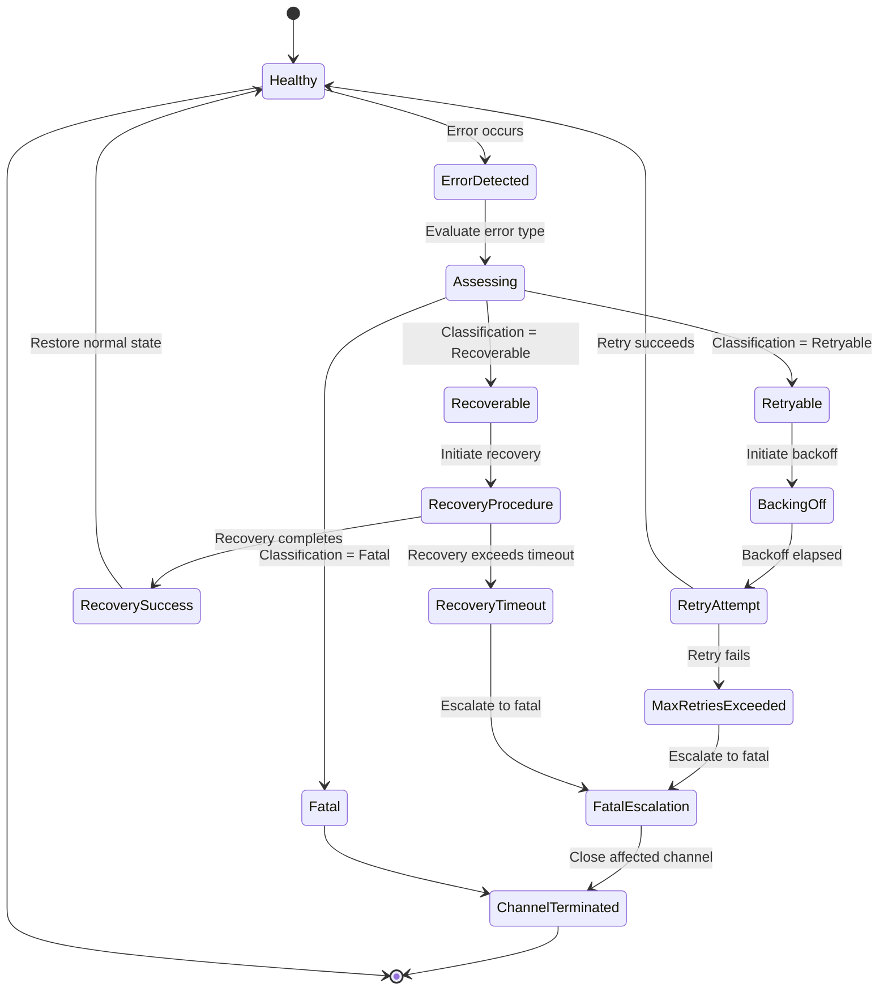
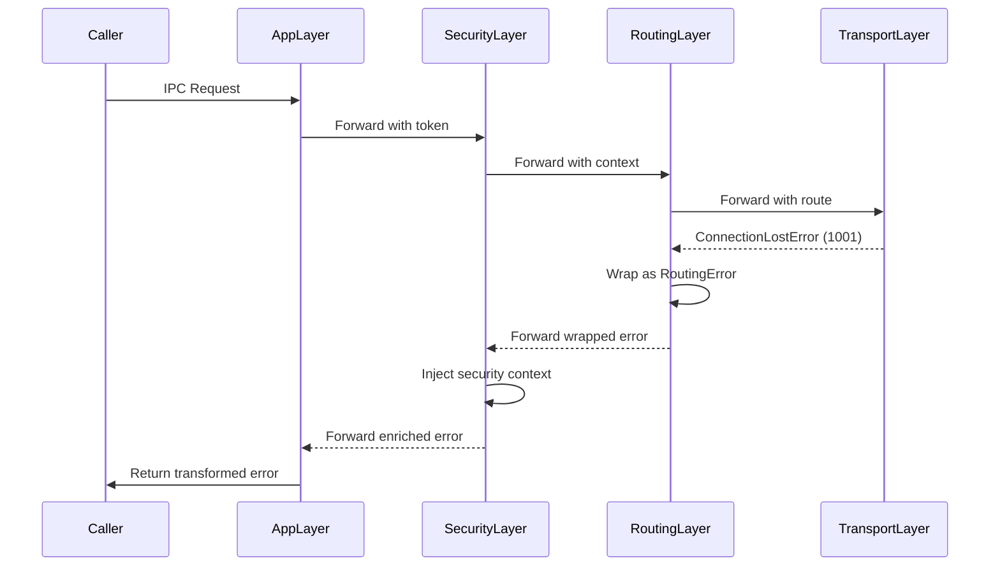

# RFC-0111: IPC Error Model

RFC: RFC-0111
Title: IPC Error Model
Status: Accepted
Version: 1.0.0
Author: Atlas Team
Reviewers: Atlas Specification Committee
Created: 2026-06-30
Last Updated: 2026-06-30
Depends On:
  - RFC-0101 IPC Overview
  - RFC-0103 Transport
  - RFC-0107 Security
Required By:
  - RFC-0108 Reliability
  - RFC-0110 Observability
Supersedes: None
Superseded By: None
Category: IPC
Layer: Error Handling
Normative: YES
Audience: Systems Engineers
ADR References:
  - ADR-0010
Constitution References:
  - Section 4.2 (Error Handling)
Related RFCs:
  - RFC-0108 Reliability
  - RFC-0110 Observability
Target Release: 1.0.0
Review Cycle: Core Architecture Board
Compatibility: Compatible with Spec 1.x
Last Updated: 2026-06-30

---

## Normative Status

## Authority

This RFC is the authoritative specification for the IPC subsystem domain defined herein.

Any implementation MUST conform to this document.

If an implementation conflicts with this RFC, this RFC takes precedence.

Conflicts between RFCs SHALL be resolved through the ADR process.

---

## Terminology

The following terms are defined with exact meanings consistent with the Atlas Master Glossary.

| Term | Definition | Source |
|---|---|---|
| IPC | Inter-Process Communication; the unified messaging fabric enabling cross-process data exchange. | Glossary |
| Channel | A bidirectional or unidirectional communication pathway between two endpoints. | Glossary |
| Transport | The underlying mechanism by which messages are delivered between processes. | Glossary |
| Correlation ID | A globally unique identifier attached to every message for end-to-end tracing. | Glossary |

---
This specification is Normative. Every Atlas IPC implementation MUST conform to the error taxonomy, error classification framework, error hierarchy, code assignments, retry and recovery procedures, and propagation rules defined herein. Any deviation MUST be approved through the formal Architecture Decision Record (ADR) process.

This specification is subordinate to the Atlas Development System (ADS) Constitution, ADR-0010, and all active ADRs.

---


## Layer Boundaries

### Responsibilities

This specification IS responsible for:

- Defining the architectural contract for this domain.
- Specifying behavioral requirements that all implementations MUST satisfy.
- Establishing extension points and their contracts.

### Non-Responsibilities

This specification IS NOT responsible for:

- Implementation details (see related RFCs for implementation guidance).
- Runtime platform specifics.
- User-facing UI behavior.

### Dependencies

| Dependency | Direction | Description |
|---|---|---|
| RFC-0001 | Consumed | Runtime Overview — foundational runtime architecture |

### Consumers

- See related RFCs for consumer listings.

### Providers

- This specification provides domain-specific contracts and behavioral models.

### Forbidden Dependencies

- This specification MUST NOT depend on any specific programming language.
- This specification MUST NOT depend on any specific storage backend.
- This specification MUST NOT depend on any specific operating system.
## Table of Contents
1. [Introduction](#1-introduction)
2. [Goals](#2-goals)
3. [Non-Goals](#3-non-goals)
4. [Error Model Overview](#4-error-model-overview)
5. [Error Hierarchy](#5-error-hierarchy)
6. [Error Categories](#6-error-categories)
7. [Error Codes](#7-error-codes)
8. [Retryable Errors](#8-retryable-errors)
9. [Fatal Errors](#9-fatal-errors)
10. [Recoverable Errors](#10-recoverable-errors)
11. [Timeout Errors](#11-timeout-errors)
12. [Authorization Errors](#12-authorization-errors)
13. [Validation Errors](#13-validation-errors)
14. [Routing Errors](#14-routing-errors)
15. [Transport Errors](#15-transport-errors)
16. [Serialization Errors](#16-serialization-errors)
17. [Standard Error Payload](#17-standard-error-payload)
18. [Error Catalog](#18-error-catalog)
19. [Error Propagation](#19-error-propagation)
20. [Error Reporting](#20-error-reporting)
21. [Glossary](#21-glossary)
22. [Acceptance Criteria](#22-acceptance-criteria)
23. [References](#23-references)
24. [Changelog](#24-changelog)
25. [Compatibility](#25-compatibility)


| RFC-0007 | Consumed | Runtime IPC Architecture |


## 2 Goals

- **Unified Taxonomy**: Every IPC error MUST be classifiable into exactly one primary category from the defined error taxonomy.
- **Hierarchical Structure**: Errors MUST follow a parent-child inheritance model where child errors inherit constraints from their parent category.
- **Deterministic Classification**: Given identical failure conditions, the error classification MUST be deterministic and reproducible.
- **Retry Semantics**: Each error MUST be deterministically classified as retryable, fatal, or recoverable, with well-defined retry conditions and backoff policies.
- **Standard Payload**: All errors MUST carry a standardized payload enabling consistent inspection, logging, and aggregation.
- **Traceability**: Every error MUST carry sufficient metadata for end-to-end tracing across all IPC hops.
- **Forward Compatibility**: New error codes MUST NOT invalidate existing error classifications or break backward compatibility with prior versions.


- RFC-0220 Plugin IPC (consumes IPC channel model)
- RFC-0327 Workflow IPC (consumes IPC routing model)


## 4 Error Model Overview

### 4.1 Unified Error Taxonomy

The Atlas IPC Error Model employs a three-dimensional classification framework:

| Dimension | Description | Values |
|---|---|---|
| **Category** | The functional area of failure | Transport, Routing, Serialization, Security, Lifecycle, Channel, Reliability |
| **Severity** | The impact level of the error | Retryable, Fatal, Recoverable, Timeout, Authorization, Validation |
| **Propagation** | How the error flows through the stack | Immediate, Forwarded, Transformed, Suppressed |

Every IPC error MUST be classifiable along all three dimensions simultaneously. An error identified as a Transport category with Fatal severity and Immediate propagation is a transport-layer failure that causes an immediate halt and does not propagate further up the stack.

### 4.2 Error Classification Framework

Errors are classified through a deterministic decision tree:

`mermaid
flowchart TD
    A[IPC Error Occurs] --> B{Is it a\nsecurity/authorization\nfailure?}
    B -->|Yes| C[Classification: Authorization\nCategory: Security]
    B -->|No| D{Is it a\nschema/type\nviolation?}
    D -->|Yes| E[Classification: Validation\nCategory: Serialization]
    D -->|No| F{Does it involve\ntime expiration?}
    F -->|Yes| G[Classification: Timeout\nCategory: Transport]
    F -->|No| H{Can it be retried?\nwithout side effects?}
    H -->|Yes| I[Classification: Retryable\nCategory: Transport/Routing]
    H -->|No| J{Is the error\nself-healing?}
    J -->|Yes| K[Classification: Recoverable\nCategory: Channel/Lifecycle]
    J -->|No| L[Classification: Fatal\nCategory: Any]
`

### 4.3 Error Classification Matrix

| Error Code Range | Category | Severity | Retryable |
|---|---|---|---|
| 1000–1999 | Transport | Retryable / Fatal | Conditional |
| 2000–2999 | Routing | Retryable / Fatal | Conditional |
| 3000–3999 | Serialization | Fatal | No |
| 4000–4999 | Security | Authorization | No |
| 5000–5999 | Lifecycle | Fatal / Recoverable | Conditional |
| 6000–6999 | Channel | Recoverable | Yes |
| 7000–7999 | Reliability | Retryable | Yes |
---

│   ├── ServiceNotReadyError
│   ├── ServiceDestroyedError
│   └── VersionMismatchError
├── ChannelError (6xxx)
│   ├── ChannelClosedError
│   ├── ChannelOverloadedError
│   └── ChannelUnreachableError
└── ReliabilityError (7xxx)
    ├── DuplicateMessageError
    ├── MessageOrderViolationError
    └── AcknowledgmentTimeoutError
```

### 5.2 Error Inheritance Rules

- **Rule 1**: Child errors MUST NOT widen the set of recoverable conditions beyond their parent category.
- **Rule 2**: Child errors MAY refine the error code range within their parent category.
- **Rule 3**: All errors MUST preserve the standard error payload defined in Section 17.
- **Rule 4**: A parent category's retry classification applies to all children unless explicitly overridden by a child-specific rule.

### 5.3 Error Hierarchy Diagram

```mermaid
classDiagram
    class IPCError {
        <<root>>
        +ErrorCode code
        +ErrorCategory category
        +ErrorSeverity severity
        +Timestamp timestamp
        +CorrelationID correlation_id
        +TraceID trace_id
        +SourceID source
        +DestinationID destination
        +string message
        +Map~string,string~ metadata
        +IsRetryable() bool
        +IsFatal() bool
        +IsRecoverable() bool
    }

    class TransportError {
        <<category>>
        +string transport_protocol
        +int retry_attempt
    }
    class RoutingError {
        <<category>>
        +string route_key
        +int hop_count
    }
    class SerializationError {
        <<category>>
        +string schema_version
        +string encoding_format
    }
    class SecurityError {
        <<category>>
        +string principal_id
        +string permission_level
    }
    class LifecycleError {
        <<category>>
        +string service_state
        +string version
    }
    class ChannelError {
        <<category>>
        +string channel_id
        +int queue_depth
    }
    class ReliabilityError {
        <<category>>
        +int sequence_number
        +bool reorder_detected
    }

    IPCError <|-- TransportError
    IPCError <|-- RoutingError
    IPCError <|-- SerializationError
    IPCError <|-- SecurityError
    IPCError <|-- LifecycleError
    IPCError <|-- ChannelError
    IPCError <|-- ReliabilityError

    class ConnectionLostError {
        +int last_known_sequence
    }
    class ConnectionRefusedError {
        +string refusal_reason
    }
    class TransportUnavailableError {
        +string unavailable_resource
    }
    class TimeoutError {
        <<abstract>>
        +duration timeout_duration
    }
    class RequestTimeoutError {
        +string pending_request_id
    }
    class ResponseTimeoutError {
        +string expected_response_type
    }
    class HeartbeatTimeoutError {
        +int missed_heartbeats
    }

    class NoRouteError {
        +string target_service
    }
    class AmbiguousRouteError {
        +int candidate_routes
    }
    class RouteExpiredError {
        +string expired_route_key
    }

    class DecodeFailureError {
        +int byte_offset
        +string decode_context
    }
    class EncodeFailureError {
        +string encode_context
    }
    class SchemaMismatchError {
        +string expected_schema
        +string actual_schema
    }

    class PermissionDeniedError {
        +string required_permission
    }
    class InsufficientPrivilegeError {
        +string granted_privilege
        +string required_privilege
    }
    class ExpiredCredentialsError {
        +Timestamp credential_expiry
    }

    class ServiceNotReadyError {
        +string required_state
    }
    class ServiceDestroyedError {
        +string destruction_reason
    }
    class VersionMismatchError {
        +string client_version
        +string server_version
    }

    class ChannelClosedError {
        +string close_reason
    }
    class ChannelOverloadedError {
        +int max_capacity
        +int current_load
    }
    class ChannelUnreachableError {
        +string unreachable_channel
    }

    class DuplicateMessageError {
        +int duplicate_sequence
    }
    class MessageOrderViolationError {
        +int expected_order
        +int actual_order
    }
    class AcknowledgmentTimeoutError {
        +string message_id
    }

    TransportError <|-- ConnectionLostError
    TransportError <|-- ConnectionRefusedError
    TransportError <|-- TransportUnavailableError
    TransportError <|-- TimeoutError
    TimeoutError <|-- RequestTimeoutError
    TimeoutError <|-- ResponseTimeoutError
    TimeoutError <|-- HeartbeatTimeoutError
    RoutingError <|-- NoRouteError
    RoutingError <|-- AmbiguousRouteError
    RoutingError <|-- RouteExpiredError
    SerializationError <|-- DecodeFailureError
    SerializationError <|-- EncodeFailureError
    SerializationError <|-- SchemaMismatchError
    SecurityError <|-- PermissionDeniedError
    SecurityError <|-- InsufficientPrivilegeError
    SecurityError <|-- ExpiredCredentialsError
    LifecycleError <|-- ServiceNotReadyError
    LifecycleError <|-- ServiceDestroyedError
    LifecycleError <|-- VersionMismatchError
    ChannelError <|-- ChannelClosedError
    ChannelError <|-- ChannelOverloadedError
    ChannelError <|-- ChannelUnreachableError
    ReliabilityError <|-- DuplicateMessageError
    ReliabilityError <|-- MessageOrderViolationError
    ReliabilityError <|-- AcknowledgmentTimeoutError

---

- Defining the requirements for this IPC subsystem component.
- Establishing the boundaries between IPC layers.


## 7 Error Codes

### 7.1 Numeric Code Assignment

Error codes are 4-digit integers assigned within category-specific ranges. The format is:

```
[Category Digit][Subcategory Digit][Sequence Digit][Variant Digit]
```

| Digit Position | Meaning | Range |
|---|---|---|
| 1st | Error category | 1-7 |
| 2nd | Sub-category or modifier | 0-9 |
| 3rd | Specific error sequence | 0-9 |
| 4th | Variant or instance | 0-9 |

### 7.2 Code Ranges Per Category

| Category | Code Range | Size | Reserved For |
|---|---|---|---|
| Transport | 1000-1999 | 1000 | Connection, timeout, and transport protocol errors |
| Routing | 2000-2999 | 1000 | Route lookup, resolution, and expiration errors |
| Serialization | 3000-3999 | 1000 | Encode, decode, and schema errors |
| Security | 4000-4999 | 1000 | Authentication, authorization, and credential errors |
| Lifecycle | 5000-5999 | 1000 | Service state and version errors |
| Channel | 6000-6999 | 1000 | Channel management errors |
| Reliability | 7000-7999 | 1000 | Duplication, ordering, and acknowledgment errors |

### 7.3 Code Format

Each error code MUST be represented as an unsigned 16-bit integer (range 0-65535). Codes outside the defined category ranges (1000-7999) are reserved for future Atlas expansion. Codes below 1000 are reserved for the IPC root error infrastructure. Codes above 7999 are reserved for non-IPC Atlas system errors.

### 7.4 Code Assignment Rules

- **Rule 1**: Once assigned, an error code MUST NOT be reused, repurposed, or reassigned to a different error type.
- **Rule 2**: New error codes MUST be assigned sequentially within their category range.
- **Rule 3**: Codes in the range 1000-7999 MUST follow the category digit convention defined in Section 7.1.
- **Rule 4**: Codes 0-999 are reserved for the IPC root error envelope and MUST NOT be used for category-specific errors.
- **Rule 5**: Codes 8000-9999 are reserved for implementation-specific extensions and MUST NOT conflict with normative codes.

---


| Error Type | Backoff Strategy | Initial Interval | Max Interval | Max Retries |
|---|---|---|---|---|
| ConnectionRefusedError | Exponential with jitter | 100 ms | 30 s | 5 |
| TransportUnavailableError | Exponential with jitter | 200 ms | 60 s | 3 |
| ChannelOverloadedError | Linear | 50 ms | 10 s | 10 |
| ServiceNotReadyError | Exponential with jitter | 500 ms | 30 s | 6 |
| AcknowledgmentTimeoutError | Exponential with jitter | 100 ms | 15 s | 4 |
| RouteExpiredError | Exponential with jitter | 250 ms | 20 s | 3 |

The backoff formula for exponential backoff with jitter is:

```
backoff = min(initial_interval * (2 ^ attempt) + random_jitter, max_interval)
```

Where `random_jitter` is a uniformly distributed random value in the range `[0, initial_interval * (2 ^ attempt) * 0.1]`.

---


Upon encountering a Fatal Error:

1. The error MUST be logged with full payload metadata.
2. The affected channel MUST be closed immediately.
3. All in-flight messages on the channel MUST be discarded or forwarded to a dead-letter store.
4. The error MUST be reported to the observability pipeline (refer to RFC-0110).
5. No automatic retry MUST be initiated.

---



---

- **Rule 2**: Timeout values MUST NOT be less than 1 ms.
- **Rule 3**: A timeout that fires MUST generate the corresponding Timeout Error with the exact elapsed duration recorded in the error metadata.
- **Rule 4**: Timeout errors are retryable unless the timeout represents a permanent unavailability condition, in which case they escalate to Fatal.

---

---

- **Rule 3**: Partially decoded payloads MUST NOT be processed; the entire message MUST be discarded.
- **Rule 4**: Validation errors MUST be reported to the observability pipeline with full schema version information.

---


## 15 Transport Errors

### 15.1 Definition

Transport Errors are errors triggered at the physical or logical transport layer, including connection establishment, maintenance, and teardown failures, as well as transport protocol unavailability.

### 15.2 Error Types

| Error Code | Name | Description |
|---|---|---|
| 1001 | ConnectionLostError | An established connection was unexpectedly terminated |
| 1002 | ConnectionRefusedError | A connection attempt was actively refused by the peer |
| 1003 | TransportUnavailableError | The transport protocol is unavailable or unreachable |

### 15.3 Transport Error Handling

| Error | Severity | Retryable | Recovery |
|---|---|---|---|
| ConnectionLostError | Retryable | Yes | Re-establish connection with backoff |
| ConnectionRefusedError | Retryable | Yes | Retry with backoff; escalate to Fatal after max retries |
| TransportUnavailableError | Retryable | Yes | Retry with backoff; escalate to Fatal after max retries |

- **Handling Rule 1**: ConnectionLostError MUST trigger an automatic reconnection attempt with exponential backoff.
- **Handling Rule 2**: ConnectionRefusedError MUST be retried up to the maximum retry count; if all retries fail, the error escalates to Fatal.
- **Handling Rule 3**: TransportUnavailableError MUST trigger a transport health check before attempting reconnection.

---


## 17 Standard Error Payload

### 17.1 Definition

Every IPC error, regardless of category or severity, MUST carry a Standard Error Payload containing the fields defined below. This ensures uniform error inspection, logging, aggregation, and debugging across all IPC layers.

### 17.2 Payload Fields

| Field | Type | Required | Description |
|---|---|---|---|
| `code` | uint16 | Yes | The numeric error code from the Error Catalog |
| `category` | enum | Yes | The error category (Transport, Routing, Serialization, Security, Lifecycle, Channel, Reliability) |
| `severity` | enum | Yes | The error severity (Retryable, Fatal, Recoverable) |
| `timestamp` | uint64 | Yes | Unix epoch timestamp in microseconds when the error occurred |
| `correlation_id` | string | Yes | The correlation ID of the IPC operation that triggered the error |
| `trace_id` | string | Yes | The trace ID for end-to-end observability |
| `source` | string | Yes | The identifier of the process/component that generated the error |
| `destination` | string | Yes | The intended target of the failed IPC operation |
| `message` | string | Yes | Human-readable error description |
| `metadata` | map<string, string> | No | Implementation-specific key-value pairs for additional context |
| `retry_count` | uint16 | Yes | Number of retry attempts made before this error was emitted |
| `max_retries` | uint16 | Yes | Maximum retry count configured for this error type |
| `parent_code` | uint16 | No | The error code of the parent category, if applicable |
| `context` | string | No | Additional operational context (e.g., operation type, channel name) |

### 17.3 Payload Constraints

- **Constraint 1**: The `code` field MUST match one of the error codes defined in the Error Catalog (Section 18).
- **Constraint 2**: The `correlation_id` and `trace_id` MUST be preserved unchanged across all IPC hops.
- **Constraint 3**: The `timestamp` MUST be in monotonic increasing order within a single process; cross-process timestamps are approximate.
- **Constraint 4**: The `metadata` map MUST NOT exceed 16 entries.
- **Constraint 5**: The `message` field MUST NOT exceed 512 characters.

### 17.4 Payload Serialization

The Standard Error Payload MUST be serializable in a format-agnostic manner. Implementations MUST support at minimum a canonical JSON representation and a binary TLV (Type-Length-Value) representation for high-throughput scenarios.

---

| IPC-2005 | Dead Letter | Routing | Error | No | 0 | The message has been moved to the dead letter queue |
| IPC-2006 | Route Stale | Routing | Warning | Yes | 3 | The route entry is outdated but not fully expired; refresh recommended |

#### Serialization Errors (IPC-3xxx)

| Error Code | Name | Category | Severity | Retryable | Max Retries | Description |
|---|---|---|---|---|---|---|
| IPC-3001 | Serialization Failed | Serialization | Error | Yes | 3 | The payload could not be encoded or decoded |
| IPC-3002 | Schema Mismatch | Serialization | Error | Yes | 3 | The message schema version is incompatible |
| IPC-3003 | Payload Too Large | Serialization | Error | No | 0 | The message payload exceeds the maximum allowed size |
| IPC-3004 | Encoding Unsupported | Serialization | Error | No | 0 | The requested encoding format is not supported |
| IPC-3005 | Fragment Lost | Serialization | Warning | Yes | 3 | A message fragment was lost during transmission |
| IPC-3006 | Reassembly Timeout | Serialization | Warning | Yes | 3 | Message reassembly exceeded the configured timeout |

#### Security Errors (IPC-4xxx)

| Error Code | Name | Category | Severity | Retryable | Max Retries | Description |
|---|---|---|---|---|---|---|
| IPC-4001 | Authentication Failed | Security | Critical | No | 0 | The process failed cryptographic authentication |
| IPC-4002 | Authorization Denied | Security | Critical | No | 0 | The process lacks required permissions for this operation |
| IPC-4003 | Token Expired | Security | Warning | Yes | 3 | The authentication token has exceeded its validity period |
| IPC-4004 | Certificate Revoked | Security | Critical | No | 0 | The authentication certificate has been revoked |
| IPC-4005 | Replay Detected | Security | Critical | No | 0 | A replay attack was detected on this connection |
| IPC-4006 | Spoofing Detected | Security | Critical | No | 0 | Source or destination spoofing was detected |
| IPC-4007 | Tampering Detected | Security | Critical | No | 0 | Message integrity verification failed |

#### Lifecycle Errors (IPC-5xxx)

| Error Code | Name | Category | Severity | Retryable | Max Retries | Description |
|---|---|---|---|---|---|---|
| IPC-5001 | Service Not Ready | Lifecycle | Warning | Yes | 6 | The target service has not reached the Ready state |
| IPC-5002 | Service Destroyed | Lifecycle | Error | No | 0 | The target service has been destroyed and cannot accept IPC |
| IPC-5003 | Version Mismatch | Lifecycle | Error | No | 0 | The client and server major versions are incompatible |
| IPC-5004 | Session Expired | Lifecycle | Warning | Yes | 3 | The IPC session has exceeded its maximum lifetime |
| IPC-5005 | Shutdown Pending | Lifecycle | Info | No | 0 | The target is undergoing shutdown; retry after completion |

#### Channel Errors (IPC-6xxx)

| Error Code | Name | Category | Severity | Retryable | Max Retries | Description |
|---|---|---|---|---|---|---|
| IPC-6001 | Channel Closed | Channel | Error | No | 0 | The target channel is not available or has been closed |
| IPC-6002 | Channel Full | Channel | Warning | Yes | 3 | The channel message queue has reached capacity |
| IPC-6003 | Channel Unreachable | Channel | Warning | Yes | 3 | The channel endpoint is unreachable and requires re-resolution |
| IPC-6004 | Channel Not Registered | Channel | Error | No | 0 | The target channel has not been registered |
| IPC-6005 | Channel Permission Violation | Channel | Critical | No | 0 | Unauthorized access attempt to a restricted channel |

#### Message Errors (IPC-7xxx)

| Error Code | Name | Category | Severity | Retryable | Max Retries | Description |
|---|---|---|---|---|---|---|
| IPC-7001 | Invalid Message Format | Message | Error | No | 0 | The message envelope does not conform to the schema |
| IPC-7002 | Message Expired | Message | Warning | No | 0 | The message TTL has elapsed before delivery |
| IPC-7003 | Duplicate Message | Message | Info | No | 0 | A duplicate message was detected and deduplicated |
| IPC-7004 | Sequence Gap Detected | Message | Warning | Yes | 3 | A gap in the message sequence was detected |
| IPC-7005 | Acknowledgment Timeout | Message | Warning | Yes | 4 | The acknowledgment for a sent message was not received within the timeout |
| IPC-7006 | Message Order Violation | Message | Error | No | 0 | Messages were received out of the expected sequence order |

### 18.2 Error Code Assignment Rules

- **Rule CAT-ASSIGN-01**: Error codes MUST follow the format IPC-XXXX where XXXX is a 4-digit number.
- **Rule CAT-ASSIGN-02**: The first digit indicates the category (1=Transport, 2=Routing, 3=Serialization, 4=Security, 5=Lifecycle, 6=Channel, 7=Message).
- **Rule CAT-ASSIGN-03**: Error codes MUST be globally unique across all IPC subsystems.
- **Rule CAT-ASSIGN-04**: Once assigned, error codes MUST NEVER be reused or reassigned.
- **Rule CAT-ASSIGN-05**: Error codes 8000-9999 are reserved for implementation-specific extensions.
- **Rule CAT-ASSIGN-06**: Error codes 0000-0999 are reserved for the IPC root error envelope.
- **Rule CAT-ASSIGN-07**: New error code assignments MUST be reviewed by the Architecture Board.
- **Rule CAT-ASSIGN-08**: Error code documentation MUST include name, category, severity, retryability, and description.

### 18.3 Error Code Usage in Messages

- **Rule CAT-USE-01**: All error responses MUST include the fixed error code in the Standard Error Payload.
- **Rule CAT-USE-02**: Error codes MUST be transmitted as strings, not integers, to preserve leading zeros.
- **Rule CAT-USE-03**: Error code fields MUST be present in every error message; omission is a protocol violation.
- **Rule CAT-USE-04**: Clients MUST compare error codes using string equality, not numeric comparison.
- **Rule CAT-USE-05**: Error code translations across languages MUST preserve the exact string value.## Layer Boundaries


## 19 Error Propagation

### 19.1 Error Forwarding Rules

Errors propagate through the IPC stack according to the following rules:

| Rule | Description |
|---|---|
| Rule 1 | Errors generated at the transport layer MUST be wrapped in a TransportError and forwarded to the routing layer |
| Rule 2 | Errors generated at the routing layer MUST be wrapped in a RoutingError and forwarded to the caller |
| Rule 3 | Errors generated at the serialization layer MUST be forwarded unchanged to the caller |
| Rule 4 | Errors generated at the security layer MUST be forwarded unchanged to the caller |
| Rule 5 | Errors generated at the channel layer MUST be wrapped in a ChannelError and forwarded to the lifecycle manager |
| Rule 6 | Errors generated at the reliability layer MUST be forwarded to both the caller and the observability pipeline |

### 19.2 Error Transformation

Error transformation occurs when an error crosses a layer boundary and must be adapted to the receiving layer's error taxonomy:



- **Transformation Rule 1**: When wrapping an error, the original error code MUST be preserved in the `parent_code` field.
- **Transformation Rule 2**: The transforming layer MUST NOT alter the `correlation_id` or `trace_id`.
- **Transformation Rule 3**: The transforming layer MAY add layer-specific metadata to the `metadata` field.
- **Transformation Rule 4**: Error severity MUST NOT be downgraded during transformation; it MAY be upgraded.

### 19.3 Error Suppression

Error suppression is the deliberate omission of an error from propagation to the caller. Suppression is permitted ONLY under the following conditions:

| Condition | Justification |
|---|---|
| HeartbeatTimeoutError | Heartbeat failures are monitored locally and do not affect data flow |
| DuplicateMessageError | Duplicates are handled idempotently; suppression prevents noise |
| RouteStaleError | Stale routes are informational; not actionable for the caller |

- **Suppression Rule 1**: Suppressed errors MUST still be logged and reported to the observability pipeline.
- **Suppression Rule 2**: Suppressed errors MUST NOT be classified as Fatal.
- **Suppression Rule 3**: The decision to suppress an error MUST be documented in the Error Catalog with the justification.

---


- **Aggregation Rule 1**: Aggregated error counts MUST NOT expose individual error payloads or sensitive metadata.
- **Aggregation Rule 2**: Aggregation windows MUST be configurable but default to 1-minute buckets.
- **Aggregation Rule 3**: Error rates exceeding defined thresholds MUST trigger alerts per RFC-0110.

### 20.3 Error Dashboards

Error dashboards MUST surface the following views:

| View | Content | Update Frequency |
|---|---|---|
| Error Rate Chart | Errors per minute by category | Real-time (1 s) |
| Top Errors | Most frequent error codes | 1-minute aggregation |
| Error Heatmap | Source-destination error pairs | 5-minute aggregation |
| Retry Statistics | Retry counts and success rates | 1-minute aggregation |
| Fatal Error Log | Chronological fatal error entries | Real-time |

### 20.4 Error Dead Letter Store

Messages that generate Fatal Errors or exhaust their retry budget MUST be forwarded to a Dead Letter Store for offline inspection. The Dead Letter Store MUST retain:

- The original message payload (if not sensitive).
- The full Standard Error Payload.
- The complete trace and correlation IDs.
- The retry history for the message.

Retention in the Dead Letter Store MUST follow a configurable policy, defaulting to 30 days.

---


---

- **Verification**: Send a corrupted payload and inspect message handling.
- **Expected Result**: The corrupted message is discarded; no partial data reaches higher layers.

### AC-1107
- **Requirement**: The Standard Error Payload MUST be serializable in both JSON and TLV formats.
- **Verification**: Serialize and deserialize error payloads in both formats and compare field integrity.
- **Expected Result**: Both formats preserve all field values identically.

### AC-1108
- **Requirement**: Retry backoff MUST use exponential backoff with jitter as defined in Section 8.4.
- **Verification**: Measure actual retry intervals for a sequence of 10 retries.
- **Expected Result**: Intervals follow the exponential formula with jitter within the specified tolerance.

### AC-1109
- **Requirement**: Correlation IDs MUST be preserved unchanged across all IPC hops.
- **Verification**: Trace a single request through 5 services and record the correlation ID at each hop.
- **Expected Result**: The correlation ID is identical at all 5 hops.

### AC-1110
- **Requirement**: Trace IDs MUST be preserved unchanged across all IPC hops.
- **Verification**: Trace a single request through 5 services and record the trace ID at each hop.
- **Expected Result**: The trace ID is identical at all 5 hops.

### AC-1111
- **Requirement**: AmbiguousRouteError (2002) MUST trigger deterministic disambiguation.
- **Verification**: Configure multiple routes to the same target and observe route selection.
- **Expected Result**: The disambiguation algorithm selects a route based on priority, latency, and load metrics consistently.

### AC-1112
- **Requirement**: ExpiredCredentialsError (4003) MUST trigger automatic credential refresh if the Security Manager supports it.
- **Verification**: Simulate credential expiration in a Security Manager with refresh capability.
- **Expected Result**: Credentials are refreshed automatically; the IPC operation proceeds without manual intervention.

### AC-1113
- **Requirement**: SchemaMismatchError (3003) MUST trigger schema negotiation when both parties support it.
- **Verification**: Send a payload with a compatible but different minor schema version.
- **Expected Result**: Schema negotiation succeeds and the payload is accepted.

### AC-1114
- **Requirement**: ServiceNotReadyError (5001) MUST be retried up to 6 times with exponential backoff.
- **Verification**: Send an IPC request to a service that is starting up.
- **Expected Result**: The system retries up to 6 times; the request succeeds once the service is Ready.

### AC-1115
- **Requirement**: ServiceDestroyedError (5002) MUST result in immediate channel closure.
- **Verification**: Destroy a service mid-communication and observe channel state.
- **Expected Result**: The channel is closed immediately; no further messages are sent.

### AC-1116
- **Requirement**: VersionMismatchError (5003) MUST be rejected when major versions differ.
- **Verification**: Connect a v1 client to a v2 server.
- **Expected Result**: The connection is rejected with VersionMismatchError.

### AC-1117
- **Requirement**: ChannelOverloadedError (6002) MUST be retryable with a maximum of 10 retries.
- **Verification**: Flood a channel beyond its capacity and observe retry behavior.
- **Expected Result**: The system retries up to 10 times with linear backoff before escalating.

### AC-1118
- **Requirement**: DuplicateMessageError (7001) MUST be suppressed from the caller but logged.
- **Verification**: Send duplicate messages and observe both caller response and log output.
- **Expected Result**: The caller receives no error; the duplicate is logged in the observability pipeline.

### AC-1119
- **Requirement**: MessageOrderViolationError (7002) MUST be classified as Recoverable.
- **Verification**: Send out-of-order messages and observe recovery behavior.
- **Expected Result**: The system reorders messages and continues normal operation.

### AC-1120
- **Requirement**: AcknowledgmentTimeoutError (7301) MUST be retryable with a maximum of 4 retries.
- **Verification**: Simulate acknowledgment loss and observe retry behavior.
- **Expected Result**: The system retries up to 4 times with exponential backoff.

### AC-1121
- **Requirement**: RequestTimeoutError (1101) MUST have a default timeout of 30 seconds.
- **Verification**: Send a request that exceeds 30 seconds without processing.
- **Expected Result**: The request times out and RequestTimeoutError is emitted.

### AC-1122
- **Requirement**: ResponseTimeoutError (1201) MUST have a default timeout of 30 seconds.
- **Verification**: Send a request that is processed but the response is delayed beyond 30 seconds.
- **Expected Result**: The response times out and ResponseTimeoutError is emitted.

### AC-1123
- **Requirement**: HeartbeatTimeoutError (1301) MUST have a default interval of 10 seconds.
- **Verification**: Stop sending heartbeats and observe timeout detection.
- **Expected Result**: HeartbeatTimeoutError is emitted after 10 seconds of missed heartbeats.

### AC-1124
- **Requirement**: All Timeout Errors MUST record the exact elapsed duration in error metadata.
- **Verification**: Trigger a timeout and inspect the error metadata for the elapsed duration.
- **Expected Result**: The metadata contains the precise elapsed duration in milliseconds.

### AC-1125
- **Requirement**: NoRouteError (2001) MUST trigger a routing table refresh.
- **Verification**: Delete all routes to a target and send a message.
- **Expected Result**: The routing table is refreshed and NoRouteError is returned.

### AC-1126
- **Requirement**: RouteExpiredError (2003) MUST trigger an immediate re-route query.
- **Verification**: Send a message with a route that expires mid-transit.
- **Expected Result**: The system queries the routing table for an updated route and retries.

### AC-1127
- **Requirement**: ConnectionRefusedError (1002) MUST be retried up to 5 times.
- **Verification**: Connect to a port where no service is listening.
- **Expected Result**: The system retries up to 5 times with exponential backoff.

### AC-1128
- **Requirement**: TransportUnavailableError (1003) MUST trigger a transport health check before retry.
- **Verification**: Disable the transport endpoint and send a message.
- **Expected Result**: A health check is performed before the first retry attempt.

### AC-1129
- **Requirement**: EncodeFailureError (3002) MUST prevent the message from entering the transport queue.
- **Verification**: Construct a payload with unsupported data types and attempt encoding.
- **Expected Result**: The message is rejected before queue insertion; EncodeFailureError is emitted.

### AC-1130
- **Requirement**: ExpiredCredentialsError (4003) MUST include the credential expiry timestamp in the error metadata.
- **Verification**: Trigger credential expiration and inspect the error payload.
- **Expected Result**: The metadata contains the exact credential expiry timestamp.

### AC-1131
- **Requirement**: The `metadata` map MUST NOT exceed 16 entries.
- **Verification**: Attempt to add 17 entries to the metadata map.
- **Expected Result**: The 17th entry is rejected; the map retains exactly 16 entries.

### AC-1132
- **Requirement**: The `message` field MUST NOT exceed 512 characters.
- **Verification**: Attempt to set the message field to 513 characters.
- **Expected Result**: The message is truncated to 512 characters or rejected.

### AC-1133
- **Requirement**: Error severity MUST NOT be downgraded during error transformation.
- **Verification**: Transform a Fatal error through multiple layers and check severity.
- **Expected Result**: The severity remains Fatal throughout all transformations.

### AC-1134
- **Requirement**: Suppressed errors MUST still be reported to the observability pipeline.
- **Verification**: Trigger a DuplicateMessageError and check both caller response and observability logs.
- **Expected Result**: The caller receives no error; the observability pipeline records the error.

### AC-1135
- **Requirement**: Dead Letter Store MUST retain failed messages for a default of 30 days.
- **Verification**: Send a message that generates a Fatal Error and check retention.
- **Expected Result**: The message and error payload are retained for 30 days.

### AC-1136
- **Requirement**: Error rate dashboards MUST update at a minimum frequency of 1 second.
- **Verification**: Generate errors at a known rate and check dashboard update latency.
- **Expected Result**: Dashboard reflects the error rate within 1 second.

### AC-1137
- **Requirement**: Aggregated error counts MUST NOT expose individual error payloads.
- **Verification**: Query the aggregation endpoint and inspect the response.
- **Expected Result**: The response contains only counts and summaries, not individual payloads.

### AC-1138
- **Requirement**: All error timestamps MUST be in UTC.
- **Verification**: Generate errors across multiple timezones and inspect timestamps.
- **Expected Result**: All timestamps are in UTC format.

### AC-1139
- **Requirement**: Error code 0-999 MUST be reserved for IPC root error envelope.
- **Verification**: Attempt to assign any code below 1000 to a category-specific error.
- **Expected Result**: The assignment is rejected by the error code registry.

### AC-1140
- **Requirement**: Error codes 8000-9999 MUST be reserved for implementation-specific extensions.
- **Verification**: Attempt to assign any code in 8000-9999 to a normative error type.
- **Expected Result**: The assignment is rejected; codes in this range are flagged as non-normative.

### AC-1141
- **Requirement**: The error hierarchy MUST enforce that child errors inherit parent category constraints.
- **Verification**: Define a child error that attempts to override a parent constraint and test enforcement.
- **Expected Result**: The child error is rejected for violating the parent constraint.

### AC-1142
- **Requirement**: Fatal errors MUST result in immediate channel closure.
- **Verification**: Trigger a Fatal error on an active channel.
- **Expected Result**: The channel is closed immediately; no further messages are transmitted.

### AC-1143
- **Requirement**: Recoverable errors MUST complete recovery within the defined recovery timeout.
- **Verification**: Trigger a recoverable error and measure recovery time.
- **Expected Result**: Recovery completes within the defined timeout; otherwise, the error escalates to Fatal.

### AC-1144
- **Requirement**: The retry backoff formula MUST include jitter with a maximum of 10% of the calculated backoff.
- **Verification**: Measure jitter values across 100 retry sequences.
- **Expected Result**: All jitter values are within 10% of the calculated exponential backoff value.

### AC-1145
- **Requirement**: Error transformation MUST preserve the original error code in the parent_code field.
- **Verification**: Transform an error through a layer boundary and inspect the parent_code field.
- **Expected Result**: The parent_code field contains the original error code.

### AC-1146
- **Requirement**: Any retryable error MAY escalate to Fatal if the retry budget is exhausted.
- **Verification**: Trigger a retryable error and allow retries to exhaust.
- **Expected Result**: After max_retries are exhausted, the error is reclassified as Fatal.

### AC-1147
- **Requirement**: The Standard Error Payload MUST support both canonical JSON and binary TLV serialization.
- **Verification**: Serialize the same error in both formats and verify field parity.
- **Expected Result**: Both formats produce semantically identical error representations.

### AC-1148
- **Requirement**: Error aggregation MUST support 1-minute bucket windows by default.
- **Verification**: Query aggregated error counts with the default window.
- **Expected Result**: Counts are aggregated in 1-minute buckets.

### AC-1149
- **Requirement**: The Error Catalog MUST document the justification for every suppressed error.
- **Verification**: Review the Error Catalog for suppressed error entries.
- **Expected Result**: Each suppressed error has a documented justification in the catalog.

### AC-1150
- **Requirement**: All normative error codes MUST be assigned sequentially within their category range.
- **Verification**: Audit the Error Catalog for sequential assignment within each category.
- **Expected Result**: All codes within each category are assigned in ascending sequential order.

### AC-1151
- **Requirement**: HeartbeatTimeoutError (1301) MUST trigger a heartbeat state re-sync upon recovery.
- **Verification**: Trigger a heartbeat timeout and observe recovery behavior.
- **Expected Result**: After recovery, the heartbeat state is re-synchronized between peers.

### AC-1152
- **Requirement**: ChannelClosedError (6001) MUST include the close reason in the error metadata.
- **Verification**: Close a channel and inspect the resulting error payload.
- **Expected Result**: The metadata contains the reason for channel closure.

### AC-1153
- **Requirement**: InsufficientPrivilegeError (4002) MUST include both granted and required privilege levels in metadata.
- **Verification**: Trigger an insufficient privilege error and inspect the payload.
- **Expected Result**: The metadata contains both the granted privilege and the required privilege.

### AC-1154
- **Requirement**: SchemaMismatchError (3003) MUST include both expected and actual schema versions in metadata.
- **Verification**: Trigger a schema mismatch error and inspect the payload.
- **Expected Result**: The metadata contains both the expected schema version and the actual schema version.

### AC-1155
- **Requirement**: The IPC Error Model MUST be implementation-independent, with zero references to specific programming languages, frameworks, libraries, or operating systems.
- **Verification**: Perform a text scan of the RFC for language-specific, framework-specific, library-specific, or OS-specific terms.
- **Expected Result**: Zero implementation-specific references are found in the normative text.

---

| RFC-0001 | Consumed | Runtime Overview |
| RFC-0007 | Consumed | Runtime IPC Architecture |


## 24 Changelog

- **1.0.0** (2026-06-30): Initial release. Defined the complete IPC Error Model including error taxonomy, hierarchy, catalog, retry and recovery procedures, propagation rules, and 55 acceptance criteria.

---


| Category | Value |
|---|---|
| Related RFC | See References section |
| Related ADR | ADR-0012 (and ADR-0010 if security-related) |
| Related JSON Schema | See References section |
| Related Catalog | See References section |

---

## Runtime Independence

This specification is completely independent of any runtime implementation platform. Specifically, this specification MUST NOT assume:

- Any programming language (Rust, Node.js, TypeScript, Go, Python, etc.)
- Any runtime environment (Electron, Tauri, Browser, Desktop, Server)
- Any storage backend (SQLite, PostgreSQL, MongoDB, Redis, etc.)
- Any operating system (Windows, Linux, macOS, etc.)
- Any hardware architecture (CPU, GPU, FPGA, etc.)
- Any threading model (single-threaded, multi-threaded, actor-based, etc.)
- Any cloud provider (AWS, Azure, GCP, etc.)
- Any container platform (Docker, containerd, etc.)

---

## Acceptance Criteria

### Architecture

| # | Criterion | Verification Method |
|---|---|---|
| AC-01 | The implementation MUST satisfy all normative requirements in this specification. | Specification conformance review |
| AC-02 | The implementation MUST NOT assume any specific runtime platform. | Platform independence audit |
| AC-03 | All cross-references to related RFCs MUST resolve to valid specifications. | Cross-reference validation |

---

## References

| Reference | Description |
|---|---|
| RFC-0001 | Runtime Overview |
| Glossary | Atlas Master Glossary |

---

## Compliance Matrix

| Category | Value |
|---|---|
| Related RFC | See References section |
| Related ADR | ADR-0012 (and ADR-0010 if security-related) |
| Related JSON Schema | See References section |
| Related Catalog | See References section |

---

## Revision History

| Version | Status | Date | Author | Notes |
|---|---|---|---|---|
| 1.0.0 | Accepted | 2026-06-30 | Atlas Team | Initial publication |
| 1.1.0 | Accepted | 2026-07-01 | Atlas Specification Committee | Added Authority, Terminology, Layer Boundaries, Runtime Independence per RFC_TEMPLATE.md |


