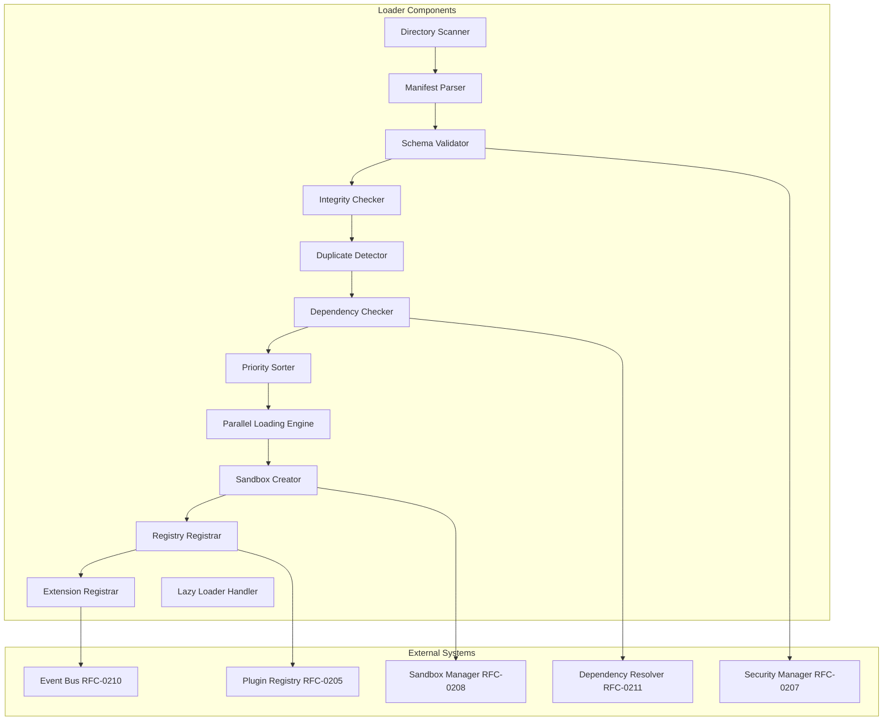

# RFC-0204: Plugin Loader

RFC: RFC-0204
Title: Plugin Loader
Status: Accepted
Version: 1.0.0
Category: Plugin
Layer: Extension
Normative: YES
Authors: Atlas Specification Committee
Created: 2026-06-30
Last Updated: 2026-06-30
Depends On:
  - RFC-0008 Runtime Plugin Host
  - RFC-0201 Plugin Overview
  - RFC-0202 Plugin Manifest
  - RFC-0203 Plugin Lifecycle
  - RFC-0205 Plugin Registry
  - RFC-0207 Plugin Security
  - RFC-0208 Plugin Sandbox
  - RFC-1005 Common Manifest Model
Related RFC:
  - RFC-0203 Plugin Lifecycle
  - RFC-0211 Plugin Dependency
Related ADR:
  - ADR-0005 Plugin Architecture
Target Release: 1.0.0
Review Cycle: Core Architecture Board
Compatibility: Compatible with Spec 1.x

---

## Normative Status

## Authority

This RFC is the authoritative specification for the plugin subsystem domain defined herein.

Any implementation MUST conform to this document.

If an implementation conflicts with this RFC, this RFC takes precedence.

Conflicts between RFCs SHALL be resolved through the ADR process.

---

## Terminology

The following terms are defined with exact meanings consistent with the Atlas Master Glossary.

| Term | Definition | Source |
|---|---|---|
| Plugin | A package containing extensions, nodes, and custom services loaded into isolated execution sandboxes. | Glossary |
| Extension Point | A predefined location in the architecture where external components MAY inject behavior. | Glossary |
| Hook | A callback registered at an extension point. | Glossary |
| Sandbox | An isolated execution process restricting OS access. | Glossary |

---

## Layer Boundaries

### Responsibilities
This specification IS responsible for: defining the architecture and requirements for this plugin subsystem component.

### Non-Responsibilities
This specification IS NOT responsible for: implementation details handled by other subsystems.

### Dependencies
| Dependency | Direction | Description |
|---|---|---|
| RFC-0201 | Consumed | Plugin Overview |

### Consumers
- RFC-0323 Workflow Plugin Integration

### Providers
- RFC-0201 Plugin Overview (provides architecture context)

### Forbidden Dependencies
- This specification MUST NOT depend on any programming language.
- This specification MUST NOT depend on any specific plugin API.

---

This specification is Normative. Every Atlas implementation MUST conform to the plugin discovery, scanning, validation, loading, isolation, registration, activation, failure recovery, duplicate detection, priority, lazy loading, parallel loading, and performance requirements defined in this document. Any deviation MUST be approved through the formal Architecture Decision Record (ADR) process.

This specification is subordinate to the Atlas Development System (ADS) Constitution, ADR-0005, and RFC-0201.

---

## Table of Contents

1. [Introduction](#1-introduction)
2. [Goals](#2-goals)
3. [Non-Goals](#3-non-goals)
4. [Loader Philosophy](#4-loader-philosophy)
5. [Ownership](#5-ownership)
6. [Boundaries](#6-boundaries)
7. [Runtime Invariants](#7-runtime-invariants)
8. [Architecture](#8-architecture)
9. [Discovery](#9-discovery)
10. [Scanning](#10-scanning)
11. [Validation](#11-validation)
12. [Loading](#12-loading)
13. [Isolation](#13-isolation)
14. [Registration](#14-registration)
15. [Activation](#15-activation)
16. [Failure Recovery](#16-failure-recovery)
17. [Duplicate Detection](#17-duplicate-detection)
18. [Priority](#18-priority)
19. [Lazy Loading](#19-lazy-loading)
20. [Parallel Loading](#20-parallel-loading)
21. [Performance Budgets](#21-performance-budgets)
22. [Glossary](#22-glossary)
23. [Acceptance Criteria](#23-acceptance-criteria)
24. [Cross References](#24-cross-references)
25. [References](#25-references)
26. [Revision History](#26-revision-history)
27. [Future Evolution](#27-future-evolution)

---

## 2 Goals

1. **Automated Discovery**: The Loader MUST automatically discover plugin packages in configured directories without manual registration.
2. **Comprehensive Scanning**: The Loader MUST scan all plugin artifacts for completeness, integrity, and conformance.
3. **Strict Validation**: Manifests MUST be validated against the schema defined in RFC-0202 before any loading proceeds.
4. **Safe Loading**: Plugins MUST be loaded into isolated execution contexts. No plugin MAY access host resources outside its sandbox.
5. **Atomic Registration**: Plugin registration with the Registry MUST be atomic. Partial registrations MUST be rolled back on failure.
6. **Graceful Activation**: Plugin activation MUST register all extension points and subscribe to event channels atomically.
7. **Failure Recovery**: Failed loading operations MUST leave the platform in a consistent state with no residual artifacts.
8. **Duplicate Prevention**: The Loader MUST detect and reject duplicate plugin installations.
9. **Priority Ordering**: Plugins with higher priority MUST be loaded before plugins with lower priority.
10. **Lazy Loading Support**: The Loader MAY defer loading of non-essential plugins until their extension points are invoked.
11. **Parallel Loading**: Independent plugins MAY be loaded in parallel to reduce total load time.
12. **Performance**: All loader operations MUST complete within the performance budgets defined in Section 21.

---

## 4 Loader Philosophy

1. **Discover-Then-Validate**: The Loader discovers all available plugins first, then validates them in sequence.
2. **Fail-Fast**: Validation failures are reported immediately. The Loader does not attempt to load plugins with invalid manifests.
3. **Isolate-Then-Activate**: Plugins are isolated in sandboxes before any activation occurs.
4. **Atomic Operations**: Every loader operation (scan, validate, load, register, activate) is atomic. Failures roll back all effects.
5. **Idempotent Discovery**: Repeated discovery operations produce the same results. No side effects occur from discovery alone.

---

## 6 Boundaries

- **Loader MAY communicate with**:
  - Plugin Registry (RFC-0205) for registration
  - Plugin Sandbox Manager (RFC-0208) for isolation
  - Plugin Security Manager (RFC-0207) for validation
  - Plugin Dependency Resolver (RFC-0211) for dependency checks
  - Event Bus (RFC-0210) for lifecycle events

- **Loader MUST NOT communicate with**:
  - Plugin extension logic directly
  - External networks without IPC mediation

---

| RFC-0201 | Consumed | Plugin Overview |

## 8 Architecture

---

| RFC-0001 | Consumed | Runtime Overview |
| RFC-0201 | Consumed | Plugin Overview |

## 10 Scanning

Scanning is the process of examining plugin package contents for completeness and structural validity.

- **Required Artifacts**: Every plugin package MUST contain a valid manifest file. Additional artifacts (binaries, data files, configuration) are optional but MUST conform to declared structure.
- **Artifact Verification**: The Loader verifies that all artifacts declared in the manifest exist in the package.
- **Directory Traversal**: The Loader traverses the plugin package directory recursively to enumerate all artifacts.
- **Size Limits**: Individual plugin packages MUST NOT exceed 500 MB. The Loader rejects packages exceeding this limit.

---

## 12 Loading

Loading is the process of preparing a plugin for execution within an isolated sandbox.

- **Sandbox Creation**: The Loader requests the Sandbox Manager to create an execution context for the plugin.
- **Resource Allocation**: The Sandbox Manager allocates memory, CPU, and GPU resources per the manifest declarations.
- **Artifact Injection**: Plugin artifacts are injected into the sandbox file system namespace.
- **Initialization**: The plugin is initialized within the sandbox. This includes loading the manifest, establishing IPC channels, and registering with the security layer.

---

| RFC-0001 | Consumed | Runtime Overview |
| RFC-0201 | Consumed | Plugin Overview |

## 14 Registration

Registration adds the plugin to the Plugin Registry.

- **Atomic Registration**: The Loader performs registration as an atomic operation. If any step fails, the entire registration is rolled back.
- **Registry Entry**: The registry entry includes the plugin ID, manifest data, current lifecycle state, resource allocations, and registration timestamp.
- **Duplicate Detection**: Before registration, the Loader checks if the plugin ID already exists in the Registry. Duplicates are rejected.

---

| RFC-0201 | Consumed | Plugin Overview |

## 16 Failure Recovery

Failed loader operations MUST be recovered according to the following procedures:

- **Schema Validation Failure**: The plugin is rejected. An error event is published. No registry entry is created.
- **Integrity Check Failure**: The plugin is rejected. An integrity failure event is published. The package is quarantined.
- **Sandbox Creation Failure**: The plugin is rejected. The sandbox is destroyed. No registry entry is created.
- **Registry Registration Failure**: The sandbox is destroyed. The plugin is rejected. A registry error event is published.
- **Extension Point Registration Failure**: The plugin is deactivated. All registered extensions are unregistered. The plugin is removed from the registry.
- **Dependency Resolution Failure**: The plugin is rejected. A dependency error event is published with the unresolved dependency details.

---

- RFC-0323 Workflow Plugin Integration

## 18 Priority

- **Priority Levels**: Plugins MAY declare a priority level from 1 (highest) to 100 (lowest). Default priority is 50.
- **Load Order**: Plugins with higher priority (lower number) are loaded before plugins with lower priority.
- **Priority Resolution**: If two plugins have the same priority, alphabetical order by plugin ID is used as a tiebreaker.
- **Priority Override**: Platform administrators MAY override plugin priorities through configuration.

---

## 20 Parallel Loading

- **Independence Check**: The Loader determines which plugins have no inter-dependencies and can be loaded in parallel.
- **Concurrency Limit**: The maximum number of parallel load operations is configurable. Default is 4.
- **Race Condition Prevention**: The Registry uses optimistic locking to prevent race conditions during parallel registration.
- **Resource Contention**: Parallel loaders share the sandbox creation pool. Resource exhaustion in one loader does not block others.

---

- Workflow execution (covered by RFC-0301).

## 22 Glossary

| Term | Definition |
|---|---|
| Discovery | The process of identifying plugin packages in configured directories. |
| Scanning | Examining plugin package contents for completeness and structural validity. |
| Validation | Verifying manifests and artifacts against schemas and security policies. |
| Loading | Preparing a plugin for execution within an isolated sandbox. |
| Isolation | Separating plugin execution from host and other plugins. |
| Registration | Adding a plugin to the Plugin Registry. |
| Activation | Registering extension points and subscribing to event channels. |
| Lazy Loading | Deferring plugin activation until extension points are invoked. |
| Parallel Loading | Loading independent plugins simultaneously. |

---

- **Expected Result**: Discovery completes within 10,000 ms total.

### Scanning

#### AC-0204-006
- **Requirement**: Scanning MUST verify all artifacts declared in the manifest exist.
- **Verification**: Remove one declared artifact and run scanning.
- **Expected Result**: The missing artifact is reported as a scan failure.

#### AC-0204-007
- **Requirement**: Scanning MUST reject packages exceeding 500 MB.
- **Verification**: Create a plugin package larger than 500 MB.
- **Expected Result**: The package is rejected during scanning.

#### AC-0204-008
- **Requirement**: Scanning MUST recursively enumerate all artifacts in a package.
- **Verification**: Create a deeply nested package structure.
- **Expected Result**: All artifacts at all nesting levels are enumerated.

### Validation

#### AC-0204-009
- **Requirement**: Manifests MUST be validated against the RFC-0202 schema.
- **Verification**: Submit a manifest with invalid fields.
- **Expected Result**: Validation fails with a schema violation error.

#### AC-0204-010
- **Requirement**: Manifest integrity hashes MUST be verified.
- **Verification**: Submit a manifest with a mismatched integrity hash.
- **Expected Result**: Validation fails with an integrity error.

#### AC-0204-011
- **Requirement**: Manifest signatures MUST be verified if present.
- **Verification**: Submit a signed manifest with an invalid signature.
- **Expected Result**: Validation fails with a signature error.

#### AC-0204-012
- **Requirement**: All declared dependencies MUST be resolvable.
- **Verification**: Declare a dependency on a non-existent plugin.
- **Expected Result**: Validation fails with a dependency resolution error.

#### AC-0204-013
- **Requirement**: All declared capabilities MUST be available.
- **Verification**: Declare a capability that is not available.
- **Expected Result**: Validation fails with a capability unavailable error.

#### AC-0204-014
- **Requirement**: All declared permissions MUST be valid PERM-* IDs.
- **Verification**: Declare a permission with an invalid ID.
- **Expected Result**: Validation fails with a permission validation error.

#### AC-0204-015
- **Requirement**: All declared plugin types MUST be valid PT-* IDs.
- **Verification**: Declare a plugin type with an invalid ID.
- **Expected Result**: Validation fails with a type validation error.

#### AC-0204-016
- **Requirement**: All declared extension points MUST be valid PEXT-* IDs.
- **Verification**: Declare an extension point with an invalid ID.
- **Expected Result**: Validation fails with an extension point validation error.

### Loading

#### AC-0204-017
- **Requirement**: The Loader MUST create a sandbox before loading a plugin.
- **Verification**: Inspect the loading sequence.
- **Expected Result**: Sandbox creation precedes plugin loading.

#### AC-0204-018
- **Requirement**: Resource allocation MUST conform to manifest declarations.
- **Verification**: Load a plugin declaring specific resource limits.
- **Expected Result**: The sandbox is allocated exactly the declared resources.

#### AC-0204-019
- **Requirement**: Artifact injection MUST place files in the sandbox namespace only.
- **Verification**: Inspect file placement after loading.
- **Expected Result**: No files are placed outside the sandbox namespace.

### Isolation

#### AC-0204-020
- **Requirement**: Each plugin MUST execute in a separate process or VM context.
- **Verification**: Inspect running processes after loading multiple plugins.
- **Expected Result**: Each plugin has its own process or VM context.

#### AC-0204-021
- **Requirement**: Plugin memory spaces MUST be separated from the host.
- **Verification**: Attempt to read host memory from within a plugin sandbox.
- **Expected Result**: Access is denied.

#### AC-0204-022
- **Requirement**: Plugin file system access MUST be restricted to the sandbox namespace.
- **Verification**: Attempt to access host file system from within a plugin.
- **Expected Result**: Access is denied.

#### AC-0204-023
- **Requirement**: Plugin network access MUST be restricted to declared endpoints.
- **Verification**: Attempt a network connection to an undeclared endpoint.
- **Expected Result**: The connection is blocked.

#### AC-0204-024
- **Requirement**: Plugin IPC MUST go through the IPC Dispatcher.
- **Verification**: Attempt direct IPC from a plugin.
- **Expected Result**: Direct IPC is blocked; only dispatcher-mediated IPC is allowed.

### Registration

#### AC-0204-025
- **Requirement**: Registration MUST be atomic.
- **Verification**: Interrupt registration mid-operation.
- **Expected Result**: No partial registry entry is left behind.

#### AC-0204-026
- **Requirement**: The registry entry MUST include plugin ID, manifest data, state, resources, and timestamp.
- **Verification**: Inspect a registry entry after registration.
- **Expected Result**: All five fields are present.

#### AC-0204-027
- **Requirement**: Duplicate plugin IDs MUST be rejected during registration.
- **Verification**: Register the same plugin ID twice.
- **Expected Result**: The second registration is rejected.

### Activation

#### AC-0204-028
- **Requirement**: Extension point registration MUST occur during activation.
- **Verification**: Inspect extension registrations after activation.
- **Expected Result**: All declared extension points are registered.

#### AC-0204-029
- **Requirement**: Event subscriptions MUST be established during activation.
- **Verification**: Inspect event subscriptions after activation.
- **Expected Result**: All declared subscriptions are active.

#### AC-0204-030
- **Requirement**: Capability binding MUST occur during activation.
- **Verification**: Inspect capability bindings after activation.
- **Expected Result**: All declared capabilities are bound to the execution context.

#### AC-0204-031
- **Requirement**: Successful activation MUST transition the plugin to the ACTIVE state.
- **Verification**: Check plugin state after activation.
- **Expected Result**: The plugin state is ACTIVE.

### Failure Recovery

#### AC-0204-032
- **Requirement**: Schema validation failures MUST reject the plugin without registry entry.
- **Verification**: Submit an invalid manifest and check the registry.
- **Expected Result**: No registry entry exists for the rejected plugin.

#### AC-0204-033
- **Requirement**: Integrity check failures MUST quarantine the package.
- **Verification**: Submit a manifest with a tampered integrity hash.
- **Expected Result**: The package is moved to a quarantine directory.

#### AC-0204-034
- **Requirement**: Sandbox creation failures MUST destroy the sandbox.
- **Verification**: Simulate a sandbox creation failure.
- **Expected Result**: No sandbox resource is leaked.

#### AC-0204-035
- **Requirement**: Registry registration failures MUST destroy the sandbox.
- **Verification**: Simulate a registry failure after sandbox creation.
- **Expected Result**: The sandbox is destroyed and no registry entry exists.

#### AC-0204-036
- **Requirement**: Extension point registration failures MUST unregister all extensions.
- **Verification**: Simulate a partial extension registration failure.
- **Expected Result**: All previously registered extensions are unregistered.

#### AC-0204-037
- **Requirement**: Dependency resolution failures MUST include unresolved dependency details in the error event.
- **Verification**: Declare an unresolvable dependency and check the error event.
- **Expected Result**: The error event includes the unresolved dependency ID.

### Duplicate Detection

#### AC-0204-038
- **Requirement**: Same plugin ID in different directories MUST be detected as a conflict.
- **Verification**: Install the same plugin ID in two directories.
- **Expected Result**: Both installations are rejected with a directory conflict error.

#### AC-0204-039
- **Requirement**: Different major versions of the same plugin ID MUST be rejected.
- **Verification**: Install v1.0.0 and v2.0.0 of the same plugin ID.
- **Expected Result**: The second installation is rejected with a version conflict error.

### Priority

#### AC-0204-040
- **Requirement**: Higher priority plugins MUST be loaded before lower priority plugins.
- **Verification**: Install two plugins with different priorities and load them.
- **Expected Result**: The higher priority plugin is loaded first.

#### AC-0204-041
- **Requirement**: Default priority MUST be 50.
- **Verification**: Install a plugin without a priority declaration.
- **Expected Result**: The plugin is assigned priority 50.

#### AC-0204-042
- **Requirement**: Equal priority plugins MUST be ordered alphabetically by ID.
- **Verification**: Install two plugins with the same priority and different IDs.
- **Expected Result**: The plugin with the earlier alphabetical ID is loaded first.

### Lazy Loading

#### AC-0204-043
- **Requirement**: Lazy-loaded plugins MUST be discovered and validated at startup.
- **Verification**: Start the platform with a lazy-loaded plugin.
- **Expected Result**: The plugin appears in the registry in the LOADED state.

#### AC-0204-044
- **Requirement**: Lazy-loaded plugins MUST NOT be activated until their extension points are invoked.
- **Verification**: Check the state of a lazy-loaded plugin without invoking its extensions.
- **Expected Result**: The plugin remains in the LOADED state.

#### AC-0204-045
- **Requirement**: Activation on demand MUST complete within 1,000 ms.
- **Verification**: Measure activation time of a lazy-loaded plugin when its extension is invoked.
- **Expected Result**: Activation completes within 1,000 ms.

#### AC-0204-046
- **Requirement**: Lazy load activation failure MUST return a capability unavailable error.
- **Verification**: Simulate a lazy load activation failure.
- **Expected Result**: The invoking subsystem receives a capability unavailable error.

### Parallel Loading

#### AC-0204-047
- **Requirement**: The Loader MUST identify independent plugins for parallel loading.
- **Verification**: Install five plugins with no inter-dependencies.
- **Expected Result**: All five are scheduled for parallel loading.

#### AC-0204-048
- **Requirement**: The maximum concurrent load operations MUST be configurable with a default of 4.
- **Verification**: Change the concurrency limit and load plugins.
- **Expected Result**: No more than the configured number of plugins load concurrently.

#### AC-0204-049
- **Requirement**: Parallel loading MUST not create race conditions in the Registry.
- **Verification**: Load ten independent plugins in parallel and check registry consistency.
- **Expected Result**: All ten plugins are registered correctly with no duplicates or missing entries.

#### AC-0204-050
- **Requirement**: Resource exhaustion in one parallel loader MUST not block others.
- **Verification**: Saturate sandbox resources with one loader and check others.
- **Expected Result**: Other loaders continue operating normally.

### Performance

#### AC-0204-051
- **Requirement**: Full plugin load MUST complete within 5,000 ms.
- **Verification**: Measure end-to-end load time for a simple plugin.
- **Expected Result**: Load completes within 5,000 ms.

#### AC-0204-052
- **Requirement**: Manifest parsing MUST complete within 50 ms.
- **Verification**: Benchmark manifest parsing.
- **Expected Result**: Parsing completes within 50 ms.

#### AC-0204-053
- **Requirement**: Schema validation MUST complete within 100 ms.
- **Verification**: Benchmark schema validation.
- **Expected Result**: Validation completes within 100 ms.

#### AC-0204-054
- **Requirement**: Dependency resolution MUST complete within 200 ms.
- **Verification**: Benchmark dependency resolution for a plugin with 10 dependencies.
- **Expected Result**: Resolution completes within 200 ms.

#### AC-0204-055
- **Requirement**: Sandbox creation MUST complete within 5,000 ms.
- **Verification**: Benchmark sandbox creation.
- **Expected Result**: Creation completes within 5,000 ms.

### Security

#### AC-0204-056
- **Requirement**: The Loader MUST verify manifest integrity before loading.
- **Verification**: Tamper with a manifest and attempt to load.
- **Expected Result**: Loading is rejected with an integrity error.

#### AC-0204-057
- **Requirement**: The Loader MUST verify manifest signatures if present.
- **Verification**: Submit a manifest with an expired signature.
- **Expected Result**: Loading is rejected with a signature verification error.

#### AC-0204-058
- **Requirement**: The Loader MUST enforce permission validation.
- **Verification**: Declare an invalid permission in a manifest.
- **Expected Result**: Validation fails with a permission error.

### Consistency

#### AC-0204-059
- **Requirement**: The Loader MUST be consistent with RFC-0203 lifecycle states.
- **Verification**: Compare loader state transitions with RFC-0203 state machine.
- **Expected Result**: All loader state transitions map to valid RFC-0203 transitions.

#### AC-0204-060
- **Requirement**: The Loader MUST be consistent with RFC-0202 manifest schema.
- **Verification**: Compare loader validation rules with RFC-0202 schema definition.
- **Expected Result**: All validation rules match the schema constraints.

#### AC-0204-061
- **Requirement**: The Loader MUST be consistent with RFC-0208 sandbox boundaries.
- **Verification**: Compare loader isolation procedures with RFC-0208 requirements.
- **Expected Result**: All isolation procedures meet RFC-0208 requirements.

#### AC-0204-062
- **Requirement**: The Loader MUST emit lifecycle events for all state transitions.
- **Verification**: Load a plugin and check event log.
- **Expected Result**: Events for DISCOVERED, VALIDATING, LOADED, INITIALIZING, ACTIVATING, and ACTIVE are all published.

#### AC-0204-063
- **Requirement**: The Loader MUST use Mermaid diagrams for architecture visualization.
- **Verification**: Inspect Section 8 for diagrams.
- **Expected Result**: A graph TD diagram is present showing all loader components and external system connections.

#### AC-0204-064
- **Requirement**: The Loader MUST define at least five loader philosophy principles.
- **Verification**: Count principles in Section 4.
- **Expected Result**: Five principles are defined.

#### AC-0204-065
- **Requirement**: The Loader MUST handle empty plugin directories gracefully.
- **Verification**: Configure a directory with no plugins.
- **Expected Result**: Discovery completes with an empty result set without errors.

#### AC-0204-066
- **Requirement**: The Loader MUST handle corrupted manifest files without crashing.
- **Verification**: Place a corrupted file where a manifest is expected.
- **Expected Result**: The file is skipped with an error log; the loader continues.

#### AC-0204-067
- **Requirement**: The Loader MUST support plugins with zero declared dependencies.
- **Verification**: Install a plugin with no dependencies.
- **Expected Result**: The plugin loads successfully without dependency resolution.

#### AC-0204-068
- **Requirement**: The Loader MUST support plugins with zero declared capabilities.
- **Verification**: Install a plugin with no capabilities.
- **Expected Result**: The plugin loads successfully without capability negotiation.

---

- Workflow execution (covered by RFC-0301).

## Acceptance Criteria

### Architecture

| # | Criterion | Verification Method |
|---|---|---|
| AC-01 | The implementation MUST satisfy all normative requirements in this specification. | Specification conformance review |
| AC-02 | The implementation MUST NOT assume any specific runtime platform. | Platform independence audit |
| AC-03 | All cross-references to related RFCs MUST resolve to valid specifications. | Cross-reference validation |

## 25 References

1. **RFC-0008**: Runtime Plugin Host
2. **RFC-0201**: Plugin Overview
3. **RFC-0202**: Plugin Manifest
4. **RFC-0203**: Plugin Lifecycle
5. **RFC-0205**: Plugin Registry
6. **RFC-0207**: Plugin Security
7. **RFC-0208**: Plugin Sandbox
8. **RFC-0211**: Plugin Dependency
9. **RFC-1005**: Common Manifest Model
10. **ADR-0005**: Plugin Architecture
11. **glossary.md**: Unified Atlas Glossary

---

This specification IS NOT responsible for:
- Runtime core lifecycle (covered by RFC-0002).
- Workflow execution (covered by RFC-0301).

## 27 Future Evolution

- **Incremental Loading**: Future versions MAY define incremental loading allowing plugins to load only the components they need at a given time.
- **Hot Reload**: Future versions MAY define hot-reload capabilities allowing plugin binary replacement without state loss.
- **Plugin Profiling**: Future versions MAY define profiling hooks for measuring plugin resource usage during loading.
- **Plugin Dependency Graph Visualization**: Future versions MAY define standardized dependency graph visualization for operator dashboards.

---

## Runtime Independence

This specification is completely independent of any runtime implementation platform. Specifically, this specification MUST NOT assume:

- Any programming language (Rust, Node.js, TypeScript, Go, Python, etc.)
- Any runtime environment (Electron, Tauri, Browser, Desktop, Server)
- Any storage backend (SQLite, PostgreSQL, MongoDB, Redis, etc.)
- Any operating system (Windows, Linux, macOS, etc.)
- Any hardware architecture (CPU, GPU, FPGA, etc.)
- Any threading model (single-threaded, multi-threaded, actor-based, etc.)
- Any cloud provider (AWS, Azure, GCP, etc.)
- Any container platform (Docker, containerd, etc.)

All plugin contracts are defined as abstract behavioral interfaces.

---

---

## Compliance Matrix

| Category | Value |
|---|---|
| Related RFC | See References section |
| Related ADR | ADR-0012 (and ADR-0010 if security-related) |
| Related JSON Schema | See References section |
| Related Catalog | See References section |

---

## Revision History

| Version | Status | Date | Author | Notes |
|---|---|---|---|---|
| 1.0.0 | Proposed | 2026-07-01 | Atlas Specification Committee | Initial publication |