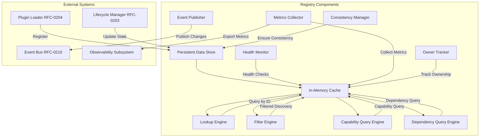

# RFC-0205: Plugin Registry

RFC: RFC-0205
Title: Plugin Registry
Status: Accepted
Version: 1.0.0
Category: Plugin
Layer: Extension
Normative: YES
Authors: Atlas Specification Committee
Created: 2026-06-30
Last Updated: 2026-06-30
Depends On:
  - RFC-0003 Runtime Service Model
  - RFC-0006 Runtime State Management
  - RFC-0201 Plugin Overview
  - RFC-0203 Plugin Lifecycle
  - RFC-0204 Plugin Loader
  - RFC-0206 Plugin Capability
  - RFC-0210 Plugin Events
  - RFC-1003 Common Capability Model
  - RFC-1005 Common Manifest Model
Related RFC:
  - RFC-0211 Plugin Dependency
  - RFC-0210 Plugin Events
Related ADR:
  - ADR-0012 Contract-First Specification
Target Release: 1.0.0
Review Cycle: Core Architecture Board
Compatibility: Compatible with Spec 1.x

---

## Normative Status

## Authority

This RFC is the authoritative specification for the plugin subsystem domain defined herein.

Any implementation MUST conform to this document.

If an implementation conflicts with this RFC, this RFC takes precedence.

Conflicts between RFCs SHALL be resolved through the ADR process.

---

## Terminology

The following terms are defined with exact meanings consistent with the Atlas Master Glossary.

| Term | Definition | Source |
|---|---|---|
| Plugin | A package containing extensions, nodes, and custom services loaded into isolated execution sandboxes. | Glossary |
| Extension Point | A predefined location in the architecture where external components MAY inject behavior. | Glossary |
| Hook | A callback registered at an extension point. | Glossary |
| Sandbox | An isolated execution process restricting OS access. | Glossary |

---

## Layer Boundaries

### Responsibilities
This specification IS responsible for: defining the architecture and requirements for this plugin subsystem component.

### Non-Responsibilities
This specification IS NOT responsible for: implementation details handled by other subsystems.

### Dependencies
| Dependency | Direction | Description |
|---|---|---|
| RFC-0201 | Consumed | Plugin Overview |

### Consumers
- RFC-0323 Workflow Plugin Integration

### Providers
- RFC-0201 Plugin Overview (provides architecture context)

### Forbidden Dependencies
- This specification MUST NOT depend on any programming language.
- This specification MUST NOT depend on any specific plugin API.

---

This specification is Normative. Every Atlas implementation MUST conform to the plugin registry architecture, registration, lookup, discovery, filtering, capability query, dependency query, health monitoring, ownership tracking, metrics collection, and consistency requirements defined in this document. Any deviation MUST be approved through the formal Architecture Decision Record (ADR) process.

This specification is subordinate to the Atlas Development System (ADS) Constitution, ADR-0012, and RFC-0201.

---

## Table of Contents

1. [Introduction](#1-introduction)
2. [Goals](#2-goals)
3. [Non-Goals](#3-non-goals)
4. [Registry Philosophy](#4-registry-philosophy)
5. [Ownership](#5-ownership)
6. [Boundaries](#6-boundaries)
7. [Runtime Invariants](#7-runtime-invariants)
8. [Architecture](#8-architecture)
9. [Registry Data Model](#9-registry-data-model)
10. [Registration](#10-registration)
11. [Lookup](#11-lookup)
12. [Discovery](#12-discovery)
13. [Filtering](#13-filtering)
14. [Capability Query](#14-capability-query)
15. [Dependency Query](#15-dependency-query)
16. [Health Monitoring](#16-health-monitoring)
17. [Ownership Tracking](#17-ownership-tracking)
18. [Metrics Collection](#18-metrics-collection)
19. [Registry Consistency](#19-registry-consistency)
20. [Performance Budgets](#20-performance-budgets)
21. [Glossary](#21-glossary)
22. [Acceptance Criteria](#22-acceptance-criteria)
23. [Cross References](#23-cross-references)
24. [References](#24-references)
25. [Revision History](#25-revision-history)
26. [Future Evolution](#26-future-evolution)

---

## 2 Goals

1. **Authoritative Store**: The Registry MUST be the single source of truth for all plugin metadata and state.
2. **Fast Lookup**: Plugin lookup by ID MUST complete within 0.01 ms.
3. **Filtered Discovery**: Plugins MUST be discoverable through multiple filter criteria (type, capability, state, trust level).
4. **Capability Queries**: The Registry MUST support querying which plugins provide or require specific capabilities.
5. **Dependency Queries**: The Registry MUST support querying dependency relationships between plugins.
6. **Health Monitoring**: The Registry MUST track and expose plugin health status.
7. **Ownership Tracking**: The Registry MUST track plugin ownership for access control and auditing.
8. **Metrics Collection**: The Registry MUST collect and expose plugin lifecycle and operational metrics.
9. **Consistency**: The Registry MUST maintain data consistency under concurrent access.
10. **Persistence**: Registry data MUST survive platform restarts.

---

- RFC-0323 Workflow Plugin Integration

## 4 Registry Philosophy

1. **Single Source of Truth**: The Registry is the authoritative source for plugin metadata. All other subsystems query the Registry for plugin information.
2. **Immutable Metadata**: Plugin metadata is immutable once registered. Changes require unregistration and re-registration.
3. **Atomic Operations**: All registry operations are atomic. Partial operations are rolled back.
4. **Event-Driven Updates**: Registry changes produce events on the Event Bus.
5. **Consistent Reads**: All reads return consistent data. Stale reads are not permitted.

---

| Dependency | Direction | Description |
|---|---|---|
| RFC-0001 | Consumed | Runtime Overview |
| RFC-0201 | Consumed | Plugin Overview |

## 6 Boundaries

- **Registry MAY communicate with**:
  - Plugin Loader (RFC-0204) for registration
  - Plugin Lifecycle Manager (RFC-0203) for state updates
  - Plugin Capability Manager (RFC-0206) for capability queries
  - Plugin Dependency Resolver (RFC-0211) for dependency queries
  - Event Bus (RFC-0210) for change events
  - Observability subsystem for metrics

- **Registry MUST NOT communicate with**:
  - Plugin extension logic
  - External networks directly
  - User-facing interfaces directly

---

| RFC-0201 | Consumed | Plugin Overview |

## 8 Architecture

---

| RFC-0001 | Consumed | Runtime Overview |
| RFC-0201 | Consumed | Plugin Overview |

## 11 Lookup

Lookup retrieves a plugin entry by identifier.

- **By ID**: The primary lookup method. Returns the full entry or a not-found response.
- **By Name**: Lookup by plugin name returns all matching entries.
- **By Type**: Lookup by plugin type returns all plugins of that type.
- **By State**: Lookup by lifecycle state returns all plugins in that state.
- **Cache First**: Lookups check the in-memory cache first. Cache misses trigger a data store read.

---

| RFC-0201 | Consumed | Plugin Overview |

## 13 Filtering

Filtering narrows discovery results.

- **Type Filter**: Filter by plugin type (PT-*).
- **State Filter**: Filter by lifecycle state (PSTATE-*).
- **Trust Level Filter**: Filter by trust level (TRUST-LEVEL-*).
- **Capability Filter**: Filter by required or provided capabilities (CAP-*).
- **Dependency Filter**: Filter by declared dependencies.
- **Owner Filter**: Filter by plugin owner.
- **Name Filter**: Filter by plugin name substring match.

---

| RFC-0201 | Consumed | Plugin Overview |

## 15 Dependency Query

Dependency query finds plugins by dependency relationships.

- **Direct Dependencies**: Find all plugins directly depended upon by a given plugin.
- **Transitive Dependencies**: Find all plugins transitively depended upon.
- **Reverse Dependencies**: Find all plugins that depend on a given plugin.
- **Circular Dependency Detection**: Detect circular dependencies in the dependency graph.
- **Load Order**: Compute the deterministic load order based on dependency resolution.

---

| RFC-0201 | Consumed | Plugin Overview |

## 17 Ownership Tracking

Ownership tracking records and enforces plugin ownership.

- **Owner Assignment**: Each plugin has exactly one owner.
- **Owner Types**: Owners may be individual users, teams, or organizational units.
- **Ownership Transfer**: Ownership MAY be transferred through administrative operation.
- **Access Control**: Ownership determines who may modify or remove plugin entries.

---

| RFC-0001 | Consumed | Runtime Overview |
| RFC-0201 | Consumed | Plugin Overview |

## 19 Registry Consistency

Registry consistency ensures data integrity.

- **Atomic Writes**: All writes are atomic. Partial writes are rolled back.
- **Optimistic Locking**: Concurrent updates use optimistic locking with version numbers.
- **Conflict Resolution**: Conflicting updates are resolved by timestamp. Latest update wins.
- **Data Integrity Checks**: Periodic integrity checks verify registry consistency.
- **Recovery**: On inconsistency detection, the Registry rebuilds from the persisted data store.

---

## 21 Glossary

| Term | Definition |
|---|---|
| Registry Entry | A data record representing a registered plugin. |
| Lookup | Retrieving a registry entry by identifier. |
| Discovery | Enumerating registry entries matching filter criteria. |
| Capability Query | Finding plugins by capability relationships. |
| Dependency Query | Finding plugins by dependency relationships. |
| Health Status | Current operational health of a registered plugin. |
| Owner | The entity responsible for a registered plugin. |
| Metrics | Operational data collected from registered plugins. |
| Consistency | Guarantee that registry data is accurate and coherent. |

---

- **Expected Result**: The registration is rejected with a trust level validation error.

### Registration

#### AC-0205-006
- **Requirement**: Registration MUST be an atomic operation.
- **Verification**: Interrupt registration mid-write.
- **Expected Result**: No partial entry exists in the registry.

#### AC-0205-007
- **Requirement**: Duplicate plugin IDs MUST be rejected during registration.
- **Verification**: Register the same plugin ID twice.
- **Expected Result**: The second registration is rejected.

#### AC-0205-008
- **Requirement**: A PEVT-REGISTRY-REGISTERED event MUST be published on successful registration.
- **Verification**: Register a plugin and check the event log.
- **Expected Result**: The PEVT-REGISTRY-REGISTERED event is published.

#### AC-0205-009
- **Requirement**: The in-memory cache MUST be updated on registration.
- **Verification**: Register a plugin and immediately look it up.
- **Expected Result**: The lookup returns the newly registered entry.

#### AC-0205-010
- **Requirement**: Registration MUST complete within 10 ms.
- **Verification**: Benchmark registration operations.
- **Expected Result**: Registration completes within 10 ms.

### Lookup

#### AC-0205-011
- **Requirement**: Lookup by plugin ID MUST return the correct entry.
- **Verification**: Register a plugin and look it up by ID.
- **Expected Result**: The correct entry is returned.

#### AC-0205-012
- **Requirement**: Lookup by plugin ID MUST complete within 0.01 ms (cache hit).
- **Verification**: Benchmark lookup operations with cached entries.
- **Expected Result**: Lookup completes within 0.01 ms.

#### AC-0205-013
- **Requirement**: Lookup by plugin ID MUST return not-found for non-existent IDs.
- **Verification**: Look up a non-existent plugin ID.
- **Expected Result**: A not-found response is returned.

#### AC-0205-014
- **Requirement**: Lookup by name MUST return all matching entries.
- **Verification**: Register multiple plugins with similar names and look up by name.
- **Expected Result**: All matching entries are returned.

#### AC-0205-015
- **Requirement**: Lookup by state MUST return all plugins in that state.
- **Verification**: Register plugins in different states and look up by state.
- **Expected Result**: Only plugins in the requested state are returned.

### Discovery

#### AC-0205-016
- **Requirement**: Discovery MUST support filtering by type, state, trust level, capability, dependency, owner, and priority.
- **Verification**: Run discovery with each filter type.
- **Expected Result**: Results are correctly filtered for each type.

#### AC-0205-017
- **Requirement**: Combined filters MUST use AND logic.
- **Verification**: Apply two filters simultaneously.
- **Expected Result**: Only entries matching both filters are returned.

#### AC-0205-018
- **Requirement**: Discovery results MAY be paginated.
- **Verification**: Request discovery results with pagination parameters.
- **Expected Result**: Results are returned in pages.

#### AC-0205-019
- **Requirement**: Discovery results MAY be sorted by registration date, priority, or name.
- **Verification**: Request sorted discovery results.
- **Expected Result**: Results are returned in the requested sort order.

#### AC-0205-020
- **Requirement**: Discovery MUST complete within 50 ms for filtered enumeration.
- **Verification**: Benchmark filtered discovery with 1000 plugins.
- **Expected Result**: Discovery completes within 50 ms.

### Capability Query

#### AC-0205-021
- **Requirement**: Capability query MUST find all plugins providing a specific capability.
- **Verification**: Register plugins with different capabilities and query by capability.
- **Expected Result**: All providers of the queried capability are returned.

#### AC-0205-022
- **Requirement**: Capability query MUST find all plugins requiring a specific capability.
- **Verification**: Register plugins requiring different capabilities and query by capability.
- **Expected Result**: All consumers of the queried capability are returned.

#### AC-0205-023
- **Requirement**: Capability query MUST complete within 5 ms.
- **Verification**: Benchmark capability queries.
- **Expected Result**: Queries complete within 5 ms.

#### AC-0205-024
- **Requirement**: Missing capability checks MUST return accurate results.
- **Verification**: Check for a capability not provided by any registered plugin.
- **Expected Result**: The check returns that the capability is unavailable.

### Dependency Query

#### AC-0205-025
- **Requirement**: Direct dependency queries MUST return all directly depended-upon plugins.
- **Verification**: Register a plugin with declared dependencies and query direct dependencies.
- **Expected Result**: All direct dependencies are returned.

#### AC-0205-026
- **Requirement**: Transitive dependency queries MUST return all transitively depended-upon plugins.
- **Verification**: Register a chain of three dependent plugins and query transitive dependencies.
- **Expected Result**: All three plugins in the chain are returned.

#### AC-0205-027
- **Requirement**: Reverse dependency queries MUST find all plugins depending on a given plugin.
- **Verification**: Register dependent plugins and query reverse dependencies.
- **Expected Result**: All dependents are returned.

#### AC-0205-028
- **Requirement**: Circular dependency detection MUST identify all cycles in the dependency graph.
- **Verification**: Create a circular dependency and run detection.
- **Expected Result**: The cycle is detected and reported.

#### AC-0205-029
- **Requirement**: Load order computation MUST produce a deterministic order.
- **Verification**: Compute load order multiple times for the same dependency graph.
- **Expected Result**: The same order is produced every time.

#### AC-0205-030
- **Requirement**: Dependency queries MUST complete within 10 ms.
- **Verification**: Benchmark dependency queries.
- **Expected Result**: Queries complete within 10 ms.

### Health Monitoring

#### AC-0205-031
- **Requirement**: Health status MUST be one of: HEALTHY, DEGRADED, UNHEALTHY, UNKNOWN.
- **Verification**: Inspect health status values in registry entries.
- **Expected Result**: All values are from the defined set.

#### AC-0205-032
- **Requirement**: Health check interval MUST be configurable with a default of 30 seconds.
- **Verification**: Change the health check interval and verify.
- **Expected Result**: The interval is updated and new checks occur at the new interval.

#### AC-0205-033
- **Requirement**: Health status changes MUST produce PEVT-HEALTH-* events.
- **Verification**: Change a plugin health status and check the event log.
- **Expected Result**: The corresponding PEVT-HEALTH-* event is published.

#### AC-0205-034
- **Requirement**: The Registry MUST track the duration of degraded states.
- **Verification**: Set a plugin to DEGRADED and measure tracking.
- **Expected Result**: Duration is accurately tracked.

### Ownership Tracking

#### AC-0205-035
- **Requirement**: Each plugin MUST have exactly one owner.
- **Verification**: Inspect registry entries for ownership.
- **Expected Result**: All entries have exactly one owner.

#### AC-0205-036
- **Requirement**: Ownership transfer MUST be an administrative operation.
- **Verification**: Attempt an ownership transfer without administrative privileges.
- **Expected Result**: The transfer is rejected.

### Metrics Collection

#### AC-0205-037
- **Requirement**: The Registry MUST collect lifecycle metrics for each plugin.
- **Verification**: Load and monitor a plugin.
- **Expected Result**: Time-in-state metrics are collected.

#### AC-0205-038
- **Requirement**: The Registry MUST collect resource metrics for each plugin.
- **Verification**: Load a plugin and check resource metrics.
- **Expected Result**: CPU, memory, and GPU usage metrics are collected.

#### AC-0205-039
- **Requirement**: The Registry MUST collect error metrics for each plugin.
- **Verification**: Trigger errors in a plugin and check metrics.
- **Expected Result**: Error count and types are tracked.

#### AC-0205-040
- **Requirement**: Metrics MUST be exported to the observability subsystem.
- **Verification**: Collect metrics and check observability export.
- **Expected Result**: Metrics are exported within 5 ms.

### Registry Consistency

#### AC-0205-041
- **Requirement**: All registry writes MUST be atomic.
- **Verification**: Interrupt a write mid-operation.
- **Expected Result**: No partial write is persisted.

#### AC-0205-042
- **Requirement**: Concurrent updates MUST use optimistic locking.
- **Verification**: Simulate concurrent updates to the same entry.
- **Expected Result**: The last update by timestamp wins; earlier updates are rejected.

#### AC-0205-043
- **Requirement**: Periodic integrity checks MUST verify registry consistency.
- **Verification**: Run an integrity check on a consistent registry.
- **Expected Result**: The check reports consistency.

#### AC-0205-044
- **Requirement**: On inconsistency detection, the Registry MUST rebuild from the persisted data store.
- **Verification**: Corrupt the in-memory cache and trigger rebuild.
- **Expected Result**: The cache is rebuilt correctly from the data store.

### Architecture

#### AC-0205-045
- **Requirement**: The Registry architecture MUST be illustrated with a Mermaid graph TD diagram.
- **Verification**: Inspect Section 8.
- **Expected Result**: A graph TD diagram is present showing all components and connections.

#### AC-0205-046
- **Requirement**: The Registry MUST define at least six runtime invariants.
- **Verification**: Count invariant entries in Section 7.
- **Expected Result**: Six invariants (INV-REG-01 through INV-REG-06) are defined.

#### AC-0205-047
- **Requirement**: The Registry MUST define at least eight goals.
- **Verification**: Count goal entries in Section 2.
- **Expected Result**: Ten goals are defined.

#### AC-0205-048
- **Requirement**: The Registry data model MUST define seventeen fields.
- **Verification**: Count fields in the data model table in Section 9.
- **Expected Result**: All seventeen fields are defined.

#### AC-0205-049
- **Requirement**: The Registry MUST be consistent with RFC-0201 architecture.
- **Verification**: Compare registry component definitions between RFC-0201 and RFC-0205.
- **Expected Result**: All components match.

#### AC-0205-050
- **Requirement**: The Registry MUST be consistent with RFC-0203 lifecycle states.
- **Verification**: Compare state values between RFC-0203 and RFC-0205.
- **Expected Result**: All state values reference PSTATE-* IDs.

### Performance

#### AC-0205-051
- **Requirement**: Registry lookup MUST complete within 0.01 ms for cache hits.
- **Verification**: Benchmark lookups.
- **Expected Result**: Lookups complete within 0.01 ms.

#### AC-0205-052
- **Requirement**: Registry lookup MUST complete within 0.1 ms for cache misses.
- **Verification**: Benchmark lookups with cache eviction.
- **Expected Result**: Lookups complete within 0.1 ms.

#### AC-0205-053
- **Requirement**: Registry registration MUST complete within 10 ms.
- **Verification**: Benchmark registration.
- **Expected Result**: Registration completes within 10 ms.

#### AC-0205-054
- **Requirement**: Capability queries MUST complete within 5 ms.
- **Verification**: Benchmark capability queries.
- **Expected Result**: Queries complete within 5 ms.

#### AC-0205-055
- **Requirement**: Dependency queries MUST complete within 10 ms.
- **Verification**: Benchmark dependency queries.
- **Expected Result**: Queries complete within 10 ms.

### Security

#### AC-0205-056
- **Requirement**: The Registry MUST enforce ownership-based access control.
- **Verification**: Attempt to modify an entry owned by another user.
- **Expected Result**: The modification is rejected.

#### AC-0205-057
- **Requirement**: Registry data MUST be persisted securely.
- **Verification**: Inspect data persistence mechanisms.
- **Expected Result**: Data is persisted with integrity protection.

### Edge Cases

#### AC-0205-058
- **Requirement**: The Registry MUST handle zero-plugin registries gracefully.
- **Verification**: Start with an empty registry and run discovery.
- **Expected Result**: Discovery returns an empty result set.

#### AC-0205-059
- **Requirement**: The Registry MUST handle plugin removal (unregistration) cleanly.
- **Verification**: Unregister a plugin and check registry state.
- **Expected Result**: The entry is removed; no orphaned data remains.

#### AC-0205-060
- **Requirement**: The Registry MUST handle concurrent read and write operations.
- **Verification**: Perform reads and writes concurrently.
- **Expected Result**: Reads return consistent data; writes are serialized.

#### AC-0205-061
- **Requirement**: The Registry MUST support plugins with zero dependencies.
- **Verification**: Register a plugin with no dependencies and query dependencies.
- **Expected Result**: An empty dependency list is returned.

#### AC-0205-062
- **Requirement**: The Registry MUST support plugins with zero capabilities.
- **Verification**: Register a plugin with no capabilities and query capabilities.
- **Expected Result**: Empty capability lists are returned for both providers and consumers.

#### AC-0205-063
- **Requirement**: The Registry MUST handle plugins with identical names.
- **Verification**: Register two plugins with the same name but different IDs.
- **Expected Result**: Both are registered; lookup by name returns both.

#### AC-0205-064
- **Requirement**: The Registry MUST handle plugins with identical types.
- **Verification**: Register multiple plugins of the same type and filter by type.
- **Expected Result**: All plugins of that type are returned.

#### AC-0205-065
- **Requirement**: The Registry MUST produce a Mermaid diagram for architecture visualization.
- **Verification**: Inspect Section 8.
- **Expected Result**: A graph TD diagram is present showing all components and connections.

---

## Acceptance Criteria

### Architecture

| # | Criterion | Verification Method |
|---|---|---|
| AC-01 | The implementation MUST satisfy all normative requirements in this specification. | Specification conformance review |
| AC-02 | The implementation MUST NOT assume any specific runtime platform. | Platform independence audit |
| AC-03 | All cross-references to related RFCs MUST resolve to valid specifications. | Cross-reference validation |

## 24 References

1. **RFC-0003**: Runtime Service Model
2. **RFC-0006**: Runtime State Management
3. **RFC-0201**: Plugin Overview
4. **RFC-0203**: Plugin Lifecycle
5. **RFC-0204**: Plugin Loader
6. **RFC-0206**: Plugin Capability
7. **RFC-0210**: Plugin Events
8. **RFC-0211**: Plugin Dependency
9. **RFC-1003**: Common Capability Model
10. **RFC-1005**: Common Manifest Model
11. **ADR-0012**: Contract-First Specification
12. **glossary.md**: Unified Atlas Glossary

---

This specification IS NOT responsible for:
- Runtime core lifecycle (covered by RFC-0002).
- Workflow execution (covered by RFC-0301).

## 26 Future Evolution

- **Distributed Registry**: Future versions MAY define a distributed registry for multi-instance Atlas deployments.
- **Registry Backup and Restore**: Future versions MAY define standardized backup and restore procedures.
- **Registry API Gateway**: Future versions MAY define a standardized REST or GraphQL API gateway for external registry access.
- **Registry Analytics**: Future versions MAY define advanced analytics for plugin ecosystem health.

---

## Runtime Independence

This specification is completely independent of any runtime implementation platform. Specifically, this specification MUST NOT assume:

- Any programming language (Rust, Node.js, TypeScript, Go, Python, etc.)
- Any runtime environment (Electron, Tauri, Browser, Desktop, Server)
- Any storage backend (SQLite, PostgreSQL, MongoDB, Redis, etc.)
- Any operating system (Windows, Linux, macOS, etc.)
- Any hardware architecture (CPU, GPU, FPGA, etc.)
- Any threading model (single-threaded, multi-threaded, actor-based, etc.)
- Any cloud provider (AWS, Azure, GCP, etc.)
- Any container platform (Docker, containerd, etc.)

All plugin contracts are defined as abstract behavioral interfaces.

---

---

## Compliance Matrix

| Category | Value |
|---|---|
| Related RFC | See References section |
| Related ADR | ADR-0012 (and ADR-0010 if security-related) |
| Related JSON Schema | See References section |
| Related Catalog | See References section |

---

## Revision History

| Version | Status | Date | Author | Notes |
|---|---|---|---|---|
| 1.0.0 | Proposed | 2026-07-01 | Atlas Specification Committee | Initial publication |