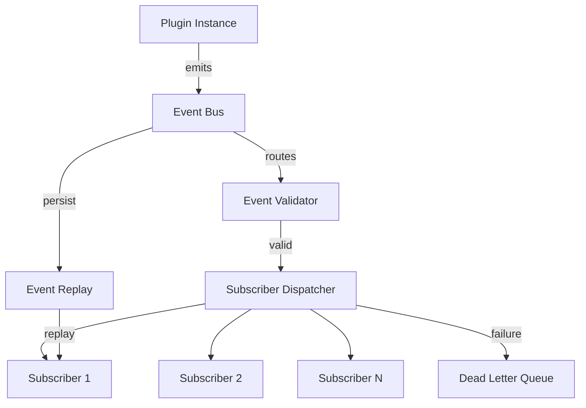

# RFC-0210: Plugin Events

RFC: RFC-0210
Title: Plugin Events
Status: Accepted
Version: 1.0.0
Category: Plugin
Layer: Extension
Normative: YES
Authors: Atlas Specification Committee
Created: 2026-06-30
Last Updated: 2026-07-01
Depends On:
  - RFC-0005 Runtime Event Bus
  - RFC-1001 Common Event Model
  - RFC-0201 Plugin Overview
Related RFC:
  - RFC-0203 Plugin Lifecycle
  - RFC-0207 Plugin Security
  - RFC-0208 Plugin Sandbox
Related ADR:
  - ADR-0010 Event-Driven Architecture
Target Release: 1.0.0
Review Cycle: Core Architecture Board
Compatibility: Compatible with Spec 1.x

---

## Normative Status

## Authority

This RFC is the authoritative specification for the plugin subsystem domain defined herein.

Any implementation MUST conform to this document.

If an implementation conflicts with this RFC, this RFC takes precedence.

Conflicts between RFCs SHALL be resolved through the ADR process.

---

## Terminology

The following terms are defined with exact meanings consistent with the Atlas Master Glossary.

| Term | Definition | Source |
|---|---|---|
| Plugin | A package containing extensions, nodes, and custom services loaded into isolated execution sandboxes. | Glossary |
| Extension Point | A predefined location in the architecture where external components MAY inject behavior. | Glossary |
| Hook | A callback registered at an extension point. | Glossary |
| Sandbox | An isolated execution process restricting OS access. | Glossary |

---

## Layer Boundaries

### Responsibilities
This specification IS responsible for: defining the architecture and requirements for this plugin subsystem component.

### Non-Responsibilities
This specification IS NOT responsible for: implementation details handled by other subsystems.

### Dependencies
| Dependency | Direction | Description |
|---|---|---|
| RFC-0201 | Consumed | Plugin Overview |

### Consumers
- RFC-0323 Workflow Plugin Integration

### Providers
- RFC-0201 Plugin Overview (provides architecture context)

### Forbidden Dependencies
- This specification MUST NOT depend on any programming language.
- This specification MUST NOT depend on any specific plugin API.

---

This specification is Normative. Every Atlas implementation MUST conform to the plugin event catalog, lifecycle events, capability events, registry events, error events, health events, update events, audit events, event ordering, event IDs, event payloads, and delivery guarantees defined in this document. Any deviation MUST be approved through the formal Architecture Decision Record (ADR) process.

This specification is subordinate to the Atlas Development System (ADS) Constitution, ADR-0005, and RFC-0201.

---

## Table of Contents

1. [Introduction](#1-introduction)
2. [Goals](#2-goals)
3. [Non-Goals](#3-non-goals)
4. [Event Philosophy](#4-event-philosophy)
5. [Ownership](#5-ownership)
6. [Boundaries](#6-boundaries)
7. [Runtime Invariants](#7-runtime-invariants)
8. [Architecture](#8-architecture)
9. [Event Catalog](#9-event-catalog)
10. [Lifecycle Events](#10-lifecycle-events)
11. [Capability Events](#11-capability-events)
12. [Registry Events](#12-registry-events)
13. [Error Events](#13-error-events)
14. [Health Events](#14-health-events)
15. [Update Events](#15-update-events)
16. [Audit Events](#16-audit-events)
17. [Event Ordering](#17-event-ordering)
18. [Event IDs](#18-event-ids)
19. [Event Payloads](#19-event-payloads)
20. [Delivery Guarantees](#20-delivery-guarantees)
21. [Event Schema](#21-event-schema)
22. [Event Retention](#22-event-retention)
23. [Performance Budgets](#23-performance-budgets)
24. [Glossary](#24-glossary)
25. [Acceptance Criteria](#25-acceptance-criteria)
26. [Cross References](#26-cross-references)
27. [References](#27-references)
28. [Revision History](#28-revision-history)
29. [Future Evolution](#29-future-evolution)

---

- RFC-0323 Workflow Plugin Integration

## 2 Goals

1. **Event Catalog**: Define a comprehensive, stable catalog of all plugin-subsystem events with canonical identifiers.
2. **Lifecycle Events**: Emit standardized events for every plugin state transition.
3. **Capability Events**: Notify subscribers of capability additions and removals.
4. **Registry Events**: Broadcast registration and unregistration operations.
5. **Error Events**: Communicate error conditions with structured error codes.
6. **Health Events**: Report plugin health status changes.
7. **Update Events**: Track plugin version changes and rollback operations.
8. **Audit Events**: Record security-relevant operations for compliance.
9. **Event Ordering**: Guarantee causal and temporal ordering of events.
10. **Event IDs**: Provide unique, monotonic event identifiers.
11. **Event Payloads**: Define structured, schema-validated event payloads.
12. **Delivery Guarantees**: Support configurable delivery semantics.

---

| RFC-0201 | Consumed | Plugin Overview |


## 4 Event Philosophy

Events in the Plugin subsystem are immutable, append-only records of state transitions and operational facts. The event philosophy follows these principles:

- Events represent WHAT happened, not HOW to react.
- Events are the source of truth for plugin state.
- Events are durable and replayable.
- Events are decoupled from subscribers.
- Events carry sufficient context for downstream consumers.

---


## 6 Boundaries

Events emitted by the Plugin subsystem are bounded by:

- **Temporal Boundary**: Events are emitted at or near the time of the underlying state change.
- **Causal Boundary**: Events preserve causal ordering within a single plugin instance and across related plugin instances.
- **Scope Boundary**: Events emitted for one plugin instance MUST NOT leak state from other instances.
- **Security Boundary**: Audit events MUST NOT contain sensitive data beyond what the security policy permits.

---

|---|---|---|
| RFC-0001 | Consumed | Runtime Overview |
| RFC-0201 | Consumed | Plugin Overview |


## 8 Architecture

The plugin event architecture consists of the following components:

- **Event Producers**: Plugins and subsystem components that generate events.
- **Event Bus**: The central routing layer that receives, validates, and distributes events.
- **Event Subscribers**: Components that register interest in specific event types or categories.
- **Event Schema Validator**: Ensures all events conform to the defined schema.
- **Dead Letter Queue**: Stores events that cannot be delivered to any subscriber.
- **Event Replay Service**: Enables replaying historical events for reconstruction or debugging.



---

| PEVT-MANIFEST-VALIDATED | Manifest Validated | MANIFEST | VALIDATED | Plugin manifest passed validation. |
| PEVT-MANIFEST-INVALID | Manifest Invalid | MANIFEST | INVALID | Plugin manifest failed validation. |
| PEVT-REGISTRY-REGISTERED | Registry Registered | REGISTRY | REGISTERED | Plugin registered in the registry. |
| PEVT-REGISTRY-UNREGISTERED | Registry Unregistered | REGISTRY | UNREGISTERED | Plugin removed from the registry. |

---

- Defining the requirements for this plugin subsystem component.
- Establishing the boundaries between plugin layers.


## 11 Capability Events

Capability events are emitted when a plugin capability set changes:

- `PEVT-CAPABILITY-ADDED`: Emitted when a new capability is registered with the `PIF-CAPABILITY-MANAGER`.
- `PEVT-CAPABILITY-REMOVED`: Emitted when a capability is unregistered.

Capability events MUST include the capability identifier, the plugin identifier, and the operation type.

---

| RFC-0201 | Consumed | Plugin Overview |


## 13 Error Events

Error events communicate failure conditions:

- `PEVT-FAILED`: Emitted when a plugin encounters an unrecoverable error.
- `PEVT-RECOVERED`: Emitted when a plugin recovers from a previously reported error.

Error events MUST include the error code from the error catalog, a human-readable message, and the affected plugin identifier.

---

| RFC-0201 | Consumed | Plugin Overview |


## 15 Update Events

Update events track version changes:

- `PEVT-UPDATED`: Emitted after a successful plugin version upgrade.
- `PEVT-ROLLBACK`: Emitted after a version revert.

Update events MUST include the previous version, the new version, the update initiator, and the update method (automatic or manual).

---

| RFC-0001 | Consumed | Runtime Overview |
| RFC-0201 | Consumed | Plugin Overview |


## 17 Event Ordering

Event ordering guarantees are essential for correct state reconstruction:

1. Events within a single plugin instance MUST be ordered by monotonically increasing sequence numbers.
2. Events across different plugin instances MAY be interleaved but MUST preserve causal ordering.
3. Events emitted during a state transition MUST be ordered before events emitted after the transition completes.
4. Events with the same sequence number MUST be considered concurrent and MUST NOT imply ordering.
5. Global event ordering MUST be derivable from per-stream ordering plus causal metadata.
6. Lamport-style timestamps MUST be included in every event to support cross-instance ordering.
7. Sequence numbers MUST wrap around only after exhausting the full range; implementations SHOULD use sufficient bit width to avoid practical wraparound.
8. Event ordering MUST be verifiable by any subscriber without access to the event bus internals.

---


## 19 Event Payloads

Event payloads carry the data associated with each event:

1. Every event payload MUST conform to the schema defined in Section 21.
2. Event payloads MUST include: `eventId`, `eventType`, `timestamp`, `source`, `sequenceNumber`, `correlationId`, `data`.
3. The `data` field MUST be a structured object containing event-specific information.
4. Event payloads MUST NOT exceed the configured maximum size.
5. Event payloads MUST be serializable and deserializable without loss of information.
6. Sensitive data MUST NOT be included in event payloads unless explicitly permitted by the security policy.
7. Event payloads MUST be immutable once emitted.
8. Event payload schemas MUST be versioned; older schemas MUST remain readable by compliant parsers.

---

This specification IS responsible for:
- Defining the requirements for this plugin subsystem component.
- Establishing the boundaries between plugin layers.


## 21 Event Schema

All events MUST conform to the following schema structure:

```
Event {
  eventId: string (globally unique)
  eventType: string (PEVT-* identifier)
  timestamp: int64 (monotonic)
  source: string (plugin_id or subsystem_id)
  sequenceNumber: int64 (monotonic per source)
  correlationId: string (links related events)
  data: object (event-specific payload)
  schemaVersion: string (event schema version)
}
```

Schema validation rules:

1. The `eventId` field MUST be a valid globally unique identifier.
2. The `eventType` field MUST match an identifier in the event catalog.
3. The `timestamp` field MUST be a monotonic integer.
4. The `source` field MUST identify the emitting plugin or subsystem component.
5. The `sequenceNumber` field MUST be monotonically increasing per source.
6. The `correlationId` field MUST be present and non-empty.
7. The `data` field MUST conform to the event-type-specific payload schema.
8. The `schemaVersion` field MUST match the current event schema version.

---

| RFC-0001 | Consumed | Runtime Overview |
| RFC-0201 | Consumed | Plugin Overview |


## 23 Performance Budgets

1. Event emission MUST NOT add more than 1 millisecond of latency to the originating state transition.
2. The event bus MUST handle at least 10,000 events per second per plugin instance.
3. Event delivery to a subscriber MUST complete within 100 milliseconds under normal load.
4. Event validation MUST complete within 1 millisecond per event.
5. Dead letter queue operations MUST complete within 10 milliseconds.
6. Event replay of a single plugin event stream MUST complete within 1 second for up to 1 million events.
7. Event payload serialization MUST complete within 0.5 milliseconds per event.
8. Event storage operations MUST not block event emission.

---

- Workflow execution (covered by RFC-0301).


## 25 Acceptance Criteria

### Architecture (AC-0210-001 to AC-0210-012)

#### AC-0210-001
- **Requirement**: The event system MUST consist of an event bus, event producers, event subscribers, and a dead letter queue.
- **Verification**: Inspect architecture documentation and component interface definitions.
- **Expected Result**: All four components are present and interfaces are clearly defined.

#### AC-0210-002
- **Requirement**: Events MUST be routed through the central event bus; direct producer-to-subscriber communication for plugin events MUST NOT be permitted.
- **Verification**: Attempt to route an event directly from a plugin to a subscriber bypassing the bus.
- **Expected Result**: Event is rejected or intercepted by the bus.

#### AC-0210-003
- **Requirement**: The event bus MUST validate every event against the event schema before distribution.
- **Verification**: Submit an event with a missing required field.
- **Expected Result**: Event is rejected and logged as a schema violation.

#### AC-0210-004
- **Requirement**: The event bus MUST support at least three subscriber registration modes: category-based, type-based, and wildcard.
- **Verification**: Register three subscribers using each mode and emit a matching event.
- **Expected Result**: Each subscriber receives the event according to its registration mode.

#### AC-0210-005
- **Requirement**: The dead letter queue MUST be a separate storage component from the primary event store.
- **Verification**: Query the dead letter queue and the primary event store independently.
- **Expected Result**: Each returns distinct sets of events.

#### AC-0210-006
- **Requirement**: Event producers MUST be plugins or subsystem components; no external entity MAY emit events directly.
- **Verification**: Attempt to emit an event from an unregistered external entity.
- **Expected Result**: Event emission is rejected.

#### AC-0210-007
- **Requirement**: The event replay service MUST be independent of the event bus and MUST NOT interfere with live event delivery.
- **Verification**: Initiate a replay operation while live events are being emitted.
- **Expected Result**: Live events are delivered without delay or corruption.

#### AC-0210-008
- **Requirement**: Event schema validation MUST occur before event ordering is applied.
- **Verification**: Submit a structurally invalid event and verify ordering is not applied.
- **Expected Result**: Event is rejected before ordering.

#### AC-0210-009
- **Requirement**: The event architecture MUST support horizontal scaling of the event bus.
- **Verification**: Add additional event bus instances to a running system.
- **Expected Result**: All instances share event routing responsibility without data loss.

#### AC-0210-010
- **Requirement**: Event subscribers MUST be able to deregister at any time without affecting other subscribers.
- **Verification**: Deregister one subscriber while others remain active.
- **Expected Result**: Remaining subscribers continue receiving events normally.

#### AC-0210-011
- **Requirement**: The event bus MUST maintain a mapping of event types to subscriber registrations.
- **Verification**: Query the mapping after registering subscribers for multiple event types.
- **Expected Result**: Mapping correctly reflects all registrations.

#### AC-0210-012
- **Requirement**: Event routing decisions MUST be deterministic for identical input.
- **Verification**: Emit the same event twice and compare routing outcomes.
- **Expected Result**: Both events are routed to the same set of subscribers identically.

### Event Catalog (AC-0210-013 to AC-0210-022)

#### AC-0210-013
- **Requirement**: Every event identifier in the catalog MUST match the regex pattern `^PEVT-[A-Z][A-Z0-9]*(-[A-Z][A-Z0-9]*)*$`.
- **Verification**: Validate each identifier in the catalog against the regex.
- **Expected Result**: All identifiers match the pattern.

#### AC-0210-014
- **Requirement**: The event catalog MUST contain at least all identifiers listed in Section 9.
- **Verification**: Count catalog entries and compare to Section 9.
- **Expected Result**: Catalog contains all listed identifiers and no fewer.

#### AC-0210-015
- **Requirement**: Each event identifier MUST have a unique semantic meaning.
- **Verification**: Compare descriptions of all event identifiers pairwise.
- **Expected Result**: No two identifiers share identical semantics.

#### AC-0210-016
- **Requirement**: Event identifiers MUST NOT be reused across catalog revisions.
- **Verification**: Modify an event identifier in a catalog revision and attempt to register it.
- **Expected Result**: Registration is rejected due to identifier reuse.

#### AC-0210-017
- **Requirement**: The event catalog MUST be versioned and immutable once published.
- **Verification**: Attempt to modify a published catalog version.
- **Expected Result**: Modification is rejected; a new catalog version must be created.

#### AC-0210-018
- **Requirement**: Every event category (LIFECYCLE, HEALTH, CAPABILITY, REGISTRY, ERROR, UPDATE, AUDIT) MUST have at least one identifier in the catalog.
- **Verification**: Count identifiers per category.
- **Expected Result**: All seven categories have at least one identifier.

#### AC-0210-019
- **Requirement**: Event identifiers MUST be stable across all plugin subsystem versions within a major release.
- **Verification**: Compare event catalogs across minor versions.
- **Expected Result**: Identifiers are unchanged.

#### AC-0210-020
- **Requirement**: Event emitters MUST NOT fabricate event identifiers not present in the catalog.
- **Verification**: Attempt to emit an event with an unregistered identifier.
- **Expected Result**: Event is rejected.

#### AC-0210-021
- **Requirement**: Event categories MUST be exhaustive; no event MAY belong to an undefined category.
- **Verification**: Classify every event in the catalog by category.
- **Expected Result**: All events map to one of the seven defined categories.

#### AC-0210-022
- **Requirement**: The event catalog MUST be queryable by category, transition, and description.
- **Verification**: Query the catalog using each dimension.
- **Expected Result**: Correct results are returned for all query types.

### Event Ordering (AC-0210-023 to AC-0210-030)

#### AC-0210-023
- **Requirement**: Events within a single plugin instance MUST be ordered by monotonically increasing sequence numbers.
- **Verification**: Emit five events from one plugin and verify sequence number ordering.
- **Expected Result**: Sequence numbers are strictly increasing.

#### AC-0210-024
- **Requirement**: Events MUST support causal ordering via Lamport-style timestamps.
- **Verification**: Emit two causally related events and verify timestamp ordering.
- **Expected Result**: Cause event has a lower Lamport timestamp than effect event.

#### AC-0210-025
- **Requirement**: Events emitted during a failed state transition MUST be recorded with a failure indicator.
- **Verification**: Trigger a failed transition and inspect emitted events.
- **Expected Result**: Events carry a failure indicator field.

#### AC-0210-026
- **Requirement**: Sequence number wraparound MUST NOT cause ordering ambiguity.
- **Verification**: Simulate sequence number exhaustion and rollover.
- **Expected Result**: Ordering is preserved across the rollover boundary.

#### AC-0210-027
- **Requirement**: Events from different plugin instances MAY be interleaved but MUST preserve per-instance ordering.
- **Verification**: Emit events from two instances and interleave them.
- **Expected Result**: Per-instance sequence numbers remain monotonic.

#### AC-0210-028
- **Requirement**: Global event ordering MUST be derivable from per-stream ordering plus causal metadata.
- **Verification**: Reconstruct global order from streams and causal metadata.
- **Expected Result**: Reconstructed order is consistent and deterministic.

#### AC-0210-029
- **Requirement**: Events with identical sequence numbers MUST be considered concurrent.
- **Verification**: Emit two events with the same sequence number from different sources.
- **Expected Result**: Both events are accepted as concurrent.

#### AC-0210-030
- **Requirement**: Event ordering MUST be verifiable by any subscriber without access to event bus internals.
- **Verification**: Give a subscriber only the event stream and verify ordering.
- **Expected Result**: Subscriber can independently confirm ordering.

### Event Payloads (AC-0210-031 to AC-0210-038)

#### AC-0210-031
- **Requirement**: Every event payload MUST include the seven mandatory fields: eventId, eventType, timestamp, source, sequenceNumber, correlationId, data.
- **Verification**: Emit an event and verify all seven fields are present.
- **Expected Result**: All seven fields are present and non-empty.

#### AC-0210-032
- **Requirement**: Event payloads MUST conform to the schema defined in Section 21.
- **Verification**: Submit a payload that violates the schema.
- **Expected Result**: Payload is rejected by the schema validator.

#### AC-0210-033
- **Requirement**: Event payloads MUST NOT exceed the configured maximum size of 64 kilobytes.
- **Verification**: Emit an event with a payload exceeding 64 kilobytes.
- **Expected Result**: Event is rejected.

#### AC-0210-034
- **Requirement**: Event payloads MUST be immutable once emitted.
- **Verification**: Attempt to modify an emitted event payload.
- **Expected Result**: Modification is rejected; original payload is preserved.

#### AC-0210-035
- **Requirement**: Sensitive data MUST NOT be included in event payloads unless explicitly permitted by the security policy.
- **Verification**: Emit an event containing unapproved sensitive data.
- **Expected Result**: Event is rejected by the security gate.

#### AC-0210-036
- **Requirement**: Event payloads MUST be serializable and deserializable without loss of information.
- **Verification**: Serialize and deserialize a complex payload.
- **Expected Result**: Round-trip preserves all field values.

#### AC-0210-037
- **Requirement**: Event payload schemas MUST be versioned.
- **Verification**: Emit events using two different schema versions.
- **Expected Result**: Both versions are accepted and parsed correctly.

#### AC-0210-038
- **Requirement**: The `data` field of every event payload MUST be a structured object, not a raw string.
- **Verification**: Emit an event with a string data field.
- **Expected Result**: Event is rejected.

### Delivery Guarantees (AC-0210-039 to AC-0210-046)

#### AC-0210-039
- **Requirement**: The event system MUST support AT-MOST-ONCE, AT-LEAST-ONCE, and EXACTLY-ONCE delivery modes.
- **Verification**: Configure each mode and emit events.
- **Expected Result**: Each mode behaves according to its definition.

#### AC-0210-040
- **Requirement**: Delivery guarantees MUST be configurable per subscriber per event type.
- **Verification**: Configure different guarantees for two subscribers on the same event type.
- **Expected Result**: Each subscriber receives events according to its configured guarantee.

#### AC-0210-041
- **Requirement**: The default delivery mode MUST be AT-LEAST-ONCE.
- **Verification**: Register a subscriber without specifying a delivery mode.
- **Expected Result**: Subscriber receives events with at-least-once semantics.

#### AC-0210-042
- **Requirement**: Events that cannot be delivered after the configured retry count MUST be moved to the dead letter queue.
- **Verification**: Simulate delivery failure exceeding the retry count.
- **Expected Result**: Event is moved to the dead letter queue.

#### AC-0210-043
- **Requirement**: The dead letter queue MUST retain undelivered events for a configurable retention period.
- **Verification**: Set a retention period and verify events are retained until expiry.
- **Expected Result**: Events persist in the dead letter queue for the configured period.

#### AC-0210-044
- **Requirement**: Operators MUST be able to inspect, replay, or discard dead letter queue entries.
- **Verification**: Perform each operation on a dead letter queue entry.
- **Expected Result**: Each operation completes successfully.

#### AC-0210-045
- **Requirement**: Event replay MUST preserve original sequence numbers and timestamps.
- **Verification**: Replay a set of events and compare sequence numbers and timestamps to originals.
- **Expected Result**: Values are identical to originals.

#### AC-0210-046
- **Requirement**: Replay operations MUST NOT interfere with live event delivery.
- **Verification**: Initiate a replay while live events are being emitted.
- **Expected Result**: Live events are delivered without delay.

### Event Schema (AC-0210-047 to AC-0210-052)

#### AC-0210-047
- **Requirement**: The `eventId` field MUST be a valid globally unique identifier.
- **Verification**: Submit an event with an invalid UUID.
- **Expected Result**: Event is rejected.

#### AC-0210-048
- **Requirement**: The `eventType` field MUST match an identifier in the event catalog.
- **Verification**: Submit an event with a non-catalog event type.
- **Expected Result**: Event is rejected.

#### AC-0210-049
- **Requirement**: The `timestamp` field MUST be a monotonic integer.
- **Verification**: Submit an event with a decreasing timestamp.
- **Expected Result**: Event is rejected.

#### AC-0210-050
- **Requirement**: The `source` field MUST identify the emitting plugin or subsystem component.
- **Verification**: Submit an event with an empty source field.
- **Expected Result**: Event is rejected.

#### AC-0210-051
- **Requirement**: The `correlationId` field MUST be present and non-empty.
- **Verification**: Submit an event without a correlation ID.
- **Expected Result**: Event is rejected.

#### AC-0210-052
- **Requirement**: The schema MUST reject events with unknown additional fields.
- **Verification**: Submit an event with an extra field not defined in the schema.
- **Expected Result**: Event is rejected.

### Performance (AC-0210-053 to AC-0210-058)

#### AC-0210-053
- **Requirement**: Event emission MUST NOT add more than 1 millisecond of latency to the originating state transition.
- **Verification**: Measure the time delta between state change and event emission for 10,000 events.
- **Expected Result**: 99th percentile latency is at or below 1 millisecond.

#### AC-0210-054
- **Requirement**: The event bus MUST handle at least 10,000 events per second per plugin instance.
- **Verification**: Emit 10,000 events per second and measure throughput.
- **Expected Result**: All events are processed without loss.

#### AC-0210-055
- **Requirement**: Event delivery to a subscriber MUST complete within 100 milliseconds under normal load.
- **Verification**: Measure delivery latency for 1,000 concurrent events.
- **Expected Result**: 99th percentile delivery latency is at or below 100 milliseconds.

#### AC-0210-056
- **Requirement**: Event validation MUST complete within 1 millisecond per event.
- **Verification**: Validate 100,000 events and measure per-event validation time.
- **Expected Result**: Average validation time is at or below 1 millisecond.

#### AC-0210-057
- **Requirement**: Dead letter queue operations MUST complete within 10 milliseconds.
- **Verification**: Perform enqueue, inspect, and dequeue operations.
- **Expected Result**: All operations complete within 10 milliseconds.

#### AC-0210-058
- **Requirement**: Event payload serialization MUST complete within 0.5 milliseconds per event.
- **Verification**: Serialize 50,000 events and measure time per event.
- **Expected Result**: Average serialization time is at or below 0.5 milliseconds.

### Security (AC-0210-059 to AC-0210-063)

#### AC-0210-059
- **Requirement**: Audit events MUST include a tamper-evident log entry.
- **Verification**: Modify an audit event after emission and check integrity.
- **Expected Result**: Integrity check detects the modification.

#### AC-0210-060
- **Requirement**: Event emitters MUST be authenticated before event submission is accepted.
- **Verification**: Submit an event from an unauthenticated source.
- **Expected Result**: Event is rejected.

#### AC-0210-061
- **Requirement**: Event subscribers MUST be authorized to receive the event type they subscribe to.
- **Verification**: Register a subscriber without authorization for the event type.
- **Expected Result**: Subscription is rejected.

#### AC-0210-062
- **Requirement**: Event payloads MUST NOT contain credentials, tokens, or secret material.
- **Verification**: Emit an event containing a credential in the payload.
- **Expected Result**: Event is rejected by the security gate.

#### AC-0210-063
- **Requirement**: Event bus communication channels MUST be encrypted in transit.
- **Verification**: Intercept event bus traffic and attempt to read plaintext.
- **Expected Result**: Traffic is encrypted and unintelligible without decryption keys.

### Consistency (AC-0210-064 to AC-0210-068)

#### AC-0210-064
- **Requirement**: Every plugin state transition MUST produce at least one event.
- **Verification**: Trigger all 18 state transitions and verify event emission.
- **Expected Result**: At least one event is emitted for every transition.

#### AC-0210-065
- **Requirement**: Events MUST be emitted before the state transition is considered complete.
- **Verification**: Observe state transition completion and verify preceding event emission.
- **Expected Result**: Event is emitted prior to transition completion.

#### AC-0210-066
- **Requirement**: No event MUST be dropped during normal operation.
- **Verification**: Emit 1,000,000 events and count delivered events.
- **Expected Result**: Delivered event count equals emitted event count.

#### AC-0210-067
- **Requirement**: Events MUST be delivered to all registered subscribers within the configured timeout.
- **Verification**: Set a 500-millisecond timeout and measure delivery for 10,000 events.
- **Expected Result**: All events are delivered within the timeout.

#### AC-0210-068
- **Requirement**: Correlation IDs MUST link related events across subsystem boundaries.
- **Verification**: Emit correlated events from two different subsystems and compare correlation IDs.
- **Expected Result**: Related events share the same correlation ID.

### Edge Cases (AC-0210-069 to AC-0210-073)

#### AC-0210-069
- **Requirement**: The event system MUST handle simultaneous events from multiple plugins without loss.
- **Verification**: Emit 100,000 events concurrently from 100 plugins.
- **Expected Result**: All events are processed and delivered.

#### AC-0210-070
- **Requirement**: The event system MUST handle a subscriber crash without losing events destined for that subscriber.
- **Verification**: Crash a subscriber mid-stream and check event handling.
- **Expected Result**: Events are retained in the dead letter queue until the subscriber recovers.

#### AC-0210-071
- **Requirement**: The event system MUST handle event bus restart without losing in-flight events.
- **Verification**: Restart the event bus during active event emission.
- **Expected Result**: In-flight events are recovered and delivered.

#### AC-0210-072
- **Requirement**: The event system MUST handle malformed event payloads gracefully without crashing.
- **Verification**: Emit events with progressively corrupted payloads.
- **Expected Result**: Each malformed event is rejected without system instability.

#### AC-0210-073
- **Requirement**: The event system MUST handle clock skew between distributed event producers.
- **Verification**: Emit events with intentionally skewed timestamps from multiple producers.
- **Expected Result**: Events are ordered correctly using Lamport timestamps despite clock skew.

### Documentation (AC-0210-074 to AC-0210-075)

#### AC-0210-074
- **Requirement**: The event catalog MUST be published as a machine-readable reference alongside this specification.
- **Verification**: Locate the machine-readable catalog document.
- **Expected Result**: Catalog is available and matches the identifiers in Section 9.

#### AC-0210-075
- **Requirement**: Event schema documentation MUST include example payloads for every event type.
- **Verification**: Check that each event type has at least one example payload.
- **Expected Result**: All event types have example payloads.

---

| RFC-0001 | Consumed | Runtime Overview |
| RFC-0201 | Consumed | Plugin Overview |


## 27 References

1. RFC 2119: Key Words for Use in RFCs to Indicate Requirement Levels
2. RFC 0005: Runtime Event Bus Specification
3. RFC 1001: Common Event Model Specification
4. Lamport, L.: Time, Clocks, and the Ordering of Events in a Distributed System, Communications of the ACM, 1978.

---

This specification IS NOT responsible for:
- Runtime core lifecycle (covered by RFC-0002).
- Workflow execution (covered by RFC-0301).


## 29 Future Evolution

1. Support for event compression to reduce bandwidth.
2. Event prioritization to ensure critical events are delivered before lower-priority events.
3. Event deduplication at the bus level for EXACTLY-ONCE semantics.
4. Cross-subscribe filtering to reduce subscriber processing overhead.
5. Event schema evolution mechanisms for backward-compatible schema changes.

---

## Runtime Independence

This specification is completely independent of any runtime implementation platform. Specifically, this specification MUST NOT assume:

- Any programming language (Rust, Node.js, TypeScript, Go, Python, etc.)
- Any runtime environment (Electron, Tauri, Browser, Desktop, Server)
- Any storage backend (SQLite, PostgreSQL, MongoDB, Redis, etc.)
- Any operating system (Windows, Linux, macOS, etc.)
- Any hardware architecture (CPU, GPU, FPGA, etc.)
- Any threading model (single-threaded, multi-threaded, actor-based, etc.)
- Any cloud provider (AWS, Azure, GCP, etc.)
- Any container platform (Docker, containerd, etc.)

All plugin contracts are defined as abstract behavioral interfaces.

---


---

## Compliance Matrix

| Category | Value |
|---|---|
| Related RFC | See References section |
| Related ADR | ADR-0012 (and ADR-0010 if security-related) |
| Related JSON Schema | See References section |
| Related Catalog | See References section |

---


## Revision History

| Version | Status | Date | Author | Notes |
|---|---|---|---|---|
| 1.0.0 | Proposed | 2026-07-01 | Atlas Specification Committee | Initial publication |