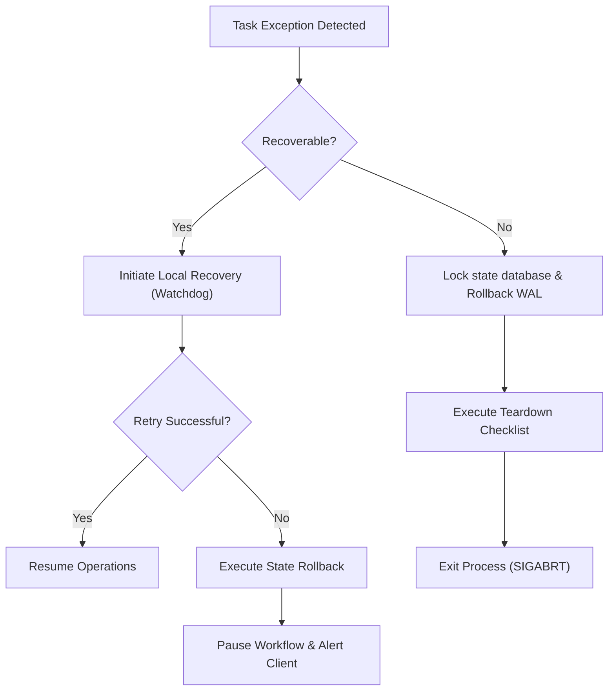

# RFC-0011: Runtime Error Taxonomy

RFC: RFC-0011  
Title: Runtime Error Taxonomy  
Status: Frozen  
Version: 1.0.0  
Category: Runtime  
Layer: Core Runtime  
Domain: Runtime Architecture  
Normative: YES
Audience: Systems Engineers  
Depends On:  
  - RFC-0001 Runtime Overview  
  - RFC-0002 Runtime Lifecycle  
Required By:  
  - RFC-0013 Runtime Contracts  
Supersedes: None  
Superseded By: None  
ADR References:  
  - ADR-0010  
  - ADR-0012  
Constitution References:  
  - Section 4.2 (Fault Isolation)  
Related RFCs:  
  - RFC-0002 Runtime Lifecycle  
Target Release: 1.0.0  
Review Cycle: Core Architecture Board  
Compatibility: Compatible with Spec 1.x  
Last Updated: 2026-06-29  

---

## Normative Status

## Authority

This RFC is the authoritative specification for the domain defined in this document.

Any implementation MUST conform to this document.

If an implementation conflicts with this RFC, this RFC takes precedence.

Conflicts between RFCs SHALL be resolved through the ADR process.

---

## Terminology

The following terms are defined with exact meanings consistent with the Atlas Master Glossary.

| Term | Definition | Source |
|---|---|---|
| Runtime | The core execution engine coordinating process lifecycles, states, resources, and scheduling queues. | Glossary |
| Service | A modular system component registered with the Service Registry. | Glossary |
| Lifecycle | The state transitions of a process or service from allocation to disposal. | Glossary |

---
This specification is Normative. Every Atlas Runtime implementation MUST conform to the error classifications, error codes, recovery paths, and exception structures defined in this document. Any deviation MUST be approved through the formal Architecture Decision Record (ADR) process.

This specification is subordinate to the Atlas Development System (ADS) Constitution, ADR-0010, and ADR-0012.

---


## Layer Boundaries

### Responsibilities

This specification IS responsible for:

- Defining the architectural contract for this domain.
- Specifying behavioral requirements that all implementations MUST satisfy.
- Establishing extension points and their contracts.

### Non-Responsibilities

This specification IS NOT responsible for:

- Implementation details (see related RFCs for implementation guidance).
- Runtime platform specifics.
- User-facing UI behavior.

### Dependencies

| Dependency | Direction | Description |
|---|---|---|
| RFC-0001 | Consumed | Runtime Overview — foundational runtime architecture |

### Consumers

- See related RFCs for consumer listings.

### Providers

- This specification provides domain-specific contracts and behavioral models.

### Forbidden Dependencies

- This specification MUST NOT depend on any specific programming language.
- This specification MUST NOT depend on any specific storage backend.
- This specification MUST NOT depend on any specific operating system.
## Table of Contents
1. [Introduction](#1-introduction)
2. [Goals](#2-goals)
3. [Non-Goals](#3-non-goals)
4. [Error Philosophy](#4-error-philosophy)
5. [Ownership](#5-ownership)
6. [Boundaries](#6-boundaries)
7. [Runtime Invariants](#7-runtime-invariants)
8. [Error Classifications](#8-error-classifications)
9. [Error Codes Registry](#9-error-codes-registry)
10. [Error Escalation Diagram](#10-error-escalation-diagram)
11. [Crash Recovery Flow](#11-crash-recovery-flow)
12. [Sandbox Fault Containment](#12-sandbox-fault-containment)
13. [Error Handling APIs](#13-error-handling-apis)
14. [Performance Budgets](#14-performance-budgets)
15. [Security Considerations](#15-security-considerations)
16. [Compatibility](#16-compatibility)
17. [Acceptance Criteria](#17-acceptance-criteria)
18. [References](#18-references)
19. [Changelog](#19-changelog)

---

- Downstream subsystem RFCs.


## 2 Goals

- **Uniform Error Representation**: Establish standard JSON exception payload schemas across all core runtimes.
- **Fail-Safe Containment**: Define boundaries to ensure that errors inside plugins or workflows do not crash the host process.
- **Traceable Error History**: Every raised exception MUST carry Correlation and Trace identifiers.
- **Predictable Recovery Paths**: Define recovery escalation paths for all error classifications (Recoverable vs. Fatal).

---


## 4 Error Philosophy

1. **Crash Early on Boot**: Errors during the bootstrap sequence are fatal and must halt the process.
2. **Contain Runtime Failures**: Errors during execution should be contained within sandboxed boundaries.
3. **No Swallowed Exceptions**: Every exception must write to the transaction log.

---

|---|---|---|
| RFC-0001 | Consumed | Runtime Overview |


## 6 Boundaries

- **Error Taxonomy may communicate with**:
  - Event Bus (refer to RFC-0005)
  - Telemetry Service
  - Service Registry (refer to RFC-0003)
- **Error Taxonomy MUST NOT communicate with**:
  - User Interface (UI)
  - AI reasoning providers directly

---


## 8 Error Classifications

Failures are categorized into two execution modes:

### 8.1 Recoverable Exceptions
Exceptions that can resolve automatically or yield to workflow pause hooks:
- **Timeouts**: Minor request delays (e.g., model response latencies).
- **Cancellations**: Safe tasks stopped via cancel tokens.
- **Isolated Sandbox Crashes**: Runaway plugins terminated by watchdogs.

### 8.2 Fatal Exceptions
Unrecoverable errors that require immediate runtime teardown and rollback:
- **Configuration Errors**: Invalid manifest schemas.
- **Dependency Failures**: Missing core services at boot.
- **Storage Write Lockouts**: Corrupted transaction logs or filesystem failures.

---

This specification IS responsible for:
- Defining the architecture and requirements for this subsystem.


## 10 Error Escalation Diagram

The following diagram illustrates the error escalation path from task failures to runtime shutdowns:



---

```

---


## 14 Performance Budgets

| Metric | Target Budget Limit | Measurement Context |
| :--- | :--- | :--- |
| **Exception Logging** | $\le 0.1 \text{ ms}$ | Time to compile exception payload and write to log buffer. |
| **Escalation Trigger**| $\le 0.05 \text{ ms}$| Deciding recovery actions based on error categories. |
| **Sandbox Re-init** | $\le 50.0 \text{ ms}$| Terminating crashed sandboxes and allocating replacement runtimes. |

---


## 16 Compatibility

This specification is compatible with the following versions:
- **Specification Version**: `1.x`
- **Error Registries**: `v1.x`

---

This specification IS NOT responsible for:
- Implementation details.


## Acceptance Criteria

### Architecture

| # | Criterion | Verification Method |
|---|---|---|
| AC-01 | The implementation MUST satisfy all normative requirements in this specification. | Specification conformance review |
| AC-02 | The implementation MUST NOT assume any specific runtime platform. | Platform independence audit |
| AC-03 | All cross-references to related RFCs MUST resolve to valid specifications. | Cross-reference validation |

## 18 References
1. **RFC-0001**: Runtime Overview  
2. **RFC-0002**: Runtime Lifecycle  
3. **RFC-0003**: Runtime Service Model  
4. **glossary.md**: Unified glossary (refer to [glossary.md](glossary.md))  

---

## Compliance Matrix

| Category | Value |
|---|---|
| Related RFC | See References section |
| Related ADR | ADR-0012 (and ADR-0010 if security-related) |
| Related JSON Schema | See References section |
| Related Catalog | See References section |

---

## Revision History

| Version | Status | Date | Author | Notes |
|---|---|---|---|---|
| 1.0.0 | Frozen | 2026-06-30 | Runtime Architecture Board | Initial publication |
| 1.1.0 | Frozen | 2026-07-01 | Atlas Specification Committee | Added Authority, Terminology, Layer Boundaries, Runtime Independence per RFC_TEMPLATE.md |

## Runtime Independence

This specification is completely independent of any runtime implementation platform. Specifically, this specification MUST NOT assume:

- Any programming language (Rust, Node.js, TypeScript, Go, Python, etc.)
- Any runtime environment (Electron, Tauri, Browser, Desktop, Server)
- Any storage backend (SQLite, PostgreSQL, MongoDB, Redis, etc.)
- Any operating system (Windows, Linux, macOS, etc.)
- Any hardware architecture (CPU, GPU, FPGA, etc.)
- Any threading model (single-threaded, multi-threaded, actor-based, etc.)
- Any cloud provider (AWS, Azure, GCP, etc.)
- Any container platform (Docker, containerd, etc.)
