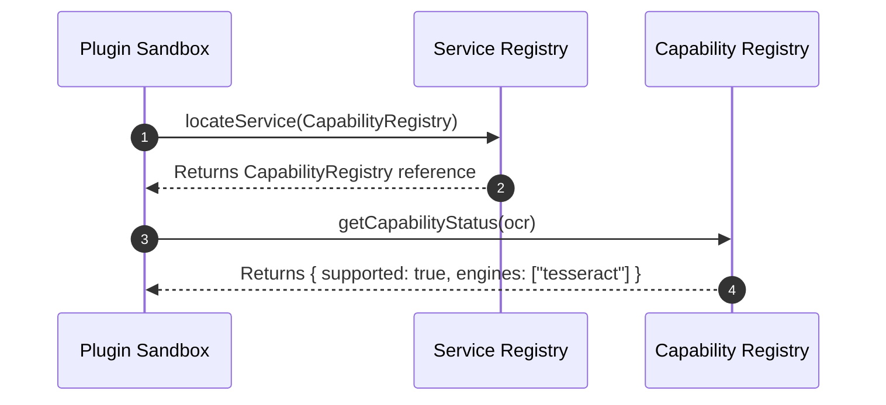

# RFC-0012: Runtime Capability Registry

RFC: RFC-0012  
Title: Runtime Capability Registry  
Status: Frozen  
Version: 1.0.0  
Category: Runtime  
Layer: Core Runtime  
Domain: Runtime Architecture  
Normative: YES
Audience: Systems Engineers  
Depends On:  
  - RFC-0001 Runtime Overview  
  - RFC-0002 Runtime Lifecycle  
  - RFC-0010 Runtime Manifest Specification  
Required By:  
  - RFC-0008 Runtime Plugin Host  
  - RFC-0013 Runtime Contracts  
Supersedes: None  
Superseded By: None  
ADR References:  
  - ADR-0012  
  - ADR-0014  
Constitution References:  
  - Section 5.1 (Sandboxing)  
Related RFCs:  
  - RFC-0008 Runtime Plugin Host  
  - RFC-0010 Runtime Manifest Specification  
Target Release: 1.0.0  
Review Cycle: Core Architecture Board  
Compatibility: Compatible with Spec 1.x  
Last Updated: 2026-06-29  

---

## Normative Status

## Authority

This RFC is the authoritative specification for the domain defined in this document.

Any implementation MUST conform to this document.

If an implementation conflicts with this RFC, this RFC takes precedence.

Conflicts between RFCs SHALL be resolved through the ADR process.

---

## Terminology

The following terms are defined with exact meanings consistent with the Atlas Master Glossary.

| Term | Definition | Source |
|---|---|---|
| Runtime | The core execution engine coordinating process lifecycles, states, resources, and scheduling queues. | Glossary |
| Service | A modular system component registered with the Service Registry. | Glossary |
| Lifecycle | The state transitions of a process or service from allocation to disposal. | Glossary |

---
This specification is Normative. Every Atlas Runtime implementation MUST conform to the capability schemas, query structures, capability status maps, and registration methods defined in this document. Any deviation MUST be approved through the formal Architecture Decision Record (ADR) process.

This specification is subordinate to the Atlas Development System (ADS) Constitution, ADR-0012, and ADR-0014.

---


## Layer Boundaries

### Responsibilities

This specification IS responsible for:

- Defining the architectural contract for this domain.
- Specifying behavioral requirements that all implementations MUST satisfy.
- Establishing extension points and their contracts.

### Non-Responsibilities

This specification IS NOT responsible for:

- Implementation details (see related RFCs for implementation guidance).
- Runtime platform specifics.
- User-facing UI behavior.

### Dependencies

| Dependency | Direction | Description |
|---|---|---|
| RFC-0001 | Consumed | Runtime Overview — foundational runtime architecture |

### Consumers

- See related RFCs for consumer listings.

### Providers

- This specification provides domain-specific contracts and behavioral models.

### Forbidden Dependencies

- This specification MUST NOT depend on any specific programming language.
- This specification MUST NOT depend on any specific storage backend.
- This specification MUST NOT depend on any specific operating system.
## Table of Contents
1. [Introduction](#1-introduction)
2. [Goals](#2-goals)
3. [Non-Goals](#3-non-goals)
4. [Capability Philosophy](#4-capability-philosophy)
5. [Ownership](#5-ownership)
6. [Boundaries](#6-boundaries)
7. [Runtime Invariants](#7-runtime-invariants)
8. [Capability Classifications](#8-capability-classifications)
9. [Capability Status Map Schema](#9-capability-status-map-schema)
10. [Capability Registry Architecture](#10-capability-registry-architecture)
11. [Capability Query Flow](#11-capability-query-flow)
12. [Entitlement Verification Sequence](#12-entitlement-verification-sequence)
13. [Registration & Initialization](#13-registration--initialization)
14. [Performance Budgets](#14-performance-budgets)
15. [Security & Sandbox Permissions](#15-security--sandbox-permissions)
16. [Compatibility](#16-compatibility)
17. [Acceptance Criteria](#17-acceptance-criteria)
18. [References](#18-references)
19. [Changelog](#19-changelog)

---

- Downstream subsystem RFCs.


## 2 Goals

- **Unified Capabilities Discovery**: Provide a standard query interface for all platform capabilities.
- **Strict Entitlement Verification**: Enforce permission checks before exposing capabilities to sandboxed processes.
- **Dynamic Configuration Updates**: Allow drivers to register capabilities (such as GPU capabilities) during runtime bootstrapping.
- **Fault Containment**: Gracefully handle missing optional capabilities by executing fallback routines.

---


## 4 Capability Philosophy

1. **Declared in Manifests**: Services and plugins declare required capabilities in manifests.
2. **Immutable Status at Runtime**: Capabilities maps are frozen after boot initialization.
3. **No Direct Hardware Access**: Sandboxed processes query the Registry instead of directly accessing hardware contexts.

---


## 6 Boundaries

- **Capability Registry may communicate with**:
  - Manifest Manager (refer to RFC-0010)
  - State Manager (refer to RFC-0006)
  - Security Manager
- **Capability Registry MUST NOT communicate with**:
  - User Interface (UI)
  - Third-party packages directly

---


## 8 Capability Classifications

The Registry registers the following platform capabilities:

- **Vision**: Screen capture framerates, video codecs, and active window handles.
- **OCR**: Registered OCR engines (e.g., Tesseract).
- **AI**: GPU/VRAM statuses, active model cache sizes, and local model inference capabilities.
- **Storage**: Storage space allocations, caching configurations, and directory permissions.
- **Sandboxing**: WebAssembly compilation limits and subprocess memory boundaries.
- **Hot Reload**: Re-registration capabilities during soft restarts.

---

      "supported": true,
      "type": "wasmtime",
      "heap_limit_bytes": 536870912
    }
  }
}
```

---

- Implementation details.


## 11 Capability Query Flow

The following sequence details how plugins query active capabilities:



---


## 14 Performance Budgets

| Metric | Target Budget Limit | Measurement Context |
| :--- | :--- | :--- |
| **Entitlement Verification**| $\le 0.05 \text{ ms}$ | Validating caller permission entitlement keys. |
| **Status Query** | $\le 0.01 \text{ ms}$ | Fetching capability status from memory cache. |

---


## 16 Compatibility

This specification is compatible with the following versions:
- **Specification Version**: `1.x`
- **Capability Schemas**: `v1.x`

---

This specification IS NOT responsible for:
- Implementation details.


## Acceptance Criteria

### Architecture

| # | Criterion | Verification Method |
|---|---|---|
| AC-01 | The implementation MUST satisfy all normative requirements in this specification. | Specification conformance review |
| AC-02 | The implementation MUST NOT assume any specific runtime platform. | Platform independence audit |
| AC-03 | All cross-references to related RFCs MUST resolve to valid specifications. | Cross-reference validation |

## 18 References
1. **RFC-0001**: Runtime Overview  
2. **RFC-0002**: Runtime Lifecycle  
3. **RFC-0010**: Runtime Manifest Specification  
4. **glossary.md**: Unified glossary (refer to [glossary.md](glossary.md))  

---

## Compliance Matrix

| Category | Value |
|---|---|
| Related RFC | See References section |
| Related ADR | ADR-0012 (and ADR-0010 if security-related) |
| Related JSON Schema | See References section |
| Related Catalog | See References section |

---

## Revision History

| Version | Status | Date | Author | Notes |
|---|---|---|---|---|
| 1.0.0 | Frozen | 2026-06-30 | Runtime Architecture Board | Initial publication |
| 1.1.0 | Frozen | 2026-07-01 | Atlas Specification Committee | Added Authority, Terminology, Layer Boundaries, Runtime Independence per RFC_TEMPLATE.md |

## Runtime Independence

This specification is completely independent of any runtime implementation platform. Specifically, this specification MUST NOT assume:

- Any programming language (Rust, Node.js, TypeScript, Go, Python, etc.)
- Any runtime environment (Electron, Tauri, Browser, Desktop, Server)
- Any storage backend (SQLite, PostgreSQL, MongoDB, Redis, etc.)
- Any operating system (Windows, Linux, macOS, etc.)
- Any hardware architecture (CPU, GPU, FPGA, etc.)
- Any threading model (single-threaded, multi-threaded, actor-based, etc.)
- Any cloud provider (AWS, Azure, GCP, etc.)
- Any container platform (Docker, containerd, etc.)
