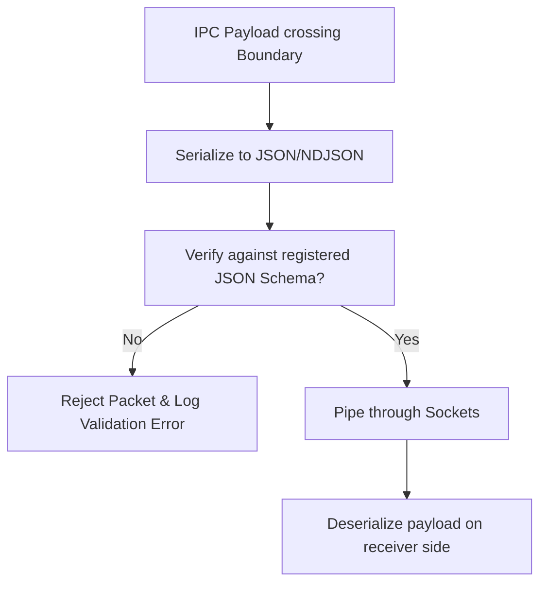

# RFC-0013: Runtime Contracts

RFC: RFC-0013  
Title: Runtime Contracts  
Status: Frozen  
Version: 1.0.0  
Category: Runtime  
Layer: Core Runtime  
Domain: Runtime Architecture  
Normative: YES
Audience: Systems Engineers  
Depends On:  
  - RFC-0001 Runtime Overview  
  - RFC-0002 Runtime Lifecycle  
  - RFC-0003 Runtime Service Model  
  - RFC-0004 Runtime Scheduler  
  - RFC-0005 Runtime Event Bus  
  - RFC-0006 Runtime State Management  
  - RFC-0007 Runtime IPC Architecture  
  - RFC-0008 Runtime Plugin Host  
  - RFC-0009 Runtime Resource Management  
  - RFC-0010 Runtime Manifest Specification  
  - RFC-0011 Runtime Error Taxonomy  
  - RFC-0012 Runtime Capability Registry  
Required By: None  
Supersedes: None  
Superseded By: None  
ADR References:  
  - ADR-0010  
  - ADR-0012  
Constitution References:  
  - Section 3.1 (Contract Integrity)  
Related RFCs: All Core Runtime RFCs  
Target Release: 1.0.0  
Review Cycle: Core Architecture Board  
Compatibility: Compatible with Spec 1.x  
Last Updated: 2026-06-29  

---

## Normative Status

## Authority

This RFC is the authoritative specification for the domain defined in this document.

Any implementation MUST conform to this document.

If an implementation conflicts with this RFC, this RFC takes precedence.

Conflicts between RFCs SHALL be resolved through the ADR process.

---

## Terminology

The following terms are defined with exact meanings consistent with the Atlas Master Glossary.

| Term | Definition | Source |
|---|---|---|
| Runtime | The core execution engine coordinating process lifecycles, states, resources, and scheduling queues. | Glossary |
| Service | A modular system component registered with the Service Registry. | Glossary |
| Lifecycle | The state transitions of a process or service from allocation to disposal. | Glossary |

---
This specification is Normative. Every Atlas Runtime implementation MUST conform to the abstract interface signatures, JSON schemas, serialization protocols, and return types defined in this document. Any deviation MUST be approved through the formal Architecture Decision Record (ADR) process.

This specification is subordinate to the Atlas Development System (ADS) Constitution, ADR-0010, and ADR-0012.

---


## Layer Boundaries

### Responsibilities

This specification IS responsible for:

- Defining the architectural contract for this domain.
- Specifying behavioral requirements that all implementations MUST satisfy.
- Establishing extension points and their contracts.

### Non-Responsibilities

This specification IS NOT responsible for:

- Implementation details (see related RFCs for implementation guidance).
- Runtime platform specifics.
- User-facing UI behavior.

### Dependencies

| Dependency | Direction | Description |
|---|---|---|
| RFC-0001 | Consumed | Runtime Overview — foundational runtime architecture |

### Consumers

- See related RFCs for consumer listings.

### Providers

- This specification provides domain-specific contracts and behavioral models.

### Forbidden Dependencies

- This specification MUST NOT depend on any specific programming language.
- This specification MUST NOT depend on any specific storage backend.
- This specification MUST NOT depend on any specific operating system.
## Table of Contents
1. [Introduction](#1-introduction)
2. [Goals](#2-goals)
3. [Non-Goals](#3-non-goals)
4. [Contract Philosophy](#4-contract-philosophy)
5. [Ownership](#5-ownership)
6. [Boundaries](#6-boundaries)
7. [Runtime Invariants](#7-runtime-invariants)
8. [Consolidated Interface Registry](#8-consolidated-interface-registry)
9. [Standard Serialization Formats](#9-standard-serialization-formats)
10. [Interface Registration Sequence](#10-interface-registration-sequence)
11. [Serialization Boundary Flow](#11-serialization-boundary-flow)
12. [Version Negotiation Protocols](#12-version-negotiation-protocols)
13. [Compatibility Guarantees](#13-compatibility-guarantees)
14. [Performance Budgets](#14-performance-budgets)
15. [Security Considerations](#15-security-considerations)
16. [Acceptance Criteria](#16-acceptance-criteria)
17. [References](#17-references)
18. [Changelog](#18-changelog)

---

- Downstream subsystem RFCs.


## 2 Goals

- **Technology-Agnostic Definitions**: Expose abstract interfaces without assuming host programming language features (e.g., native pointers).
- **Consolidated Contract Schema**: Provide a single repository of all service API contracts, event formats, state maps, and IPC schemas.
- **Strict ABI/API Stability**: Guarantee backward compatibility for all core contracts across minor platform releases.
- **Automatic Contract Compliance**: Expose schemas in standardized JSON Format to facilitate automated validation tests.

---


## 4 Contract Philosophy

1. **Contracts are Immutable**: Once finalized, interfaces cannot be mutated. Updates require version upgrades.
2. **Strict Schema Validation**: Data crossing service or process boundaries must match registered schemas.
3. **No Direct Code Reference**: Subsystems interact by importing contract interfaces, preventing circular reference paths.

---


## 6 Boundaries

- **Runtime Contracts may communicate with**: All core layers compile against and satisfy this specification.
- **Runtime Contracts MUST NOT communicate with**: Out-of-spec libraries or untrusted interfaces.

---


## 8 Consolidated Interface Registry

Every core service MUST implement and compile against the corresponding abstract interface signatures:

### 8.1 Runtime Control API (RFC-0002)
```a typed programming language
interface RuntimeControlAPI {
  initialize(configPath: string): Promise<void>;
  start(): Promise<void>;
  pause(): Promise<void>;
  resume(): Promise<void>;
  stop(gracePeriodMs: number): Promise<void>;
  shutdown(): Promise<void>;
  restart(mode: "soft" | "hard"): Promise<void>;
  health(): Promise<SystemHealthReport>;
  status(): RuntimeState;
}
```

### 8.2 Service Model Contract (RFC-0003)
```a typed programming language
interface ServiceContract {
  initialize(config: ConfigurationObject): Promise<void>;
  start(): Promise<void>;
  pause(): Promise<void>;
  resume(): Promise<void>;
  stop(): Promise<void>;
  shutdown(): Promise<void>;
  dispose(): void;
  health(): Promise<HealthReport>;
  state(): SerializedState;
}
```

### 8.3 Scheduler Contract (RFC-0004)
```a typed programming language
interface SchedulerAPI {
  scheduleTask(definition: TaskDefinition): string;
  cancelTask(taskId: string): Promise<boolean>;
  getQueueStatus(): QueueStatus;
  setConcurrencyCap(priority: number, cap: number): void;
}
```

### 8.4 Event Bus Contract (RFC-0005)
```a typed programming language
interface EventBusAPI {
  publish(event: EventPayload): Promise<void>;
  subscribe(topic: string, callback: (event: EventPayload) => void): string;
  unsubscribe(subscriptionId: string): void;
  registerSchema(topic: string, schema: object): void;
}
```

### 8.5 State Manager Contract (RFC-0006)
```a typed programming language
interface StateManagerAPI {
  beginTransaction(scopeId: string): string;
  commitTransaction(transactionId: string): Promise<void>;
  abortTransaction(transactionId: string): void;
  get(scopeId: string, key: string): any;
  set(transactionId: string, key: string, value: any): void;
  takeSnapshot(scopeId: string): Promise<void>;
}
```

### 8.6 IPC Manager Contract (RFC-0007)
```a typed programming language
interface IPCManagerAPI {
  sendMessage(message: IPCMessage): Promise<IPCMessage>;
  registerEndpoint(command: string, schema: object, handler: Function): void;
  deregisterEndpoint(command: string): void;
}
```

### 8.7 Plugin Manager Contract (RFC-0008)
```a typed programming language
interface PluginManagerAPI {
  loadPlugin(packagePath: string): Promise<string>;
  unloadPlugin(pluginId: string): Promise<boolean>;
  invokePluginAction(pluginId: string, actionId: string, args: object): Promise<object>;
}
```

### 8.8 Resource Manager Contract (RFC-0009)
```a typed programming language
interface ResourceManagerAPI {
  requestAllocation(taskId: string, resourceType: string, amount: number): Promise<boolean>;
  releaseAllocation(taskId: string, resourceType: string, amount: number): void;
  getSystemMetrics(): SystemMetricsReport;
}
```

### 8.9 Manifest Manager Contract (RFC-0010)
```a typed programming language
interface ManifestManagerAPI {
  getManifest(): RuntimeManifest;
  getCapabilities(): CapabilityManifest;
  verifyCompatibility(pluginVersionReq: string): boolean;
}
```

### 8.10 Error Reporter Contract (RFC-0011)
```a typed programming language
interface ErrorReporter {
  reportError(error: AtlasException): void;
  getExceptionLogs(traceId: string): AtlasException[];
}
```

### 8.11 Capability Manager Contract (RFC-0012)
```a typed programming language
interface CapabilityManagerAPI {
  getCapabilities(): CapabilityManifest;
  checkEntitlement(callerId: string, entitlement: string): boolean;
}
```

---


### 9.2 IPC Message Schema (RFC-0007)
```json
{
  "$schema": "https://atlas.dev/schemas/ipc-message.schema.json",
  "type": "object",
  "required": ["id", "version", "source", "destination", "command", "payload", "metadata"],
  "properties": {
    "id": { "type": "string", "format": "uuid" },
    "version": { "type": "string" },
    "source": { "type": "string" },
    "destination": { "type": "string" },
    "command": { "type": "string" },
    "payload": { "type": "object" },
    "metadata": {
      "type": "object",
      "required": ["correlation_id", "trace_id", "token", "timestamp"],
      "properties": {
        "correlation_id": { "type": "string", "format": "uuid" },
        "trace_id": { "type": "string", "format": "uuid" },
        "token": { "type": "string" },
        "timestamp": { "type": "integer" }
      }
    }
  }
}
```

---


## 11 Serialization Boundary Flow

The following flowchart details how data crossing process boundaries is validated:



---


## 13 Compatibility Guarantees

Platform implementations MUST satisfy the following compatibility rules:
- **API Stability**: API signatures registered in this spec MUST NOT change during minor releases.
- **Schema Compatibility**: Schema updates MUST support backwards compatibility for payloads within the same major version.

---


## 15 Security Considerations

- **Strict Validation Rules**: All data crossing process boundaries must undergo validation checks.
- **Token Checks**: Calling APIs requires validation of caller security tokens.

---

This specification IS NOT responsible for:
- Implementation details.


## Acceptance Criteria

### Architecture

| # | Criterion | Verification Method |
|---|---|---|
| AC-01 | The implementation MUST satisfy all normative requirements in this specification. | Specification conformance review |
| AC-02 | The implementation MUST NOT assume any specific runtime platform. | Platform independence audit |
| AC-03 | All cross-references to related RFCs MUST resolve to valid specifications. | Cross-reference validation |

## 17 References
1. **RFC-0001**: Runtime Overview  
2. **RFC-0002**: Runtime Lifecycle  
3. **RFC-0003**: Runtime Service Model  
4. **RFC-0005**: Event Bus  
5. **RFC-0007**: Runtime IPC Architecture  
6. **glossary.md**: Unified glossary (refer to [glossary.md](glossary.md))  

---

## Compliance Matrix

| Category | Value |
|---|---|
| Related RFC | See References section |
| Related ADR | ADR-0012 (and ADR-0010 if security-related) |
| Related JSON Schema | See References section |
| Related Catalog | See References section |

---

## Revision History

| Version | Status | Date | Author | Notes |
|---|---|---|---|---|
| 1.0.0 | Frozen | 2026-06-30 | Runtime Architecture Board | Initial publication |
| 1.1.0 | Frozen | 2026-07-01 | Atlas Specification Committee | Added Authority, Terminology, Layer Boundaries, Runtime Independence per RFC_TEMPLATE.md |

## Runtime Independence

This specification is completely independent of any runtime implementation platform. Specifically, this specification MUST NOT assume:

- Any programming language (Rust, Node.js, TypeScript, Go, Python, etc.)
- Any runtime environment (Electron, Tauri, Browser, Desktop, Server)
- Any storage backend (SQLite, PostgreSQL, MongoDB, Redis, etc.)
- Any operating system (Windows, Linux, macOS, etc.)
- Any hardware architecture (CPU, GPU, FPGA, etc.)
- Any threading model (single-threaded, multi-threaded, actor-based, etc.)
- Any cloud provider (AWS, Azure, GCP, etc.)
- Any container platform (Docker, containerd, etc.)
