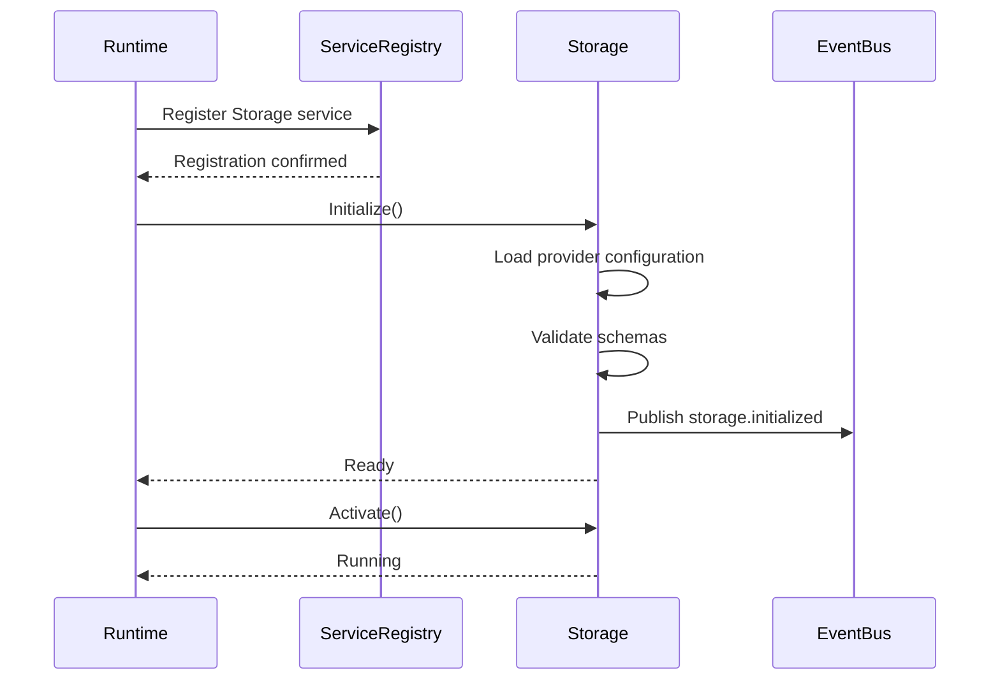

# RFC-0401: Storage Overview

RFC: RFC-0401
Title: Storage Overview
Status: Accepted
Category: Core
Owner: Storage Team
Authors: Atlas Specification Committee
Created: 2026-07-01
Updated: 2026-07-01
ADS Version: 1.0.0
Spec Version: 0.1.0
Normative: YES
Depends On:
  - RFC-0001 Runtime Overview
  - RFC-0002 Runtime Lifecycle
  - RFC-0006 Runtime State Management
  - RFC-0009 Runtime Resource Management
  - RFC-0201 Plugin Overview
  - RFC-1001 Common Event Model
  - RFC-1006 Common Error Model
Supersedes: None
Superseded By: None
Related ADR:
  - ADR-0001 Architecture Freeze
  - ADR-0010 Contract-First Specification
Related JSON Schema:
  - schemas/storage/resource.json
Related Catalog:
  - catalog/storage-overview.md
Layer: Core
Audience: Storage developers, architects, specification reviewers
Target Release: 1.0.0
Review Cycle: Quarterly
Compatibility: Compatible with Spec 1.x
Last Updated: 2026-07-01

---

## Normative Status
This specification is Normative. Every Atlas implementation MUST conform to the storage philosophy, responsibilities, ownership model, boundaries, principles, and interaction contracts defined in this document. Any deviation MUST be approved through the formal Architecture Decision Record (ADR) process.

This specification is subordinate to the Atlas Development System (ADS) Constitution, ADR-0010, and ADR-0012.

---

## Authority
This RFC is the authoritative specification for the Atlas Storage overview domain.

Any implementation MUST conform to this document.

If an implementation conflicts with this RFC, this RFC takes precedence.

Conflicts between RFCs SHALL be resolved through the ADR process.

---

## Terminology

The following terms are defined with exact meanings consistent with the Atlas Master Glossary and RFC-0301.

| Term | Definition | Source |
|---|---|---|
| Storage | The unified persistence, caching, versioning, backup, recovery, security, and observability layer of the Atlas platform. | RFC-0401 |
| Provider | The abstraction layer that encapsulates a specific storage backend implementation. | RFC-0403 |
| Resource | A unit of data managed by Storage, identified by a unique resource identifier. | RFC-0423 |
| Schema | A declarative definition of the structure, types, and constraints for stored resources. | RFC-0405 |
| Transaction | A sequence of storage operations that execute atomically, consistently, isolated, and durably. | RFC-0406 |
| Version | An immutable snapshot of a resource or schema at a point in time. | RFC-0407 |
| Migration | A deterministic procedure for evolving schemas and data between versions. | RFC-0408 |
| Cache | A transient storage layer that holds frequently accessed data for improved read performance. | RFC-0410 |
| Backup | A point-in-time copy of stored data preserved for recovery purposes. | RFC-0411 |
| Recovery | The process of restoring data from backups or replicas after a failure. | RFC-0412 |
| Event | A structured notification emitted by Storage to record an operation or state change. | RFC-0413 |
| Metric | A quantitative measurement of Storage behavior, such as latency, throughput, or error rate. | RFC-0414 |
| Consistency Model | The contractual guarantee about the visibility of writes to subsequent reads. | RFC-0416 |
| Lock | A concurrency control mechanism that serializes access to shared resources. | RFC-0417 |
| Replication | The process of maintaining copies of data across multiple storage locations. | RFC-0418 |
| Extension | A pluggable module that augments Storage behavior without modifying core code. | RFC-0419 |
| Domain | A logical partition of storage resources with independent namespace and quota. | RFC-0421 |
| Namespace | The hierarchical addressing scheme for resources within a domain. | RFC-0422 |
| Quota | A limit on the amount of storage resources a domain or user may consume. | RFC-0424 |
| Capability | A discrete function or service exposed by a Storage provider. | RFC-0425 |
| Workflow | A declarative directed graph specification expressing WHAT must happen, not HOW. | RFC-0301 |
| Execution | The process of evaluating a workflow graph and activating nodes to produce results. | RFC-0303 |
 RFC-0301 |
| Task | An atomic unit of work within a workflow, represented as a node. | RFC-0301 |
| Node | A graph element representing an atomic unit of work with defined inputs and outputs. | RFC-0301 |
| Context | The scoped data environment available to nodes during execution. | RFC-0307 |
| Frame | A discrete unit of visual data processed by vision nodes. | RFC-0301 |
| Tick | A single evaluation cycle of the workflow scheduler. | RFC-0301 |
| Scheduler | The component that determines WHEN and WHERE each node is executed. | RFC-0312 |
| Trigger | An event or condition that initiates workflow execution. | RFC-0311 |

---

This specification is Normative. Every Atlas implementation MUST conform to the storage philosophy, responsibilities, ownership model, boundaries, principles, and interaction contracts defined in this document. Any deviation MUST be approved through the formal Architecture Decision Record (ADR) process.

This specification is subordinate to the Atlas Development System (ADS) Constitution, ADR-0001, ADR-0010, and all active ADRs.

---

## Table of Contents
1. [Introduction](#1-introduction)
2. [Goals](#2-goals)
3. [Non-Goals](#3-non-goals)
4. [Storage Philosophy](#4-storage-philosophy)
5. [Ownership](#5-ownership)
6. [Boundaries](#6-boundaries)
7. [Runtime Invariants](#7-runtime-invariants)
8. [Storage Responsibilities](#8-storage-responsibilities)
9. [Storage Principles](#9-storage-principles)
10. [Interaction with Runtime](#10-interaction-with-runtime)
11. [Interaction with Plugins](#11-interaction-with-plugins)
12. [Interaction with Workflows](#12-interaction-with-workflows)
13. [Interaction with Projects](#13-interaction-with-projects)
14. [Interaction with AI](#14-interaction-with-ai)
15. [Interaction with Knowledge](#15-interaction-with-knowledge)
16. [Interaction with Marketplace](#16-interaction-with-marketplace)
17. [Security Principles](#17-security-principles)
18. [Performance Targets](#18-performance-targets)
19. [Compatibility Model](#19-compatibility-model)
20. [Glossary](#20-glossary)
21. [Acceptance Criteria](#21-acceptance-criteria)
22. [References](#22-references)
23. [Future Evolution](#23-future-evolution)

---

## 1 Introduction

The Atlas Storage subsystem is the **Atlas Data Platform** — the unified persistence, caching, versioning, backup, recovery, security, and observability layer of the Atlas platform. It does not implement a database. It defines the contracts that every persistence mechanism MUST satisfy within the Atlas ecosystem. Storage is not merely save-and-load; it is the complete data lifecycle engine for Atlas.

Storage abstracts every persistence mechanism behind a uniform interface. Whether the backing store is embedded, networked, local, cloud-based, relational, document-oriented, graph-based, or key-value, Storage provides a consistent contract for data persistence, retrieval, versioning, migration, backup, recovery, caching, and consistency.

This RFC establishes the overarching philosophy, architectural boundaries, ownership model, interaction contracts, and non-functional targets that govern all Storage subsystem components. Every subsequent Storage RFC elaborates a specific aspect of this contract.

### 1.1 What is Atlas Storage?

Atlas Storage is the formal persistence layer of the Atlas platform. It provides:

- **Persistence Abstraction**: A uniform interface for storing, retrieving, updating, and deleting resources, regardless of the underlying storage technology.
- **Schema Management**: Declarative schema definitions with validation, evolution, and compatibility guarantees.
- **Transaction Support**: Atomic, isolated, and durable operations across one or more storage providers.
- **Versioning**: Immutable version history for both data and schemas.
- **Migration**: Deterministic, reversible schema and data migration procedures.
- **Backup and Recovery**: Guaranteed durability through backup schedules, retention policies, and recovery procedures.
- **Caching**: Multi-layer caching with configurable policies and coherence guarantees.
- **Consistency**: Configurable consistency models from strong to eventual.
- **Security**: Encryption, access control, audit logging, and threat mitigation.
- **Observability**: Metrics, traces, and logs for every storage operation.

### 1.2 Rationale and Why It Exists

Modern application platforms suffer from fragmented persistence layers where each subsystem manages its own storage independently. This leads to inconsistent data models, duplicated backup logic, incompatible security models, and unobservable state. Atlas Storage exists to consolidate all persistence concerns into a single, well-defined subsystem that every other subsystem consumes through stable contracts.

By abstracting persistence behind a Provider interface, Atlas ensures that storage technology choices can evolve independently of application logic. The platform is not locked into any single storage engine. New providers can be introduced without modifying consumer code.

---

## 2 Goals

1. **Unified Persistence Contract**: Provide a single, consistent interface for all data persistence needs across the Atlas platform. Every resource, regardless of its domain (workflow state, plugin data, AI context, knowledge vectors, marketplace metadata), MUST be accessible through the Storage API.

2. **Technology Independence**: Storage MUST abstract away all implementation details of the underlying persistence mechanism. Consumers MUST NOT depend on any specific storage technology. The choice of provider is an implementation detail, not an architectural dependency.

3. **Deterministic Lifecycle**: Every resource managed by Storage MUST follow a formally defined lifecycle state machine (see RFC-0404). Every state transition MUST be observable, auditable, and reversible where feasible.

4. **Schema Evolution with Compatibility**: Data structures MUST evolve through formally defined migration procedures (see RFC-0408) that guarantee backward and forward compatibility within defined version boundaries.

5. **Transaction Integrity**: Storage MUST provide transactional guarantees (atomicity, consistency, isolation, durability) abstracted over the provider layer (see RFC-0406).

6. **Versioned Data History**: Every stored resource MUST maintain an immutable version history (see RFC-0407), enabling point-in-time queries, audit trails, and rollback.

7. **Guaranteed Durability**: Storage MUST guarantee data durability through backup and recovery procedures (see RFC-0411, RFC-0412) with defined Recovery Point Objectives (RPO) and Recovery Time Objectives (RTO).

8. **Security by Default**: All storage operations MUST be secured through encryption, access control, and audit logging (see RFC-0409). No data passes through Storage without security checks.

9. **Observable and Measurable**: Every Storage operation MUST produce standardized events and metrics (see RFC-0413, RFC-0414). No storage behavior is invisible to the observability layer.

10. **Extensible Through Providers**: New storage backends MUST be integrable through the Provider interface (see RFC-0403) without modifying the Storage core.

11. **Configurable Consistency**: Storage MUST support multiple consistency models (see RFC-0416), allowing consumers to select the appropriate guarantee for their use case.

12. **Performance at Scale**: Storage MUST support high-throughput, low-latency operations across millions of resources without degrading the performance of other platform subsystems (see RFC-0415).

---

## 3 Non-Goals

- **Database Implementation**: Storage does not implement any specific database engine. It defines contracts; providers implement them.
- **Query Language Design**: Storage does not define a query language. Query expression is delegated to the Provider interface, which maps to the native query mechanism of the backing store.
- **Data Modeling Semantics**: Storage does not prescribe how consumers model their data. Schema definitions (see RFC-0405) describe structure and constraints but do not enforce a particular data modeling paradigm.
- **Infrastructure Provisioning**: Storage does not provision, deploy, or manage the infrastructure that hosts storage providers. Infrastructure is the responsibility of the deployment subsystem.
- **Backup Media Management**: Storage defines backup procedures and retention policies but does not manage physical or cloud storage media. Backup targets are configured externally.
- **Cryptographic Key Generation**: Storage encrypts data at rest and in transit but does not generate or manage cryptographic keys. Key management is delegated to a dedicated key management service.
- **User Interface for Storage Operations**: Storage provides APIs and events; any user-facing interface for storage management is built by the UI subsystem.
- **Storage Hardware Selection**: Storage does not prescribe SSDs, HDDs, NVMe, or any specific hardware. Hardware selection is an infrastructure concern.

---

## 4 Storage Philosophy

1. **Abstraction Over Implementation**: Storage defines WHAT must happen, not HOW it happens. The Provider interface (see RFC-0403) is the sole contract between Storage and persistence mechanisms.

2. **Contract-First Design**: Every Storage operation is defined as a contract with explicit preconditions, postconditions, and error conditions. Consumers interact with contracts, not implementations.

3. **Deterministic Behavior**: Given the same inputs, state, and operations, Storage MUST produce the same results. Non-determinism is confined to the Provider layer and MUST NOT propagate to the Storage API.

4. **Defense in Depth**: Security operates at every layer of Storage: API authentication, authorization, encryption, audit logging, and provider isolation. No single security control is the sole protection.

5. **Observable by Design**: Every operation, state transition, error, and security event produces a standardized platform event. Nothing happens in Storage without being observable.

6. **Versioned Evolution**: All data, schemas, and provider interfaces follow semantic versioning. Breaking changes are identifiable, migratable, and reversible.

7. **Resilient by Default**: Storage MUST continue operating in degraded modes when providers fail, caches are unavailable, or network connectivity is lost. Graceful degradation is the default, not an exception.

8. **Least Privilege**: Every Storage operation is authorized against the minimum permissions required. No operation receives broader access than necessary.

9. **Immutable Audit Trail**: All Storage operations are recorded in an append-only audit log. Audit records are tamper-evident and retention-governed.

10. **Separation of Concerns**: Storage does not compete with the Runtime for state management. The Runtime manages transient execution state; Storage manages durable persistence. The boundary is explicit and enforced.

---

## 5 Ownership

### 5.1 The Platform MUST Own

- The Storage API contract and all public interfaces
- The transaction manager and its consistency guarantees
- The schema registry and schema validation pipeline
- The cache manager and cache coherence protocol
- The version manager and version resolution logic
- The lock manager and concurrency control
- The replication manager and data synchronization
- The backup scheduler and backup integrity verification
- The recovery orchestrator and recovery procedure execution
- The security layer (encryption, access control, audit)
- The observability layer (metrics, traces, logs)
- The provider registry and provider lifecycle management
- The migration orchestrator and migration execution
- The consistency model selector and consistency enforcement

### 5.2 The Provider MUST Own

- The implementation of the Provider interface
- The internal data structures and storage engine
- The physical or logical placement of data
- The provider-specific optimization strategies
- The provider internal connection pooling and resource management
- The provider native error reporting (translated to Storage error codes)
- The provider internal caching (distinct from the Storage cache layer)

### 5.3 Consumers MUST Own

- Their schema definitions and data models
- Their transaction boundaries and isolation level selection
- Their resource lifecycle state transitions
- Their backup and recovery configuration
- Their security permissions and access control policies
- Their observability subscriptions and alerting rules

---

## 6 Boundaries

### 6.1 Storage MAY Communicate With

- **Runtime** (RFC-0001): For lifecycle management, service registration, and health monitoring
- **State Manager** (RFC-0006): For delegating durable state persistence
- **Plugin Host** (RFC-0201): For plugin state storage and provider discovery
- **Workflow Engine**: For workflow state, node outputs, and trigger data persistence
- **AI Coordinator**: For AI context, conversation history, and model state
- **Knowledge Manager**: For knowledge pack persistence and vector index storage
- **Marketplace**: For package metadata, signatures, and version manifests
- **Project Manager**: For project configuration, workspace state, and user preferences
- **Event Bus** (RFC-1001): For publishing storage events
- **Security Manager**: For encryption operations and access control decisions
- **Key Management Service**: For cryptographic key operations

### 6.2 Storage MUST NOT Communicate With

- **Direct Infrastructure APIs**: Storage MUST NOT interact with cloud provider APIs, database drivers, or storage hardware directly. All such interactions go through the Provider interface.
- **User-Facing Interfaces**: Storage MUST NOT expose APIs directly to end users. All user-facing operations go through the Storage API.
- **External Update Servers**: Storage MUST NOT initiate connections to external servers for updates or telemetry.
- **Network-Exposed Ports**: Storage MUST NOT open network ports directly. Network exposure is handled by the IPC subsystem (RFC-0101).
- **Other Storage Instances**: Storage instances MUST NOT communicate peer-to-peer. Replication (RFC-0418) is orchestrated by the Replication Manager.

### 6.3 Provider Boundaries

- **Providers MAY Communicate With**: The underlying persistence mechanism they encapsulate (filesystem, network service, embedded engine)
- **Providers MUST NOT Expose**: Internal data structures, query plans, connection strings, or implementation-specific error codes to the Storage layer

---

## 7 Runtime Invariants

The following invariants are enforced by the Storage subsystem. Violation of any invariant constitutes a specification breach.

| ID | Invariant | Description |
|---|---|---|
| INV-STG-01 | Contract Enforcement | All storage operations MUST pass through the Storage API. Direct provider access from consumers is prohibited. |
| INV-STG-02 | Schema Validation | Every write operation MUST validate against the registered schema before reaching the Provider. |
| INV-STG-03 | Transaction Atomicity | A transaction MUST either complete all its operations or roll back all of them. Partial commits are prohibited. |
| INV-STG-04 | Version Immutability | Once a version is committed, it MUST NOT be modified. Updates create new versions. |
| INV-STG-05 | Audit Completeness | Every storage operation MUST produce an audit record. No operation is exempt. |
| INV-STG-06 | Provider Isolation | Providers MUST NOT share mutable state. Each provider instance operates on a distinct data scope. |
| INV-STG-07 | Encryption Mandatory | Data classified as sensitive MUST be encrypted at rest and in transit. No exceptions. |
| INV-STG-08 | Access Control | Every operation MUST be authorized against the permission model before execution. |
| INV-STG-09 | Event Publishing | Every significant state transition MUST produce a storage event on the Event Bus. |
| INV-STG-10 | Backup Integrity | Every backup MUST include integrity verification (checksum or hash). Corrupted backups MUST be rejected. |
| INV-STG-11 | Migration Reversibility | Every migration MUST have a corresponding rollback procedure. Irreversible migrations are prohibited. |
| INV-STG-12 | Consistency Declaration | Every resource MUST have an explicitly declared consistency model. Implicit defaults are prohibited. |
| INV-STG-13 | Cache Coherence | Cache MUST NOT serve stale data when the authoritative source is available. Invalidation MUST propagate before stale reads. |
| INV-STG-14 | Lock Exclusivity | A resource held by a write lock MUST NOT be writable by any other transaction until the lock is released. |
| INV-STG-15 | Replication Consistency | Replicas MUST NOT diverge from the primary beyond the configured replication lag threshold. |

---

## 8 Storage Responsibilities

Storage is responsible for the following domains, each elaborated in its own RFC:

| Responsibility | RFC | Description |
|---|---|---|
| Architecture | RFC-0402 | Layered architecture, component interactions, data flow |
| Provider | RFC-0403 | Provider interface, adapter pattern, capability negotiation |
| Lifecycle | RFC-0404 | Resource lifecycle state machine, transitions, hooks |
| Schema | RFC-0405 | Schema definitions, validation, evolution, registry |
| Transactions | RFC-0406 | Transaction model, isolation levels, atomicity |
| Versioning | RFC-0407 | Document and schema versioning, snapshots, audit trail |
| Migration | RFC-0408 | Schema and data migration, rollback, canary deployment |
| Security | RFC-0409 | Access control, encryption, audit logging, threat model |
| Cache | RFC-0410 | Multi-layer caching, invalidation, eviction policies |
| Backup | RFC-0411 | Backup types, scheduling, retention, integrity verification |
| Recovery | RFC-0412 | Recovery types, procedures, RPO/RTO, automation |
| Events | RFC-0413 | Event taxonomy, publishing, ordering, correlation |
| Observability | RFC-0414 | Metrics, traces, logs, health checks, dashboards |
| Performance | RFC-0415 | Performance targets, benchmarks, optimization strategies |
| Consistency | RFC-0416 | Consistency models, guarantees, conflict resolution |
| Locking | RFC-0417 | Concurrency control, lock types, deadlock prevention |
| Replication | RFC-0418 | Replication topology, synchronization, failover |
| Extension | RFC-0419 | Extension points, hooks, custom provider integration |
| Compliance | RFC-0420 | Compliance checks, validation, certification |

---

## 9 Storage Principles

### 9.1 Abstraction Principle

Storage abstracts persistence behind the Provider interface. Consumers interact with the Storage API, never with providers directly. This principle ensures that storage technology can evolve without affecting consumers.

### 9.2 Contract Principle

Every Storage operation is a contract with explicit preconditions, postconditions, and error conditions. The contract is versioned and validated before deployment.

### 9.3 Determinism Principle

Storage operations are deterministic. Given identical inputs, state, and operation sequences, Storage produces identical outcomes. Non-determinism is isolated to the Provider layer.

### 9.4 Defense-in-Depth Principle

Security operates at every layer: API authentication, authorization, encryption, audit logging, provider isolation, and network security. No single layer is the sole protection.

### 9.5 Observability Principle

Every Storage operation produces events and metrics. No operation is invisible. Operators can trace any data mutation from creation through every version to its current state.

### 9.6 Resilience Principle

Storage continues operating in degraded modes. Provider failures trigger fallback to cached data, read replicas, or alternative providers. Total unavailability is a last resort.

### 9.7 Versioning Principle

All data and schemas are versioned. Every mutation creates a new version. Old versions are preserved for audit, rollback, and compatibility purposes.

### 9.8 Least Privilege Principle

Every Storage operation is authorized against the minimum permissions required. No operation receives broader access than necessary for its function.

---

## 10 Interaction with Runtime

Storage operates as a Runtime service (see RFC-0001, RFC-0002). The interaction model is as follows:

1. **Registration**: During Runtime initialization, Storage registers itself with the Service Registry (see RFC-0003).
2. **Lifecycle**: Storage follows the Runtime lifecycle states. It initializes after the Service Registry is Ready and shuts down before the Runtime enters ShuttingDown.
3. **Health Monitoring**: The Runtime watchdog monitors Storage health through periodic health checks. Unhealthy Storage triggers restart procedures.
4. **Resource Quotas**: Storage operates within the resource quotas defined by the Resource Manager (see RFC-0009). Memory, CPU, and I/O limits are enforced.
5. **Event Bus**: Storage subscribes to Runtime lifecycle events and publishes storage events to the Event Bus (see RFC-0005).
6. **IPC**: External consumers access Storage through the IPC subsystem (see RFC-0101). Direct process-level access is prohibited.

---

## 11 Interaction with Plugins

Storage interacts with the Plugin subsystem (see RFC-0201) in the following ways:

1. **Plugin State Storage**: Plugin execution state, configuration, and runtime data are persisted through Storage.
2. **Provider Discovery**: Plugins MAY register as storage providers. The Provider Registry (see RFC-0403) discovers and validates plugin-provided providers.
3. **Capability Negotiation**: Plugins declare storage capabilities in their manifest. Storage verifies capability availability before granting access.
4. **Isolation**: Each plugin storage namespace is isolated by default. Cross-namespace access requires explicit permission.
5. **Lifecycle Coordination**: Plugin state transitions coordinate with Storage resource lifecycle (see RFC-0404).

---

## 12 Interaction with Workflows

Storage interacts with the Workflow engine as follows:

1. **Workflow State Persistence**: Workflow execution state, node outputs, and intermediate data are persisted through Storage.
2. **Trigger Data**: Trigger conditions and historical trigger data are stored in Storage.
3. **Checkpoint Recovery**: Workflow checkpoints are stored as versioned snapshots (see RFC-0407), enabling crash recovery.
4. **Resource Routing**: Workflow nodes declare storage resource types. Storage routes operations to appropriate providers.

---

## 13 Interaction with Projects

Storage interacts with the Project subsystem as follows:

1. **Project Configuration**: Project settings, workspace configuration, and user preferences are stored through Storage.
2. **Workspace State**: Current workspace state, open files, and cursor positions are persisted for session restoration.
3. **User Data**: Per-user storage namespaces ensure data isolation across project contexts.

---

## 14 Interaction with AI

Storage interacts with the AI subsystem as follows:

1. **Context Persistence**: AI conversation history, context windows, and prompt templates are stored through Storage.
2. **Vector Index Storage**: Knowledge vectors and semantic search indices are persisted through Storage providers optimized for vector data.
3. **Model State**: AI model parameters, fine-tuning state, and inference caches are stored through Storage.

---

## 15 Interaction with Knowledge

Storage interacts with the Knowledge subsystem as follows:

1. **Knowledge Pack Persistence**: Knowledge Pack content, metadata, and version history are stored through Storage.
2. **Search Index**: Semantic search indices are maintained through Storage with schema support for vector types.
3. **Link Resolution**: Cross-reference links between knowledge items are stored and validated through Storage.

---

## 16 Interaction with Marketplace

Storage interacts with the Marketplace subsystem as follows:

1. **Package Metadata**: Marketplace package manifests, signatures, and version information are stored through Storage.
2. **Download History**: Package download records and installation state are persisted through Storage.
3. **Verification Data**: Cryptographic verification results and certificate chains are stored through Storage.

---

## 17 Security Principles

Storage security follows these principles:

1. **Encryption at Rest**: All sensitive data is encrypted before being written to the Provider.
2. **Encryption in Transit**: All data between Storage layers and between Storage and providers is encrypted.
3. **Access Control**: Fine-grained permissions govern every storage operation.
4. **Audit Logging**: Every operation is recorded in an immutable audit log.
5. **Threat Mitigation**: Storage defends against injection, tampering, replay, and denial-of-service attacks.
6. **Secure Deletion**: Deleted data is cryptographically erased, not merely unlinked.
7. **Multi-Tenancy**: Shared storage providers isolate tenant data through logical partitioning.

---

## 18 Performance Targets

Storage performance targets are defined in RFC-0415. High-level targets include:

| Metric | Target | Condition |
|---|---|---|
| Read Latency (p99) | < 10ms | Single-provider, cached read |
| Write Latency (p99) | < 50ms | Single-provider, committed write |
| Transaction Commit | < 100ms | Single-provider, serializable isolation |
| Cache Hit Rate | > 90% | Under normal operating conditions |
| Backup Completion | < 24 hours | Full backup of 1TB dataset |
| Recovery Time | < 1 hour | Restore from last verified backup |
| Concurrent Operations | > 10,000 | Across all providers simultaneously |
| Data Durability | 99.999% | Annual probability of data loss |

---

## 19 Compatibility Model

Storage follows semantic versioning for all public contracts:

- **Major Version Changes**: Breaking changes to the Storage API, provider interface, or event schema. Require migration procedures (see RFC-0408).
- **Minor Version Changes**: Backward-compatible additions to the API, new provider capabilities, new event types. No migration required.
- **Patch Version Changes**: Bug fixes, performance improvements, security patches. Zero impact on consumers.

Compatibility guarantees:

- Storage API consumers are guaranteed backward compatibility within a major version.
- Providers are guaranteed backward compatibility for supported interface versions.
- Event schemas are guaranteed backward compatibility for published event types.

---

## 20 Glossary

| Term | Definition |
|---|---|
| **Storage API** | The public interface through which all storage operations are performed. |
| **Provider** | An implementation of the Provider interface that encapsulates a specific persistence mechanism. |
| **Resource** | A discrete unit of data managed by Storage, identified by a unique resource identifier. |
| **Schema** | A declarative definition of a resource structure, types, and constraints. |
| **Transaction** | An atomic sequence of storage operations that either all succeed or all fail. |
| **Version** | A point-in-time snapshot of a resource or schema, identified by a version number. |
| **Snapshot** | A complete versioned copy of a resource at a specific point in time. |
| **Migration** | A controlled transformation of schema or data from one version to another. |
| **Cache** | A high-speed data store layered between consumers and providers for performance optimization. |
| **Replica** | A synchronized copy of data maintained by the replication subsystem. |
| **RPO** | Recovery Point Objective: the maximum acceptable data loss measured in time. |
| **RTO** | Recovery Time Objective: the maximum acceptable time to restore service after failure. |
| **Provider Registry** | The subsystem that discovers, registers, and manages storage providers. |
| **Schema Registry** | The subsystem that stores, validates, and serves schema definitions. |
| **Audit Log** | An append-only, tamper-evident record of all storage operations. |

---

## 21 Acceptance Criteria

### AC-0401-01: Philosophy Compliance
- **Requirement**: Every Storage implementation MUST document how it adheres to the ten Storage Principles defined in Sections 4 and 9.
- **Verification**: Architecture review of implementation design documents.
- **Expected Result**: All ten principles are addressed with explicit implementation notes.

### AC-0401-02: Ownership Clarity
- **Requirement**: The implementation MUST clearly delineate Platform-owned and Provider-owned responsibilities as defined in Section 5.
- **Verification**: Code review of module boundaries and interface definitions.
- **Expected Result**: No Platform code accesses Provider internals; no Provider code modifies Platform state directly.

### AC-0401-03: Boundary Enforcement
- **Requirement**: Storage MUST NOT communicate with infrastructure APIs, user interfaces, or external servers directly as defined in Section 6.
- **Verification**: Network traffic analysis and dependency graph review.
- **Expected Result**: All external communication flows through the Provider interface or IPC subsystem.

### AC-0401-04: Invariant Implementation
- **Requirement**: All fifteen Runtime Invariants (Section 7) MUST be enforced by automated checks.
- **Verification**: Unit tests covering each invariant under normal and adversarial conditions.
- **Expected Result**: 15/15 invariants verified with automated test suites.

### AC-0401-05: Cross-Subsystem Integration
- **Requirement**: Storage MUST expose integration points for Runtime, Plugins, Workflows, Projects, AI, Knowledge, and Marketplace as defined in Sections 10-16.
- **Verification**: Integration test suite exercising each cross-subsystem interaction.
- **Expected Result**: All seven subsystem integrations tested and verified.

### AC-0401-06: Security Principles
- **Requirement**: The implementation MUST enforce encryption, access control, and audit logging as defined in Section 17.
- **Verification**: Security audit and penetration testing.
- **Expected Result**: All sensitive data encrypted at rest and in transit; unauthorized access attempts logged and denied.

### AC-0401-07: Performance Baseline
- **Requirement**: The implementation MUST meet the performance targets defined in Section 18 under standard operating conditions.
- **Verification**: Performance benchmark suite executed against the implementation.
- **Expected Result**: All eight performance metrics meet or exceed targets.

### AC-0401-08: Compatibility Guarantee
- **Requirement**: The implementation MUST maintain backward compatibility within major versions as defined in Section 19.
- **Verification**: Regression test suite spanning multiple minor and patch versions.
- **Expected Result**: Zero breaking changes detected across compatible version ranges.

---

## 22 References

- [ADS Constitution](../README.md)
- [ADR-0001 Architecture Freeze](../adr/ADR-0001.md)
- [ADR-0010 Contract-First Specification](../adr/ADR-0010.md)
- [RFC-0001 Runtime Overview](../runtime/RFC-0001-runtime-overview.md)
- [RFC-0002 Runtime Lifecycle](../runtime/RFC-0002-runtime-lifecycle.md)
- [RFC-0003 Runtime Service Model](../runtime/RFC-0003-runtime-service-model.md)
- [RFC-0005 Runtime Event Bus](../runtime/RFC-0005-runtime-eventbus.md)
- [RFC-0006 Runtime State Management](../runtime/RFC-0006-runtime-state.md)
- [RFC-0009 Runtime Resource Management](../runtime/RFC-0009-runtime-resource.md)
- [RFC-0007 Runtime IPC Architecture](../runtime/RFC-0007-runtime-ipc.md)
- [RFC-0201 Plugin Overview](../plugin/RFC-0201-plugin-overview.md)
- [RFC-0101 IPC Overview](../ipc/RFC-0101-ipc-overview.md)
- [RFC-1001 Common Event Model](../common/RFC-1001-event-model.md)
- [RFC-1006 Common Error Model](../common/RFC-1006-error-model.md)
- [Security Standards](../README.md)
- [Performance Standards](../README.md)
- [Architecture Rules](../README.md)

---

## 23 Future Evolution

Future specifications will address advanced storage topics:

- **Distributed Storage**: Multi-region and multi-cloud storage deployments with automatic sharding and geo-replication.
- **Serverless Storage**: Event-driven storage scaling for burst workloads without provisioned capacity.
- **AI-Native Storage**: Storage engines optimized for vector similarity search, embedding storage, and semantic retrieval.
- **Quantum-Resistant Encryption**: Migration to post-quantum cryptographic algorithms for long-term data protection.
- **Self-Healing Storage**: Automated corruption detection and repair without human intervention.
- **Storage-as-Code**: Declarative storage configuration with version-controlled infrastructure definitions.

---

## Layer Boundaries

### Responsibilities
This specification IS responsible for:
- Defining the overall philosophy, goals, and non-goals of the Atlas Storage subsystem.
- Establishing the ownership model separating Platform-owned and Provider-owned responsibilities.
- Defining the interaction contracts between Storage and all other Atlas subsystems.
- Setting non-functional targets for security, performance, and compatibility.
- Maintaining the canonical glossary of Storage domain terms.

### Non-Responsibilities
This specification IS NOT responsible for:
- Defining individual component behaviors (delegated to domain-specific RFCs).
- Specifying provider implementation details (delegated to RFC-0403).
- Managing deployment topology or infrastructure provisioning.
- Implementing any storage backend directly.

### Dependencies
| Dependency | Direction | Description |
|---|---|---|
| RFC-0402 | Consumed | Storage Architecture |
| RFC-0403 | Consumed | Storage Provider |
| RFC-0409 | Consumed | Storage Security |
| RFC-0414 | Consumed | Storage Observability |

### Consumers
- RFC-0402 Storage Architecture (consumes overview for goals and philosophy)
- RFC-0403 Storage Provider (consumes overview for boundaries)
- All other Storage RFCs (consume overview for context)

### Providers
- schemas/storage/resource.json (resource schema definition)
- catalog/storage-overview.md (glossary catalog)

### Forbidden Dependencies
- This specification MUST NOT depend on any specific programming language.
- This specification MUST NOT assume a particular deployment topology.
- This specification MUST NOT reference implementation-specific APIs.

---

## Security

This specification defines security principles that govern all Storage operations:

- **Encryption at Rest**: All stored data MUST be encrypted using industry-standard algorithms. The choice of algorithm is delegated to the Provider interface.
- **Encryption in Transit**: All data transmitted between Storage components and providers MUST be encrypted using secure transport protocols.
- **Access Control**: Every Storage operation MUST be subject to authorization checks. Access policies are defined by the consuming subsystem and enforced by Storage.
- **Audit Logging**: All Storage operations MUST produce tamper-evident audit log entries. Audit logs MUST be immutable and retained according to policy.
- **Threat Mitigation**: Storage MUST defend against injection attacks, privilege escalation, data exfiltration, and denial-of-service through the provider abstraction layer.

---

## Performance

This specification establishes performance targets that govern Storage operations:

- **Latency**: Read operations MUST complete within defined latency bounds under normal operating conditions. Write operations MUST complete within defined latency bounds under normal operating conditions.
- **Throughput**: Storage MUST support concurrent operations proportional to the workload demands of all consuming subsystems.
- **Scalability**: Storage MUST scale linearly with the number of resources and providers within defined operational bounds.
- **Resource Efficiency**: Storage operations MUST minimize CPU, memory, and I/O consumption relative to the volume of data processed.

---

## Compatibility

This specification defines the compatibility model for Storage:

- **Backward Compatibility**: Within a major version, Storage MUST maintain backward compatibility for all public interfaces. Consumers relying on documented interfaces MUST continue to function without modification across patch releases.
- **Schema Compatibility**: Schema evolution MUST follow the compatibility rules defined in RFC-0405. Breaking schema changes require a major version increment.
- **Provider Compatibility**: New provider implementations MUST conform to the Provider interface defined in RFC-0403. Existing providers continue to function without modification unless a breaking interface change occurs.

---

## Compliance

This specification requires compliance with the following:

- The Atlas Development System (ADS) Constitution.
- ADR-0010 (Contract-First Specification-Driven Development).
- ADR-0012 (Security Architecture).
- All normative requirements defined in this RFC and its dependent RFCs.

Non-compliance requires formal approval through the ADR process.

---

## Future Evolution

Future specifications will address advanced storage topics:

- **Distributed Storage**: Multi-region and multi-cloud storage deployments with automatic sharding and geo-replication.
- **Serverless Storage**: Event-driven storage scaling for burst workloads without provisioned capacity.
- **AI-Native Storage**: Storage engines optimized for vector similarity search, embedding storage, and semantic retrieval.
- **Quantum-Resistant Encryption**: Migration to post-quantum cryptographic algorithms for long-term data protection.
- **Self-Healing Storage**: Automated corruption detection and repair without human intervention.
- **Storage-as-Code**: Declarative storage configuration with version-controlled infrastructure definitions.

---

## Runtime Independence

This specification is completely independent of any runtime implementation platform. Specifically, this specification MUST NOT assume:

- Any programming language (Rust, Node.js, TypeScript, Go, Python, etc.)
- Any runtime environment (Electron, Tauri, Browser, Desktop, Server)
- Any storage backend (SQLite, PostgreSQL, MongoDB, Redis, etc.)
- Any operating system (Windows, Linux, macOS, etc.)
- Any hardware architecture (CPU, GPU, FPGA, etc.)
- Any threading model (single-threaded, multi-threaded, actor-based, etc.)
- Any cloud provider (AWS, Azure, GCP, etc.)
- Any container platform (Docker, containerd, etc.)

---

## Acceptance Criteria

| # | Criterion | Verification Method |
|---|---|---|
| AC-01 | The implementation MUST document adherence to the ten Storage Principles defined in this RFC. | Architecture review of implementation design documents. |
| AC-02 | The implementation MUST clearly delineate Platform-owned and Provider-owned responsibilities. | Code review of module boundaries and interface definitions. |
| AC-03 | Storage MUST NOT communicate with infrastructure APIs, user interfaces, or external servers directly. | Network traffic analysis and dependency graph review. |
| AC-04 | All Runtime Invariants defined in this RFC MUST be enforced by automated checks. | Unit tests covering each invariant under normal and adversarial conditions. |
| AC-05 | Storage MUST expose integration points for Runtime, Plugins, Workflows, Projects, AI, Knowledge, and Marketplace. | Integration test suite exercising each cross-subsystem interaction. |
| AC-06 | The implementation MUST enforce encryption, access control, and audit logging. | Security audit and penetration testing. |
| AC-07 | The implementation MUST meet the performance targets defined in this RFC under standard operating conditions. | Performance benchmark suite executed against the implementation. |
| AC-08 | The implementation MUST maintain backward compatibility within major versions. | Regression test suite spanning multiple minor and patch versions. |

---

## References

| Reference | Description |
|---|---|
| RFC-0402 | Storage Architecture |
| RFC-0403 | Storage Provider |
| RFC-0404 | Storage Lifecycle |
| RFC-0405 | Storage Schema |
| RFC-0406 | Storage Transactions |
| RFC-0409 | Storage Security |
| RFC-0414 | Storage Observability |
| ADR-0010 | Contract-First Specification |
| ADR-0012 | Security Architecture |
| schemas/storage/resource.json | Resource Schema Definition |
| catalog/storage-overview.md | Storage Overview Catalog |
| Glossary | Atlas Master Glossary |
| Constitution | Atlas AI Constitution |
| See Also | RFC-0401 through RFC-0425 |

---

## Compliance Matrix

| Category | Value |
|---|---|
| Related RFC | RFC-0402, RFC-0403, RFC-0404, RFC-0405, RFC-0406, RFC-0407, RFC-0408, RFC-0409, RFC-0410, RFC-0411, RFC-0412, RFC-0413, RFC-0414, RFC-0415, RFC-0416, RFC-0417, RFC-0418, RFC-0419, RFC-0420, RFC-0421, RFC-0422, RFC-0423, RFC-0424, RFC-0425 |
| Related ADR | ADR-0001, ADR-0010, ADR-0012 |
| Related JSON Schema | schemas/storage/resource.json |
| Related Catalog | catalog/storage-overview.md |

---

## Revision History

| Version | Status | Date | Author | Notes |
|---|---|---|---|---|
| 0.1.0 | Proposed | 2026-07-01 | Atlas Specification Committee | Initial publication |
| 1.0.0 | Accepted | 2026-07-01 | Atlas Specification Committee | Added Authority, Terminology, Layer Boundaries, Security, Performance, Compatibility, Compliance, Runtime Independence, Acceptance Criteria, References, Compliance Matrix, Revision History |

