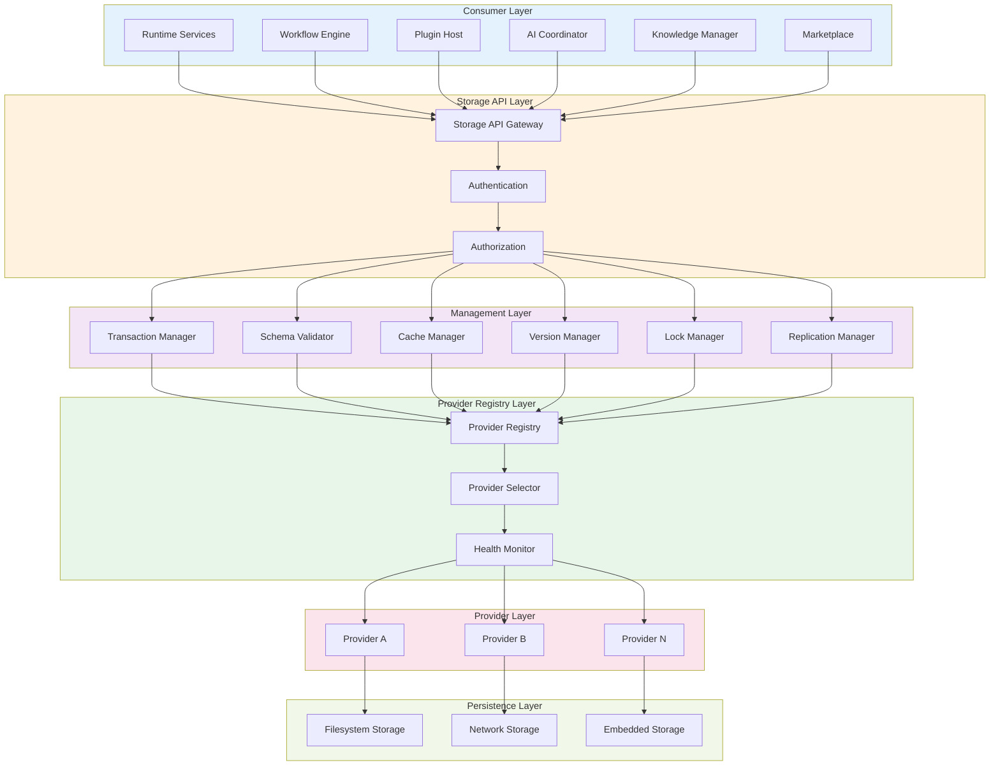
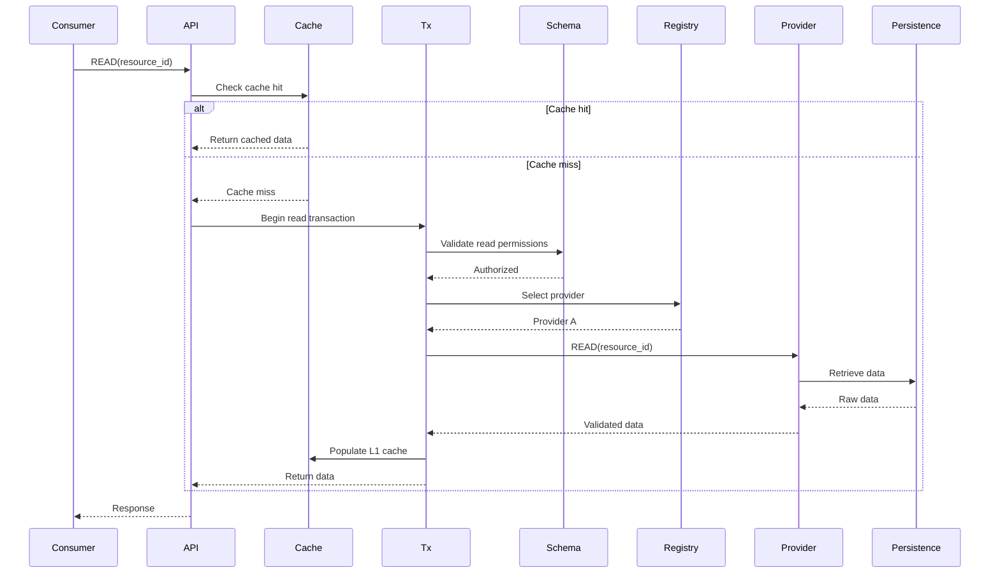
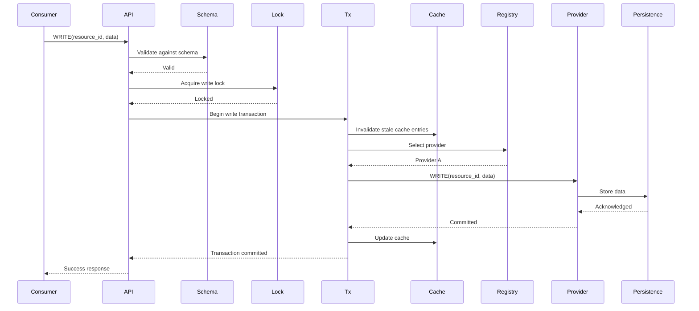
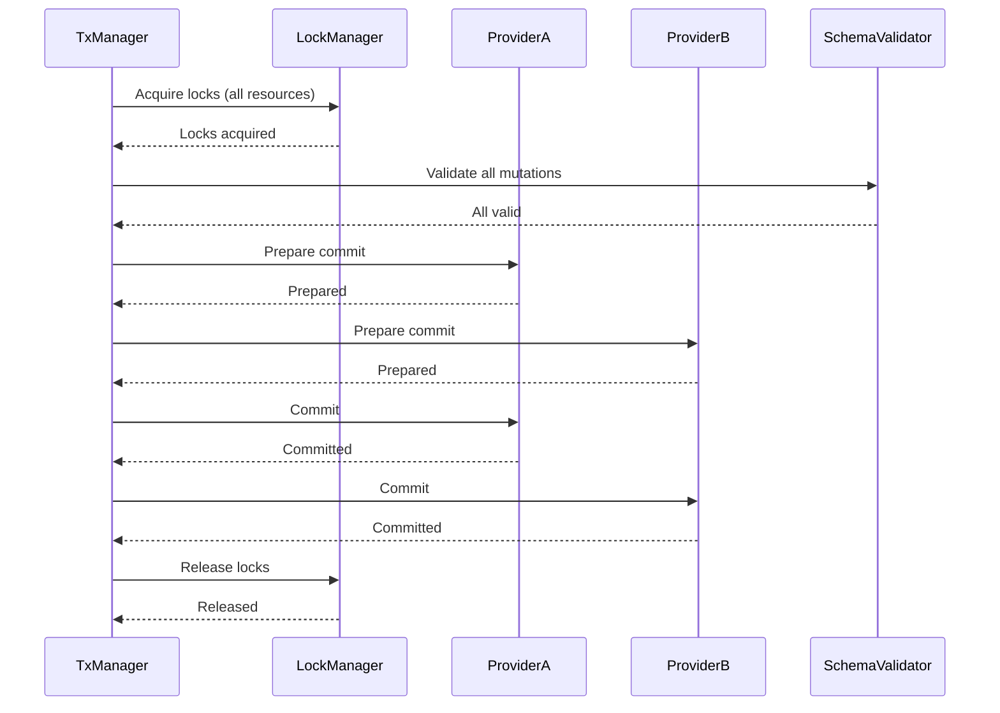
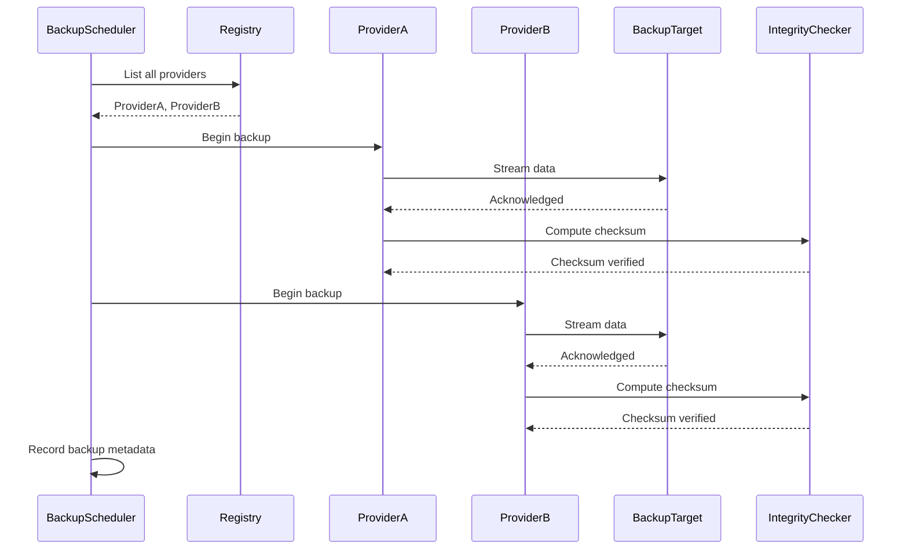
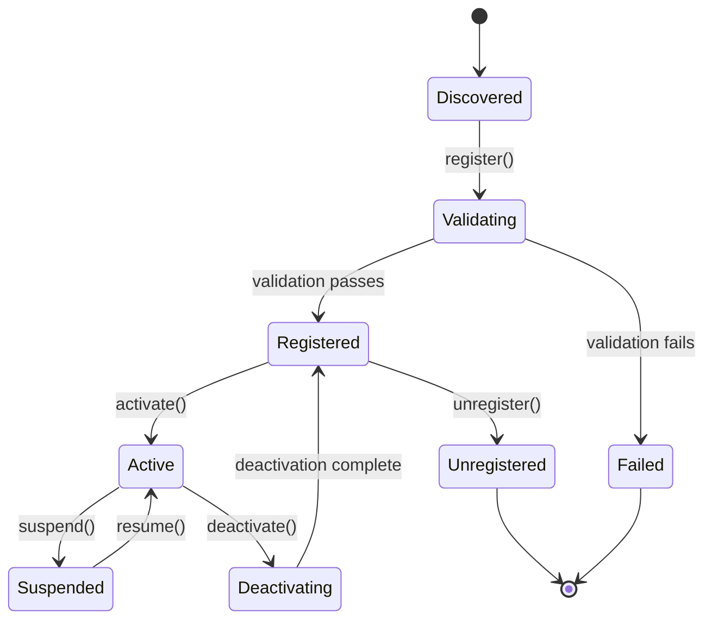
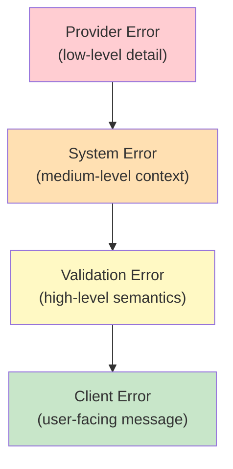
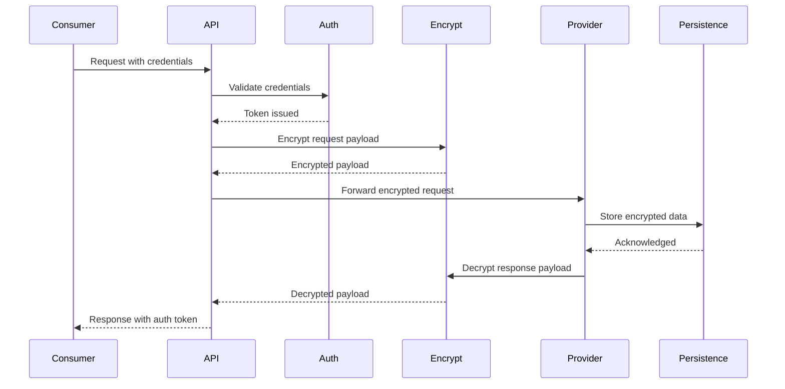

# RFC-0402: Storage Architecture

RFC: RFC-0402
Title: Storage Architecture
Status: Accepted
Category: Core
Owner: Storage Team
Authors: Atlas Specification Committee
Created: 2026-07-01
Updated: 2026-07-01
ADS Version: 1.0.0
Spec Version: 0.1.0
Normative: YES
Depends On:
  - RFC-0001 Runtime Overview
  - RFC-0002 Runtime Lifecycle
  - RFC-0401 Storage Overview
  - RFC-1001 Common Event Model
  - RFC-1006 Common Error Model
Supersedes: None
Superseded By: None
Related ADR:
  - ADR-0010 Contract-First Specification
Related JSON Schema:
  - schemas/storage/architecture.json
Related Catalog:
  - catalog/storage-architecture.md
Layer: Core
Audience: Storage developers, architects, specification reviewers
Target Release: 1.0.0
Review Cycle: Quarterly
Compatibility: Compatible with Spec 1.x
Last Updated: 2026-07-01

---

## Normative Status
This specification is Normative. Every Atlas implementation MUST conform to the layered architecture, component interactions, data flow patterns, and interface contracts defined in this document. Any deviation MUST be approved through the formal Architecture Decision Record (ADR) process.

This specification is subordinate to the Atlas Development System (ADS) Constitution, ADR-0010, and ADR-0012.

---

## Authority
This RFC is the authoritative specification for the Storage Architecture domain.

Any implementation MUST conform to this document.

If an implementation conflicts with this RFC, this RFC takes precedence.

Conflicts between RFCs SHALL be resolved through the ADR process.

---

## Terminology

The following terms are defined with exact meanings consistent with the Atlas Master Glossary and RFC-0301.

| Term | Definition | Source |
|---|---|---|
| Layer | A logical grouping of components with related responsibilities, enforcing unidirectional dependencies. | RFC-0402 |
| Component | A discrete unit of functionality within a layer that communicates through defined interfaces. | RFC-0402 |
| Provider Abstraction | The uniform interface layer that hides storage backend implementation details from consumers. | RFC-0403 |
| Data Flow | The sequence of operations through which data moves between components and layers. | RFC-0402 |
| Pipeline | A deterministic sequence of processing stages that a storage operation traverses. | RFC-0402 |
| Error Propagation | The mechanism by which errors traverse layer boundaries with context enrichment. | RFC-0402 |
| State Machine | A formal model defining allowed states and transitions for component lifecycle management. | RFC-0402 |
| Interface | A formal contract defining the operations, inputs, outputs, and invariants between components. | RFC-0402 |
| Workflow | A declarative directed graph specification expressing WHAT must happen, not HOW. | RFC-0301 |
| Execution | The process of evaluating a workflow graph and activating nodes to produce results. | RFC-0303 |
 RFC-0301 |
| Task | An atomic unit of work within a workflow, represented as a node. | RFC-0301 |
| Node | A graph element representing an atomic unit of work with defined inputs and outputs. | RFC-0301 |
| Context | The scoped data environment available to nodes during execution. | RFC-0307 |
| Frame | A discrete unit of visual data processed by vision nodes. | RFC-0301 |
| Tick | A single evaluation cycle of the workflow scheduler. | RFC-0301 |
| Scheduler | The component that determines WHEN and WHERE each node is executed. | RFC-0312 |
| Trigger | An event or condition that initiates workflow execution. | RFC-0311 |

---

## Table of Contents
1. [Introduction](#1-introduction)
2. [Goals](#2-goals)
3. [Non-Goals](#3-non-goals)
4. [Architectural Overview](#4-architectural-overview)
5. [Layered Architecture](#5-layered-architecture)
6. [Component Descriptions](#6-component-descriptions)
7. [Data Flow Architecture](#7-data-flow-architecture)
8. [Provider Abstraction Architecture](#8-provider-abstraction-architecture)
9. [Inter-Component Communication](#9-inter-component-communication)
10. [Error Handling Architecture](#10-error-handling-architecture)
11. [Security Architecture](#11-security-architecture)
12. [Performance Architecture](#12-performance-architecture)
12. [Storage Pipeline Architecture]
13. [Acceptance Criteria](#13-acceptance-criteria)
14. [References](#14-references)
15. [Future Evolution](#15-future-evolution)

---

## 1 Introduction

The Storage Architecture specification defines the layered component model that governs how all Storage subsystem components interact. It establishes the canonical architecture diagram, data flow patterns between layers, and the contract boundaries that every implementation MUST enforce.

This RFC does not define individual component behaviors in detail (those are covered by their respective RFCs). Instead, it defines the structural relationships, communication protocols, and data flow patterns that bind all components into a coherent system.

### 1.1 Architectural Paradigm

Storage follows a layered architecture paradigm where each layer provides services to the layer above and consumes services from the layer below. Data flows through these layers in a controlled manner, with each layer adding or transforming functionality.

### 1.2 Contract-First Architecture

Every layer boundary is a formal contract. Components communicate exclusively through their defined interfaces. No component accesses another component internal state directly.

---

## 2 Goals

1. **Layered Separation**: Define clear layer boundaries that enforce separation of concerns. Each layer has a single, well-defined responsibility.
2. **Component Isolation**: Every component operates in isolation. Components communicate only through defined interfaces.
3. **Data Flow Clarity**: Define canonical data flow patterns for all common operations: CRUD, transactions, backup, recovery, migration.
4. **Provider Abstraction**: Define a uniform abstraction layer that hides all provider implementation details from consumers.
5. **Error Propagation**: Define a consistent error handling model that propagates errors through layers with appropriate context enrichment.
6. **Security Per Layer**: Define security controls at every layer boundary. No layer is exempt from security checks.
7. **Performance Optimization Points**: Identify where performance optimizations can be applied without violating architectural boundaries.
8. **Extensibility**: Define extension points that allow new components and layers to be added without modifying existing ones.

---

## 3 Non-Goals

- **Component Implementation Details**: This RFC does not specify how individual components are implemented. Implementation details are covered by the respective RFCs.
- **Deployment Architecture**: Physical deployment topology is outside this specification. Deployment is governed by the infrastructure subsystem.
- **Network Protocol Details**: Inter-process communication protocols are governed by the IPC subsystem (RFC-0101).
- **User Interface Architecture**: UI components are outside this specification.

---

## 4 Architectural Overview

The Storage subsystem follows a six-layer architecture:

---

## 5 Layered Architecture

### 5.1 Layer 1: Consumer Layer

The Consumer Layer consists of all platform subsystems that consume storage services. Consumers interact exclusively with the Storage API Layer. They MUST NOT bypass the API to access lower layers.

**Responsibilities**:
- Declare storage requirements through schemas and resource types
- Specify transaction boundaries and isolation levels
- Configure backup and recovery policies
- Subscribe to storage events

### 5.2 Layer 2: Storage API Layer

The Storage API Layer is the public face of the Storage subsystem. It receives all requests from consumers, performs authentication and authorization, and routes requests to the appropriate management component.

**Responsibilities**:
- Accept all incoming storage operations
- Authenticate request origins
- Authorize operations against permission model
- Validate request parameters against schemas
- Route requests to management layer components
- Serialize responses

### 5.3 Layer 3: Management Layer

The Management Layer contains the core storage logic components. Each component handles a specific aspect of storage management. Components operate independently but coordinate through defined interfaces.

**Components**:
- **Transaction Manager** (RFC-0406): Coordinates atomic operations across providers
- **Schema Validator** (RFC-0405): Validates data against registered schemas
- **Cache Manager** (RFC-0410): Manages multi-layer caching
- **Version Manager** (RFC-0407): Manages version history and resolution
- **Lock Manager** (RFC-0417): Manages concurrency control
- **Replication Manager** (RFC-0418): Manages data replication

### 5.4 Layer 4: Provider Registry Layer

The Provider Registry Layer discovers, registers, and manages storage providers. It selects the appropriate provider for each operation based on resource type, consistency requirements, and availability.

**Components**:
- **Provider Registry**: Maintains the catalog of available providers
- **Provider Selector**: Chooses the optimal provider for each operation
- **Health Monitor**: Monitors provider health and triggers failover

### 5.5 Layer 5: Provider Layer

The Provider Layer contains the actual storage provider implementations. Each provider encapsulates a specific persistence mechanism and implements the Provider interface (RFC-0403).

**Constraints**:
- Providers MUST NOT expose internal state to upper layers
- Providers MUST translate all errors to Storage error codes
- Providers MUST NOT share mutable state with other providers

### 5.6 Layer 6: Persistence Layer

The Persistence Layer represents the actual storage media: filesystems, network services, embedded engines, cloud storage. This layer is entirely encapsulated by providers. Upper layers MUST NOT depend on persistence layer details.

---

## 6 Component Descriptions

### 6.1 Storage API Gateway

The API Gateway is the entry point for all storage operations. It provides:

- **Request Parsing**: Validates and parses incoming requests
- **Rate Limiting**: Enforces per-consumer rate limits
- **Request Routing**: Routes requests to appropriate management components
- **Response Serialization**: Formats responses according to consumer expectations

### 6.2 Transaction Manager

The Transaction Manager coordinates atomic operations. It:

- Begins, commits, and rolls back transactions
- Enforces isolation levels
- Detects and resolves conflicts
- Coordinates distributed transactions across providers

### 6.3 Schema Validator

The Schema Validator ensures data conforms to registered schemas. It:

- Validates data types and constraints
- Enforces referential integrity
- Checks schema compatibility for updates
- Reports validation errors with context

### 6.4 Cache Manager

The Cache Manager orchestrates multi-layer caching. It:

- Manages L1, L2, and L3 cache layers
- Enforces cache invalidation policies
- Coordinates cache coherence across providers
- Reports cache metrics

### 6.5 Version Manager

The Version Manager handles version operations. It:

- Assigns version numbers to new resources
- Maintains version histories
- Resolves version conflicts
- Manages snapshot creation and deletion

### 6.6 Lock Manager

The Lock Manager controls concurrent access. It:

- Acquires and releases locks
- Detects and resolves deadlocks
- Enforces lock escalation policies
- Manages lock timeouts

### 6.7 Replication Manager

The Replication Manager coordinates data replication. It:

- Configures replication topology
- Monitors replication lag
- Triggers failover procedures
- Validates replica consistency

---

## 7 Data Flow Architecture

### 7.1 Read Operation Flow

### 7.2 Write Operation Flow

### 7.3 Transaction Commit Flow

### 7.4 Backup Operation Flow

---

## 8 Provider Abstraction Architecture

The Provider abstraction is the cornerstone of Storage architecture. It ensures that upper layers are completely independent of persistence technology.

### 8.1 Provider Interface Contract

Every provider MUST implement the following operations:

| Operation | Input | Output | Error Conditions |
|---|---|---|---|
| Read | resource_id, options | data, metadata | NotFound, AccessDenied |
| Write | resource_id, data, options | version_number | ValidationError, Conflict |
| Delete | resource_id, options | deleted_version | NotFound, Locked |
| Query | filter, pagination | result_set | InvalidQuery |
| BeginTransaction | isolation_level | transaction_id | ProviderUnavailable |
| CommitTransaction | transaction_id | committed_count | Conflict, Timeout |
| RollbackTransaction | transaction_id | void | AlreadyCommitted |
| HealthCheck | void | health_status | Unhealthy |

### 8.2 Provider Registration Flow

### 8.3 Provider Selection Algorithm

The Provider Selector uses the following criteria to choose a provider for a given operation:

1. **Resource Type Match**: The provider MUST support the resource type being operated on.
2. **Capability Availability**: The provider MUST declare the required capability (read, write, query, replicate).
3. **Consistency Requirement**: The provider MUST support the required consistency level.
4. **Health Status**: The provider MUST be in Active or Registered state.
5. **Load Balance**: Among eligible providers, select the one with lowest current load.
6. **Affinity**: If a provider is already handling the resource, prefer affinity.

---

## 9 Inter-Component Communication

### 9.1 Synchronous Communication

Components communicate synchronously for:
- API requests (Consumer -> API Gateway)
- Schema validation (API Gateway -> Schema Validator)
- Lock acquisition (API Gateway -> Lock Manager)
- Provider selection (Management Layer -> Provider Registry)

### 9.2 Asynchronous Communication

Components communicate asynchronously for:
- Event publishing (any component -> Event Bus)
- Cache invalidation (Cache Manager -> other components)
- Backup notifications (Backup Scheduler -> observers)
- Health check results (Health Monitor -> Provider Registry)

### 9.3 Communication Protocol

All inter-component communication uses a structured message format:

| Field | Type | Required | Description |
|---|---|---|---|
| message_id | string | YES | Unique message identifier |
| timestamp | int64 | YES | Unix epoch timestamp in nanoseconds |
| source_component | string | YES | Originating component identifier |
| target_component | string | YES | Destination component identifier |
| operation | string | YES | Operation being performed |
| resource_id | string | YES | Affected resource identifier |
| payload | bytes | YES | Operation-specific data |
| metadata | map | NO | Additional context |
| correlation_id | string | NO | Links related messages |
| trace_id | string | NO | Distributed tracing identifier |

---

## 10 Error Handling Architecture

### 10.1 Error Classification

Errors are classified into four categories:

| Category | Description | Recovery |
|---|---|---|
| ClientError | Invalid request from consumer | Consumer correction |
| ValidationError | Data violates schema constraints | Data correction |
| ProviderError | Provider-specific failure | Retry or failover |
| SystemError | Internal system failure | Operator intervention |

### 10.2 Error Propagation

Errors propagate upward through layers with context enrichment:

### 10.3 Error Codes

All Storage errors use standardized error codes defined in catalog/storage-errors.md. Error codes follow the pattern STG-XXXX where XXXX is a four-digit numeric code.

---

## 11 Security Architecture

### 11.1 Defense-in-Depth Layers

Security is enforced at every layer:

| Layer | Security Control | RFC Reference |
|---|---|---|
| API Layer | Request authentication | RFC-0409 |
| API Layer | Access control authorization | RFC-0409 |
| Management | Data encryption at rest | RFC-0409 |
| Management | Data encryption in transit | RFC-0409 |
| Provider | Provider isolation | INV-STG-06 |
| Provider | Secure deletion | RFC-0409 |

### 11.2 Security Data Flow

---

## 12 Performance Architecture

### 12.1 Optimization Points

The architecture identifies specific layers where performance optimizations can be applied:

| Layer | Optimization | Impact |
|---|---|---|
| Cache Layer | Read caching | Reduces provider load by >90% |
| Lock Layer | Optimistic concurrency | Reduces lock contention |
| Provider Layer | Connection pooling | Reduces connection overhead |
| Management Layer | Batch operations | Reduces round-trip count |
| API Layer | Request coalescing | Reduces duplicate operations |

### 12.2 Performance Monitoring Architecture

Performance metrics flow from providers upward through the layer stack:

---

## 12 Storage Pipeline Architecture

Every write operation in Storage traverses a deterministic pipeline of stages: Validate, Serialize, Encrypt, Compress, Persist, Verify, Commit, Notify.

### 12.1 Pipeline Flow

\\\mermaid
flowchart LR
    A["Write Request"] --> B["Validate"]
    B --> C["Serialize"]
    C --> D["Encrypt"]
    D --> E["Compress"]
    E --> F["Persist"]
    F --> G["Verify"]
    G --> H["Commit"]
    H --> I["Notify"]
    I --> J["Response"]
    
    B -->|"Failed"| K["Error"]
    D -->|"Failed"| L["Error"]
    F -->|"Failed"| M["Error"]
    G -->|"Failed"| N["Error"]
    
    style Validate fill:#e8f5e9
    style Serialize fill:#fff3e0
    style Encrypt fill:#fce4ec
    style Compress fill:#e3f2fd
    style Persist fill:#f3e5f5
    style Verify fill:#ffebee
    style Commit fill:#e8f5e9
    style Notify fill:#e3f2fd
\\\

## 13 Acceptance Criteria

### AC-0402-01: Architecture Compliance
- **Requirement**: Every Storage implementation MUST follow the six-layer architecture defined in Section 5.
- **Verification**: Architecture review of implementation module structure.
- **Expected Result**: All six layers are present with proper separation.

### AC-0402-02: Provider Abstraction
- **Requirement**: No component in Layers 1-3 MAY access provider internals directly.
- **Verification**: Code review of cross-layer dependencies.
- **Expected Result**: All provider access flows through the Provider interface.

### AC-0402-03: Data Flow Completeness
- **Requirement**: Read, write, transaction, and backup data flows MUST be implemented as defined in Section 7.
- **Verification**: Integration tests exercising each data flow pattern.
- **Expected Result**: All four data flows tested and verified.

### AC-0402-04: Error Propagation
- **Requirement**: Errors MUST propagate through layers with context enrichment as defined in Section 10.
- **Verification**: Fault injection tests at each layer boundary.
- **Expected Result**: Error context is enriched at each layer without leaking implementation details.

### AC-0402-05: Security Layers
- **Requirement**: Security controls MUST be enforced at every layer boundary as defined in Section 11.
- **Verification**: Security audit of each layer security controls.
- **Expected Result**: All five security layers verified.

### AC-0402-06: Provider Registration
- **Requirement**: Provider lifecycle state machine MUST be implemented as defined in Section 8.
- **Verification**: State machine transition tests.
- **Expected Result**: All legal transitions verified; all illegal transitions rejected.

---

## 14 References

- [RFC-0401 Storage Overview](RFC-0401-storage-overview.md)
- [RFC-0403 Storage Provider](RFC-0403-storage-provider.md)
- [RFC-0406 Storage Transactions](RFC-0406-storage-transactions.md)
- [RFC-0409 Storage Security](RFC-0409-storage-security.md)
- [RFC-0001 Runtime Overview](../runtime/RFC-0001-runtime-overview.md)
- [RFC-0101 IPC Overview](../ipc/RFC-0101-ipc-overview.md)
- [RFC-1001 Common Event Model](../common/RFC-1001-event-model.md)
- [RFC-1006 Common Error Model](../common/RFC-1006-error-model.md)

---

## 15 Future Evolution

Future specifications will address:
- **Dynamic Layer Addition**: Support for adding new layers at runtime without restart.
- **Adaptive Routing**: Intelligent request routing based on real-time provider performance.
- **Multi-Cluster Architecture**: Storage across multiple Atlas clusters with automatic failover.
- **Edge Storage**: Lightweight storage layers for edge computing deployments.

---

## Layer Boundaries

### Responsibilities
This specification IS responsible for:
- Defining the six-layer architecture model and enforcing separation of concerns between layers.
- Specifying the canonical data flow patterns for CRUD, transactions, backup, and recovery operations.
- Defining the Provider Abstraction interface that isolates consumers from backend implementation details.
- Establishing error propagation and context enrichment rules across layer boundaries.
- Defining the component lifecycle state machine and registration model.

### Non-Responsibilities
This specification IS NOT responsible for:
- Implementing individual component logic (delegated to domain-specific RFCs).
- Managing deployment topology or physical infrastructure.
- Defining security policies (delegated to RFC-0409).
- Defining performance benchmarks (delegated to RFC-0415).

### Dependencies
| Dependency | Direction | Description |
|---|---|---|
| RFC-0401 | Consumed | Storage Overview (philosophy and goals) |
| RFC-0403 | Consumed | Storage Provider (provider abstraction) |
| RFC-0409 | Consumed | Storage Security (security per layer) |
| RFC-1001 | Consumed | Common Event Model |
| RFC-1006 | Consumed | Common Error Model |

### Consumers
- RFC-0404 Storage Lifecycle (consumes layer model for state management)
- RFC-0406 Storage Transactions (consumes data flow patterns)
- RFC-0410 Storage Cache (consumes layer boundaries)
- RFC-0414 Storage Observability (consumes component interactions)

### Providers
- schemas/storage/architecture.json (architecture schema)
- catalog/storage-architecture.md (architecture catalog)

### Forbidden Dependencies
- Layers MUST NOT depend on layers above them.
- This specification MUST NOT assume any specific programming language.
- This specification MUST NOT assume any specific storage backend.

---

## Security

This specification defines security architecture for each layer:

- **Authentication**: Every layer boundary MUST enforce authentication for incoming requests. Credentials are validated before any operation proceeds.
- **Authorization**: Access control policies MUST be enforced at the API layer before requests reach lower layers.
- **Encryption**: Data MUST be encrypted at the Provider layer before being passed to the underlying storage backend.
- **Audit Trail**: Every cross-layer operation MUST produce an audit log entry capturing the operation, initiator, timestamp, and result.
- **Defense in Depth**: Security controls are applied at every layer boundary. No single layer is the sole security enforcement point.

---

## Performance

This specification defines performance considerations for the layered architecture:

- **Layer Overhead**: Each layer adds bounded processing overhead. The cumulative overhead across all layers MUST NOT degrade overall system performance beyond acceptable thresholds.
- **Pipeline Efficiency**: The write pipeline MUST execute stages in a deterministic order with minimal intermediate copying.
- **Concurrency**: Components within a layer MUST support concurrent operation without locking across layer boundaries.
- **Resource Limits**: Each layer MUST enforce resource consumption limits to prevent cascading resource exhaustion.

---

## Compatibility

This specification defines compatibility guarantees:

- **Interface Stability**: Public interfaces between layers MUST maintain backward compatibility within a major version.
- **Data Flow Consistency**: The canonical data flow patterns MUST remain stable across minor versions.
- **Error Contract**: Error types and context enrichment rules MUST remain consistent across layer boundaries.

---

## Compliance

This specification requires compliance with:

- The Atlas Development System (ADS) Constitution.
- ADR-0010 (Contract-First Specification-Driven Development).
- ADR-0012 (Security Architecture).
- All normative requirements defined in this RFC and its dependent RFCs.

---

## Future Evolution

Future specifications will address:
- **Dynamic Layer Addition**: Support for adding new layers at runtime without restart.
- **Adaptive Routing**: Intelligent request routing based on real-time provider performance.
- **Multi-Cluster Architecture**: Storage across multiple Atlas clusters with automatic failover.
- **Edge Storage**: Lightweight storage layers for edge computing deployments.

---

## Runtime Independence

This specification is completely independent of any runtime implementation platform. Specifically, this specification MUST NOT assume:

- Any programming language (Rust, Node.js, TypeScript, Go, Python, etc.)
- Any runtime environment (Electron, Tauri, Browser, Desktop, Server)
- Any storage backend (SQLite, PostgreSQL, MongoDB, Redis, etc.)
- Any operating system (Windows, Linux, macOS, etc.)
- Any hardware architecture (CPU, GPU, FPGA, etc.)
- Any threading model (single-threaded, multi-threaded, actor-based, etc.)
- Any cloud provider (AWS, Azure, GCP, etc.)
- Any container platform (Docker, containerd, etc.)

---

## Acceptance Criteria

| # | Criterion | Verification Method |
|---|---|---|
| AC-01 | Every Storage implementation MUST follow the six-layer architecture defined in this RFC. | Architecture review of implementation module structure. |
| AC-02 | No component in Layers 1-3 MAY access provider internals directly. | Code review of cross-layer dependencies. |
| AC-03 | Read, write, transaction, and backup data flows MUST be implemented as defined in this RFC. | Integration tests exercising each data flow pattern. |
| AC-04 | Errors MUST propagate through layers with context enrichment as defined in this RFC. | Fault injection tests at each layer boundary. |
| AC-05 | Security controls MUST be enforced at every layer boundary as defined in this RFC. | Security audit of each layer security controls. |
| AC-06 | Provider lifecycle state machine MUST be implemented as defined in this RFC. | State machine transition tests. |

---

## References

| Reference | Description |
|---|---|
| RFC-0401 | Storage Overview |
| RFC-0403 | Storage Provider |
| RFC-0406 | Storage Transactions |
| RFC-0409 | Storage Security |
| RFC-0410 | Storage Cache |
| RFC-0414 | Storage Observability |
| ADR-0010 | Contract-First Specification |
| ADR-0012 | Security Architecture |
| schemas/storage/architecture.json | Architecture Schema Definition |
| catalog/storage-architecture.md | Architecture Catalog |
| Glossary | Atlas Master Glossary |
| Constitution | Atlas AI Constitution |

---

## Compliance Matrix

| Category | Value |
|---|---|
| Related RFC | RFC-0401, RFC-0403, RFC-0404, RFC-0406, RFC-0409, RFC-0410, RFC-0414 |
| Related ADR | ADR-0010, ADR-0012 |
| Related JSON Schema | schemas/storage/architecture.json |
| Related Catalog | catalog/storage-architecture.md |

---

## Revision History

| Version | Status | Date | Author | Notes |
|---|---|---|---|---|
| 0.1.0 | Proposed | 2026-07-01 | Atlas Specification Committee | Initial publication |
| 1.0.0 | Accepted | 2026-07-01 | Atlas Specification Committee | Added Authority, Terminology, Layer Boundaries, Security, Performance, Compatibility, Compliance, Runtime Independence, Acceptance Criteria, References, Compliance Matrix, Revision History |

