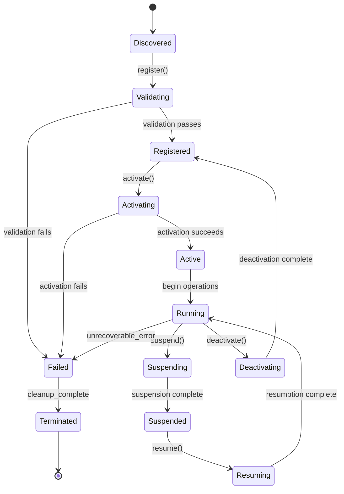
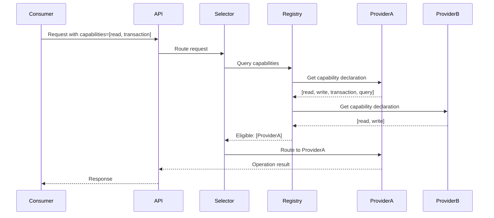
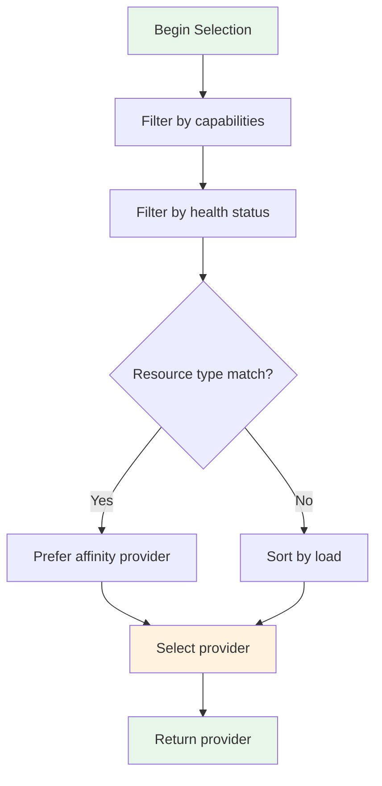

# RFC-0403: Storage Provider

RFC: RFC-0403
Title: Storage Provider
Status: Accepted
Category: Core
Owner: Storage Team
Authors: Atlas Specification Committee
Created: 2026-07-01
Updated: 2026-07-01
ADS Version: 1.0.0
Spec Version: 0.1.0
Normative: YES
Depends On:
  - RFC-0401 Storage Overview
  - RFC-0402 Storage Architecture
Supersedes: None
Superseded By: None
Related ADR:
  - ADR-0010 Contract-First Specification
Related JSON Schema:
  - schemas/storage/provider.json
Related Catalog:
  - catalog/storage-provider.md
Layer: Core
Audience: Storage developers, architects, specification reviewers
Target Release: 1.0.0
Review Cycle: Quarterly
Compatibility: Compatible with Spec 1.x
Last Updated: 2026-07-01

---

## Normative Status
This specification is Normative. Every Atlas implementation MUST conform to the Provider interface, lifecycle, capability negotiation, and error translation rules defined in this document. Any deviation MUST be approved through the formal Architecture Decision Record (ADR) process.

This specification is subordinate to the Atlas Development System (ADS) Constitution, ADR-0010, and ADR-0012.

---

## Authority
This RFC is the authoritative specification for the Storage Provider domain.

Any implementation MUST conform to this document.

If an implementation conflicts with this RFC, this RFC takes precedence.

Conflicts between RFCs SHALL be resolved through the ADR process.

---

## Terminology

The following terms are defined with exact meanings consistent with the Atlas Master Glossary and RFC-0301.

| Term | Definition | Source |
|---|---|---|
| Provider | The abstraction layer that encapsulates a specific storage backend implementation and exposes a uniform interface to Storage components. | RFC-0403 |
| Provider Interface | The formal contract defining operations, inputs, outputs, and invariants that every storage provider MUST implement. | RFC-0403 |
| Provider Registry | The subsystem that discovers, registers, and manages storage providers. | RFC-0401 |
| Capability | A discrete function or service exposed by a Storage provider. | RFC-0425 |
| Capability Negotiation | The process by which a consumer determines which operations a provider supports. | RFC-0403 |
| Error Translation | The conversion of provider-specific error codes into the common error taxonomy defined by the platform. | RFC-0403 |
| Hot-Swap | The ability to replace a running provider instance without interrupting ongoing operations. | RFC-0403 |
| Provider Lifecycle | The sequence of states a provider traverses from registration through deactivation. | RFC-0403 |
| Workflow | A declarative directed graph specification expressing WHAT must happen, not HOW. | RFC-0301 |
| Execution | The process of evaluating a workflow graph and activating nodes to produce results. | RFC-0303 |
 RFC-0301 |
| Task | An atomic unit of work within a workflow, represented as a node. | RFC-0301 |
| Node | A graph element representing an atomic unit of work with defined inputs and outputs. | RFC-0301 |
| Context | The scoped data environment available to nodes during execution. | RFC-0307 |
| Frame | A discrete unit of visual data processed by vision nodes. | RFC-0301 |
| Tick | A single evaluation cycle of the workflow scheduler. | RFC-0301 |
| Scheduler | The component that determines WHEN and WHERE each node is executed. | RFC-0312 |
| Trigger | An event or condition that initiates workflow execution. | RFC-0311 |

---

## 1 Introduction

The Storage Provider specification defines the contract that every storage backend MUST implement. The Provider interface abstracts all persistence mechanisms behind a uniform API, enabling the Storage subsystem to work with any storage technology without modification.

Providers are discovered, registered, validated, and managed by the Provider Registry (see RFC-0402). Each provider declares its capabilities, configuration requirements, and health status through standardized interfaces.

### 1.1 The Provider Contract

The Provider contract is a formal interface specification. Any implementation that satisfies this interface is a valid Storage provider. The contract defines:

- **Operations**: Read, write, delete, query, transaction management
- **Lifecycle**: Discovery, registration, activation, deactivation, removal
- **Capabilities**: Declared through a capability registry
- **Error Translation**: Provider-specific errors mapped to Storage error codes
- **Health**: Periodic health checks and failure reporting

### 1.2 Provider Types

Providers are categorized by the persistence mechanism they encapsulate:

| Provider Type | Description | Example Use Case |
|---|---|---|
| Embedded Provider | Stores data within the same process address space | Local configuration, session state |
| Network Provider | Stores data on a remote service accessible over a network | Distributed workflow state |
| Hybrid Provider | Combines local and remote storage strategies | Cached workflow state with remote persistence |
| Plugin Provider | Dynamically loaded provider registered at runtime | Third-party storage backends |

---

## 2 Goals

1. **Uniform Interface**: Define a single interface that all providers MUST implement, regardless of their underlying persistence technology.
2. **Hot-Swappable Providers**: Support replacing providers at runtime without stopping the Storage subsystem.
3. **Capability Negotiation**: Enable consumers to select providers based on declared capabilities.
4. **Provider Isolation**: Ensure providers cannot interfere with each other or access each other data.
5. **Error Translation**: Map provider-specific errors to standardized Storage error codes.
6. **Health Monitoring**: Continuously monitor provider health and trigger failover on failure.
7. **Configuration Flexibility**: Allow providers to be configured without modifying the Storage core.
8. **Multi-Provider Routing**: Route different resource types to different providers based on requirements.

---

## 3 Non-Goals

- **Provider Implementation**: This RFC does not define how providers implement their internal storage mechanisms.
- **Provider Deployment**: How providers are deployed and distributed is outside this specification.
- **Provider Testing**: Testing procedures for providers are not defined here.
- **Provider Licensing**: Licensing terms for providers are not governed by this specification.

---

## 4 Provider Interface

Every provider MUST implement the following interface operations:

### 4.1 Core Operations

| Method | Description | Parameters | Returns | Errors |
|---|---|---|---|---|
| Read | Retrieve a resource by ID | resource_id, options | data, metadata | NotFound, AccessDenied |
| Write | Store or update a resource | resource_id, data, options | version_number | ValidationError, Conflict |
| Delete | Remove a resource | resource_id, options | deleted_version | NotFound, Locked |
| Query | Execute a query with filters | filter, pagination | result_set, total_count | InvalidQuery, Timeout |
| Exists | Check if a resource exists | resource_id | boolean | AccessDenied |

### 4.2 Transaction Operations

| Method | Description | Parameters | Returns | Errors |
|---|---|---|---|---|
| BeginTransaction | Start a new transaction | isolation_level | transaction_id | ProviderUnavailable |
| CommitTransaction | Commit an open transaction | transaction_id | committed_count | Conflict, Timeout |
| RollbackTransaction | Roll back an open transaction | transaction_id | void | AlreadyCommitted |
| PrepareTransaction | Prepare a transaction for two-phase commit | transaction_id | prepared_flag | ProviderUnavailable |
| AbortTransaction | Abort a transaction without rollback | transaction_id | void | None |

### 4.3 Health Operations

| Method | Description | Parameters | Returns | Errors |
|---|---|---|---|---|
| HealthCheck | Check provider health | void | health_status | None |
| GetMetrics | Return provider metrics | void | metrics_map | None |
| GetStatus | Return detailed provider status | void | status_object | None |

### 4.4 Lifecycle Operations

| Method | Description | Parameters | Returns | Errors |
|---|---|---|---|---|
| Initialize | Initialize the provider | config | void | ConfigError |
| Shutdown | Gracefully shut down the provider | void | void | None |
| Migrate | Migrate provider data to new format | version_from, version_to | void | MigrationError |

---

## 5 Provider Lifecycle

### 5.1 State Machine

### 5.2 State Definitions

**Discovered**: The provider has been detected by the Provider Registry but not yet registered. The provider module or package has been identified.

**Validating**: The Provider Registry is validating the provider implementation against the Provider interface contract. Schema, capability declarations, and configuration are checked.

**Registered**: The provider has passed validation and is registered in the Provider Registry. It is not yet active and cannot serve operations.

**Activating**: The provider is initializing its internal state, establishing connections, and preparing to serve operations.

**Active**: The provider is fully initialized and ready to serve operations. It is visible to the Provider Selector.

**Running**: The provider is actively serving storage operations. Health checks are passing.

**Suspending**: The provider is transitioning from Running to Suspended. Active operations are being drained.

**Suspended**: The provider is inactive but retains its configuration and registered state. It can be resumed without re-initialization.

**Deactivating**: The provider is shutting down gracefully. Active connections are being closed, buffers are being flushed.

**Failed**: The provider encountered an unrecoverable error. It cannot serve operations and must be removed.

**Terminated**: The provider has been fully removed from the Provider Registry. All resources are released.

### 5.3 Transition Rules

| From | To | Trigger | Condition |
|---|---|---|---|
| Discovered | Validating | register(provider_id) | Provider package is accessible |
| Validating | Registered | validation_complete | All interface methods present |
| Validating | Failed | validation_error | Missing required methods or signature mismatch |
| Registered | Activating | activate(provider_id) | No active transactions |
| Activating | Active | initialization_complete | All internal state initialized |
| Activating | Failed | initialization_error | Connection failure, config error |
| Active | Running | start_operations() | Health check passes |
| Running | Suspending | suspend(provider_id) | All active operations acknowledged |
| Suspending | Suspended | drain_complete | No in-flight operations remain |
| Suspended | Resuming | resume(provider_id) | Configuration unchanged |
| Resuming | Running | reinitialization_complete | Provider re-initialized |
| Running | Deactivating | deactivate(provider_id) | No active transactions |
| Deactivating | Registered | shutdown_complete | All resources released |
| Running | Failed | error_classifier(error) | Error classified as fatal |
| Failed | Terminated | cleanup_complete | Error logged, resources released |

---

## 6 Provider Capabilities

### 6.1 Capability Declaration

Every provider declares its capabilities through a capability registry. Capabilities determine which operations the provider supports.

| Capability | Description | Required For |
|---|---|---|
| read | Read resources by ID | All providers |
| write | Write resources by ID | All providers |
| delete | Delete resources by ID | All providers |
| query | Execute filtered queries | Search, analytics |
| transaction | Support transactions | Consistent multi-resource ops |
| batch | Support batch operations | Bulk imports/exports |
| replicate | Support data replication | Multi-region deployments |
| backup | Support backup operations | Disaster recovery |
| versioning | Support version history | Audit, rollback |
| encryption | Support encryption at rest | Security compliance |
| streaming | Support streaming operations | Large data transfers |
| locking | Support row-level locking | Concurrency control |

### 6.2 Capability Negotiation

When a consumer requests a storage operation, the Provider Selector negotiates capabilities:

1. The consumer declares required capabilities in the request.
2. The Provider Selector queries the capability registry for each registered provider.
3. Providers that declare all required capabilities are eligible.
4. The Provider Selector chooses the best eligible provider based on load, affinity, and health.

---

## 7 Provider Selection

### 7.1 Selection Criteria

The Provider Selector evaluates providers using the following priority order:

1. **Capability Match** (MUST): Provider declares all required capabilities.
2. **Health Status** (MUST): Provider is in Running or Active state.
3. **Resource Type Match** (SHOULD): Provider is configured for the resource type.
4. **Consistency Level** (SHOULD): Provider supports the required consistency model.
5. **Load Balance** (SHOULD): Provider has the lowest current operation count.
6. **Affinity** (MAY): Provider is already handling the same resource.
7. **Latency** (MAY): Provider has the lowest average response time.

### 7.2 Selection Algorithm

---

## 8 Provider Configuration

### 8.1 Configuration Structure

Each provider is configured through a structured configuration object:

| Field | Type | Required | Description |
|---|---|---|---|
| provider_id | string | YES | Unique provider identifier |
| provider_type | string | YES | Provider type enum |
| capabilities | string[] | YES | Declared capabilities |
| endpoints | map | YES | Connection endpoint configuration |
| timeout_ms | int | NO | Operation timeout in milliseconds |
| max_connections | int | NO | Maximum concurrent connections |
| retry_policy | object | NO | Retry configuration |
| encryption_enabled | bool | NO | Whether encryption is enabled |
| consistency_level | string | NO | Default consistency model |

### 8.2 Configuration Validation

The Provider Registry validates provider configurations during registration:

1. All required fields are present.
2. Endpoint addresses are syntactically valid.
3. Numeric values are within acceptable ranges.
4. Capability declarations are consistent with provider type.
5. No configuration conflicts exist with registered providers.

---

## 9 Provider Health Monitoring

### 9.1 Health Check Types

| Check Type | Frequency | Description |
|---|---|---|
| Ping | Every 5 seconds | Basic connectivity check |
| Operation | Every 30 seconds | Execute a lightweight read operation |
| Resource | Every 60 seconds | Verify provider resource availability |
| Comprehensive | Every 300 seconds | Full health diagnostic |

### 9.2 Health Status Values

| Status | Description | Action |
|---|---|---|
| Healthy | All checks passing | Continue normal operations |
| Degraded | Some checks failing | Reduce load, prepare failover |
| Unhealthy | Critical checks failing | Stop routing new operations |
| Unknown | Health check timeout | Quarantine provider, investigate |

### 9.3 Failover Procedure

When a provider becomes Unhealthy:

1. The Health Monitor marks the provider as Unhealthy.
2. The Provider Selector stops routing new operations to the provider.
3. In-flight operations are allowed to complete or are rolled back.
4. The Provider Registry attempts to activate a standby provider if available.
5. An event is published to the Event Bus (see RFC-0413).
6. If no standby is available, the affected resource types become temporarily unavailable.

---

## 10 Provider Error Translation

### 10.1 Error Translation Table

Providers MUST map their native errors to Storage error codes:

| Provider Error Category | Storage Error Code | Description |
|---|---|---|
| Connection failure | STG-4001 | Provider connection lost |
| Timeout | STG-4002 | Operation exceeded timeout |
| Validation error | STG-4003 | Data failed validation |
| Conflict | STG-4004 | Concurrent modification detected |
| Not found | STG-4005 | Resource does not exist |
| Access denied | STG-4006 | Insufficient permissions |
| Storage full | STG-4007 | Provider storage capacity exceeded |
| Corruption | STG-4008 | Data integrity violation detected |
| Lock timeout | STG-4009 | Could not acquire lock within timeout |
| Unsupported operation | STG-4010 | Operation not supported by provider |

### 10.2 Error Context Preservation

While native provider errors are translated to Storage error codes, the original error context is preserved in the audit log (see RFC-0409) for diagnostic purposes. The audit log entry includes the provider name, error code, timestamp, and a sanitized error message.

---

## 11 Provider Pluggability

### 11.1 Hot-Swap Procedure

Providers MUST support hot-swapping without restarting the Storage subsystem:

1. The new provider is registered alongside the existing provider.
2. Both providers are validated against the interface contract.
3. Resource types are migrated from the old provider to the new provider.
4. The old provider is deactivated and removed.
5. The migration is verified and confirmed.

### 11.2 Plugin Provider Loading

Plugin providers are loaded dynamically:

1. The Plugin Host discovers the provider plugin package.
2. The provider module is loaded into an isolated execution context.
3. The provider interface is validated against the contract.
4. The provider is registered with the Provider Registry.
5. The provider is activated and begins serving operations.

---

## 12 Multi-Provider Support

### 12.1 Resource Type Routing

Different resource types can be routed to different providers:

| Resource Type | Provider | Rationale |
|---|---|---|
| Workflow state | Embedded provider | Low latency, same process |
| Plugin data | Network provider | Distributed plugin state |
| Audit log | Hybrid provider | Local write, remote backup |
| User preferences | Embedded provider | Small data, frequent access |

### 12.2 Cross-Provider Transactions

When a transaction spans multiple providers, the Transaction Manager coordinates a two-phase commit:

1. The Transaction Manager identifies all involved providers.
2. Each provider prepares its transaction (Phase 1).
3. If all providers report prepared, the Transaction Manager commits (Phase 2).
4. If any provider reports failure, all prepared transactions are rolled back.

---

## 13 Provider Isolation

### 13.1 Isolation Requirements

- **Data Isolation**: Providers MUST NOT share mutable state. Each provider operates on a distinct data scope.
- **Memory Isolation**: Plugin providers MUST execute in isolated memory contexts.
- **Error Isolation**: A provider failure MUST NOT propagate to other providers.
- **Configuration Isolation**: Provider configurations MUST NOT leak between providers.

### 13.2 Isolation Enforcement

The Provider Registry enforces isolation through:

1. Separate connection pools per provider.
2. Namespace-scoped resource IDs per provider.
3. Independent error handling per provider.
4. Configuration isolation through sealed configuration objects.

---

## 13 Provider Capability Matrix

Every Storage Provider declares its capabilities at initialization time. Consumers query these capabilities before attempting operations, enabling safe feature negotiation.

### 13.1 Capability Declaration

Providers MUST declare capabilities through the manifest interface defined in RFC-0425. Each capability is identified by a flag from the storage-capability-flags.md catalog.

### 13.2 Baseline Capability Requirements

All providers MUST support: Read, Write, Delete, List, Scan, Encrypt, Versioning, Backup, Recovery, Audit.

Optional capabilities vary by provider type as defined in storage-providers.md.

### 13.3 Capability Query Protocol

1. The consumer sends a capability query with required flag set.
2. The provider returns matching capabilities with version information.
3. If no provider satisfies all required flags, the query returns empty.
4. The Storage layer MAY compose multiple providers to satisfy complex requirements.

## 14 Acceptance Criteria

### AC-0403-01: Interface Compliance
- **Requirement**: Every provider implementation MUST implement all methods defined in Section 4.
- **Verification**: Static interface conformance check at registration time.
- **Expected Result**: All required methods present with correct signatures.

### AC-0403-02: Lifecycle State Machine
- **Requirement**: Provider lifecycle state machine MUST be implemented as defined in Section 5.
- **Verification**: State transition tests covering all legal and illegal transitions.
- **Expected Result**: All legal transitions succeed; all illegal transitions rejected with appropriate errors.

### AC-0403-03: Capability Negotiation
- **Requirement**: Provider capability negotiation MUST work as defined in Section 6.
- **Verification**: Integration tests with providers declaring different capabilities.
- **Expected Result**: Operations are correctly routed to providers with matching capabilities.

### AC-0403-04: Error Translation
- **Requirement**: All provider-specific errors MUST be translated to Storage error codes as defined in Section 10.
- **Verification**: Fault injection tests triggering each error category.
- **Expected Result**: All errors mapped to correct Storage error codes with preserved context in audit log.

### AC-0403-05: Hot-Swap
- **Requirement**: Providers MUST support hot-swapping without Storage subsystem restart as defined in Section 11.
- **Verification**: Hot-swap test executing the procedure defined in Section 11.1.
- **Expected Result**: Provider swap completes with zero downtime; all operations continue during swap.

### AC-0403-06: Provider Isolation
- **Requirement**: Provider isolation MUST be enforced as defined in Section 13.
- **Verification**: Tests verifying data, memory, error, and configuration isolation.
- **Expected Result**: No cross-provider state leakage detected in any isolation dimension.

---

## 15 References

- [RFC-0401 Storage Overview](RFC-0401-storage-overview.md)
- [RFC-0402 Storage Architecture](RFC-0402-storage-architecture.md)
- [RFC-0406 Storage Transactions](RFC-0406-storage-transactions.md)
- [RFC-0409 Storage Security](RFC-0409-storage-security.md)
- [RFC-0413 Storage Events](RFC-0413-storage-events.md)
- [RFC-1006 Common Error Model](../common/RFC-1006-error-model.md)

---

## 16 Future Evolution

Future specifications will address:
- **Auto-Scaling Providers**: Providers that automatically adjust capacity based on load.
- **Provider Fencing**: Enhanced isolation for multi-tenant provider deployments.
- **Provider Federation**: Cross-provider resource queries spanning multiple providers.
- **Provider Versioning**: Support for multiple provider interface versions simultaneously.

---

## Layer Boundaries

### Responsibilities
This specification IS responsible for:
- Defining the Provider interface that every storage backend MUST implement.
- Specifying the Provider lifecycle state machine from registration through deactivation.
- Defining the capability negotiation protocol for discovering provider-supported operations.
- Establishing error translation rules mapping provider-specific errors to the common error taxonomy.
- Enforcing hot-swap requirements for zero-downtime provider replacement.

### Non-Responsibilities
This specification IS NOT responsible for:
- Defining the storage backend implementation details (internal to each provider).
- Managing provider deployment or provisioning (delegated to infrastructure).
- Defining schema validation logic (delegated to RFC-0405).
- Managing transactions (delegated to RFC-0406).

### Dependencies
| Dependency | Direction | Description |
|---|---|---|
| RFC-0401 | Consumed | Storage Overview (provider registry concept) |
| RFC-0402 | Consumed | Storage Architecture (layer placement) |
| RFC-1006 | Consumed | Common Error Model (error translation) |

### Consumers
- RFC-0404 Storage Lifecycle (consumes provider for state management)
- RFC-0406 Storage Transactions (consumes provider for atomic operations)
- RFC-0410 Storage Cache (consumes provider for cache backend)

### Providers
- schemas/storage/provider.json (provider schema)
- catalog/storage-provider.md (provider catalog)

### Forbidden Dependencies
- Providers MUST NOT depend on consumer implementation details.
- This specification MUST NOT assume any specific storage backend technology.
- This specification MUST NOT mandate a particular programming language for provider implementation.

---

## Security

This specification defines security requirements for providers:

- **Credential Management**: Providers MUST accept credentials through the Provider interface without exposing credential handling details to consumers.
- **Encryption Boundary**: Providers MUST support encrypted data storage and retrieval. The encryption key management is external to the Provider interface.
- **Access Isolation**: Each provider instance MUST enforce access isolation between resources belonging to different domains or tenants.
- **Audit Support**: Providers MUST emit audit events for all data operations through the common event model.

---

## Performance

This specification defines performance requirements for providers:

- **Latency Bounds**: Provider operations MUST complete within defined latency bounds under normal operating conditions.
- **Throughput**: Providers MUST support concurrent operations proportional to the workload demands of all consumers.
- **Resource Efficiency**: Provider implementations MUST minimize CPU, memory, and I/O consumption relative to the volume of data processed.
- **Connection Management**: Providers MUST support connection pooling and reuse to minimize connection establishment overhead.

---

## Compatibility

This specification defines compatibility requirements:

- **Interface Stability**: The Provider interface MUST maintain backward compatibility within a major version.
- **Error Translation**: Error translation rules MUST remain consistent across minor versions.
- **Capability Negotiation**: The capability negotiation protocol MUST remain stable across minor versions.

---

## Compliance

This specification requires compliance with:

- The Atlas Development System (ADS) Constitution.
- ADR-0010 (Contract-First Specification-Driven Development).
- ADR-0012 (Security Architecture).
- All normative requirements defined in this RFC and its dependent RFCs.

---

## Future Evolution

Future specifications will address:
- **Plugin-Based Providers**: Dynamic provider loading through the plugin host system.
- **Provider Versioning**: Support for multiple provider versions running concurrently.
- **Provider Benchmarking**: Standardized benchmarking framework for comparing provider implementations.
- **Provider Health Checks**: Automated health monitoring and self-healing for provider instances.

---

## Runtime Independence

This specification is completely independent of any runtime implementation platform. Specifically, this specification MUST NOT assume:

- Any programming language (Rust, Node.js, TypeScript, Go, Python, etc.)
- Any runtime environment (Electron, Tauri, Browser, Desktop, Server)
- Any storage backend (SQLite, PostgreSQL, MongoDB, Redis, etc.)
- Any operating system (Windows, Linux, macOS, etc.)
- Any hardware architecture (CPU, GPU, FPGA, etc.)
- Any threading model (single-threaded, multi-threaded, actor-based, etc.)
- Any cloud provider (AWS, Azure, GCP, etc.)
- Any container platform (Docker, containerd, etc.)

---

## Acceptance Criteria

### AC-0403-01: Provider Interface

| # | Criterion | Verification Method |
|---|---|---|
| AC-01 | Every Storage provider MUST implement the Provider interface defined in this RFC. | Interface compliance test suite. |
| AC-02 | The Provider lifecycle state machine MUST be implemented with all defined states and transitions. | State machine transition tests. |
| AC-03 | Capability negotiation MUST accurately reflect provider-supported operations. | Capability enumeration test. |
| AC-04 | Provider-specific errors MUST be translated to the common error taxonomy. | Error translation test suite. |
| AC-05 | Hot-swap of provider instances MUST occur without interrupting ongoing operations. | Hot-swap integration test. |
| AC-06 | Provider isolation MUST prevent cross-provider data leakage. | Isolation test suite. |

---

## References

| Reference | Description |
|---|---|
| RFC-0401 | Storage Overview |
| RFC-0402 | Storage Architecture |
| RFC-0404 | Storage Lifecycle |
| RFC-0406 | Storage Transactions |
| RFC-0410 | Storage Cache |
| RFC-1006 | Common Error Model |
| ADR-0010 | Contract-First Specification |
| ADR-0012 | Security Architecture |
| schemas/storage/provider.json | Provider Schema Definition |
| catalog/storage-provider.md | Provider Catalog |
| Glossary | Atlas Master Glossary |
| Constitution | Atlas AI Constitution |

---

## Compliance Matrix

| Category | Value |
|---|---|
| Related RFC | RFC-0401, RFC-0402, RFC-0404, RFC-0406, RFC-0410 |
| Related ADR | ADR-0010, ADR-0012 |
| Related JSON Schema | schemas/storage/provider.json |
| Related Catalog | catalog/storage-provider.md |

---

## Revision History

| Version | Status | Date | Author | Notes |
|---|---|---|---|---|
| 0.1.0 | Proposed | 2026-07-01 | Atlas Specification Committee | Initial publication |
| 1.0.0 | Accepted | 2026-07-01 | Atlas Specification Committee | Added Authority, Terminology, Layer Boundaries, Security, Performance, Compatibility, Compliance, Runtime Independence, Acceptance Criteria, References, Compliance Matrix, Revision History |

