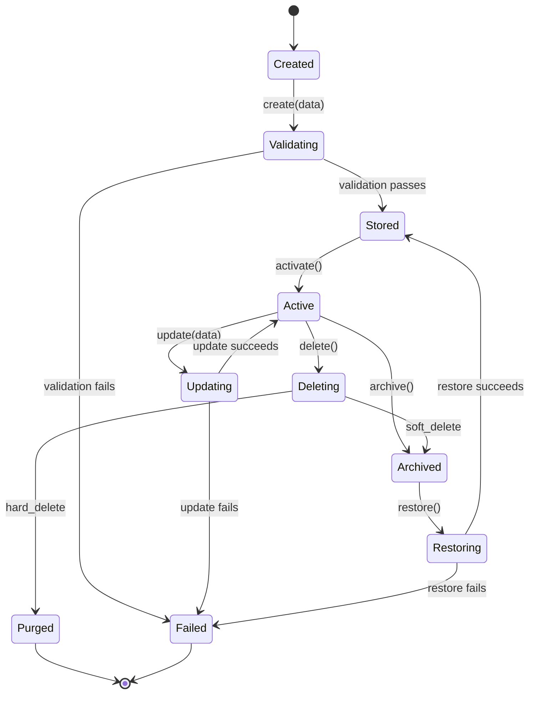

# RFC-0404: Storage Lifecycle

RFC: RFC-0404
Title: Storage Lifecycle
Status: Accepted
Category: Standard
Owner: Storage Team
Authors: Atlas Specification Committee
Created: 2026-07-01
Updated: 2026-07-01
ADS Version: 1.0.0
Spec Version: 0.1.0
Normative: YES
Depends On:
  - RFC-0401 Storage Overview
  - RFC-0402 Storage Architecture
Supersedes: None
Superseded By: None
Related ADR:
  - ADR-0010 Contract-First Specification
Related JSON Schema:
  - schemas/storage/lifecycle.json
Related Catalog:
  - catalog/storage-lifecycle.md
Layer: Core
Audience: Storage developers, architects, specification reviewers
Target Release: 1.0.0
Review Cycle: Quarterly
Compatibility: Compatible with Spec 1.x
Last Updated: 2026-07-01

---

## Normative Status
This specification is Normative. Every Atlas implementation MUST conform to the resource lifecycle state machine, state transitions, transition guards, and observability requirements defined in this document. Any deviation MUST be approved through the formal Architecture Decision Record (ADR) process.

This specification is subordinate to the Atlas Development System (ADS) Constitution, ADR-0010, and ADR-0012.

---

## Authority
This RFC is the authoritative specification for the Storage Lifecycle domain.

Any implementation MUST conform to this document.

If an implementation conflicts with this RFC, this RFC takes precedence.

Conflicts between RFCs SHALL be resolved through the ADR process.

---

## Terminology

The following terms are defined with exact meanings consistent with the Atlas Master Glossary and RFC-0301.

| Term | Definition | Source |
|---|---|---|
| Lifecycle | The state transitions of a process or service from allocation to disposal. | Glossary | RFC-0404 |
| State | A discrete condition within the resource lifecycle representing a specific stage of existence. | RFC-0404 |
| Transition | A directed change from one lifecycle state to another, governed by defined guards. | RFC-0404 |
| Transition Guard | A condition that MUST be satisfied for a state transition to proceed. | RFC-0404 |
| Resource | A unit of data managed by Storage, identified by a unique resource identifier. | RFC-0401 |
| Workflow | A declarative directed graph specification expressing WHAT must happen, not HOW. | RFC-0301 |
| Execution | The process of evaluating a workflow graph and activating nodes to produce results. | RFC-0303 |
 RFC-0301 |
| Task | An atomic unit of work within a workflow, represented as a node. | RFC-0301 |
| Node | A graph element representing an atomic unit of work with defined inputs and outputs. | RFC-0301 |
| Context | The scoped data environment available to nodes during execution. | RFC-0307 |
| Frame | A discrete unit of visual data processed by vision nodes. | RFC-0301 |
| Tick | A single evaluation cycle of the workflow scheduler. | RFC-0301 |
| Scheduler | The component that determines WHEN and WHERE each node is executed. | RFC-0312 |
| Trigger | An event or condition that initiates workflow execution. | RFC-0311 |

---

## 1 Introduction

The Storage Lifecycle specification defines the complete state machine governing resource existence from creation through purging. Every resource managed by Storage MUST traverse a deterministic sequence of states, each with well-defined entry conditions, exit operations, observable events, and recovery procedures.

This RFC defines the formal state machine, all possible transitions, lifecycle hooks that consumers MAY implement, timeout policies, and batch operations for bulk lifecycle management.

---

## 2 Goals

1. **Deterministic State Transitions**: Every resource MUST follow the defined finite state machine. Invalid transitions MUST be rejected.
2. **Observable Transitions**: Every state change MUST produce a lifecycle event on the Event Bus.
3. **Timeout Enforcement**: Each lifecycle phase MUST have a maximum duration. Exceeding the timeout MUST trigger failure handling.
4. **Recovery from Failure**: Failed transitions MUST follow defined recovery procedures including rollback and retry.
5. **Hook Extensibility**: Consumers MAY register lifecycle hooks that are invoked at defined transition points.
6. **Partial Failure Handling**: If a resource fails during a multi-step transition, partial effects MUST be rolled back.
7. **Consistent Cleanup**: Removing resources MUST release all acquired resources regardless of the failure mode.
8. **Batch Operations**: Bulk lifecycle operations MUST maintain the same invariants as single operations.

---

## 3 Non-Goals

- **Resource Content**: This RFC does not define what resources contain or their data models.
- **Lifecycle Scheduling**: When lifecycle transitions are triggered is governed by the consumer, not this specification.
- **Automatic State Promotion**: Resources MUST NOT be automatically promoted between states without explicit consumer request.
- **Resource Garbage Collection**: Automatic cleanup of expired resources is governed by retention policies, not this specification.

---

## 4 Lifecycle Philosophy

1. **State Machine Enforcement**: The lifecycle state machine is authoritative. No resource MAY exist in a state not defined by this specification.
2. **Transition Atomicity**: Each lifecycle transition is atomic. Either the full transition succeeds or the resource returns to its previous state.
3. **Event-Driven Observation**: Every state transition produces an event. Observers react to events, not state polling.
4. **Graceful Degradation**: Resources SHOULD enter an Archived state rather than Deleted when storage is temporarily unavailable.
5. **Defensive Cleanup**: Every exit path from every state MUST release all acquired resources. No resource leak is acceptable.

---

## 5 Ownership

- **The Platform MUST own**:
  - The lifecycle state machine definition
  - Transition enforcement and validation
  - Timeout monitoring and enforcement
  - Recovery procedure orchestration
  - Lifecycle event publication

- **Consumers MUST own**:
  - Hook implementation code
  - Resource acquisition and release within hooks
  - Error handling within hook implementations

---

## 6 Boundaries

- **Lifecycle Manager MAY communicate with**:
  - Storage API (RFC-0402) for resource operations
  - Provider Registry (RFC-0403) for provider selection
  - Event Bus (RFC-1001) for lifecycle event publication
  - Lock Manager (RFC-0417) for resource locking

- **Lifecycle Manager MUST NOT communicate with**:
  - Resource content directly
  - External lifecycle services
  - User-facing interfaces

---

## 7 Runtime Invariants

| ID | Invariant | Description |
|---|---|---|
| INV-LCF-01 | State Machine Compliance | A resource MUST NOT transition to a state not defined in the state machine diagram (Section 8). |
| INV-LCF-02 | Event Production | Every lifecycle transition MUST produce a corresponding event on the Event Bus. |
| INV-LCF-03 | Timeout Enforcement | Lifecycle timeouts MUST be enforced by the Platform, not by the resource. |
| INV-LCF-04 | Failed State Isolation | A resource in the Failed state MUST NOT be reactivated without explicit administrative intervention. |
| INV-LCF-05 | Resource Release on Failure | Resource acquisition during a transition MUST be released if the transition fails. |
| INV-LCF-06 | Valid Path Requirement | The Stored state MUST be reachable from Created through a valid transition path only. |

---

## 8 State Machine Architecture

State classification:

| Category | States | Description |
|---|---|---|
| Pre-Stored | Created, Validating | Resource preparation phases |
| Operational | Stored, Active | Resource operational phases |
| Modification | Updating | Resource update phase |
| Deactivation | Archived | Resource archival phase |
| Removal | Deleting, Purged | Resource removal phases |
| Recovery | Restoring | Resource restoration phase |
| Error | Failed | Resource error phase |

---

## 9 Lifecycle States

### 9.1 Created
The resource has been requested but not yet persisted. Data is buffered in the Storage API layer.

**Entry conditions**: create() called by consumer.
**Exit conditions**: Transition to Stored on successful persistence. Transition to Failed on validation error.
**Invariants**: No data is persisted. Resource ID is reserved but not assigned.

### 9.2 Validating
The resource data is being validated against the registered schema. Schema validation, constraint checking, and referential integrity verification are performed.

**Entry conditions**: create() called from Created.
**Exit conditions**: Transition to Stored on validation success. Transition to Failed on validation error.
**Invariants**: Data is not yet persisted. Schema validation is in progress.

### 9.3 Stored
The resource has been persisted to the provider but is not yet active. It is available for reading but not for modification.

**Entry conditions**: validation passes from Validating.
**Exit conditions**: Transition to Active on activation. Transition to Failed on post-store error.
**Invariants**: Data is persisted. Resource is readable. Resource is not modifiable until activated.

### 9.4 Active
The resource is fully operational. It can be read, updated, and deleted.

**Entry conditions**: activate() called from Stored.
**Exit conditions**: Transition to Archived on archival request. Transition to Updating on modification. Transition to Deleting on deletion request. Transition to Failed on error.
**Invariants**: Resource is readable and writable. Version tracking is active. Audit logging is active.

### 9.5 Updating
The resource is being modified. The previous version is preserved.

**Entry conditions**: update() called from Active.
**Exit conditions**: Transition to Active on update success. Transition to Failed on update error.
**Invariants**: Previous version is preserved. New version is not yet committed. Lock is held on the resource.

### 9.6 Archived
The resource has been archived. It is no longer actively managed but is preserved for potential restoration.

**Entry conditions**: archive() called from Active.
**Exit conditions**: Transition to Stored on restoration. Transition to Purged on permanent deletion.
**Invariants**: Resource is not modifiable. Resource is not deletable except through purge. Retention policy applies.

### 9.7 Deleting
The resource is being removed. The deletion may be soft (archive) or hard (purge).

**Entry conditions**: delete() called from Active.
**Exit conditions**: Transition to Archived on soft delete. Transition to Purged on hard delete.
**Invariants**: Resource is not accessible for normal operations. Audit record of deletion is created.

### 9.8 Restoring
An archived or deleted resource is being restored to an operational state.

**Entry conditions**: restore() called from Archived or Purged (if recoverable).
**Exit conditions**: Transition to Stored on restore success. Transition to Failed on restore error.
**Invariants**: Original archived data is being reconstructed. Restoration is logged.

### 9.9 Purged
The resource has been permanently removed. No data remains.

**Entry conditions**: purge() called from Archived or Deleting.
**Exit conditions**: Terminal state. No further transitions.
**Invariants**: No data remains accessible. Audit record of purge is retained.

### 9.10 Failed
The resource encountered an unrecoverable error during any lifecycle phase.

**Entry conditions**: Any state receives a fatal error.
**Exit conditions**: Terminal state. Resource must be administratively removed.
**Invariants**: No operations are performed on the resource. Error is logged.

---

## 10 Lifecycle Transitions

| From State | To State | Trigger | Condition |
|---|---|---|---|
| Created | Validating | create(data) | Data is provided |
| Validating | Stored | validation passes | Schema validation succeeds |
| Validating | Failed | validation fails | Schema violation detected |
| Stored | Active | activate() | No pending rollback |
| Active | Archived | archive() | Any |
| Active | Updating | update(data) | New data is provided |
| Updating | Active | update succeeds | New version committed |
| Updating | Failed | update fails | New version cannot be committed |
| Active | Deleting | delete() | Any |
| Deleting | Archived | soft_delete | Archive policy applies |
| Deleting | Purged | hard_delete | No retention policy |
| Archived | Restoring | restore() | Archive is intact |
| Restoring | Stored | restore succeeds | Data reconstructed |
| Restoring | Failed | restore fails | Data corruption detected |
| Purged | [*] | purge complete | Permanent removal |
| Failed | [*] | cleanup complete | Resources released |

---

## 11 Illegal Transitions

The following transitions are prohibited and MUST result in a LifecycleTransitionError:

| From State | Attempted Transition | Reason |
|---|---|---|
| Created | activate() | Resource not yet stored |
| Created | delete() | Resource not yet created |
| Validating | archive() | Resource not yet stored |
| Validating | update() | Resource not yet stored |
| Stored | archive() | Resource not yet active |
| Stored | update() | Resource not yet active |
| Stored | delete() | Resource not yet active |
| Active | create() | Resource already exists |
| Active | activate() | Already active |
| Updating | activate() | Update in progress |
| Updating | delete() | Must complete update first |
| Archived | update() | Archived resources are immutable |
| Archived | activate() | Must restore first |
| Deleting | update() | Deletion in progress |
| Restoring | delete() | Must complete restore first |
| Purged | *any* | Purged resources are gone |
| Failed | *any* | Failed resources require admin intervention |

---

## 12 Lifecycle Hooks

Consumers MAY register hooks that are invoked at specific lifecycle transition points.

### 12.1 Pre-Transition Hooks

Invoked BEFORE a state transition begins:

| Hook | Triggered Before | Purpose |
|---|---|---|
| pre_create | Created -> Validating | Validate business rules |
| pre_activate | Stored -> Active | Initialize dependent resources |
| pre_update | Active -> Updating | Snapshot current state |
| pre_archive | Active -> Archived | Notify subscribers |
| pre_delete | Active -> Deleting | Release external references |
| pre_restore | Archived -> Restoring | Allocate storage space |

### 12.2 Post-Transition Hooks

Invoked AFTER a state transition completes:

| Hook | Triggered After | Purpose |
|---|---|---|
| post_create | Validating -> Stored | Acknowledge creation |
| post_activate | Stored -> Active | Broadcast availability |
| post_update | Updating -> Active | Notify dependents |
| post_archive | Active -> Archived | Compress archived data |
| post_delete | Deleting -> Purged | Clean up orphaned references |
| post_restore | Restoring -> Stored | Rebuild indexes |

### 12.3 Hook Failure Handling

If a hook fails:
1. The transition is rolled back to the pre-transition state.
2. The hook failure is logged.
3. A LifecycleHookError event is published.
4. The consumer is notified of the hook failure.

---

## 13 Batch Lifecycle Operations

### 13.1 Batch Create

Bulk creation of resources with the following guarantees:

- All resources in a batch share the same transaction.
- If any resource fails validation, ALL resources in the batch are rolled back.
- Partial successes are NOT allowed in a single batch transaction.

### 13.2 Batch Update

Bulk modification of resources with the following guarantees:

- Updates are applied in deterministic order (by resource ID).
- If any update fails, all preceding updates in the batch are rolled back.
- Batch size is limited to prevent resource exhaustion.

### 13.3 Batch Delete

Bulk removal of resources with the following guarantees:

- Soft deletes preserve data for potential restoration.
- Hard deletes permanently remove data immediately.
- Batch delete operations are logged individually for audit purposes.

---

## 14 Lifecycle Event Publishing

Every lifecycle transition produces a standardized event on the Event Bus (see RFC-0413).

### 14.1 Event Structure

| Field | Type | Description |
|---|---|---|
| event_id | string | Unique event identifier |
| event_type | string | Lifecycle event type |
| resource_id | string | Affected resource identifier |
| from_state | string | Previous lifecycle state |
| to_state | string | New lifecycle state |
| timestamp | int64 | Event timestamp |
| operator | string | Entity that triggered the transition |
| metadata | map | Transition-specific context |

### 14.2 Event Types

| Event Type | Transition | Description |
|---|---|---|
| resource.created | Created -> Validating | Resource creation initiated |
| resource.stored | Validating -> Stored | Resource persisted |
| resource.active | Stored -> Active | Resource activated |
| resource.updated | Active -> Updating -> Active | Resource modified |
| resource.archived | Active -> Archived | Resource archived |
| resource.deleted | Active -> Deleting | Resource deletion initiated |
| resource.purged | Deleting -> Purged | Resource permanently removed |
| resource.restored | Archived -> Restoring -> Stored | Resource restored |
| resource.failed | * -> Failed | Resource entered failed state |

---

## 15 Timeout Management

### 15.1 Timeout Configuration

| Phase | Default Timeout | Configurable |
|---|---|---|
| Validation | 30 seconds | Yes |
| Activation | 60 seconds | Yes |
| Update | 120 seconds | Yes |
| Archival | 300 seconds | Yes |
| Deletion | 60 seconds | Yes |
| Restoration | 600 seconds | Yes |
| Purge | 120 seconds | Yes |

### 15.2 Timeout Handling

When a lifecycle phase exceeds its timeout:
1. The phase is marked as timed out.
2. The resource transitions to Failed state.
3. A timeout event is published.
4. The consumer is notified of the timeout.
5. Manual intervention is required to recover.

---

## 16 Acceptance Criteria

### AC-0404-01: State Machine Compliance
- **Requirement**: Every resource MUST follow the lifecycle state machine defined in Section 8.
- **Verification**: State machine transition tests covering all legal and illegal transitions.
- **Expected Result**: All legal transitions succeed; all illegal transitions rejected.

### AC-0404-02: Event Production
- **Requirement**: Every lifecycle transition MUST produce a corresponding event on the Event Bus.
- **Verification**: Event bus log analysis after lifecycle operations.
- **Expected Result**: 100% of transitions produce events with correct state values.

### AC-0404-03: Timeout Enforcement
- **Requirement**: Lifecycle timeouts MUST be enforced by the Platform as defined in Section 15.
- **Verification**: Timeout injection tests for each lifecycle phase.
- **Expected Result**: Timed-out transitions result in Failed state with timeout event.

### AC-0404-04: Hook Execution
- **Requirement**: Lifecycle hooks MUST be invoked at defined transition points as defined in Section 12.
- **Verification**: Hook registration and invocation tests.
- **Expected Result**: All registered hooks are invoked at correct transition points.

### AC-0404-05: Batch Operations
- **Requirement**: Batch lifecycle operations MUST maintain transactional integrity as defined in Section 13.
- **Verification**: Batch operation tests with injected failures.
- **Expected Result**: All-or-nothing semantics verified for create, update, and delete batches.

### AC-0404-06: Recovery Procedures
- **Requirement**: Failed resources MUST follow defined recovery procedures as defined in Section 9.
- **Verification**: Failure injection and recovery tests.
- **Expected Result**: Failed resources can be restored or removed through defined procedures.

---

## 17 References

- [RFC-0401 Storage Overview](RFC-0401-storage-overview.md)
- [RFC-0402 Storage Architecture](RFC-0402-storage-architecture.md)
- [RFC-0403 Storage Provider](RFC-0403-storage-provider.md)
- [RFC-0406 Storage Transactions](RFC-0406-storage-transactions.md)
- [RFC-0413 Storage Events](RFC-0413-storage-events.md)
- [RFC-1001 Common Event Model](../common/RFC-1001-event-model.md)
- [RFC-1002 Common State Model](../common/RFC-1002-state-model.md)

---

## 18 Future Evolution

Future specifications will address:
- **Automated Lifecycle Policies**: Policy-driven automatic state transitions based on resource age and usage.
- **Lifecycle Analytics**: Metrics and dashboards for lifecycle operation performance.
- **Cross-Resource Lifecycle**: Coordinated lifecycle transitions across related resources.
- **Lifecycle Templates**: Reusable lifecycle definitions for common resource patterns.

---

## Layer Boundaries

### Responsibilities
This specification IS responsible for:
- Defining the resource lifecycle state machine with all states, transitions, and guards.
- Specifying the conditions under which each state transition is permitted or forbidden.
- Defining the observability requirements for lifecycle events.
- Ensuring lifecycle state is consistent with versioning and schema requirements.

### Non-Responsibilities
This specification IS NOT responsible for:
- Implementing lifecycle state storage (delegated to the Provider interface).
- Defining schema evolution (delegated to RFC-0405).
- Managing resource data content (delegated to consuming subsystems).

### Dependencies
| Dependency | Direction | Description |
|---|---|---|
| RFC-0401 | Consumed | Storage Overview (lifecycle context) |
| RFC-0402 | Consumed | Storage Architecture (layer placement) |
| RFC-0403 | Consumed | Storage Provider (lifecycle storage) |
| RFC-0407 | Consumed | Storage Versioning (version-aware lifecycle) |

### Consumers
- RFC-0405 Storage Schema (schema lifecycle tied to resource lifecycle)
- RFC-0407 Storage Versioning (version transitions follow lifecycle states)
- RFC-0413 Storage Events (lifecycle events emitted through event system)

### Providers
- schemas/storage/lifecycle.json (lifecycle schema)
- catalog/storage-lifecycle.md (lifecycle catalog)

### Forbidden Dependencies
- This specification MUST NOT depend on any specific state persistence mechanism.
- This specification MUST NOT assume any specific programming language for lifecycle management.

---

## Security

This specification defines security requirements for the lifecycle:

- **State Transition Authorization**: Every state transition MUST be subject to authorization checks. Unauthorized transitions MUST be rejected.
- **Immutable States**: Resources in certain states (e.g., Archived, Deleted) MUST be immutable except through explicitly defined reverse transitions.
- **Audit Trail**: All lifecycle state transitions MUST be recorded in the audit log with the initiating entity, timestamp, and transition details.

---

## Performance

This specification defines performance requirements for lifecycle operations:

- **Transition Latency**: State transitions MUST complete within bounded time under normal operating conditions.
- **State Lookup Efficiency**: Resource state lookup MUST be efficient, with O(1) access to the current state.
- **Concurrent Transitions**: The lifecycle state machine MUST handle concurrent transition attempts safely through atomic state comparison and update.

---

## Compatibility

This specification defines compatibility requirements:

- **State Machine Stability**: The defined states and transitions MUST remain stable within a major version.
- **Guard Semantics**: The meaning of transition guards MUST remain consistent across minor versions.

---

## Compliance

This specification requires compliance with:

- The Atlas Development System (ADS) Constitution.
- ADR-0010 (Contract-First Specification-Driven Development).
- ADR-0012 (Security Architecture).
- All normative requirements defined in this RFC and its dependent RFCs.

---

## Future Evolution

Future specifications will address:
- **Conditional Lifecycle Policies**: Domain-specific lifecycle policies that customize state transitions.
- **Automated Lifecycle Management**: Policy-driven automatic state transitions based on resource age or usage patterns.
- **Lifecycle Analytics**: Metrics and dashboards for lifecycle state distributions and transition frequencies.

---

## Runtime Independence

This specification is completely independent of any runtime implementation platform. Specifically, this specification MUST NOT assume:

- Any programming language (Rust, Node.js, TypeScript, Go, Python, etc.)
- Any runtime environment (Electron, Tauri, Browser, Desktop, Server)
- Any storage backend (SQLite, PostgreSQL, MongoDB, Redis, etc.)
- Any operating system (Windows, Linux, macOS, etc.)
- Any hardware architecture (CPU, GPU, FPGA, etc.)
- Any threading model (single-threaded, multi-threaded, actor-based, etc.)
- Any cloud provider (AWS, Azure, GCP, etc.)
- Any container platform (Docker, containerd, etc.)

---

## Acceptance Criteria

### AC-0404-01: Lifecycle Compliance

| # | Criterion | Verification Method |
|---|---|---|
| AC-01 | Every resource MUST follow the lifecycle state machine defined in this RFC. | State machine transition tests. |
| AC-02 | All transition guards MUST be enforced before permitting a state change. | Guard evaluation test suite. |
| AC-03 | Lifecycle events MUST be emitted for every state transition. | Event emission test. |
| AC-04 | Unauthorized state transitions MUST be rejected. | Authorization bypass test. |
| AC-05 | State transitions MUST be atomic under concurrent access. | Concurrent transition test. |
| AC-06 | All lifecycle transitions MUST be recorded in the audit log. | Audit log verification test. |

---

## References

| Reference | Description |
|---|---|
| RFC-0401 | Storage Overview |
| RFC-0402 | Storage Architecture |
| RFC-0403 | Storage Provider |
| RFC-0405 | Storage Schema |
| RFC-0407 | Storage Versioning |
| RFC-0413 | Storage Events |
| ADR-0010 | Contract-First Specification |
| ADR-0012 | Security Architecture |
| schemas/storage/lifecycle.json | Lifecycle Schema Definition |
| catalog/storage-lifecycle.md | Lifecycle Catalog |
| Glossary | Atlas Master Glossary |
| Constitution | Atlas AI Constitution |

---

## Compliance Matrix

| Category | Value |
|---|---|
| Related RFC | RFC-0401, RFC-0402, RFC-0403, RFC-0405, RFC-0407, RFC-0413 |
| Related ADR | ADR-0010, ADR-0012 |
| Related JSON Schema | schemas/storage/lifecycle.json |
| Related Catalog | catalog/storage-lifecycle.md |

---

## Revision History

| Version | Status | Date | Author | Notes |
|---|---|---|---|---|
| 0.1.0 | Proposed | 2026-07-01 | Atlas Specification Committee | Initial publication |
| 1.0.0 | Accepted | 2026-07-01 | Atlas Specification Committee | Added Authority, Terminology, Layer Boundaries, Security, Performance, Compatibility, Compliance, Runtime Independence, Acceptance Criteria, References, Compliance Matrix, Revision History |

