# RFC-0405: Storage Schema

RFC: RFC-0405
Title: Storage Schema
Status: Accepted
Category: Standard
Owner: Storage Team
Authors: Atlas Specification Committee
Created: 2026-07-01
Updated: 2026-07-01
ADS Version: 1.0.0
Spec Version: 0.1.0
Normative: YES
Depends On:
  - RFC-0401 Storage Overview
  - RFC-0402 Storage Architecture
Supersedes: None
Superseded By: None
Related ADR:
  - ADR-0010 Contract-First Specification
Related JSON Schema:
  - schemas/storage/schema.json
Related Catalog:
  - catalog/storage-schema.md
Layer: Core
Audience: Storage developers, architects, specification reviewers
Target Release: 1.0.0
Review Cycle: Quarterly
Compatibility: Compatible with Spec 1.x
Last Updated: 2026-07-01

---

## Normative Status
This specification is Normative. Every Atlas implementation MUST conform to the schema definitions, validation rules, evolution procedures, and compatibility guarantees defined in this document. Any deviation MUST be approved through the formal Architecture Decision Record (ADR) process.

This specification is subordinate to the Atlas Development System (ADS) Constitution, ADR-0010, and ADR-0012.

---

## Authority
This RFC is the authoritative specification for the Storage Schema domain.

Any implementation MUST conform to this document.

If an implementation conflicts with this RFC, this RFC takes precedence.

Conflicts between RFCs SHALL be resolved through the ADR process.

---

## Terminology

The following terms are defined with exact meanings consistent with the Atlas Master Glossary and RFC-0301.

| Term | Definition | Source |
|---|---|---|
| Schema | A declarative definition of the structure, types, constraints, and relationships for stored resources. | RFC-0405 |
| Schema Registry | The subsystem that stores, validates, and serves schema definitions. | RFC-0401 |
| Schema Evolution | The process of modifying a schema while maintaining compatibility with existing data and consumers. | RFC-0405 |
| Validation Rule | A constraint defined in a schema that data MUST satisfy before being accepted. | RFC-0405 |
| Compatibility Mode | A schema evolution strategy that preserves the ability of existing consumers to operate with evolved schemas. | RFC-0405 |
| Resource | A unit of data managed by Storage, identified by a unique resource identifier. | RFC-0401 |
| Workflow | A declarative directed graph specification expressing WHAT must happen, not HOW. | RFC-0301 |
| Execution | The process of evaluating a workflow graph and activating nodes to produce results. | RFC-0303 |
 RFC-0301 |
| Task | An atomic unit of work within a workflow, represented as a node. | RFC-0301 |
| Node | A graph element representing an atomic unit of work with defined inputs and outputs. | RFC-0301 |
| Context | The scoped data environment available to nodes during execution. | RFC-0307 |
| Frame | A discrete unit of visual data processed by vision nodes. | RFC-0301 |
| Tick | A single evaluation cycle of the workflow scheduler. | RFC-0301 |
| Scheduler | The component that determines WHEN and WHERE each node is executed. | RFC-0312 |
| Trigger | An event or condition that initiates workflow execution. | RFC-0311 |

---

This specification is Normative. Every Atlas implementation MUST conform to the schema definition model, validation pipeline, registry, evolution rules, and compatibility guarantees defined in this document. Any deviation MUST be approved through the formal Architecture Decision Record (ADR) process.

This specification is subordinate to the Atlas Development System (ADS) Constitution, ADR-0010, and RFC-0401.

---

## Table of Contents
1. [Introduction](#1-introduction)
2. [Goals](#2-goals)
3. [Non-Goals](#3-non-goals)
4. [Schema Definition Model](#4-schema-definition-model)
5. [Schema Types](#5-schema-types)
6. [Schema Validation](#6-schema-validation)
7. [Schema Evolution](#7-schema-evolution)
8. [Schema Registry](#8-schema-registry)
9. [Schema Compatibility](#9-schema-compatibility)
10. [Schema Validation Pipeline](#10-schema-validation-pipeline)
11. [Schema Error Reporting](#11-schema-error-reporting)
12. [Schema Annotations](#12-schema-annotations)
13. [Acceptance Criteria](#13-acceptance-criteria)
14. [References](#14-references)
15. [Future Evolution](#15-future-evolution)

---

## 1 Introduction

The Storage Schema specification defines how data structures are declared, validated, evolved, and managed throughout their lifecycle. Schemas are the contractual agreement between consumers and the Storage subsystem about the structure, types, and constraints of stored data.

Every resource stored through the Storage API MUST conform to a registered schema. Schema validation is performed before any data reaches the Provider layer, ensuring data integrity at the earliest possible point.

### 1.1 Schema as Contract

A schema is a formal contract. When a consumer registers a schema, they declare the structure of data they will store. The Storage subsystem enforces this contract on every write operation. Violations produce validation errors before data reaches the Provider.

### 1.2 Schema Evolution

Schemas evolve over time as data models change. The schema evolution model supports both forward-compatible and backward-compatible changes, ensuring that existing consumers continue to function during schema transitions.

---

## 2 Goals

1. **Structural Integrity**: Every stored resource MUST conform to its declared schema.
2. **Type Safety**: Schema definitions MUST enforce data types at the Storage API layer.
3. **Referential Integrity**: Cross-resource references MUST be validated at write time.
4. **Backward Compatibility**: Schema changes MUST not break existing consumers within compatibility boundaries.
5. **Forward Compatibility**: New consumers MUST be able to read data written by older schema versions.
6. **Centralized Registry**: All schemas are registered and versioned in a central schema registry.
7. **Validation at Edge**: Schema validation occurs at the Storage API layer, before data reaches providers.
8. **Evolution Support**: Schemas MUST support defined evolution paths for structural changes.

---

## 3 Non-Goals

- **Query Optimization**: Schema definitions do not dictate query performance characteristics.
- **Data Migration**: Schema evolution triggers migration procedures (RFC-0408) but does not define migration logic.
- **UI Form Generation**: Schema definitions are not intended for automatic UI form generation.
- **Data Profiling**: Schema definitions do not include statistical data profiles.

---

## 4 Schema Definition Model

### 4.1 Schema Structure

Every schema definition consists of the following components:

| Component | Type | Required | Description |
|---|---|---|---|
| name | string | YES | Unique schema identifier |
| version | string | YES | Semantic version |
| type | enum | YES | Schema type category |
| fields | array | YES | Field definitions |
| constraints | object | NO | Validation constraints |
| references | array | NO | Cross-resource references |
| annotations | map | NO | Metadata attachments |
| compatibility | enum | NO | Compatibility level |

### 4.2 Field Definition

Each field in a schema is defined with:

| Property | Type | Required | Description |
|---|---|---|---|
| name | string | YES | Field identifier |
| type | string | YES | Data type |
| required | bool | NO | Whether field is mandatory (default: false) |
| nullable | bool | NO | Whether null values are allowed (default: true) |
| default | any | NO | Default value when not provided |
| constraints | object | NO | Field-level validation rules |
| indexed | bool | NO | Whether field is indexed for queries |

### 4.3 Supported Data Types

| Type | Description | Constraints Supported |
|---|---|---|
| string | Variable-length text | min_length, max_length, pattern |
| integer | Signed 64-bit integer | minimum, maximum |
| float | IEEE 754 double precision | minimum, maximum |
| boolean | True or false | None |
| timestamp | Unix epoch nanoseconds | None |
| bytes | Binary data | max_length |
| object | Nested structure | field_constraints |
| array | Ordered collection | min_items, max_items |
| enum | Fixed set of values | values_list |
| vector | Numeric vector | dimension_count |

---

## 5 Schema Types

### 5.1 Schema Categories

| Type | Description | Use Case |
|---|---|---|
| document | Flexible structure with typed fields | General-purpose resource storage |
| relational | Tabular structure with foreign keys | Structured data with relationships |
| hierarchical | Tree-structured data | Configuration, settings |
| graph | Node and edge relationships | Knowledge graphs, dependencies |

### 5.2 Schema Type Selection

Consumers select a schema type based on their data access patterns:

- **Document**: Optimal for read-heavy workloads with varied access patterns.
- **Relational**: Optimal for data with strong referential integrity requirements.
- **Hierarchical**: Optimal for nested configuration data.
- **Graph**: Optimal for data with complex relationship queries.

---

## 6 Schema Validation

### 6.1 Validation Rules

Schema validation enforces the following rule categories:

| Rule Category | Description | Example |
|---|---|---|
| Type Check | Field value matches declared type | integer field rejects string |
| Constraint Check | Field value satisfies constraints | max_length rejects oversized string |
| Required Check | Required fields are present | Missing required field rejects |
| Nullable Check | Null values are allowed | Non-nullable field rejects null |
| Default Check | Default values are applied | Missing optional field gets default |
| Reference Check | Cross-resource references exist | Foreign key must reference existing resource |
| Pattern Check | String matches regex pattern | Email field validates format |

### 6.2 Validation Levels

| Level | Description | Strictness |
|---|---|---|
| strict | Reject on any validation failure | Highest |
| lenient | Reject only on type mismatches | Medium |
| advisory | Log violations but allow data | Lowest |

Consumers configure the validation level per-operation. The default is strict.

---

## 7 Schema Evolution

### 7.1 Allowed Changes

Schema changes are categorized by their compatibility impact:

| Change | Compatibility | Description |
|---|---|---|
| Add optional field | Backward compatible | New field with default value |
| Add required field | Breaking | New mandatory field |
| Remove optional field | Backward compatible | Field no longer read |
| Remove required field | Backward compatible | Field no longer mandatory |
| Change field type | Breaking | Type coercion not allowed |
| Add constraint | Backward compatible | New validation rule |
| Remove constraint | Backward compatible | Relax validation |
| Change field name | Breaking | Reference invalidation |
| Add reference | Breaking | New relationship required |
| Change enum values | Backward compatible | Add new values only |

### 7.2 Evolution Timeline

```mermaid
gantt
    title Schema Evolution Timeline
    dateFormat X
    axisFormat %s
    section Current
    Schema v1.0     :0, 100
    section Transition
    Deprecate v1.0  :100, 200
    Deploy v2.0     :150, 250
    section Stable
    Schema v2.0     :250, 500
```



### 7.3 Deprecation Policy

When a schema change is breaking:

1. The old schema version is marked as deprecated.
2. A deprecation period of at least 30 days is enforced.
3. During deprecation, both old and new schemas are accepted.
4. After deprecation, the old schema is rejected for writes.
5. Read support for the old schema may be maintained indefinitely.

---

## 8 Schema Registry

### 8.1 Registry Functions

The Schema Registry provides:

- **Registration**: Store new schema definitions with version assignment.
- **Lookup**: Retrieve schema by name and version.
- **Validation**: Validate schema definitions for structural correctness.
- **Compatibility Check**: Verify proposed changes against compatibility rules.
- **Deprecation**: Mark schemas as deprecated with expiration dates.
- **Listing**: Enumerate all registered schemas and versions.

### 8.2 Registry Data Model

| Field | Type | Description |
|---|---|---|
| schema_id | string | Unique schema identifier |
| name | string | Human-readable schema name |
| version | string | Semantic version |
| type | enum | Schema type category |
| definition | object | Full schema definition |
| created_at | timestamp | Registration timestamp |
| updated_at | timestamp | Last modification timestamp |
| deprecated_at | timestamp | Deprecation timestamp (null if active) |
| compatibility | enum | Compatibility level |
| consumer_count | int | Number of active consumers |

---

## 9 Schema Compatibility

### 9.1 Compatibility Matrix

| New Version | Old Reader | New Reader |
|---|---|---|
| Backward compatible | Can read old data | Can read old and new data |
| Forward compatible | Cannot read new data | Can read old data |
| Breaking | Cannot read either | May require migration |

### 9.2 Compatibility Enforcement

The Schema Registry enforces compatibility rules:

1. Breaking changes require a new major version.
2. Backward-compatible changes may use a new minor version.
3. Advisory changes may use a patch version.
4. Cross-version reads are only supported for compatible versions.

---

## 10 Schema Validation Pipeline

### 10.1 Pipeline Stages

```mermaid
flowchart LR
    Input["Incoming Data"] --> Parse["Parse Fields"]
    Parse --> TypeCheck["Type Validation"]
    TypeCheck --> ConstraintCheck["Constraint Validation"]
    ConstraintCheck --> RequiredCheck["Required Field Check"]
    RequiredCheck --> RefCheck["Reference Validation"]
    RefCheck --> DefaultApply["Apply Defaults"]
    DefaultApply --> Output["Validated Data"]
    
    TypeCheck -. Failure --> Err1["Type Error"]
    ConstraintCheck -. Failure --> Err2["Constraint Error"]
    RequiredCheck -. Failure --> Err3["Missing Field Error"]
    RefCheck -. Failure --> Err4["Reference Error"]
    
    style Input fill:#e3f2fd
    style Output fill:#c8e6c9
    style Err1 fill:#ffcdd2
    style Err2 fill:#ffcdd2
    style Err3 fill:#ffcdd2
    style Err4 fill:#ffcdd2
```

### 10.2 Pipeline Execution

1. **Parse**: Extract fields from incoming data structure.
2. **Type Validation**: Verify each field matches its declared type.
3. **Constraint Validation**: Verify each field satisfies its constraints.
4. **Required Field Check**: Verify all required fields are present.
5. **Reference Validation**: Verify cross-resource references exist.
6. **Default Application**: Apply default values for missing optional fields.
7. **Output**: Return validated data or appropriate error.

---

## 11 Schema Error Reporting

### 11.1 Error Structure

Schema validation errors include:

| Field | Type | Description |
|---|---|---|
| error_code | string | STG-SCHEMA-XXXX |
| field_path | string | Dot-notation path to invalid field |
| error_type | enum | type_mismatch, constraint_violation, missing_required, invalid_reference |
| message | string | Human-readable error description |
| details | object | Error-specific context |
| schema_version | string | Schema version being validated against |

### 11.2 Error Categories

| Category | Error Code Prefix | Description |
|---|---|---|
| Type Error | STG-SCHEMA-01XX | Field type mismatch |
| Constraint Error | STG-SCHEMA-02XX | Field constraint violation |
| Required Error | STG-SCHEMA-03XX | Missing required field |
| Reference Error | STG-SCHEMA-04XX | Invalid cross-reference |
| Schema Error | STG-SCHEMA-05XX | Schema definition error |

---

## 12 Schema Annotations

Schemas MAY include annotations for additional metadata:

| Annotation | Type | Description |
|---|---|---|
| description | string | Human-readable description |
| example | any | Example value |
| sensitive | bool | Whether field contains sensitive data |
| searchable | bool | Whether field is used in searches |
| sortable | bool | Whether field is used in sorting |
| ttl_seconds | int | Time-to-live for field value |
| compression | enum | Compression strategy for large fields |

---

## 13 Acceptance Criteria

### AC-0405-01: Schema Registration
- **Requirement**: All schemas MUST be registered in the Schema Registry before use.
- **Verification**: Attempt to write data with unregistered schema.
- **Expected Result**: Write is rejected with SchemaNotRegistered error.

### AC-0405-02: Validation Enforcement
- **Requirement**: Every write operation MUST be validated against the registered schema.
- **Verification**: Write operations with valid and invalid data.
- **Expected Result**: Valid data accepted; invalid data rejected with appropriate error codes.

### AC-0405-03: Compatibility Enforcement
- **Requirement**: Schema changes MUST follow the compatibility rules defined in Section 7.
- **Verification**: Attempt breaking changes on minor/patch versions.
- **Expected Result**: Breaking changes on non-major versions are rejected.

### AC-0405-04: Pipeline Completeness
- **Requirement**: All six pipeline stages (Section 10) MUST execute for every write.
- **Verification**: Trace pipeline execution for sample writes.
- **Expected Result**: All stages execute; errors are caught at the correct stage.

### AC-0405-05: Error Reporting
- **Requirement**: Validation errors MUST include all fields defined in Section 11.
- **Verification**: Induce each error category and inspect error structure.
- **Expected Result**: All error fields present with correct values.

---

## 14 References

- [RFC-0401 Storage Overview](RFC-0401-storage-overview.md)
- [RFC-0402 Storage Architecture](RFC-0402-storage-architecture.md)
- [RFC-0403 Storage Provider](RFC-0403-storage-provider.md)
- [RFC-0406 Storage Transactions](RFC-0406-storage-transactions.md)
- [RFC-0407 Storage Versioning](RFC-0407-storage-versioning.md)
- [RFC-0408 Storage Migration](RFC-0408-storage-migration.md)
- [RFC-1006 Common Error Model](../common/RFC-1006-error-model.md)

---

## 15 Future Evolution

Future specifications will address:
- **Schema Inheritance**: Support for schema composition and inheritance.
- **Dynamic Schemas**: Runtime schema modification without registry updates.
- **Schema Diff**: Visual and programmatic comparison of schema versions.
- **Schema Analytics**: Usage statistics for schema fields and constraints.

---


## Layer Boundaries

### Responsibilities
This specification IS responsible for:
- Defining the schema format, structure, and encoding for all stored resources.
- Specifying validation rules and constraint enforcement mechanisms.
- Defining schema evolution strategies and compatibility guarantees.
- Managing the schema registry and schema version lifecycle.

### Non-Responsibilities
This specification IS NOT responsible for:
- Storing resource data (delegated to the Provider interface).
- Managing schema migration procedures (delegated to RFC-0408).
- Defining business logic for resource content (delegated to consuming subsystems).

### Dependencies
| Dependency | Direction | Description |
|---|---|---|
| RFC-0401 | Consumed | Storage Overview (schema registry concept) |
| RFC-0402 | Consumed | Storage Architecture (layer placement) |
| RFC-0408 | Consumed | Storage Migration (schema evolution in migrations) |

### Consumers
- RFC-0423 Storage Resource Model (resources validated against schemas)
- RFC-0408 Storage Migration (migrations operate on schema evolution)
- RFC-0404 Storage Lifecycle (schema changes affect resource lifecycle)

### Providers
- schemas/storage/schema.json (schema definition)
- catalog/storage-schema.md (schema catalog)

### Forbidden Dependencies
- This specification MUST NOT depend on any specific serialization format.
- This specification MUST NOT assume any specific programming language for schema definition.

---

## Security

This specification defines security requirements for schemas:

- **Schema Integrity**: Schema definitions MUST be tamper-evident. Unauthorized modifications MUST be detected and rejected.
- **Validation Enforcement**: All data MUST be validated against the active schema before storage. Data failing validation MUST be rejected.
- **Schema Access Control**: Schema modification rights MUST be restricted to authorized entities.

---

## Performance

This specification defines performance requirements for schema operations:

- **Validation Latency**: Schema validation MUST complete within bounded time for all supported schema sizes.
- **Schema Registry Access**: Schema lookups MUST be cached and respond within defined latency bounds.
- **Evolution Cost**: Schema evolution operations MUST NOT degrade runtime performance beyond acceptable thresholds.

---

## Compatibility

This specification defines compatibility requirements:

- **Backward Compatible Evolution**: Schema changes MUST maintain backward compatibility within a major version.
- **Forward Compatible Reading**: New schema versions MUST be readable by consumers expecting older versions where feasible.
- **Breaking Changes**: Schema changes that break existing consumers require a major version increment.

---

## Compliance

This specification requires compliance with:

- The Atlas Development System (ADS) Constitution.
- ADR-0010 (Contract-First Specification-Driven Development).
- ADR-0012 (Security Architecture).
- All normative requirements defined in this RFC and its dependent RFCs.

---

## Future Evolution

Future specifications will address:
- **Schema Composition**: Support for combining multiple schemas into composite definitions.
- **Schema Inference**: Automatic schema inference from data samples.
- **Schema Governance**: Policy-driven schema governance and approval workflows.

---

## Runtime Independence

This specification is completely independent of any runtime implementation platform. Specifically, this specification MUST NOT assume:

- Any programming language (Rust, Node.js, TypeScript, Go, Python, etc.)
- Any runtime environment (Electron, Tauri, Browser, Desktop, Server)
- Any storage backend (SQLite, PostgreSQL, MongoDB, Redis, etc.)
- Any operating system (Windows, Linux, macOS, etc.)
- Any hardware architecture (CPU, GPU, FPGA, etc.)
- Any threading model (single-threaded, multi-threaded, actor-based, etc.)
- Any cloud provider (AWS, Azure, GCP, etc.)
- Any container platform (Docker, containerd, etc.)

---

## Acceptance Criteria

### AC-0405-01: Schema Compliance

| # | Criterion | Verification Method |
|---|---|---|
| AC-01 | All stored resources MUST conform to their declared schema. | Schema validation test suite. |
| AC-02 | Schema evolution MUST maintain backward compatibility within major versions. | Compatibility regression tests. |
| AC-03 | Validation rules MUST be enforced for all write operations. | Input rejection test suite. |
| AC-04 | Schema registry MUST serve current and historical schema versions. | Registry query tests. |
| AC-05 | Schema integrity MUST be protected against unauthorized modification. | Tamper detection test. |
| AC-06 | Schema validation MUST complete within defined latency bounds. | Performance benchmark test. |

---

## References

| Reference | Description |
|---|---|
| RFC-0401 | Storage Overview |
| RFC-0402 | Storage Architecture |
| RFC-0408 | Storage Migration |
| RFC-0423 | Storage Resource Model |
| ADR-0010 | Contract-First Specification |
| ADR-0012 | Security Architecture |
| schemas/storage/schema.json | Schema Definition |
| catalog/storage-schema.md | Schema Catalog |
| Glossary | Atlas Master Glossary |
| Constitution | Atlas AI Constitution |

---

## Compliance Matrix

| Category | Value |
|---|---|
| Related RFC | RFC-0401, RFC-0402, RFC-0408, RFC-0423 |
| Related ADR | ADR-0010, ADR-0012 |
| Related JSON Schema | schemas/storage/schema.json |
| Related Catalog | catalog/storage-schema.md |

---

## Revision History

| Version | Status | Date | Author | Notes |
|---|---|---|---|---|
| 0.1.0 | Proposed | 2026-07-01 | Atlas Specification Committee | Initial publication |
| 1.0.0 | Accepted | 2026-07-01 | Atlas Specification Committee | Added Authority, Terminology, Layer Boundaries, Security, Performance, Compatibility, Compliance, Runtime Independence, Acceptance Criteria, References, Compliance Matrix, Revision History |


