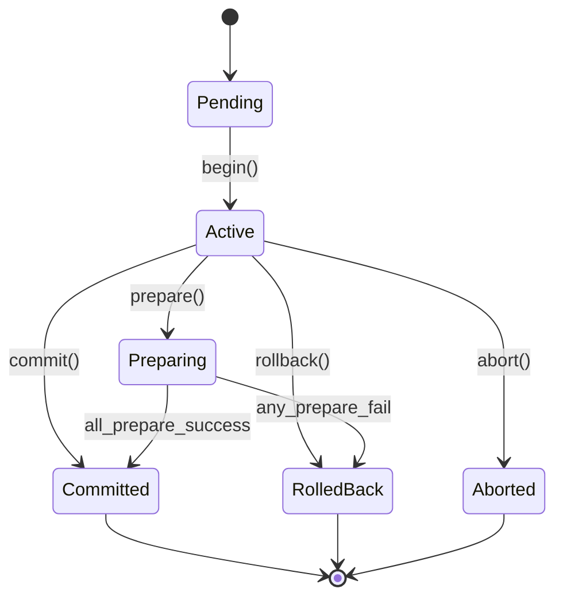
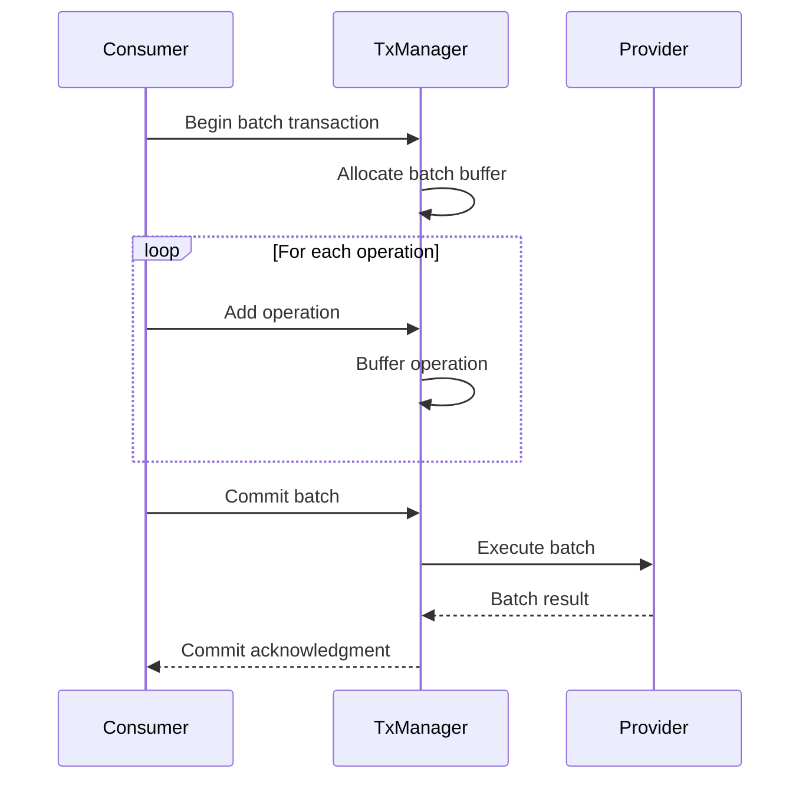
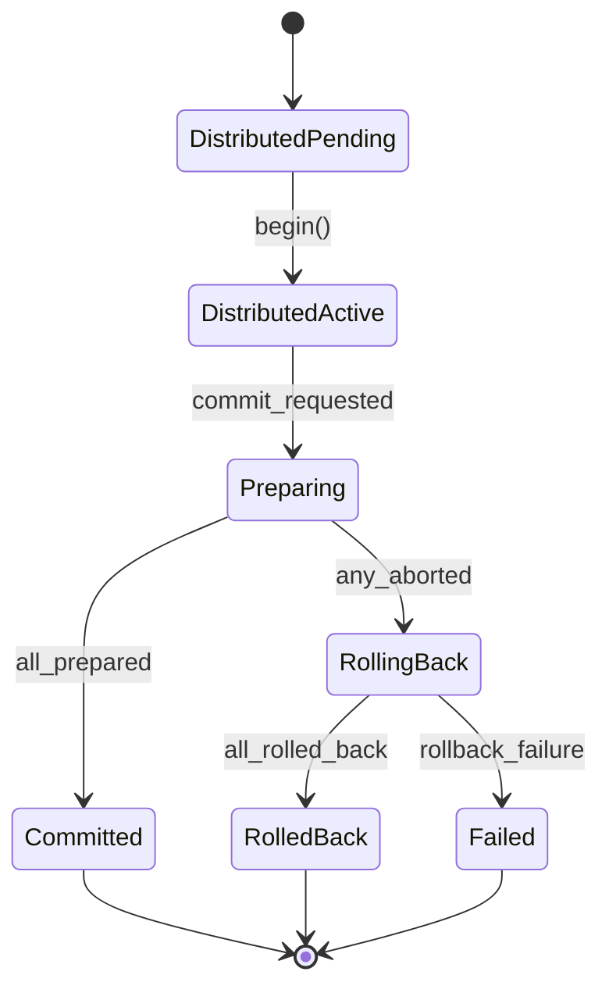

# RFC-0406: Storage Transactions

RFC: RFC-0406
Title: Storage Transactions
Status: Accepted
Category: Standard
Owner: Storage Team
Authors: Atlas Specification Committee
Created: 2026-07-01
Updated: 2026-07-01
ADS Version: 1.0.0
Spec Version: 0.1.0
Normative: YES
Depends On:
  - RFC-0401 Storage Overview
  - RFC-0402 Storage Architecture
Supersedes: None
Superseded By: None
Related ADR:
  - ADR-0010 Contract-First Specification
Related JSON Schema:
  - schemas/storage/transaction.json
Related Catalog:
  - catalog/storage-transactions.md
Layer: Core
Audience: Storage developers, architects, specification reviewers
Target Release: 1.0.0
Review Cycle: Quarterly
Compatibility: Compatible with Spec 1.x
Last Updated: 2026-07-01

---

## Normative Status
This specification is Normative. Every Atlas implementation MUST conform to the transaction model, atomicity guarantees, isolation levels, and durability requirements defined in this document. Any deviation MUST be approved through the formal Architecture Decision Record (ADR) process.

This specification is subordinate to the Atlas Development System (ADS) Constitution, ADR-0010, and ADR-0012.

---

## Authority
This RFC is the authoritative specification for the Storage Transaction domain.

Any implementation MUST conform to this document.

If an implementation conflicts with this RFC, this RFC takes precedence.

Conflicts between RFCs SHALL be resolved through the ADR process.

---

## Terminology

The following terms are defined with exact meanings consistent with the Atlas Master Glossary and RFC-0301.

| Term | Definition | Source |
|---|---|---|
| Transaction | A sequence of storage operations that execute atomically, consistently, isolated, and durably. | RFC-0406 |
| Atomicity | The property that all operations within a transaction either all succeed or all fail as a single unit. | RFC-0406 |
| Isolation | The property that concurrent transactions do not interfere with each other's visibility of intermediate states. | RFC-0406 |
| Durability | The property that committed transaction effects persist permanently despite failures. | RFC-0406 |
| Consistency | The property that a transaction transforms the system from one valid state to another valid state. | RFC-0406 |
| Rollback | The reversal of all operations within a transaction upon failure. | RFC-0406 |
| Commit | The permanent recording of all operations within a successful transaction. | RFC-0406 |
| Two-Phase Commit | A distributed coordination protocol ensuring all participants agree on transaction outcome. | RFC-0406 |
| Resource | A unit of data managed by Storage, identified by a unique resource identifier. | RFC-0401 |
| Workflow | A declarative directed graph specification expressing WHAT must happen, not HOW. | RFC-0301 |
| Execution | The process of evaluating a workflow graph and activating nodes to produce results. | RFC-0303 |
 RFC-0301 |
| Task | An atomic unit of work within a workflow, represented as a node. | RFC-0301 |
| Node | A graph element representing an atomic unit of work with defined inputs and outputs. | RFC-0301 |
| Context | The scoped data environment available to nodes during execution. | RFC-0307 |
| Frame | A discrete unit of visual data processed by vision nodes. | RFC-0301 |
| Tick | A single evaluation cycle of the workflow scheduler. | RFC-0301 |
| Scheduler | The component that determines WHEN and WHERE each node is executed. | RFC-0312 |
| Trigger | An event or condition that initiates workflow execution. | RFC-0311 |

---

This specification is Normative. Every Atlas implementation MUST conform to the transaction model, isolation levels, atomicity guarantees, and distributed transaction coordination defined in this document. Any deviation MUST be approved through the formal Architecture Decision Record (ADR) process.

This specification is subordinate to the Atlas Development System (ADS) Constitution, ADR-0010, and RFC-0401.

---

## Table of Contents
1. [Introduction](#1-introduction)
2. [Goals](#2-goals)
3. [Non-Goals](#3-non-goals)
4. [Transaction Model](#4-transaction-model)
5. [Transaction Properties](#5-transaction-properties)
6. [Transaction Types](#6-transaction-types)
7. [Transaction Lifecycle](#7-transaction-lifecycle)
8. [Isolation Levels](#8-isolation-levels)
9. [Conflict Detection](#9-conflict-detection)
10. [Conflict Resolution](#10-conflict-resolution)
11. [Transaction Batching](#11-transaction-batching)
12. [Distributed Transactions](#12-distributed-transactions)
13. [Transaction Logging](#13-transaction-logging)
14. [Nested Transactions](#14-nested-transactions)
15. [Acceptance Criteria](#15-acceptance-criteria)
16. [References](#16-references)
17. [Future Evolution](#17-future-evolution)

---

## 1 Introduction

The Storage Transaction specification defines the atomicity, isolation, and durability guarantees that Storage provides across all persistence operations. Transactions are the fundamental unit of consistency in the Storage subsystem, ensuring that related operations either all succeed or all fail.

Every transaction operates within a defined lifecycle: begin, execute, and either commit or rollback. The Transaction Manager coordinates these lifecycles across one or more providers, enforcing isolation levels and resolving conflicts.

---

## 2 Goals

1. **Atomicity**: All operations within a transaction MUST either complete or none MUST.
2. **Consistency**: Transactions MUST preserve all schema constraints and referential integrity.
3. **Isolation**: Concurrent transactions MUST not interfere with each other beyond their isolation level.
4. **Durability**: Committed transactions MUST survive system failures.
5. **Concurrency Control**: Multiple transactions MUST execute concurrently without data corruption.
6. **Distributed Coordination**: Transactions spanning multiple providers MUST be coordinated atomically.
7. **Conflict Resolution**: Concurrent modifications to the same resource MUST be detected and resolved.
8. **Observability**: Every transaction lifecycle event MUST be observable.

---

## 3 Non-Goals

- **Transaction Recovery from Crash**: Detailed crash recovery procedures are covered by RFC-0412.
- **Transaction Performance Tuning**: Performance optimization is covered by RFC-0415.
- **Database-Level Transaction Features**: Provider-specific transaction features are abstracted away.

---

## 4 Transaction Model

### 4.1 Abstract Transaction Interface

Every transaction exposes the following operations:

| Operation | Description | Preconditions | Postconditions |
|---|---|---|---|
| Begin | Start a new transaction | No active transaction | Transaction ID assigned |
| Read | Read a resource within transaction | Transaction active | Resource snapshot captured |
| Write | Write a resource within transaction | Transaction active, schema valid | New version created |
| Delete | Delete a resource within transaction | Transaction active, resource exists | Resource marked for deletion |
| Commit | Persist all changes | Transaction active | All changes persisted atomically |
| Rollback | Discard all changes | Transaction active | All changes discarded |
| Abort | Terminate transaction abnormally | Transaction active | Resources released |

### 4.2 Transaction Scope

A transaction scope defines the boundary of atomicity:

- **Single-Resource**: Operations on one resource only.
- **Multi-Resource**: Operations on multiple resources within the same provider.
- **Cross-Provider**: Operations across multiple providers.
- **Cross-Namespace**: Operations across different storage namespaces.

---

## 5 Transaction Properties

### 5.1 ACID Properties

| Property | Definition | Enforcement |
|---|---|---|
| Atomicity | All operations succeed or all fail | Transaction Manager coordination |
| Consistency | Database moves from one valid state to another | Schema validation at commit |
| Isolation | Concurrent transactions do not interfere | Lock manager and version control |
| Durability | Committed changes persist despite failures | Write-ahead logging and provider ack |

### 5.2 Property Enforcement Order

1. **Atomicity** is enforced by the Transaction Manager at commit time.
2. **Consistency** is enforced by schema validation before commit.
3. **Isolation** is enforced by the Lock Manager during execution.
4. **Durability** is enforced by write-ahead logging before commit acknowledgment.

---

## 6 Transaction Types

### 6.1 Transaction Classifications

| Type | Description | Use Case |
|---|---|---|
| Read-Only | Contains only read operations | Query execution |
| Read-Write | Contains both read and write operations | Update operations |
| Write-Only | Contains only write operations | Bulk insert |
| Batch | Groups multiple operations | Bulk operations |
| Distributed | Spans multiple providers | Cross-provider operations |
| Nested | Contains sub-transactions | Complex operations |

### 6.2 Default Transaction Type

If a consumer does not specify a transaction type, the Transaction Manager infers it from the operations:

- All reads -> Read-Only
- Any write -> Read-Write
- Multiple independent writes -> Batch

---

## 7 Transaction Lifecycle

### 7.1 State Machine

### 7.2 State Definitions

**Pending**: Transaction has been requested but not yet started. Resources are allocated.

**Active**: Transaction is executing operations. Reads and writes are buffered.

**Preparing**: Transaction is in the prepare phase of a two-phase commit. Changes are staged but not committed.

**Committed**: All changes have been persisted. Transaction is complete.

**RolledBack**: All changes have been discarded. Transaction is complete.

**Aborted**: Transaction terminated due to an unrecoverable error.

---

## 8 Isolation Levels

### 8.1 Isolation Level Definitions

| Level | Dirty Read | Non-Repeatable Read | Phantom Read | Description |
|---|---|---|---|---|
| Read-Uncommitted | Allowed | Allowed | Allowed | Lowest isolation, highest concurrency |
| Read-Committed | Prevented | Allowed | Allowed | Prevents reading uncommitted data |
| Snapshot | Prevented | Prevented | Allowed | Consistent view at transaction start |
| Repeatable-Read | Prevented | Prevented | Prevented | Consistent view throughout transaction |
| Serializable | Prevented | Prevented | Prevented | Full isolation, no anomalies |

### 8.2 Isolation Level Selection

Consumers select isolation levels based on their consistency requirements:

| Scenario | Recommended Level | Rationale |
|---|---|---|
| Analytics queries | Read-Uncommitted | Performance over consistency |
| Read-mostly workloads | Read-Committed | Balance of consistency and performance |
| Financial transactions | Serializable | Maximum consistency required |
| Cache warming | Snapshot | Consistent view without locking |
| User profile updates | Repeatable-Read | Prevent concurrent modification anomalies |

### 8.3 Isolation Level Enforcement

The Transaction Manager enforces isolation through:

- **Read-Committed**: Lock shared resources during reads.
- **Snapshot**: Maintain version snapshots at transaction start.
- **Repeatable-Read**: Hold read locks until commit.
- **Serializable**: Acquire range locks on all accessed resources.

---

## 9 Conflict Detection

### 9.1 Conflict Types

| Type | Description | Detection Method |
|---|---|---|
| Write-Write | Two transactions write the same resource | Version comparison at commit |
| Read-Write | One transaction reads while another writes | Lock conflict detection |
| Write-Read | One transaction writes while another reads | Snapshot isolation violation |
| Phantom | New resources appear in a query range | Range lock enforcement |

### 9.2 Detection Timing

Conflicts are detected at two points:

1. **During Execution**: Read-write conflicts detected through lock contention.
2. **At Commit Time**: Write-write conflicts detected through version comparison.

---

## 10 Conflict Resolution

### 10.1 Resolution Strategies

| Strategy | Description | Trade-off |
|---|---|---|
| Optimistic | Allow conflicts, retry on detection | Higher throughput, possible retries |
| Pessimistic | Lock resources before modification | Lower throughput, no retries |
| Last-Writer-Wins | Conflicting writes both succeed, last wins | Simple, may lose data |
| First-Writer-Wins | First committed write wins, others fail | Predictable, may cause failures |
| Merge | Automatically merge conflicting changes | Complex, may produce unexpected results |

### 10.2 Default Strategy

The default conflict resolution strategy is optimistic with retry. When a write-write conflict is detected at commit time:

1. The conflicting transaction is rolled back.
2. A retry event is published.
3. The transaction is retried up to a configurable maximum number of attempts (default: 3).
4. If all retries fail, the transaction returns a ConflictError.

---

## 11 Transaction Batching

### 11.1 Batch Composition

Multiple operations MAY be grouped into a single batch transaction:

| Property | Value |
|---|---|
| Max batch size | Configurable (default: 1000) |
| Execution order | Deterministic (by operation index) |
| Atomicity | All-or-nothing |
| Timeout | Per-batch, not per-operation |

### 11.2 Batch Execution Flow

---

## 12 Distributed Transactions

### 12.1 Two-Phase Commit

Distributed transactions use a two-phase commit protocol:

**Phase 1 - Prepare**:
1. The Transaction Manager sends a prepare request to each participating provider.
2. Each provider validates its operations and prepares to commit.
3. Each provider responds with prepared or aborted.

**Phase 2 - Commit/Abort**:
1. If all providers report prepared, the Transaction Manager sends commit.
2. If any provider reports aborted, the Transaction Manager sends abort.
3. Each provider commits or rolls back accordingly.

### 12.2 Distributed Transaction State Machine

---

## 13 Transaction Logging

### 13.1 Write-Ahead Logging

All transactions use write-ahead logging (WAL) for durability:

1. Before any data modification, the operation is logged to the WAL.
2. The WAL entry includes: operation type, resource ID, before-state, after-state.
3. The WAL is flushed to durable storage before the operation is acknowledged.
4. On recovery, the WAL is replayed to restore uncommitted changes.

### 13.2 WAL Entry Structure

| Field | Type | Description |
|---|---|---|
| log_id | string | Unique log entry identifier |
| transaction_id | string | Associated transaction ID |
| operation | enum | begin, write, delete, commit, rollback |
| resource_id | string | Affected resource identifier |
| before_state | bytes | State before operation (null for inserts) |
| after_state | bytes | State after operation (null for deletes) |
| timestamp | int64 | Operation timestamp |
| checksum | string | Integrity verification |

---

## 14 Nested Transactions

### 14.1 Nesting Model

Transactions MAY be nested within parent transactions:

- Child transactions commit to the parent, not to storage.
- Parent transaction commit persists all child changes.
- Parent transaction rollback discards all child changes.
- Child transaction rollback discards only child changes.

### 14.2 Nesting Limits

| Property | Limit |
|---|---|
| Maximum nesting depth | Configurable (default: 5) |
| Child isolation level | Must be equal or higher than parent |
| Child timeout | Must be less than parent remaining timeout |

---

## 15 Acceptance Criteria

### AC-0406-01: Atomicity
- **Requirement**: All transactions MUST provide atomic commit or rollback.
- **Verification**: Inject failures during transaction execution.
- **Expected Result**: No partial commits observed; all operations either committed or rolled back.

### AC-0406-02: Isolation Enforcement
- **Requirement**: All five isolation levels MUST be enforced correctly.
- **Verification**: Concurrent transaction tests at each isolation level.
- **Expected Result**: No isolation anomalies at the configured level.

### AC-0406-03: Conflict Detection
- **Requirement**: All four conflict types MUST be detectable.
- **Verification**: Fault injection tests triggering each conflict type.
- **Expected Result**: Conflicts detected and resolved using configured strategy.

### AC-0406-04: Distributed Commit
- **Requirement**: Two-phase commit MUST coordinate across providers correctly.
- **Verification**: Simulate provider failures during prepare and commit phases.
- **Expected Result**: Consistent commit/abort decision across all providers.

### AC-0406-05: WAL Durability
- **Requirement**: Write-ahead log entries MUST be durable before acknowledgment.
- **Verification**: Crash recovery tests with in-flight transactions.
- **Expected Result**: Recovered state matches pre-crash committed state.

### AC-0406-06: Batch Operations
- **Requirement**: Batch transactions MUST maintain all-or-nothing semantics.
- **Verification**: Batch operations with injected mid-batch failures.
- **Expected Result**: Partial batch failures result in complete rollback.

---

## 16 References

- [RFC-0401 Storage Overview](RFC-0401-storage-overview.md)
- [RFC-0402 Storage Architecture](RFC-0402-storage-architecture.md)
- [RFC-0403 Storage Provider](RFC-0403-storage-provider.md)
- [RFC-0404 Storage Lifecycle](RFC-0404-storage-lifecycle.md)
- [RFC-0405 Storage Schema](RFC-0405-storage-schema.md)
- [RFC-0416 Storage Consistency](RFC-0416-storage-consistency.md)
- [RFC-0417 Storage Locking](RFC-0417-storage-locking.md)

---

## 17 Future Evolution

Future specifications will address:
- **Optimistic Concurrency Control**: Enhanced conflict detection using version vectors.
- **Transactional Streams**: Streaming transactions for large data operations.
- **Cross-Cluster Transactions**: Distributed transactions spanning multiple Atlas clusters.
- **Compensating Transactions**: Saga pattern support for long-running transactions.

---

## Layer Boundaries

### Responsibilities
This specification IS responsible for:
- Defining the transaction model including ACID properties and their enforcement.
- Specifying transaction scopes, nesting rules, and boundary semantics.
- Defining isolation levels and their trade-offs.
- Establishing commit and rollback protocols for single and multi-provider transactions.

### Non-Responsibilities
This specification IS NOT responsible for:
- Implementing the underlying storage engine (delegated to the Provider interface).
- Defining schema validation (delegated to RFC-0405).
- Managing resource lifecycle (delegated to RFC-0404).

### Dependencies
| Dependency | Direction | Description |
|---|---|---|
| RFC-0401 | Consumed | Storage Overview (transaction context) |
| RFC-0402 | Consumed | Storage Architecture (layer placement) |
| RFC-0403 | Consumed | Storage Provider (transaction support) |
| RFC-0417 | Consumed | Storage Locking (concurrency control) |

### Consumers
- RFC-0404 Storage Lifecycle (transactions manage lifecycle state changes)
- RFC-0408 Storage Migration (migrations execute as transactions)
- RFC-0418 Storage Replication (replication uses transactions for consistency)

### Providers
- schemas/storage/transaction.json (transaction schema)
- catalog/storage-transactions.md (transactions catalog)

### Forbidden Dependencies
- This specification MUST NOT depend on any specific transaction protocol.
- This specification MUST NOT assume any specific storage backend transaction support.

---

## Security

This specification defines security requirements for transactions:

- **Atomicity Enforcement**: A transaction MUST either fully commit or fully roll back. Partial commits are forbidden.
- **Transaction Isolation**: Transactions MUST be isolated from each other according to the selected isolation level.
- **Audit Trail**: All transaction operations (begin, commit, rollback) MUST be recorded in the audit log.

---

## Performance

This specification defines performance requirements for transactions:

- **Transaction Latency**: Transaction commit MUST complete within bounded time under normal operating conditions.
- **Throughput**: The transaction system MUST support concurrent transactions proportional to workload demands.
- **Deadlock Detection**: The system MUST detect and resolve deadlocks within defined time bounds.

---

## Compatibility

This specification defines compatibility requirements:

- **Transaction API Stability**: The transaction API MUST maintain backward compatibility within a major version.
- **Isolation Level Semantics**: The meaning of each isolation level MUST remain consistent across minor versions.

---

## Compliance

This specification requires compliance with:

- The Atlas Development System (ADS) Constitution.
- ADR-0010 (Contract-First Specification-Driven Development).
- ADR-0012 (Security Architecture).
- All normative requirements defined in this RFC and its dependent RFCs.

---

## Future Evolution

Future specifications will address:
- **Distributed Transactions**: Multi-provider transaction coordination across cluster boundaries.
- **Optimistic Concurrency**: Conflict-free transaction execution with late-stage validation.
- **Transactional Snapshots**: Point-in-time transactional views for analytical workloads.

---

## Runtime Independence

This specification is completely independent of any runtime implementation platform. Specifically, this specification MUST NOT assume:

- Any programming language (Rust, Node.js, TypeScript, Go, Python, etc.)
- Any runtime environment (Electron, Tauri, Browser, Desktop, Server)
- Any storage backend (SQLite, PostgreSQL, MongoDB, Redis, etc.)
- Any operating system (Windows, Linux, macOS, etc.)
- Any hardware architecture (CPU, GPU, FPGA, etc.)
- Any threading model (single-threaded, multi-threaded, actor-based, etc.)
- Any cloud provider (AWS, Azure, GCP, etc.)
- Any container platform (Docker, containerd, etc.)

---

## Acceptance Criteria

### AC-0406-01: Transaction Compliance

| # | Criterion | Verification Method |
|---|---|---|
| AC-01 | All operations within a transaction MUST be atomic: all commit or all rollback. | Atomicity test suite. |
| AC-02 | Transaction effects MUST persist after system failure (durability). | Crash recovery test. |
| AC-03 | Concurrent transactions MUST not violate the selected isolation level. | Concurrency stress test. |
| AC-04 | Deadlocks MUST be detected and resolved automatically. | Deadlock detection test. |
| AC-05 | Transaction operations MUST be recorded in the audit log. | Audit log verification test. |
| AC-06 | Transaction commit latency MUST meet defined performance bounds. | Performance benchmark test. |

---

## References

| Reference | Description |
|---|---|
| RFC-0401 | Storage Overview |
| RFC-0402 | Storage Architecture |
| RFC-0403 | Storage Provider |
| RFC-0404 | Storage Lifecycle |
| RFC-0408 | Storage Migration |
| RFC-0417 | Storage Locking |
| RFC-0418 | Storage Replication |
| ADR-0010 | Contract-First Specification |
| ADR-0012 | Security Architecture |
| schemas/storage/transaction.json | Transaction Schema Definition |
| catalog/storage-transactions.md | Transactions Catalog |
| Glossary | Atlas Master Glossary |
| Constitution | Atlas AI Constitution |

---

## Compliance Matrix

| Category | Value |
|---|---|
| Related RFC | RFC-0401, RFC-0402, RFC-0403, RFC-0404, RFC-0408, RFC-0417, RFC-0418 |
| Related ADR | ADR-0010, ADR-0012 |
| Related JSON Schema | schemas/storage/transaction.json |
| Related Catalog | catalog/storage-transactions.md |

---

## Revision History

| Version | Status | Date | Author | Notes |
|---|---|---|---|---|
| 0.1.0 | Proposed | 2026-07-01 | Atlas Specification Committee | Initial publication |
| 1.0.0 | Accepted | 2026-07-01 | Atlas Specification Committee | Added Authority, Terminology, Layer Boundaries, Security, Performance, Compatibility, Compliance, Runtime Independence, Acceptance Criteria, References, Compliance Matrix, Revision History |

