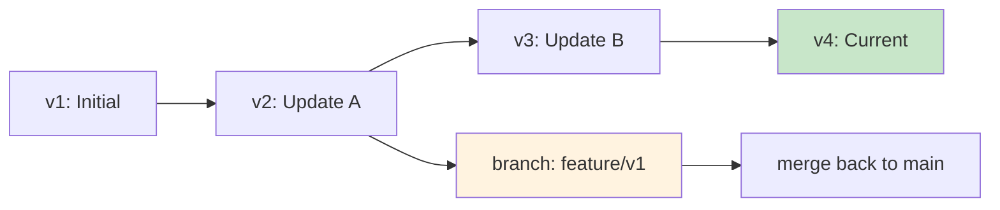
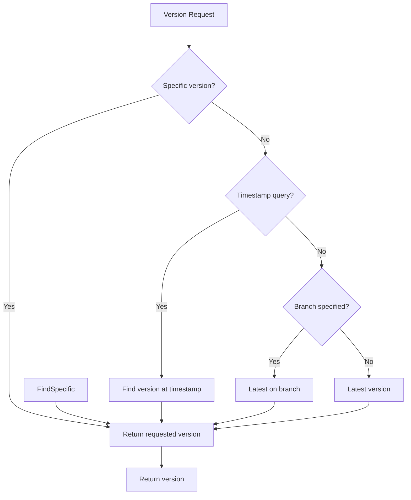

# RFC-0407: Storage Versioning

RFC: RFC-0407
Title: Storage Versioning
Status: Accepted
Category: Standard
Owner: Storage Team
Authors: Atlas Specification Committee
Created: 2026-07-01
Updated: 2026-07-01
ADS Version: 1.0.0
Spec Version: 0.1.0
Normative: YES
Depends On:
  - RFC-0401 Storage Overview
  - RFC-0402 Storage Architecture
Supersedes: None
Superseded By: None
Related ADR:
  - ADR-0010 Contract-First Specification
Related JSON Schema:
  - schemas/storage/version.json
Related Catalog:
  - catalog/storage-versioning.md
Layer: Core
Audience: Storage developers, architects, specification reviewers
Target Release: 1.0.0
Review Cycle: Quarterly
Compatibility: Compatible with Spec 1.x
Last Updated: 2026-07-01

---

## Normative Status
This specification is Normative. Every Atlas implementation MUST conform to the versioning model, immutability guarantees, version resolution, and history traversal rules defined in this document. Any deviation MUST be approved through the formal Architecture Decision Record (ADR) process.

This specification is subordinate to the Atlas Development System (ADS) Constitution, ADR-0010, and ADR-0012.

---

## Authority
This RFC is the authoritative specification for the Storage Versioning domain.

Any implementation MUST conform to this document.

If an implementation conflicts with this RFC, this RFC takes precedence.

Conflicts between RFCs SHALL be resolved through the ADR process.

---

## Terminology

The following terms are defined with exact meanings consistent with the Atlas Master Glossary and RFC-0301.

| Term | Definition | Source |
|---|---|---|
| Version | An immutable snapshot of a resource or schema at a point in time. | RFC-0407 |
| Version Chain | The ordered sequence of versions for a single resource or schema. | RFC-0407 |
| Version Resolution | The process of determining which version of a resource or schema is active for a given operation. | RFC-0407 |
| Immutable | A property of data that cannot be modified after creation. | RFC-0407 |
| Point-in-Time Query | A query that retrieves data as it existed at a specific point in time. | RFC-0407 |
| Rollback | The act of reverting a resource to a previous version. | RFC-0407 |
| Resource | A unit of data managed by Storage, identified by a unique resource identifier. | RFC-0401 |
| Workflow | A declarative directed graph specification expressing WHAT must happen, not HOW. | RFC-0301 |
| Execution | The process of evaluating a workflow graph and activating nodes to produce results. | RFC-0303 |
 RFC-0301 |
| Task | An atomic unit of work within a workflow, represented as a node. | RFC-0301 |
| Node | A graph element representing an atomic unit of work with defined inputs and outputs. | RFC-0301 |
| Context | The scoped data environment available to nodes during execution. | RFC-0307 |
| Frame | A discrete unit of visual data processed by vision nodes. | RFC-0301 |
| Tick | A single evaluation cycle of the workflow scheduler. | RFC-0301 |
| Scheduler | The component that determines WHEN and WHERE each node is executed. | RFC-0312 |
| Trigger | An event or condition that initiates workflow execution. | RFC-0311 |

---

This specification is Normative. Every Atlas implementation MUST conform to the versioning model, version numbering, resolution, and snapshot management defined in this document. Any deviation MUST be approved through the formal Architecture Decision Record (ADR) process.

This specification is subordinate to the Atlas Development System (ADS) Constitution, ADR-0010, and RFC-0401.

---

## Table of Contents
1. [Introduction](#1-introduction)
2. [Goals](#2-goals)
3. [Non-Goals](#3-non-goals)
4. [Versioning Philosophy](#4-versioning-philosophy)
5. [Document Versioning](#5-document-versioning)
6. [Schema Versioning](#6-schema-versioning)
7. [Version Numbering](#7-version-numbering)
8. [Version Resolution](#8-version-resolution)
9. [Version Storage](#9-version-storage)
10. [Version Pruning](#10-version-pruning)
11. [Version Branching](#11-version-branching)
12. [Version Merging](#12-version-merging)
13. [Version Snapshots](#13-version-snapshots)
14. [Version Audit Trail](#14-version-audit-trail)
15. [Acceptance Criteria](#15-acceptance-criteria)
16. [References](#16-references)
17. [Future Evolution](#17-future-evolution)

---

## 1 Introduction

The Storage Versioning specification defines how every stored resource and schema maintains an immutable version history. Versioning enables point-in-time queries, audit trails, rollback capabilities, and schema evolution tracking.

Every mutation to a resource or schema creates a new version. Old versions are preserved for audit, rollback, and compatibility purposes. The Version Manager (see RFC-0402) coordinates all version operations.

---

## 2 Goals

1. **Immutable History**: Once a version is committed, it MUST NOT be modified.
2. **Point-in-Time Queries**: Consumers MUST be able to query any historical version.
3. **Rollback Support**: Any previous version MUST be restorable as the current version.
4. **Audit Trail**: Every version change MUST be recorded in an immutable audit log.
5. **Schema Evolution Tracking**: Schema changes MUST be versioned alongside data versions.
6. **Branching Support**: Divergent version lines MUST be supported for experimentation.
7. **Merge Support**: Divergent version lines MUST be reconcilable through merge.
8. **Efficient Storage**: Historical versions MUST be stored efficiently using deltas where possible.

---

## 3 Non-Goals

- **Version Conflict Resolution**: Detailed merge conflict resolution is covered by RFC-0406.
- **Version Compression Algorithms**: Specific compression implementations are outside this specification.
- **Version Display**: How versions are presented to end users is outside this specification.

---

## 4 Versioning Philosophy

1. **Append-Only**: Versions are never modified; new versions are always appended.
2. **Monotonic Ordering**: Versions are always ordered by a monotonically increasing counter.
3. **Immutable Records**: Committed versions are tamper-evident through cryptographic hashes.
4. **Full History**: All versions are retained until explicitly pruned by policy.
5. **Branch-Aware**: Version numbers include branch information for divergent lines.

---

## 5 Document Versioning

### 5.1 Version Assignment

Each document version is assigned a version number:

- **Sequential**: Versions are numbered sequentially within a branch (v1, v2, v3...).
- **Branch-Prefixed**: Branch versions include branch identifier (feature/v1, main/v1).
- **Global Counter**: A global monotonic counter ensures uniqueness across all branches.

### 5.2 Version Chain

### 5.3 Version Content

Each version stores:

| Field | Type | Description |
|---|---|---|
| version_id | string | Unique version identifier |
| parent_version | string | Previous version ID (null for first) |
| timestamp | int64 | Version creation timestamp |
| operator | string | Entity that created the version |
| data_hash | string | Cryptographic hash of version data |
| delta | bytes | Change from parent (null for first version) |
| metadata | map | Version-specific metadata |

---

## 6 Schema Versioning

### 6.1 Schema Version Numbers

Schema versions follow semantic versioning:

- **Major**: Breaking schema changes (v1, v2, v3...)
- **Minor**: Backward-compatible additions (v1.1, v1.2...)
- **Patch**: Non-breaking corrections (v1.1.1, v1.1.2...)

### 6.2 Schema Version Registry

The Schema Registry (see RFC-0405) maintains schema version history:

- Each schema version is immutable once registered.
- Schema versions are linked through parent references.
- Deprecated versions are marked but not removed.

---

## 7 Version Numbering

### 7.1 Document Version Scheme

Documents use monotonic integer versioning:

- First version: 1
- Each subsequent version: previous + 1
- Branch versions: branch_name:counter (e.g., feature:5)

### 7.2 Schema Version Scheme

Schemas use semantic versioning:

- Major.Minor.Patch format
- Breaking changes increment Major
- Backward-compatible changes increment Minor
- Non-breaking changes increment Patch

### 7.3 Version Uniqueness

Every version MUST have a globally unique identifier composed of:

- Resource ID (identifies the resource)
- Version number (identifies the version within the resource)
- Branch ID (identifies the version line)
- Timestamp (provides ordering guarantee)

---

## 8 Version Resolution

### 8.1 Resolution Strategies

| Strategy | Description | Use Case |
|---|---|---|
| Latest | Return the most recent version | Default read behavior |
| Specific | Return a specific version number | Point-in-time queries |
| Timestamp | Return version at specific time | Audit queries |
| Branch | Return latest on specific branch | Branch-specific reads |
| Parent | Return parent version | Rollback preparation |

### 8.2 Resolution Algorithm

---

## 9 Version Storage

### 9.1 Storage Strategies

| Strategy | Description | Space Efficiency | Read Performance |
|---|---|---|---|
| Full | Store complete data for each version | Low | Highest |
| Delta | Store only changes from previous version | Highest | Medium |
| Hybrid | Full for recent, delta for older | Balanced | Balanced |
| Snapshot | Periodic full snapshots with deltas between | Balanced | High for snapshots |

### 9.2 Default Strategy

The default version storage strategy is hybrid: the last N versions (configurable, default: 10) are stored as full copies; older versions are stored as deltas.

---

## 10 Version Pruning

### 10.1 Pruning Policies

| Policy | Description | Trigger |
|---|---|---|
| Age-Based | Prune versions older than N days | Scheduled job |
| Count-Based | Keep only last N versions | On version creation |
| Size-Based | Prune when storage exceeds limit | On storage check |
| Manual | Explicit prune request | Admin action |

### 10.2 Pruning Constraints

- Pruned versions MUST NOT be recoverable.
- Pruning MUST preserve at least one version for audit purposes.
- Pruning MUST be logged in the audit trail.
- Pruning MUST not affect active version references.

---

## 11 Version Branching

### 11.1 Branch Creation

Branches are created from any existing version:

1. The source version is identified.
2. A new branch ID is generated.
3. The branch is registered with the Version Manager.
4. Subsequent mutations on the branch create branch-prefixed versions.

### 11.2 Branch Types

| Type | Description | Use Case |
|---|---|---|
| Feature | Experimental branch | Testing new features |
| Release | Stable branch for releases | Production deployments |
| Hotfix | Emergency branch | Quick fixes |
| Archive | Long-term preservation | Compliance retention |

---

## 12 Version Merging

### 12.1 Merge Strategies

| Strategy | Description | Data Loss Risk |
|---|---|---|
| Ours | Keep source version, discard target changes | Source changes lost |
| Theirs | Keep target version, discard source changes | Target changes lost |
| Manual | Require human resolution | None |
| Auto-Merge | Combine non-conflicting changes | Minimal |

### 12.2 Merge Process

1. Identify divergence point between branches.
2. Compute changes on each branch since divergence.
3. Apply merge strategy to resolve conflicts.
4. Create merged version with merge metadata.
5. Publish merge event to Event Bus.

---

## 13 Version Snapshots

### 13.1 Snapshot Definition

A snapshot is a named, point-in-time capture of one or more resource versions:

- Snapshots are immutable once created.
- Snapshots can capture multiple resources simultaneously.
- Snapshots support cross-resource consistency within a transaction.

### 13.2 Snapshot Operations

| Operation | Description |
|---|---|
| Create | Capture current versions of specified resources |
| Restore | Restore resources to snapshot versions |
| Compare | Compare current versions against snapshot |
| Export | Export snapshot data for external use |
| Delete | Remove snapshot (does not affect resource versions) |

---

## 14 Version Audit Trail

### 14.1 Audit Entry Structure

Every version change produces an audit entry:

| Field | Type | Description |
|---|---|---|
| entry_id | string | Unique audit entry identifier |
| resource_id | string | Affected resource |
| version_from | string | Previous version |
| version_to | string | New version |
| operation | enum | create, update, delete, merge, branch, snapshot |
| operator | string | Entity performing the operation |
| timestamp | int64 | Operation timestamp |
| hash | string | Cryptographic hash of audit entry |
| previous_hash | string | Hash of previous audit entry |

### 14.2 Tamper Evidence

The audit trail is tamper-evident through chained cryptographic hashes:

- Each entry includes the hash of the previous entry.
- Modifying any entry breaks the hash chain.
- Hash verification detects any unauthorized modification.

---

## 15 Acceptance Criteria

### AC-0407-01: Version Immutability
- **Requirement**: Once committed, no version MAY be modified.
- **Verification**: Attempt to modify committed versions.
- **Expected Result**: All modification attempts rejected.

### AC-0407-02: Version Resolution
- **Requirement**: All five resolution strategies MUST be implemented.
- **Verification**: Test each strategy with multi-version resources.
- **Expected Result**: Correct version returned for each strategy.

### AC-0407-03: Audit Trail Integrity
- **Requirement**: Audit trail MUST be tamper-evident through cryptographic chaining.
- **Verification**: Modify an audit entry and verify chain break.
- **Expected Result**: Chain break detected; modification identified.

### AC-0407-04: Snapshot Consistency
- **Requirement**: Snapshots capturing multiple resources MUST be internally consistent.
- **Verification**: Create snapshots during concurrent modifications.
- **Expected Result**: All resources in snapshot reflect consistent point-in-time state.

### AC-0407-05: Pruning Safety
- **Requirement**: Pruning MUST never remove the last version of a resource.
- **Verification**: Attempt to prune all versions.
- **Expected Result**: Pruning prevented; at least one version retained.

---

## 16 References

- [RFC-0401 Storage Overview](RFC-0401-storage-overview.md)
- [RFC-0402 Storage Architecture](RFC-0402-storage-architecture.md)
- [RFC-0404 Storage Lifecycle](RFC-0404-storage-lifecycle.md)
- [RFC-0405 Storage Schema](RFC-0405-storage-schema.md)
- [RFC-0406 Storage Transactions](RFC-0406-storage-transactions.md)
- [RFC-0408 Storage Migration](RFC-0408-storage-migration.md)
- [RFC-0413 Storage Events](RFC-0413-storage-events.md)

---

## 17 Future Evolution

Future specifications will address:
- **Version Compression**: Advanced delta compression algorithms.
- **Version Deduplication**: Eliminating duplicate content across versions.
- **Version Search**: Full-text search across version history.
- **Version Visualization**: Graph-based version history exploration.

---

## Layer Boundaries

### Responsibilities
This specification IS responsible for:
- Defining the version numbering scheme and version assignment rules.
- Specifying version immutability guarantees and version chain integrity.
- Defining point-in-time query semantics and version resolution strategies.
- Managing version retention and archival policies.

### Non-Responsibilities
This specification IS NOT responsible for:
- Storing version data (delegated to the Provider interface).
- Defining migration procedures between versions (delegated to RFC-0408).
- Managing resource lifecycle states (delegated to RFC-0404).

### Dependencies
| Dependency | Direction | Description |
|---|---|---|
| RFC-0401 | Consumed | Storage Overview (versioning context) |
| RFC-0402 | Consumed | Storage Architecture (layer placement) |
| RFC-0404 | Consumed | Storage Lifecycle (version-aware lifecycle) |
| RFC-0405 | Consumed | Storage Schema (schema versioning) |
| RFC-0408 | Consumed | Storage Migration (migration versioning) |

### Consumers
- RFC-0404 Storage Lifecycle (lifecycle snapshots are versions)
- RFC-0405 Storage Schema (schema versions)
- RFC-0408 Storage Migration (migration versioning)
- RFC-0412 Storage Recovery (recovery uses version history)

### Providers
- schemas/storage/version.json (version schema)
- catalog/storage-versioning.md (versioning catalog)

### Forbidden Dependencies
- This specification MUST NOT depend on any specific version numbering scheme.
- This specification MUST NOT assume any specific storage backend versioning support.

---

## Security

This specification defines security requirements for versions:

- **Immutability**: Once a version is created, it MUST NOT be modifiable or deletable except through explicit archival procedures.
- **Version Integrity**: Each version MUST include a tamper-evident integrity checksum.
- **Access Control**: Version creation and resolution MUST be subject to authorization checks.

---

## Performance

This specification defines performance requirements for versioning:

- **Version Creation**: Creating a new version MUST complete within bounded time.
- **Version Lookup**: Resolving a version by identifier MUST complete within bounded time.
- **History Traversal**: Traversing the version chain MUST be efficient, with logarithmic access to arbitrary version points.

---

## Compatibility

This specification defines compatibility requirements:

- **Version Resolution Stability**: Version resolution semantics MUST remain consistent within a major version.
- **Backward Compatibility**: Older versions MUST remain readable by current consumers.

---

## Compliance

This specification requires compliance with:

- The Atlas Development System (ADS) Constitution.
- ADR-0010 (Contract-First Specification-Driven Development).
- ADR-0012 (Security Architecture).
- All normative requirements defined in this RFC and its dependent RFCs.

---

## Future Evolution

Future specifications will address:
- **Branching**: Support for divergent version chains enabling parallel development of resource versions.
- **Merking**: Support for merging divergent version chains with conflict resolution.
- **Version Compression**: Deduplication of unchanged data across versions to reduce storage overhead.

---

## Runtime Independence

This specification is completely independent of any runtime implementation platform. Specifically, this specification MUST NOT assume:

- Any programming language (Rust, Node.js, TypeScript, Go, Python, etc.)
- Any runtime environment (Electron, Tauri, Browser, Desktop, Server)
- Any storage backend (SQLite, PostgreSQL, MongoDB, Redis, etc.)
- Any operating system (Windows, Linux, macOS, etc.)
- Any hardware architecture (CPU, GPU, FPGA, etc.)
- Any threading model (single-threaded, multi-threaded, actor-based, etc.)
- Any cloud provider (AWS, Azure, GCP, etc.)
- Any container platform (Docker, containerd, etc.)

---

## Acceptance Criteria

### AC-0407-01: Versioning Compliance

| # | Criterion | Verification Method |
|---|---|---|
| AC-01 | All versions MUST be immutable once created. | Immutability enforcement test. |
| AC-02 | Version integrity checksums MUST detect tampering. | Tamper detection test. |
| AC-03 | Point-in-time queries MUST return data from the specified version. | Point-in-time query test. |
| AC-04 | Version resolution MUST correctly identify the active version. | Version resolution test. |
| AC-05 | Rollback to a previous version MUST restore the resource state accurately. | Rollback verification test. |
| AC-06 | Version chain traversal MUST be efficient for long histories. | History traversal performance test. |

---

## References

| Reference | Description |
|---|---|
| RFC-0401 | Storage Overview |
| RFC-0402 | Storage Architecture |
| RFC-0404 | Storage Lifecycle |
| RFC-0405 | Storage Schema |
| RFC-0408 | Storage Migration |
| RFC-0412 | Storage Recovery |
| ADR-0010 | Contract-First Specification |
| ADR-0012 | Security Architecture |
| schemas/storage/version.json | Version Schema Definition |
| catalog/storage-versioning.md | Versioning Catalog |
| Glossary | Atlas Master Glossary |
| Constitution | Atlas AI Constitution |

---

## Compliance Matrix

| Category | Value |
|---|---|
| Related RFC | RFC-0401, RFC-0402, RFC-0404, RFC-0405, RFC-0408, RFC-0412 |
| Related ADR | ADR-0010, ADR-0012 |
| Related JSON Schema | schemas/storage/version.json |
| Related Catalog | catalog/storage-versioning.md |

---

## Revision History

| Version | Status | Date | Author | Notes |
|---|---|---|---|---|
| 0.1.0 | Proposed | 2026-07-01 | Atlas Specification Committee | Initial publication |
| 1.0.0 | Accepted | 2026-07-01 | Atlas Specification Committee | Added Authority, Terminology, Layer Boundaries, Security, Performance, Compatibility, Compliance, Runtime Independence, Acceptance Criteria, References, Compliance Matrix, Revision History |

