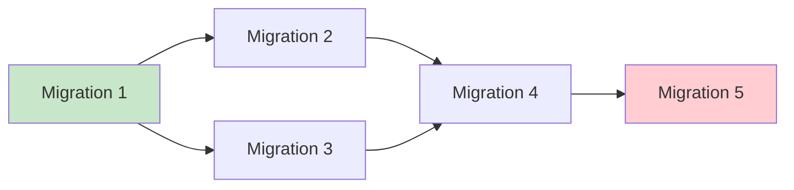
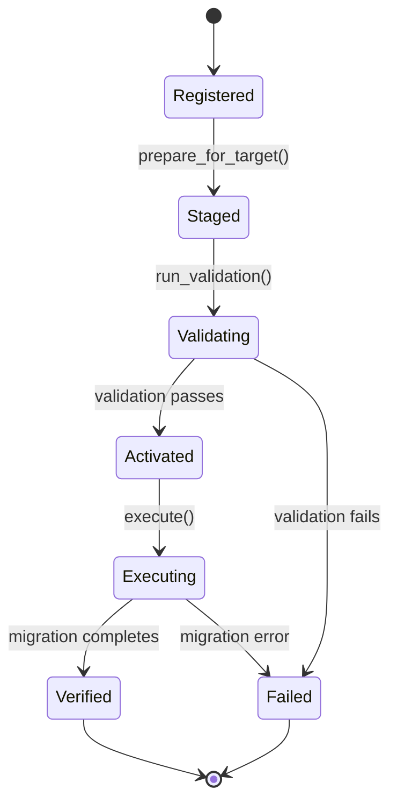

# RFC-0408: Storage Migration

RFC: RFC-0408
Title: Storage Migration
Status: Accepted
Category: Standard
Owner: Storage Team
Authors: Atlas Specification Committee
Created: 2026-07-01
Updated: 2026-07-01
ADS Version: 1.0.0
Spec Version: 0.1.0
Normative: YES
Depends On:
  - RFC-0401 Storage Overview
  - RFC-0402 Storage Architecture
Supersedes: None
Superseded By: None
Related ADR:
  - ADR-0010 Contract-First Specification
Related JSON Schema:
  - schemas/storage/migration.json
Related Catalog:
  - catalog/storage-migration.md
Layer: Core
Audience: Storage developers, architects, specification reviewers
Target Release: 1.0.0
Review Cycle: Quarterly
Compatibility: Compatible with Spec 1.x
Last Updated: 2026-07-01

---

## Normative Status
This specification is Normative. Every Atlas implementation MUST conform to the migration procedures, determinism guarantees, reversibility requirements, and rollback protocols defined in this document. Any deviation MUST be approved through the formal Architecture Decision Record (ADR) process.

This specification is subordinate to the Atlas Development System (ADS) Constitution, ADR-0010, and ADR-0012.

---

## Authority
This RFC is the authoritative specification for the Storage Migration domain.

Any implementation MUST conform to this document.

If an implementation conflicts with this RFC, this RFC takes precedence.

Conflicts between RFCs SHALL be resolved through the ADR process.

---

## Terminology

The following terms are defined with exact meanings consistent with the Atlas Master Glossary and RFC-0301.

| Term | Definition | Source |
|---|---|---|
| Migration | A deterministic, reversible procedure for evolving schemas and data between versions. | RFC-0408 |
| Migration Script | A declarative specification of schema or data transformations to apply during migration. | RFC-0408 |
| Deterministic | A property of a migration where the same input always produces the same output. | RFC-0408 |
| Reversible | A property of a migration that can be undone, restoring the previous state. | RFC-0408 |
| Rollback | The reversal of a migration to restore the pre-migration state. | RFC-0408 |
| Schema | A declarative definition of the structure, types, and constraints for stored resources. | RFC-0405 |
| Resource | A unit of data managed by Storage, identified by a unique resource identifier. | RFC-0401 |
| Workflow | A declarative directed graph specification expressing WHAT must happen, not HOW. | RFC-0301 |
| Execution | The process of evaluating a workflow graph and activating nodes to produce results. | RFC-0303 |
 RFC-0301 |
| Task | An atomic unit of work within a workflow, represented as a node. | RFC-0301 |
| Node | A graph element representing an atomic unit of work with defined inputs and outputs. | RFC-0301 |
| Context | The scoped data environment available to nodes during execution. | RFC-0307 |
| Frame | A discrete unit of visual data processed by vision nodes. | RFC-0301 |
| Tick | A single evaluation cycle of the workflow scheduler. | RFC-0301 |
| Scheduler | The component that determines WHEN and WHERE each node is executed. | RFC-0312 |
| Trigger | An event or condition that initiates workflow execution. | RFC-0311 |

---

This specification is Normative. Every Atlas implementation MUST conform to the migration model, ordering, atomicity, rollback, and validation procedures defined in this document. Any deviation MUST be approved through the formal Architecture Decision Record (ADR) process.

This specification is subordinate to the Atlas Development System (ADS) Constitution, ADR-0010, and RFC-0401.

---

## Table of Contents
1. [Introduction](#1-introduction)
2. [Goals](#2-goals)
3. [Non-Goals](#3-non-goals)
4. [Migration Philosophy](#4-migration-philosophy)
5. [Migration Types](#5-migration-types)
6. [Migration Ordering](#6-migration-ordering)
7. [Migration Atomicity](#7-migration-atomicity)
8. [Migration Rollback](#8-migration-rollback)
9. [Migration Validation](#9-migration-validation)
10. [Migration Staging](#10-migration-staging)
11. [Migration Canary](#11-migration-canary)
12. [Migration Monitoring](#12-migration-monitoring)
13. [Migration Failure Handling](#13-migration-failure-handling)
14. [Migration Dry-Run](#14-migration-dry-run)
15. [Migration Hooks](#15-migration-hooks)
16. [Acceptance Criteria](#16-acceptance-criteria)
17. [References](#17-references)
18. [Future Evolution](#18-future-evolution)

---

## 1 Introduction

The Storage Migration specification defines how schema and data changes are applied to stored resources in a controlled, reversible, and observable manner. Migrations are the mechanism through which the Storage subsystem evolves over time while maintaining data integrity and operational continuity.

Every migration is a versioned, ordered, and atomic transformation that moves the storage state from one version to another. Migrations are applied through the Migration Orchestrator (see RFC-0402).

---

## 2 Goals

1. **Deterministic Ordering**: Migrations MUST execute in a defined, reproducible order.
2. **Atomic Execution**: Each migration MUST be atomic. Either it completes fully or it is fully rolled back.
3. **Guaranteed Rollback**: Every migration MUST have a reversible counterpart.
4. **Pre- and Post-Validation**: Migrations MUST be validated before and after execution.
5. **Gradual Rollout**: Migrations MAY be deployed gradually through canary rollout.
6. **Monitoring**: Migration progress MUST be observable and measurable.
7. **Dry-Run Support**: Migrations MUST be simulatable without applying changes.
8. **Dependency Management**: Migrations with dependencies MUST respect the dependency graph.

---

## 3 Non-Goals

- **Migration Content Development**: How migrations transform specific data is outside this specification.
- **Migration Packaging**: Migration package distribution is governed by the Marketplace subsystem.
- **Automatic Migration Selection**: Which migrations to apply is determined by the migration orchestrator based on version differences.

---

## 4 Migration Philosophy

1. **Migration as Code**: Every migration is a versioned, executable unit of transformation logic.
2. **Reversibility by Default**: Every forward migration MUST have a corresponding rollback migration.
3. **Idempotency**: Repeated execution of the same migration MUST produce the same result.
4. **Observability**: Every migration step produces observable events.
5. **Safety First**: Migrations are validated before execution and verified after completion.

---

## 5 Migration Types

### 5.1 Migration Categories

| Type | Description | Example |
|---|---|---|
| Schema Migration | Change the schema definition | Add new field, remove deprecated field |
| Data Migration | Transform stored data | Migrate field format, merge columns |
| Hybrid Migration | Both schema and data changes | Schema update with data transformation |
| Provider Migration | Change the storage provider | Migrate from Provider A to Provider B |

### 5.2 Migration Direction

| Direction | Description |
|---|---|
| Forward | Apply migration to reach target version |
| Rollback | Reverse migration to return to previous version |
| Canary | Gradual forward migration with monitoring |
| Dry-Run | Simulate migration without applying changes |

---

## 6 Migration Ordering

### 6.1 Dependency Graph

Migrations form a directed acyclic graph (DAG) based on their dependencies:

### 6.2 Topological Sort

Migrations are executed in topological order:

1. Dependencies are resolved before dependents.
2. Parallelizable migrations are executed concurrently.
3. Sequential migrations are executed in dependency order.

### 6.3 Ordering Rules

- A migration MUST NOT depend on a migration with a lower version number.
- Circular dependencies are detected and rejected before execution.
- Missing dependencies cause migration execution to halt.

---

## 7 Migration Atomicity

### 7.1 Transaction Boundaries

Each migration executes within its own transaction:

- Migration operations are grouped into a single transaction.
- If any operation within the migration fails, the entire migration is rolled back.
- Partial migration state is never visible to consumers.

### 7.2 Atomicity Guarantees

| Guarantee | Description |
|---|---|
| All-or-Nothing | Either all migration steps complete or none do |
| Isolation | Migration is isolated from concurrent operations |
| Durability | Committed migration state survives failures |

---

## 8 Migration Rollback

### 8.1 Rollback Procedure

When a migration fails:

1. The Migration Orchestrator initiates the rollback procedure.
2. The rollback migration is identified (reverse of the failed forward migration).
3. The rollback migration executes within its own transaction.
4. Upon rollback completion, the migration state is reset.
5. A migration failure event is published.

### 8.2 Rollback Validation

After rollback:

1. The pre-migration state is verified.
2. Schema integrity is confirmed.
3. Data consistency is validated.
4. The system is returned to a known-good state.

---

## 9 Migration Validation

### 9.1 Pre-Migration Validation

Before a migration executes:

| Check | Description |
|---|---|
| Schema Compatibility | Target schema is compatible with current consumers |
| Data Integrity | Source data is in a valid state for migration |
| Dependency Resolution | All dependency migrations are applied |
| Resource Availability | Sufficient resources for migration execution |
| Lock Contention | No conflicting operations are in progress |

### 9.2 Post-Migration Validation

After a migration completes:

| Check | Description |
|---|---|
| Schema Registration | New schema is registered in the registry |
| Data Verification | Sample data matches expected post-migration state |
| Consumer Compatibility | Existing consumers can read migrated data |
| Version Update | Migration version is recorded as applied |

---

## 10 Migration Staging

### 10.1 Staged Deployment

Migrations are deployed in stages:

1. **Register**: Migration is registered with the Migration Orchestrator.
2. **Stage**: Migration is staged for a specific target version.
3. **Validate**: Pre-migration validation passes.
4. **Activate**: Migration is activated for execution.
5. **Execute**: Migration is applied to the target resources.
6. **Verify**: Post-migration validation passes.

### 10.2 Stage Transitions

---

## 11 Migration Canary

### 11.1 Canary Deployment

Migrations MAY be deployed gradually through canary rollout:

1. A small subset of resources is selected for canary migration.
2. The migration is applied to the canary subset.
3. Post-migration validation is performed on canary data.
4. If canary passes, the migration is applied to the remaining resources.
5. If canary fails, the migration is rolled back and no further resources are migrated.

### 11.2 Canary Configuration

| Parameter | Default | Description |
|---|---|---|
| canary_percentage | 5% | Initial percentage of resources to migrate |
| canary_duration | 30 minutes | Minimum duration for canary observation |
| success_threshold | 99.9% | Required validation pass rate |
| auto_promote | true | Automatically promote after canary succeeds |

---

## 12 Migration Monitoring

### 12.1 Monitoring Metrics

| Metric | Description | Unit |
|---|---|---|
| migration.progress | Percentage of resources migrated | percent |
| migration.duration | Time elapsed since migration start | seconds |
| migration.errors | Number of migration errors | count |
| migration.rows_affected | Number of rows processed | count |
| migration.rollback_count | Number of rollback operations | count |

### 12.2 Monitoring Events

Every migration step publishes an event:

| Event | Trigger | Description |
|---|---|---|
| migration.started | Migration begins | Migration initiation |
| migration.progress | Progress update | Current progress percentage |
| migration.canary_passed | Canary validation passes | Canary milestone |
| migration.completed | Migration finishes | Successful completion |
| migration.failed | Migration error | Failure event |
| migration.rolled_back | Rollback executes | Rollback event |

---

## 13 Migration Failure Handling

### 13.1 Failure Categories

| Category | Description | Action |
|---|---|---|
| Transient | Temporary failure (network, timeout) | Retry migration |
| Data | Data integrity violation | Manual review required |
| Schema | Schema incompatibility | Schema rollback required |
| Resource | Insufficient resources | Resource scaling required |

### 13.2 Retry Policy

| Parameter | Default | Description |
|---|---|---|
| max_retries | 3 | Maximum retry attempts |
| retry_delay_ms | 1000 | Delay between retries |
| backoff_multiplier | 2 | Exponential backoff factor |
| retry_on | [Transient] | Failure categories that trigger retry |

---

## 14 Migration Dry-Run

### 14.1 Dry-Run Execution

A dry-run simulates migration without applying changes:

1. The migration is parsed and validated.
2. Dependencies are resolved.
3. The migration is simulated against a copy of the data.
4. Results are reported: expected changes, estimated duration, affected resources.
5. No actual data is modified.

### 14.2 Dry-Run Output

| Output | Description |
|---|---|
| affected_resources | List of resources that would be migrated |
| estimated_duration | Predicted migration duration |
| expected_changes | Summary of data transformations |
| risks | Potential issues identified during simulation |
| rollback_plan | Estimated rollback procedure |

---

## 15 Migration Hooks

### 15.1 Hook Points

| Hook | Timing | Purpose |
|---|---|---|
| pre_migration | Before migration starts | Preparation, backup creation |
| post_migration | After migration completes | Cleanup, notification |
| pre_rollback | Before rollback starts | Rollback preparation |
| post_rollback | After rollback completes | Rollback verification |
| pre_validate | Before validation | Setup validation context |
| post_validate | After validation | Teardown validation context |

### 15.2 Hook Execution

Hooks execute within the migration transaction. If a hook fails, the migration is rolled back.

---

## 16 Acceptance Criteria

### AC-0408-01: Ordering Correctness
- **Requirement**: Migrations MUST execute in topological order as defined in Section 6.
- **Verification**: Test with complex dependency graphs.
- **Expected Result**: All migrations execute in dependency order; circular dependencies detected.

### AC-0408-02: Atomicity
- **Requirement**: Each migration MUST be atomic as defined in Section 7.
- **Verification**: Inject failures during migration execution.
- **Expected Result**: No partial migration state visible; full rollback on failure.

### AC-0408-03: Rollback
- **Requirement**: Every migration MUST have a working rollback as defined in Section 8.
- **Verification**: Execute migration then rollback for each migration type.
- **Expected Result**: System returns to pre-migration state after rollback.

### AC-0408-04: Validation
- **Requirement**: Pre- and post-migration validation MUST be performed as defined in Section 9.
- **Verification**: Test with invalid migrations and data.
- **Expected Result**: Invalid migrations rejected before execution; post-migration state verified.

### AC-0408-05: Canary
- **Requirement**: Canary deployment MUST work as defined in Section 11.
- **Verification**: Execute canary migration with simulated failures.
- **Expected Result**: Canary failure prevents promotion; canary success triggers full deployment.

---

## 17 References

- [RFC-0401 Storage Overview](RFC-0401-storage-overview.md)
- [RFC-0402 Storage Architecture](RFC-0402-storage-architecture.md)
- [RFC-0405 Storage Schema](RFC-0405-storage-schema.md)
- [RFC-0406 Storage Transactions](RFC-0406-storage-transactions.md)
- [RFC-0407 Storage Versioning](RFC-0407-storage-versioning.md)
- [RFC-0413 Storage Events](RFC-0413-storage-events.md)
- [RFC-0419 Storage Extension](RFC-0419-storage-extension.md)

---

## 18 Future Evolution

Future specifications will address:
- **Automated Migration Generation**: Generate migrations from schema diffs.
- **Migration Simulation**: Full simulation environment for migration testing.
- **Cross-Cluster Migration**: Migrations spanning multiple Atlas clusters.
- **Migration Analytics**: Migration performance and success rate analytics.

---

## Layer Boundaries

### Responsibilities
This specification IS responsible for:
- Defining the migration procedure for schema evolution and data transformation.
- Specifying migration determinism and reproducibility guarantees.
- Defining reversible migration requirements and rollback protocols.
- Establishing migration ordering and dependency resolution among multiple migrations.

### Non-Responsibilities
This specification IS NOT responsible for:
- Defining the schema format (delegated to RFC-0405).
- Storing migrated data (delegated to the Provider interface).
- Managing migration scheduling (delegated to the scheduler subsystem).

### Dependencies
| Dependency | Direction | Description |
|---|---|---|
| RFC-0401 | Consumed | Storage Overview (migration context) |
| RFC-0402 | Consumed | Storage Architecture (layer placement) |
| RFC-0405 | Consumed | Storage Schema (schema migration) |
| RFC-0406 | Consumed | Storage Transactions (migration as transaction) |
| RFC-0407 | Consumed | Storage Versioning (post-migration versioning) |

### Consumers
- RFC-0405 Storage Schema (schema migrations)
- RFC-0423 Storage Resource Model (resource model migrations)
- RFC-0421 Storage Domains (domain-level migrations)

### Providers
- schemas/storage/migration.json (migration schema)
- catalog/storage-migration.md (migration catalog)

### Forbidden Dependencies
- This specification MUST NOT depend on any specific scripting language for migration definitions.
- This specification MUST NOT assume any specific migration execution engine.

---

## Security

This specification defines security requirements for migrations:

- **Migration Integrity**: Migration scripts MUST be tamper-evident. Unauthorized modifications MUST be detected and rejected.
- **Rollback Safety**: Rollback procedures MUST restore the pre-migration state exactly, with no data loss.
- **Audit Trail**: All migration operations (execute, rollback, verify) MUST be recorded in the audit log.

---

## Performance

This specification defines performance requirements for migrations:

- **Migration Throughput**: Data migration MUST process records within defined throughput bounds.
- **Migration Latency**: Schema migration MUST complete within bounded time for supported schema sizes.
- **Rollback Efficiency**: Rollback operations MUST complete within bounded time proportional to the migration scope.

---

## Compatibility

This specification defines compatibility requirements:

- **Migration Ordering**: Migrations MUST be applied in a deterministic, reproducible order.
- **Reversibility**: Every migration MUST have a corresponding rollback procedure.
- **Schema Compatibility**: Post-migration schemas MUST remain compatible with existing consumers within the major version boundary.

---

## Compliance

This specification requires compliance with:

- The Atlas Development System (ADS) Constitution.
- ADR-0010 (Contract-First Specification-Driven Development).
- ADR-0012 (Security Architecture).
- All normative requirements defined in this RFC and its dependent RFCs.

---

## Future Evolution

Future specifications will address:
- **Parallel Migration**: Concurrent migration execution across multiple data partitions.
- **Incremental Migration**: Streaming migration for large datasets without downtime.
- **Migration Testing**: Automated migration testing frameworks for validating migration correctness.

---

## Runtime Independence

This specification is completely independent of any runtime implementation platform. Specifically, this specification MUST NOT assume:

- Any programming language (Rust, Node.js, TypeScript, Go, Python, etc.)
- Any runtime environment (Electron, Tauri, Browser, Desktop, Server)
- Any storage backend (SQLite, PostgreSQL, MongoDB, Redis, etc.)
- Any operating system (Windows, Linux, macOS, etc.)
- Any hardware architecture (CPU, GPU, FPGA, etc.)
- Any threading model (single-threaded, multi-threaded, actor-based, etc.)
- Any cloud provider (AWS, Azure, GCP, etc.)
- Any container platform (Docker, containerd, etc.)

---

## Acceptance Criteria

### AC-0408-01: Migration Compliance

| # | Criterion | Verification Method |
|---|---|---|
| AC-01 | Migrations MUST be deterministic: same input always produces the same output. | Determinism verification test. |
| AC-02 | All migrations MUST be reversible through rollback procedures. | Rollback verification test. |
| AC-03 | Migration scripts MUST be tamper-evident. | Integrity verification test. |
| AC-04 | Post-migration data MUST satisfy the target schema. | Schema validation test. |
| AC-05 | Migration operations MUST be recorded in the audit log. | Audit log verification test. |
| AC-06 | Migration throughput MUST meet defined performance bounds. | Performance benchmark test. |

---

## References

| Reference | Description |
|---|---|
| RFC-0401 | Storage Overview |
| RFC-0402 | Storage Architecture |
| RFC-0405 | Storage Schema |
| RFC-0406 | Storage Transactions |
| RFC-0407 | Storage Versioning |
| RFC-0421 | Storage Domains |
| RFC-0423 | Storage Resource Model |
| ADR-0010 | Contract-First Specification |
| ADR-0012 | Security Architecture |
| schemas/storage/migration.json | Migration Schema Definition |
| catalog/storage-migration.md | Migration Catalog |
| Glossary | Atlas Master Glossary |
| Constitution | Atlas AI Constitution |

---

## Compliance Matrix

| Category | Value |
|---|---|
| Related RFC | RFC-0401, RFC-0402, RFC-0405, RFC-0406, RFC-0407, RFC-0421, RFC-0423 |
| Related ADR | ADR-0010, ADR-0012 |
| Related JSON Schema | schemas/storage/migration.json |
| Related Catalog | catalog/storage-migration.md |

---

## Revision History

| Version | Status | Date | Author | Notes |
|---|---|---|---|---|
| 0.1.0 | Proposed | 2026-07-01 | Atlas Specification Committee | Initial publication |
| 1.0.0 | Accepted | 2026-07-01 | Atlas Specification Committee | Added Authority, Terminology, Layer Boundaries, Security, Performance, Compatibility, Compliance, Runtime Independence, Acceptance Criteria, References, Compliance Matrix, Revision History |

