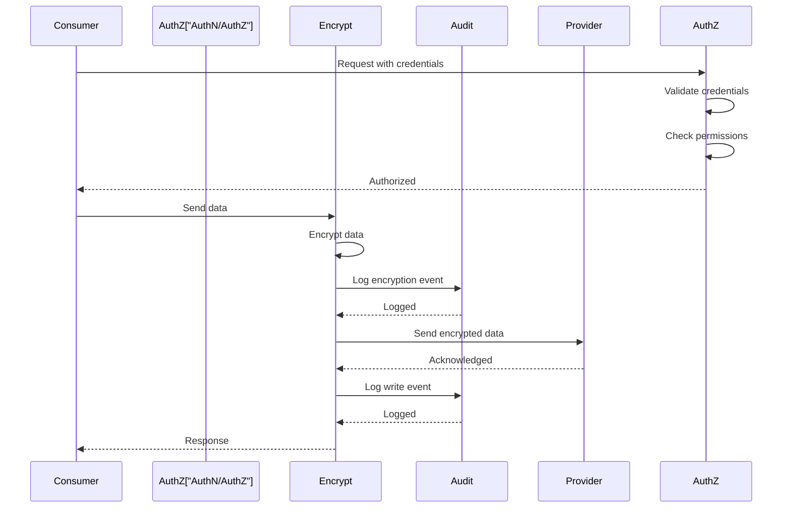

# RFC-0409: Storage Security

RFC: RFC-0409
Title: Storage Security
Status: Accepted
Category: Core
Owner: Storage Team
Authors: Atlas Specification Committee
Created: 2026-07-01
Updated: 2026-07-01
ADS Version: 1.0.0
Spec Version: 0.1.0
Normative: YES
Depends On:
  - RFC-0401 Storage Overview
  - RFC-0402 Storage Architecture
Supersedes: None
Superseded By: None
Related ADR:
  - ADR-0010 Contract-First Specification
Related JSON Schema:
  - schemas/storage/security.json
Related Catalog:
  - catalog/storage-security.md
Layer: Core
Audience: Storage developers, architects, specification reviewers
Target Release: 1.0.0
Review Cycle: Quarterly
Compatibility: Compatible with Spec 1.x
Last Updated: 2026-07-01

---

## Normative Status
This specification is Normative. Every Atlas implementation MUST conform to the security controls, encryption requirements, access control model, and audit logging defined in this document. Any deviation MUST be approved through the formal Architecture Decision Record (ADR) process.

This specification is subordinate to the Atlas Development System (ADS) Constitution, ADR-0010, and ADR-0012.

---

## Authority
This RFC is the authoritative specification for the Storage Security domain.

Any implementation MUST conform to this document.

If an implementation conflicts with this RFC, this RFC takes precedence.

Conflicts between RFCs SHALL be resolved through the ADR process.

---

## Terminology

The following terms are defined with exact meanings consistent with the Atlas Master Glossary and RFC-0301.

| Term | Definition | Source |
|---|---|---|
| Encryption at Rest | The process of encrypting stored data so that it is unreadable without the decryption key. | RFC-0409 |
| Encryption in Transit | The process of encrypting data during transmission between components. | RFC-0409 |
| Access Control | The mechanism by which permissions are granted or denied for storage operations. | RFC-0409 |
| Audit Log | An append-only, tamper-evident record of all storage operations. | RFC-0401 |
| Threat Model | A systematic analysis of potential security threats to the storage system. | RFC-0409 |
| Key Management | The process of generating, rotating, storing, and revoking cryptographic keys. | RFC-0409 |
| Data Classification | The categorization of data based on sensitivity and regulatory requirements. | RFC-0409 |
| Resource | A unit of data managed by Storage, identified by a unique resource identifier. | RFC-0401 |
| Workflow | A declarative directed graph specification expressing WHAT must happen, not HOW. | RFC-0301 |
| Execution | The process of evaluating a workflow graph and activating nodes to produce results. | RFC-0303 |
 RFC-0301 |
| Task | An atomic unit of work within a workflow, represented as a node. | RFC-0301 |
| Node | A graph element representing an atomic unit of work with defined inputs and outputs. | RFC-0301 |
| Context | The scoped data environment available to nodes during execution. | RFC-0307 |
| Frame | A discrete unit of visual data processed by vision nodes. | RFC-0301 |
| Tick | A single evaluation cycle of the workflow scheduler. | RFC-0301 |
| Scheduler | The component that determines WHEN and WHERE each node is executed. | RFC-0312 |
| Trigger | An event or condition that initiates workflow execution. | RFC-0311 |

---

This specification is Normative. Every Atlas implementation MUST conform to the security architecture, access control, encryption, audit logging, and threat mitigation defined in this document. Any deviation MUST be approved through the formal Architecture Decision Record (ADR) process.

This specification is subordinate to the Atlas Development System (ADS) Constitution, ADR-0010, and RFC-0401.

---

## Table of Contents
1. [Introduction](#1-introduction)
2. [Goals](#2-goals)
3. [Non-Goals](#3-non-goals)
4. [Security Architecture](#4-security-architecture)
5. [Access Control](#5-access-control)
6. [Permission Model](#6-permission-model)
7. [Encryption at Rest](#7-encryption-at-rest)
8. [Encryption in Transit](#8-encryption-in-transit)
9. [Key Management](#9-key-management)
10. [Audit Logging](#10-audit-logging)
11. [Data Classification](#11-data-classification)
12. [Threat Model](#12-threat-model)
13. [Secure Deletion](#13-secure-deletion)
14. [Multi-Tenancy](#14-multi-tenancy)
15. [Authentication](#15-authentication)
16. [Authorization](#16-authorization)
17. [Acceptance Criteria](#17-acceptance-criteria)
18. [References](#18-references)
19. [Future Evolution](#19-future-evolution)

---

## 1 Introduction

The Storage Security specification defines the comprehensive security model for the Storage subsystem. Security is enforced at every layer of the Storage architecture through authentication, authorization, encryption, audit logging, and threat mitigation.

Storage security follows a defense-in-depth philosophy where multiple independent security controls operate at every boundary. No single security control is the sole protection.

---

## 2 Goals

1. **Confidentiality**: Stored data MUST be protected from unauthorized disclosure.
2. **Integrity**: Stored data MUST be protected from unauthorized modification.
3. **Availability**: Authorized users MUST have reliable access to stored data.
4. **Accountability**: Every storage operation MUST be attributable to an authorized entity.
5. **Non-Repudiation**: Entities MUST NOT be able to deny performing authorized operations.
6. **Least Privilege**: Every operation MUST be authorized against minimum required permissions.
7. **Encryption**: Sensitive data MUST be encrypted at rest and in transit.
8. **Audit**: Every operation MUST be recorded in an immutable audit log.

---

## 3 Non-Goals

- **Network Security**: Network-level security is governed by the IPC subsystem (RFC-0107).
- **Operating System Security**: OS-level security is outside the Storage subsystem scope.
- **Application Security**: Application-level security is the responsibility of consumers.
- **Physical Security**: Physical security of storage media is an infrastructure concern.

---

## 4 Security Architecture

### 4.1 Defense-in-Depth Layers

| Layer | Control | Description |
|---|---|---|
| API Layer | Authentication | Verify identity of request originator |
| API Layer | Authorization | Verify permissions for requested operation |
| Schema Layer | Data Classification | Classify data sensitivity at schema level |
| Management | Encryption | Encrypt data before writing to provider |
| Management | Audit Logging | Record all operations in audit log |
| Provider | Isolation | Isolate provider data from other providers |
| Persistence | Secure Deletion | Cryptographically erase data on deletion |

### 4.2 Security Data Flow

---

## 5 Access Control

### 5.1 Access Control Models

| Model | Description | Use Case |
|---|---|---|
| Role-Based (RBAC) | Permissions assigned to roles | Organizational access patterns |
| Attribute-Based (ABAC) | Permissions based on attributes | Fine-grained contextual access |
| Capability-Based | Permissions encoded in tokens | Distributed systems |

### 5.2 Default Model

The default access control model is RBAC. ABAC and capability-based models MAY be enabled for specific resource types through configuration.

---

## 6 Permission Model

### 6.1 Permission Hierarchy

| Permission | Description | Required For |
|---|---|---|
| read | Read resource data | Query, get operations |
| write | Modify resource data | Update, create operations |
| delete | Remove resource | Delete, purge operations |
| admin | Manage resource permissions | Permission changes |
| audit | View audit logs | Security investigation |
| migrate | Execute migrations | Schema/data migration |
| backup | Execute backup operations | Backup procedures |
| recover | Execute recovery operations | Disaster recovery |

### 6.2 Permission Scopes

| Scope | Description |
|---|---|
| global | Applies to all resources |
| namespace | Applies to a storage namespace |
| resource_type | Applies to a resource type |
| resource_id | Applies to a specific resource |

### 6.3 Permission Evaluation

Permission evaluation follows this order:

1. Check for explicit deny (takes precedence over allow).
2. Check for explicit allow at the most specific scope.
3. Check inherited permissions from parent scopes.
4. Deny by default if no matching permission found.

---

## 7 Encryption at Rest

### 7.1 Encryption Requirements

- All data classified as SENSITIVE or RESTRICTED MUST be encrypted at rest.
- Encryption MUST use industry-standard algorithms.
- Each provider MAY use a different encryption key.
- Encryption MUST be transparent to consumers.

### 7.2 Encryption Scope

| Scope | Description |
|---|---|
| Field-Level | Individual fields encrypted separately |
| Record-Level | Entire resource encrypted as one unit |
| Provider-Level | All data in a provider encrypted uniformly |

---

## 8 Encryption in Transit

### 8.1 Transport Security

All data transmitted between Storage layers MUST be encrypted:

- Inter-component communication: TLS 1.3 or equivalent.
- Provider communication: Encrypted channel or encrypted payload.
- External API communication: TLS 1.3 or equivalent.

### 8.2 Certificate Management

- Certificates MUST be rotated at defined intervals.
- Expired certificates MUST trigger immediate reconnection with new certificates.
- Certificate validation MUST be enforced on all connections.

---

## 9 Key Management

### 9.1 Key Lifecycle

| Phase | Description |
|---|---|
| Generation | Cryptographic keys are generated securely |
| Distribution | Keys are distributed to authorized entities |
| Rotation | Keys are periodically replaced |
| Revocation | Compromised keys are invalidated |
| Destruction | Expired keys are securely destroyed |

### 9.2 Key Rotation

- Default rotation interval: 90 days.
- Rotation MUST NOT cause data unavailability.
- Old keys MUST be retained until all data encrypted with them is re-encrypted.
- Rotation events MUST be logged in the audit trail.

---

## 10 Audit Logging

### 10.1 Audit Entry Requirements

Every storage operation produces an audit entry:

| Field | Type | Required | Description |
|---|---|---|---|
| operation_id | string | YES | Unique operation identifier |
| timestamp | int64 | YES | Operation timestamp |
| actor | string | YES | Entity performing the operation |
| action | enum | YES | Operation type |
| resource_id | string | YES | Affected resource |
| result | enum | YES | Success, failure, denied |
| details | object | NO | Operation-specific context |
| ip_address | string | NO | Source IP (external operations) |
| session_id | string | NO | Associated session |

### 10.2 Audit Log Properties

- **Append-Only**: Entries are never modified or deleted (except by retention policy).
- **Tamper-Evident**: Cryptographic chaining detects unauthorized modification.
- **Retention**: Entries are retained for the period defined by retention policy.
- **Immutability**: Audit entries are immutable once written.

### 10.3 Audit Log Access

| Role | Access Level |
|---|---|
| Security Admin | Full read and export |
| Auditor | Read-only access |
| System | Append-only |
| Consumer | No direct access |

---

## 11 Data Classification

### 11.1 Sensitivity Levels

| Level | Description | Encryption Required | Retention |
|---|---|---|---|
| PUBLIC | No sensitivity restrictions | No | Standard |
| INTERNAL | Organization-internal use | At rest | Extended |
| SENSITIVE | Personal or confidential data | At rest and transit | Maximum |
| RESTRICTED | Highly regulated data | At rest, transit, and in memory | Regulatory |

### 11.2 Classification Enforcement

Data classification is declared at the schema level (see RFC-0405). The Storage subsystem enforces classification requirements:

1. Encryption is applied based on classification.
2. Access control is enforced based on classification.
3. Audit logging is intensified for higher classifications.
4. Retention policies are applied based on classification.

---

## 12 Threat Model

### 12.1 Storage-Specific Threats

| Threat | Description | Mitigation |
|---|---|---|
| Data Breach | Unauthorized data disclosure | Encryption, access control |
| Data Tampering | Unauthorized data modification | Integrity checks, audit log |
| Replay Attack | Replaying old operations | Nonce, timestamp validation |
| Denial of Service | Resource exhaustion | Rate limiting, quotas |
| Privilege Escalation | Gaining elevated permissions | Permission evaluation order |
| Supply Chain | Compromised provider | Provider validation, isolation |

### 12.2 Threat Mitigation Matrix

| Threat | Auth | ACL | Encrypt | Audit | Isolate |
|---|---|---|---|---|---|
| Data Breach | X | X | X | X | |
| Data Tampering | | X | | X | X |
| Replay Attack | X | | | X | |
| DoS | | X | | X | X |
| Privilege Escalation | X | X | | X | |
| Supply Chain | | X | | X | X |

---

## 13 Secure Deletion

### 13.1 Deletion Methods

| Method | Description | Use Case |
|---|---|---|
| Logical Delete | Mark as deleted, retain data | Soft delete, recovery |
| Cryptographic Erase | Destroy encryption key | Fast secure deletion |
| Overwrite | Overwrite data with random bytes | Compliance requirement |
| Physical Destroy | Remove storage media | Decommissioning |

### 13.2 Secure Deletion Requirements

- Cryptographic erase is the default secure deletion method.
- Overwrite deletion is used when cryptographic erase is not supported.
- Deletion events are logged in the audit trail.
- Deleted data MUST NOT be recoverable through any means.

---

## 14 Multi-Tenancy

### 14.1 Isolation Model

Shared storage providers isolate tenant data through logical partitioning:

| Partition Type | Description | Isolation Level |
|---|---|---|
| Schema | Separate schema per tenant | Medium |
| Row | Row-level access control | High |
| Namespace | Separate namespace per tenant | High |
| Provider | Separate provider per tenant | Maximum |

### 14.2 Tenant Identification

Tenants are identified through:

1. Namespace prefix in resource IDs.
2. Authentication token claims.
3. API request headers.

---

## 15 Authentication

### 15.1 Authentication Methods

| Method | Description | Security Level |
|---|---|---|
| Token | Short-lived authentication token | High |
| Certificate | X.509 client certificate | Very High |
| API Key | Long-lived API key | Medium |
| OAuth | OAuth 2.0 bearer token | High |

### 15.2 Session Management

- Sessions have a maximum lifetime (default: 1 hour).
- Session tokens are rotated on each operation.
- Expired sessions MUST be rejected.
- Session revocation is immediate upon request.

---

## 16 Authorization

### 16.1 Permission Evaluation

Authorization follows a deny-by-default model:

1. Actor identity is established through authentication.
2. Requested operation is identified.
3. Target resource is identified.
4. Permission check against the evaluated scope.
5. Result: allow or deny.

### 16.2 Permission Caching

Permission decisions MAY be cached for performance:

- Cache entries expire after a configurable duration.
- Cache invalidation occurs on permission changes.
- Cached decisions are logged for audit purposes.

---

## 17 Acceptance Criteria

### AC-0409-01: Encryption Coverage
- **Requirement**: All SENSITIVE and RESTRICTED data MUST be encrypted at rest and in transit.
- **Verification**: Audit encryption configuration for all data classifications.
- **Expected Result**: 100% encryption coverage for required classification levels.

### AC-0409-02: Access Control Enforcement
- **Requirement**: Every operation MUST be authorized before execution.
- **Verification**: Attempt unauthorized operations at each permission level.
- **Expected Result**: All unauthorized operations denied with appropriate error codes.

### AC-0409-03: Audit Completeness
- **Requirement**: Every storage operation MUST produce an audit entry.
- **Verification**: Compare operation logs with audit log entries.
- **Expected Result**: 100% audit log coverage with no gaps.

### AC-0409-04: Key Rotation
- **Requirement**: Encryption keys MUST be rotatable without data unavailability.
- **Verification**: Execute key rotation during active operations.
- **Expected Result**: Operations continue during rotation; old data accessible with old keys.

### AC-0409-05: Secure Deletion
- **Requirement**: Deleted data MUST NOT be recoverable.
- **Verification**: Delete data and attempt recovery through provider APIs.
- **Expected Result**: No recoverable data found after secure deletion.

### AC-0409-06: Multi-Tenant Isolation
- **Requirement**: Tenant data MUST be isolated as defined in Section 14.
- **Verification**: Cross-tenant data access attempts.
- **Expected Result**: All cross-tenant access attempts denied.

---

## 18 References

- [RFC-0401 Storage Overview](RFC-0401-storage-overview.md)
- [RFC-0402 Storage Architecture](RFC-0402-storage-architecture.md)
- [RFC-0403 Storage Provider](RFC-0403-storage-provider.md)
- [RFC-0413 Storage Events](RFC-0413-storage-events.md)
- [RFC-0414 Storage Observability](RFC-0414-storage-observability.md)
- [RFC-1006 Common Error Model](../common/RFC-1006-error-model.md)

---

## 19 Future Evolution

Future specifications will address:
- **Homomorphic Encryption**: Computation on encrypted data without decryption.
- **Zero-Knowledge Proofs**: Prove data validity without revealing data.
- **Quantum-Resistant Encryption**: Migration to post-quantum cryptographic algorithms.
- **Attribute-Based Access Control**: Dynamic permission evaluation based on context.

---

## Layer Boundaries

### Responsibilities
This specification IS responsible for:
- Defining encryption requirements for data at rest and in transit.
- Specifying the access control model and permission hierarchy for storage operations.
- Establishing audit logging requirements for all storage operations.
- Defining threat mitigation strategies and security incident response procedures.
- Setting key management requirements for cryptographic operations.

### Non-Responsibilities
This specification IS NOT responsible for:
- Implementing cryptographic algorithms (delegated to the Provider interface).
- Managing user identity and authentication (delegated to the Identity subsystem).
- Deploying security infrastructure (delegated to the infrastructure team).

### Dependencies
| Dependency | Direction | Description |
|---|---|---|
| RFC-0401 | Consumed | Storage Overview (security principles) |
| RFC-0402 | Consumed | Storage Architecture (security per layer) |
| RFC-0420 | Consumed | Storage Compliance (regulatory alignment) |
| RFC-0414 | Consumed | Storage Observability (security telemetry) |

### Consumers
- RFC-0420 Storage Compliance (security compliance requirements)
- RFC-0414 Storage Observability (security event monitoring)
- All Storage RFCs (security requirements for their domains)

### Providers
- schemas/storage/security.json (security schema)
- catalog/storage-security.md (security catalog)

### Forbidden Dependencies
- This specification MUST NOT depend on any specific encryption algorithm.
- This specification MUST NOT assume any specific key management service.
- This specification MUST NOT reference any specific identity provider.

---

## Security

This specification defines comprehensive security requirements:

- **Encryption at Rest**: All stored data MUST be encrypted using industry-standard encryption algorithms. The choice of algorithm is delegated to the Provider interface, which MUST support configurable cipher suites.
- **Encryption in Transit**: All data transmitted between Storage components and providers MUST be encrypted using secure transport protocols.
- **Access Control**: Every Storage operation MUST be subject to authorization checks. Access policies are defined by the consuming subsystem and enforced uniformly.
- **Audit Logging**: All Storage operations MUST produce tamper-evident audit log entries. Audit logs MUST be immutable and retained according to policy.
- **Key Management**: Cryptographic keys MUST be managed through a dedicated key management service. Keys MUST be rotated according to defined policies.
- **Threat Mitigation**: Storage MUST defend against injection attacks, privilege escalation, data exfiltration, denial-of-service, and insider threats.

---

## Performance

This specification defines performance requirements for security operations:

- **Encryption Overhead**: Encryption and decryption operations MUST complete within bounded time, with overhead not exceeding defined thresholds.
- **Access Control Latency**: Authorization checks MUST complete within bounded time for all operation types.
- **Audit Log Throughput**: Audit log entries MUST be written without blocking storage operations.

---

## Compatibility

This specification defines compatibility requirements:

- **Cryptography Algorithm Agility**: The system MUST support algorithm upgrades without data migration.
- **Policy Compatibility**: Security policy changes MUST maintain compatibility with existing authorized operations.

---

## Compliance

This specification requires compliance with:

- The Atlas Development System (ADS) Constitution.
- ADR-0010 (Contract-First Specification-Driven Development).
- ADR-0012 (Security Architecture).
- All applicable regulatory and organizational security standards.

---

## Future Evolution

Future specifications will address:
- **Zero-Trust Architecture**: Implementation of zero-trust principles for storage access.
- **Homomorphic Encryption**: Support for computations on encrypted data without decryption.
- **Confidential Computing**: Hardware-enforced execution environments for sensitive storage operations.
- **Automated Threat Detection**: Machine learning-based anomaly detection for storage security events.

---

## Runtime Independence

This specification is completely independent of any runtime implementation platform. Specifically, this specification MUST NOT assume:

- Any programming language (Rust, Node.js, TypeScript, Go, Python, etc.)
- Any runtime environment (Electron, Tauri, Browser, Desktop, Server)
- Any storage backend (SQLite, PostgreSQL, MongoDB, Redis, etc.)
- Any operating system (Windows, Linux, macOS, etc.)
- Any hardware architecture (CPU, GPU, FPGA, etc.)
- Any threading model (single-threaded, multi-threaded, actor-based, etc.)
- Any cloud provider (AWS, Azure, GCP, etc.)
- Any container platform (Docker, containerd, etc.)

---

## Acceptance Criteria

### AC-0409-01: Security Compliance

| # | Criterion | Verification Method |
|---|---|---|
| AC-01 | All stored data MUST be encrypted at rest. | Encryption verification test. |
| AC-02 | All data in transit MUST be encrypted. | Transport security test. |
| AC-03 | Every operation MUST be subject to authorization checks. | Authorization bypass test. |
| AC-04 | All operations MUST produce audit log entries. | Audit log completeness test. |
| AC-05 | Audit logs MUST be tamper-evident and immutable. | Tamper detection test. |
| AC-06 | Cryptographic keys MUST be managed through a dedicated service. | Key management verification test. |
| AC-07 | Encryption overhead MUST not exceed defined performance thresholds. | Performance benchmark test. |
| AC-08 | Unauthorized access attempts MUST be logged and denied. | Penetration testing. |

---

## References

| Reference | Description |
|---|---|
| RFC-0401 | Storage Overview |
| RFC-0402 | Storage Architecture |
| RFC-0414 | Storage Observability |
| RFC-0420 | Storage Compliance |
| ADR-0010 | Contract-First Specification |
| ADR-0012 | Security Architecture |
| schemas/storage/security.json | Security Schema Definition |
| catalog/storage-security.md | Security Catalog |
| Glossary | Atlas Master Glossary |
| Constitution | Atlas AI Constitution |

---

## Compliance Matrix

| Category | Value |
|---|---|
| Related RFC | RFC-0401, RFC-0402, RFC-0414, RFC-0420 |
| Related ADR | ADR-0010, ADR-0012 |
| Related JSON Schema | schemas/storage/security.json |
| Related Catalog | catalog/storage-security.md |

---

## Revision History

| Version | Status | Date | Author | Notes |
|---|---|---|---|---|
| 0.1.0 | Proposed | 2026-07-01 | Atlas Specification Committee | Initial publication |
| 1.0.0 | Accepted | 2026-07-01 | Atlas Specification Committee | Added Authority, Terminology, Layer Boundaries, Security, Performance, Compatibility, Compliance, Runtime Independence, Acceptance Criteria, References, Compliance Matrix, Revision History |

