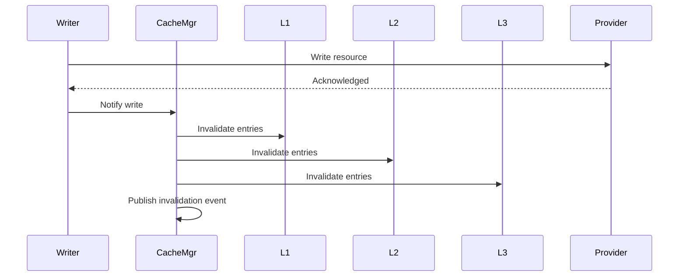
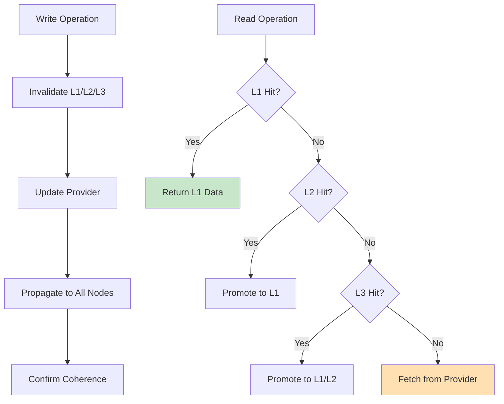

# RFC-0410: Storage Cache

RFC: RFC-0410
Title: Storage Cache
Status: Accepted
Category: Standard
Owner: Storage Team
Authors: Atlas Specification Committee
Created: 2026-07-01
Updated: 2026-07-01
ADS Version: 1.0.0
Spec Version: 0.1.0
Normative: YES
Depends On:
  - RFC-0401 Storage Overview
  - RFC-0402 Storage Architecture
Supersedes: None
Superseded By: None
Related ADR:
  - ADR-0010 Contract-First Specification
Related JSON Schema:
  - schemas/storage/cache.json
Related Catalog:
  - catalog/storage-cache.md
Layer: Core
Audience: Storage developers, architects, specification reviewers
Target Release: 1.0.0
Review Cycle: Quarterly
Compatibility: Compatible with Spec 1.x
Last Updated: 2026-07-01

---

## Normative Status
This specification is Normative. Every Atlas implementation MUST conform to the caching policies, coherence guarantees, eviction strategies, and invalidation protocols defined in this document. Any deviation MUST be approved through the formal Architecture Decision Record (ADR) process.

This specification is subordinate to the Atlas Development System (ADS) Constitution, ADR-0010, and ADR-0012.

---

## Authority
This RFC is the authoritative specification for the Storage Cache domain.

Any implementation MUST conform to this document.

If an implementation conflicts with this RFC, this RFC takes precedence.

Conflicts between RFCs SHALL be resolved through the ADR process.

---

## Terminology

The following terms are defined with exact meanings consistent with the Atlas Master Glossary and RFC-0301.

| Term | Definition | Source |
|---|---|---|
| Cache | A transient storage layer that holds frequently accessed data for improved read performance. | RFC-0410 |
| Cache Policy | A rule governing what data is cached, for how long, and under what conditions. | RFC-0410 |
| Eviction | The removal of cached data when cache capacity is reached or entries expire. | RFC-0410 |
| Coherence | The guarantee that cached data remains consistent with the underlying storage. | RFC-0410 |
| Cache Invalidation | The process of removing or updating cached entries when the underlying data changes. | RFC-0410 |
| Cache Hit | A successful cache lookup returning cached data. | RFC-0410 |
| Cache Miss | A cache lookup that requires fetching data from the underlying storage. | RFC-0410 |
| Write-Through | A caching strategy where writes update both the cache and the underlying storage simultaneously. | RFC-0410 |
| Write-Behind | A caching strategy where writes update the cache first and asynchronously propagate to storage. | RFC-0410 |
| Resource | A unit of data managed by Storage, identified by a unique resource identifier. | RFC-0401 |
| Workflow | A declarative directed graph specification expressing WHAT must happen, not HOW. | RFC-0301 |
| Execution | The process of evaluating a workflow graph and activating nodes to produce results. | RFC-0303 |
 RFC-0301 |
| Task | An atomic unit of work within a workflow, represented as a node. | RFC-0301 |
| Node | A graph element representing an atomic unit of work with defined inputs and outputs. | RFC-0301 |
| Context | The scoped data environment available to nodes during execution. | RFC-0307 |
| Frame | A discrete unit of visual data processed by vision nodes. | RFC-0301 |
| Tick | A single evaluation cycle of the workflow scheduler. | RFC-0301 |
| Scheduler | The component that determines WHEN and WHERE each node is executed. | RFC-0312 |
| Trigger | An event or condition that initiates workflow execution. | RFC-0311 |

---

This specification is Normative. Every Atlas implementation MUST conform to the cache architecture, invalidation policies, eviction strategies, and coherence protocols defined in this document. Any deviation MUST be approved through the formal Architecture Decision Record (ADR) process.

This specification is subordinate to the Atlas Development System (ADS) Constitution, ADR-0010, and RFC-0401.

---

## Table of Contents
1. [Introduction](#1-introduction)
2. [Goals](#2-goals)
3. [Non-Goals](#3-non-goals)
4. [Cache Architecture](#4-cache-architecture)
5. [Cache Layers](#5-cache-layers)
6. [Cache Policies](#6-cache-policies)
7. [Cache Invalidation](#7-cache-invalidation)
8. [Cache Eviction](#8-cache-eviction)
9. [Cache Coherence](#9-cache-coherence)
10. [Cache Warming](#10-cache-warming)
11. [Cache Sizing](#11-cache-sizing)
12. [Cache Monitoring](#12-cache-monitoring)
13. [Cache Bypass](#13-cache-bypass)
14. [Cache Serialization](#14-cache-serialization)
15. [Cache Failure Modes](#15-cache-failure-modes)
16. [Acceptance Criteria](#16-acceptance-criteria)
17. [References](#17-references)
18. [Future Evolution](#18-future-evolution)

---

## 1 Introduction

The Storage Cache specification defines a multi-layer caching architecture that sits between consumers and storage providers. The cache reduces provider load, improves read latency, and enables graceful degradation when providers are unavailable.

The Cache Manager (see RFC-0402) orchestrates all cache operations including invalidation, eviction, warming, and coherence across layers.

---

## 2 Goals

1. **Latency Reduction**: Cache hits MUST significantly reduce read latency compared to provider reads.
2. **Provider Load Reduction**: Cache MUST absorb the majority of read operations under normal conditions.
3. **Coherence**: Cache data MUST be consistent with the authoritative provider data.
4. **Graceful Degradation**: Storage MUST continue operating when the cache is unavailable.
5. **Configurable Policies**: Cache behavior MUST be configurable per-resource type.
6. **Observability**: Cache performance MUST be fully observable through metrics and events.

---

## 3 Non-Goals

- **Cache Implementation Details**: The specific data structures used within each cache layer are implementation details.
- **Cache Distribution**: How cache data is distributed across multiple nodes is outside this specification.
- **Cache Persistence**: Cache data persistence across process restarts is an implementation choice.

---

## 4 Cache Architecture

### 4.1 Layered Cache Model

```mermaid
graph TB
    subgraph L1["L1: In-Process Cache"]
        L1Fast["Fastest access<br/>Per-process<br/>Limited capacity"]
    end

    subgraph L2["L2: Shared Cache"]
        L2Medium["Medium speed<br/>Shared across processes<br/>Moderate capacity"]
    end

    subgraph L3["L3: Persistent Cache"]
        L3Slow["Slowest access<br/>Survives restarts<br/>Large capacity"]
    end

    subgraph PROV["Provider"]
        Storage["Persistent Storage"]
    end

    Consumer --> L1
    L1 -. miss --> L2
    L2 -. miss --> L3
    L3 -. miss --> Storage
    
    L1 --> L2
    L2 --> L3
    L3 --> Storage
    
    style L1Fast fill:#e8f5e9
    style L2Medium fill:#fff3e0
    style L3Slow fill:#e3f2fd
    style Storage fill:#fce4ec
```

### 4.2 Cache Flow

Read operations flow through layers from fastest to slowest. Write operations invalidate relevant cache entries and propagate updates to higher layers.

---

## 5 Cache Layers

### 5.1 L1: In-Process Cache

| Property | Value |
|---|---|
| Location | Within the Storage process |
| Speed | Nanoseconds to microseconds |
| Capacity | Limited by process memory |
| Sharing | Not shared between processes |
| Persistence | Lost on process restart |

### 5.2 L2: Shared Cache

| Property | Value |
|---|---|
| Location | Separate cache service or shared memory |
| Speed | Microseconds to milliseconds |
| Capacity | Limited by cache service resources |
| Sharing | Shared across all Storage processes |
| Persistence | Survives process restarts |

### 5.3 L3: Persistent Cache

| Property | Value |
|---|---|
| Location | Dedicated storage medium |
| Speed | Milliseconds |
| Capacity | Limited by storage medium |
| Sharing | Shared across all processes and restarts |
| Persistence | Fully persistent |

---

## 6 Cache Policies

### 6.1 Write Policies

| Policy | Description | Consistency | Performance |
|---|---|---|---|
| Write-Through | Write to cache and provider simultaneously | Strong | Moderate |
| Write-Back | Write to cache only, async flush to provider | Eventual | High |
| Write-Around | Bypass cache on write, only cache reads | Strong | High |
| Pass-Through | All writes go directly to provider | Strong | Highest |

### 6.2 Default Policy

The default write policy is Write-Through for SENSITIVE data and Write-Around for PUBLIC data.

---

## 7 Cache Invalidation

### 7.1 Invalidation Strategies

| Strategy | Description | Use Case |
|---|---|---|
| Event-Driven | Invalidate on write/delete events | Real-time consistency |
| TTL-Based | Expire after time-to-live | Best-effort freshness |
| Manual | Explicit invalidation request | Administrative operations |
| Version-Based | Invalidate when resource version changes | Version-aware consistency |

### 7.2 Invalidation Flow



---

## 8 Cache Eviction

### 8.1 Eviction Policies

| Policy | Description | Complexity |
|---|---|---|
| LRU | Least Recently Used | Medium |
| LFU | Least Frequently Used | High |
| FIFO | First In, First Out | Low |
| Random | Random selection | Lowest |
| ARC | Adaptive Replacement Cache | High |

### 8.2 Eviction Triggers

| Trigger | Description |
|---|---|
| Capacity Threshold | Evict when cache exceeds configured percentage |
| Age Expiration | Evict entries older than maximum age |
| Priority Drop | Evict low-priority entries first |
| Memory Pressure | Evict aggressively under memory pressure |

---

## 9 Cache Coherence

### 9.1 Coherence Protocol



### 9.2 Coherence Guarantees

| Guarantee | Description |
|---|---|
| Strong | All readers see the latest written data |
| Eventual | All readers see the latest data within a bounded time |
| Session | Readers within a session see their own writes |

---

## 10 Cache Warming

### 10.1 Warming Strategies

| Strategy | Description | Trigger |
|---|---|---|
| Predictive | Pre-populate based on access patterns | Scheduled |
| Manual | Explicit warm request | Administrative |
| Event-Based | Warm on resource creation | Resource lifecycle |
| Dependency-Based | Warm related resources together | Schema relationships |

---

## 11 Cache Sizing

### 11.1 Dynamic Sizing

Cache sizes are adjusted dynamically based on:

1. **Hit Rate**: Low hit rates may indicate insufficient capacity.
2. **Memory Pressure**: High memory usage triggers size reduction.
3. **Access Patterns**: Hot resources get larger cache allocations.
4. **Priority**: High-priority resource types get preferential sizing.

### 11.2 Size Limits

| Layer | Minimum | Maximum | Default |
|---|---|---|---|
| L1 | 1 MB | 1 GB | 100 MB |
| L2 | 10 MB | 10 GB | 1 GB |
| L3 | 100 MB | 100 GB | 10 GB |

---

## 12 Cache Monitoring

### 12.1 Metrics

| Metric | Description | Unit |
|---|---|---|
| hit_rate | Percentage of reads served from cache | percent |
| miss_rate | Percentage of reads not served from cache | percent |
| eviction_count | Number of evicted entries | count |
| invalidation_count | Number of invalidated entries | count |
| warm_time | Time to populate cache entries | milliseconds |
| memory_usage | Current cache memory consumption | bytes |

### 12.2 Health Checks

Cache health is monitored through:

- Hit rate trend analysis
- Eviction rate monitoring
- Memory utilization tracking
- Coherence violation detection

---

## 13 Cache Bypass

### 13.1 Bypass Conditions

The cache is bypassed when:

| Condition | Description |
|---|---|
| Write Operation | Writes always bypass the cache |
| Stale Data | Cached data exceeds maximum staleness |
| Cache Unavailable | Cache layer is unhealthy |
| Explicit Request | Consumer requests bypass |
| Sensitivity | Resource is classified as highly sensitive |

---

## 14 Cache Serialization

### 14.1 Concurrent Access

When multiple consumers access the same cached resource:

1. Read operations are concurrent and non-blocking.
2. Write operations serialize through the Cache Manager.
3. Cache updates are applied atomically.
4. Invalidation events are broadcast to all consumers.

### 14.2 Consistency During Concurrency

Under concurrent read and write:

- Readers see either the old or new value, never a partial update.
- Write operations complete before subsequent reads see the new value.

---

## 15 Cache Failure Modes

### 15.1 Degraded Operation

When the cache fails:

| Failure | Behavior |
|---|---|
| L1 Failure | Reads fall through to L2/L3/Provider |
| L2 Failure | Reads fall through to L3/Provider |
| L3 Failure | Reads fall through to Provider |
| All Layers | All reads go directly to Provider |

### 15.2 Recovery

When cache is restored:

1. Cache warm-up begins automatically.
2. Recent access patterns drive warming priority.
3. Cache performance metrics are reset.
4. Coherence is verified against provider data.

---

## 16 Acceptance Criteria

### AC-0410-01: Hit Rate
- **Requirement**: Cache hit rate MUST exceed 90% under normal operating conditions.
- **Verification**: Measure hit rate over 24-hour period.
- **Expected Result**: Average hit rate >= 90%.

### AC-0410-02: Coherence
- **Requirement**: Cache MUST NOT serve stale data when authoritative source is available.
- **Verification**: Write data and verify cache invalidation within timeout.
- **Expected Result**: No stale reads detected within coherence window.

### AC-0410-03: Graceful Degradation
- **Requirement**: Storage MUST continue operating when cache is unavailable.
- **Verification**: Disable cache and verify read/write operations.
- **Expected Result**: All operations succeed through provider fallback.

### AC-0410-04: Eviction Safety
- **Requirement**: Eviction MUST NOT cause data loss or inconsistency.
- **Verification**: Stress test with high eviction rates.
- **Expected Result**: No data inconsistencies detected after eviction cycles.

### AC-0410-05: Monitoring
- **Requirement**: All cache metrics MUST be exposed through the observability layer.
- **Verification**: Check metric availability in observability dashboard.
- **Expected Result**: All six metrics defined in Section 12.1 available.

---

## 17 References

- [RFC-0401 Storage Overview](RFC-0401-storage-overview.md)
- [RFC-0402 Storage Architecture](RFC-0402-storage-architecture.md)
- [RFC-0403 Storage Provider](RFC-0403-storage-provider.md)
- [RFC-0406 Storage Transactions](RFC-0406-storage-transactions.md)
- [RFC-0413 Storage Events](RFC-0413-storage-events.md)
- [RFC-0414 Storage Observability](RFC-0414-storage-observability.md)

---

## 18 Future Evolution

Future specifications will address:
- **Predictive Caching**: ML-driven cache population based on access patterns.
- **Tiered Caching**: Automatic data movement between cache tiers.
- **Distributed Cache**: Cross-node cache sharing with consistent hashing.
- **Cache Compression**: Transparent data compression in cache layers.

---

## Layer Boundaries

### Responsibilities
This specification IS responsible for:
- Defining the caching architecture and layer placement within the Storage stack.
- Specifying cache policies including TTL, eviction strategies, and invalidation rules.
- Defining coherence guarantees and consistency models for cached data.
- Establishing cache statistics and monitoring requirements.

### Non-Responsibilities
This specification IS NOT responsible for:
- Implementing the underlying storage backend (delegated to the Provider interface).
- Defining data access patterns (delegated to consuming subsystems).
- Managing cache deployment topology (delegated to infrastructure).

### Dependencies
| Dependency | Direction | Description |
|---|---|---|
| RFC-0401 | Consumed | Storage Overview (caching context) |
| RFC-0402 | Consumed | Storage Architecture (layer placement) |
| RFC-0406 | Consumed | Storage Transactions (cache-coherent transactions) |
| RFC-0416 | Consumed | Storage Consistency (coherence guarantees) |
| RFC-0413 | Consumed | Storage Events (cache invalidation events) |

### Consumers
- RFC-0415 Storage Performance (performance optimization through caching)
- RFC-0414 Storage Observability (cache metrics and monitoring)
- All read-heavy Storage consumers

### Providers
- schemas/storage/cache.json (cache schema)
- catalog/storage-cache.md (caching catalog)

### Forbidden Dependencies
- This specification MUST NOT depend on any specific caching technology.
- This specification MUST NOT assume any specific cache deployment topology.

---

## Security

This specification defines security requirements for caches:

- **Cache Data Protection**: Cached data MUST be subject to the same encryption and access control requirements as data in persistent storage.
- **Cache Invalidation Security**: Cache invalidation MUST be authorized. Unauthorized invalidation attempts MUST be rejected.
- **Audit Trail**: Cache operations (hit, miss, evict, invalidate) MUST be recorded in the audit log.

---

## Performance

This specification defines performance requirements for caches:

- **Hit Rate**: The cache MUST achieve a defined minimum hit rate under standard operating conditions.
- **Latency Reduction**: Cache hits MUST reduce read latency compared to direct provider access.
- **Eviction Efficiency**: Cache eviction operations MUST complete within bounded time.
- **Coherence Overhead**: Cache coherence maintenance MUST not degrade overall system performance beyond acceptable thresholds.

---

## Compatibility

This specification defines compatibility requirements:

- **Cache Policy Stability**: Cache policy semantics MUST remain consistent within a major version.
- **Coherence Model Stability**: The defined coherence model MUST remain stable across minor versions.

---

## Compliance

This specification requires compliance with:

- The Atlas Development System (ADS) Constitution.
- ADR-0010 (Contract-First Specification-Driven Development).
- ADR-0012 (Security Architecture).
- All normative requirements defined in this RFC and its dependent RFCs.

---

## Future Evolution

Future specifications will address:
- **Hierarchical Caching**: Multi-tier caching with different layers optimized for different access patterns.
- **Predictive Caching**: Machine learning-based prefetching of likely-needed data.
- **Distributed Caching**: Cache coherence across multiple cache nodes in distributed deployments.

---

## Runtime Independence

This specification is completely independent of any runtime implementation platform. Specifically, this specification MUST NOT assume:

- Any programming language (Rust, Node.js, TypeScript, Go, Python, etc.)
- Any runtime environment (Electron, Tauri, Browser, Desktop, Server)
- Any storage backend (SQLite, PostgreSQL, MongoDB, Redis, etc.)
- Any operating system (Windows, Linux, macOS, etc.)
- Any hardware architecture (CPU, GPU, FPGA, etc.)
- Any threading model (single-threaded, multi-threaded, actor-based, etc.)
- Any cloud provider (AWS, Azure, GCP, etc.)
- Any container platform (Docker, containerd, etc.)

---

## Acceptance Criteria

### AC-0410-01: Cache Compliance

| # | Criterion | Verification Method |
|---|---|---|
| AC-01 | Cache hits MUST reduce read latency compared to direct provider access. | Latency comparison test. |
| AC-02 | Cache coherence MUST be maintained after write operations. | Coherence verification test. |
| AC-03 | Cache eviction MUST follow the defined eviction policy. | Eviction policy test. |
| AC-04 | Cached data MUST be subject to the same access controls as persistent data. | Access control test. |
| AC-05 | Cache operations MUST be recorded in the audit log. | Audit log verification test. |
| AC-06 | Cache hit rate MUST meet the defined minimum threshold under standard conditions. | Hit rate benchmark test. |

---

## References

| Reference | Description |
|---|---|
| RFC-0401 | Storage Overview |
| RFC-0402 | Storage Architecture |
| RFC-0406 | Storage Transactions |
| RFC-0413 | Storage Events |
| RFC-0414 | Storage Observability |
| RFC-0415 | Storage Performance |
| RFC-0416 | Storage Consistency |
| ADR-0010 | Contract-First Specification |
| ADR-0012 | Security Architecture |
| schemas/storage/cache.json | Cache Schema Definition |
| catalog/storage-cache.md | Cache Catalog |
| Glossary | Atlas Master Glossary |
| Constitution | Atlas AI Constitution |

---

## Compliance Matrix

| Category | Value |
|---|---|
| Related RFC | RFC-0401, RFC-0402, RFC-0406, RFC-0413, RFC-0414, RFC-0415, RFC-0416 |
| Related ADR | ADR-0010, ADR-0012 |
| Related JSON Schema | schemas/storage/cache.json |
| Related Catalog | catalog/storage-cache.md |

---

## Revision History

| Version | Status | Date | Author | Notes |
|---|---|---|---|---|
| 0.1.0 | Proposed | 2026-07-01 | Atlas Specification Committee | Initial publication |
| 1.0.0 | Accepted | 2026-07-01 | Atlas Specification Committee | Added Authority, Terminology, Layer Boundaries, Security, Performance, Compatibility, Compliance, Runtime Independence, Acceptance Criteria, References, Compliance Matrix, Revision History |


