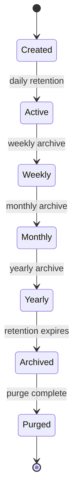

# RFC-0411: Storage Backup

RFC: RFC-0411
Title: Storage Backup
Status: Accepted
Category: Standard
Owner: Storage Team
Authors: Atlas Specification Committee
Created: 2026-07-01
Updated: 2026-07-01
ADS Version: 1.0.0
Spec Version: 0.1.0
Normative: YES
Depends On:
  - RFC-0401 Storage Overview
  - RFC-0402 Storage Architecture
Supersedes: None
Superseded By: None
Related ADR:
  - ADR-0010 Contract-First Specification
Related JSON Schema:
  - schemas/storage/backup.json
Related Catalog:
  - catalog/storage-backup.md
Layer: Core
Audience: Storage developers, architects, specification reviewers
Target Release: 1.0.0
Review Cycle: Quarterly
Compatibility: Compatible with Spec 1.x
Last Updated: 2026-07-01

---

## Normative Status
This specification is Normative. Every Atlas implementation MUST conform to the backup procedures, retention policies, scheduling requirements, and integrity verification defined in this document. Any deviation MUST be approved through the formal Architecture Decision Record (ADR) process.

This specification is subordinate to the Atlas Development System (ADS) Constitution, ADR-0010, and ADR-0012.

---

## Authority
This RFC is the authoritative specification for the Storage Backup domain.

Any implementation MUST conform to this document.

If an implementation conflicts with this RFC, this RFC takes precedence.

Conflicts between RFCs SHALL be resolved through the ADR process.

---

## Terminology

The following terms are defined with exact meanings consistent with the Atlas Master Glossary and RFC-0301.

| Term | Definition | Source |
|---|---|---|
| Backup | A point-in-time copy of stored data preserved for recovery purposes. | RFC-0411 |
| Retention Policy | A rule defining how long backups are kept before archival or deletion. | RFC-0411 |
| Backup Schedule | A timed sequence of backup operations. | RFC-0411 |
| Backup Integrity | The guarantee that a backup is complete and uncorrupted. | RFC-0411 |
| Full Backup | A backup containing all data at the time of creation. | RFC-0411 |
| Incremental Backup | A backup containing only data changed since the last backup. | RFC-0411 |
| Recovery Point Objective | The maximum acceptable data loss measured in time. | RFC-0411 |
| Resource | A unit of data managed by Storage, identified by a unique resource identifier. | RFC-0401 |
| Workflow | A declarative directed graph specification expressing WHAT must happen, not HOW. | RFC-0301 |
| Execution | The process of evaluating a workflow graph and activating nodes to produce results. | RFC-0303 |
 RFC-0301 |
| Task | An atomic unit of work within a workflow, represented as a node. | RFC-0301 |
| Node | A graph element representing an atomic unit of work with defined inputs and outputs. | RFC-0301 |
| Context | The scoped data environment available to nodes during execution. | RFC-0307 |
| Frame | A discrete unit of visual data processed by vision nodes. | RFC-0301 |
| Tick | A single evaluation cycle of the workflow scheduler. | RFC-0301 |
| Scheduler | The component that determines WHEN and WHERE each node is executed. | RFC-0312 |
| Trigger | An event or condition that initiates workflow execution. | RFC-0311 |

---

## 1 Introduction

The Storage Backup specification defines the procedures for creating, storing, verifying, and managing backups of all stored data. Backups provide the foundation for disaster recovery and data protection.

Backup is distinct from replication (RFC-0418). Replication provides real-time redundancy; backup provides point-in-time recovery capability.

---

## 2 Goals

1. **Data Durability**: Backups MUST guarantee data survival beyond the lifetime of primary storage.
2. **Recovery Point Objective**: Backups MUST achieve the defined RPO for each resource type.
3. **Integrity Verification**: Every backup MUST be verified for integrity after creation.
4. **Retention Compliance**: Backup retention MUST comply with organizational and regulatory policies.
5. **Efficient Storage**: Backups MUST minimize storage consumption through compression and deduplication.
6. **Observability**: Backup operations MUST be observable and auditable.

---

## 3 Non-Goals

- **Media Management**: Physical backup media handling is outside this specification.
- **Cloud Provider Integration**: Specific cloud backup service integrations are implementation details.
- **Backup Restore Procedures**: Restore procedures are covered by RFC-0412.

---

## 4 Backup Philosophy

1. **Immutability**: Backups are immutable once created.
2. **Independence**: Backups are independent of the primary storage state.
3. **Verification**: Every backup is verified immediately after creation.
4. **Retention**: Retention policies are enforced automatically.
5. **Encryption**: All backups are encrypted at rest and in transit.

---

## 5 Backup Types

### 5.1 Backup Categories

| Type | Description | Storage Efficiency | Recovery Speed |
|---|---|---|---|
| Full | Complete copy of all data | Low | Fastest |
| Incremental | Changes since last backup of any type | Highest | Slowest |
| Differential | Changes since last full backup | Medium | Medium |
| Continuous | Real-time change capture | High | Fast |

### 5.2 Type Selection

| Resource Type | Recommended Backup Type | Rationale |
|---|---|---|
| Configuration | Incremental | Small, frequently changing |
| Workflow State | Differential | Moderate size, moderate frequency |
| Audit Log | Continuous | Append-only, compliance required |
| User Data | Full daily + incremental | Balance of storage and recovery |

---

## 6 Backup Scheduling

### 6.1 Schedule Types

| Schedule | Description | Example |
|---|---|---|
| Periodic | Fixed interval backups | Every 6 hours |
| Event-Triggered | Backup on specific events | After schema migration |
| Continuous | Real-time change capture | Streaming backup |
| Manual | On-demand backup | Administrative request |

### 6.2 Scheduling Constraints

- Backup operations MUST NOT interfere with normal storage operations.
- Concurrent backups of the same resource MUST be serialized.
- Backup windows are configurable per resource type.

---

## 7 Backup Targets

### 7.1 Target Types

| Target | Description | Use Case |
|---|---|---|
| Local | Same machine storage | Fast recovery, primary backup |
| Remote | Network-accessible storage | Disaster recovery |
| Off-Site | Geographically separate storage | Catastrophe recovery |
| Cloud | Cloud storage service | Scalable backup |

### 7.2 Target Configuration

Each backup target is configured with:

| Parameter | Description |
|---|---|
| target_type | Local, Remote, Off-Site, Cloud |
| endpoint | Storage endpoint address |
| capacity | Maximum backup capacity |
| retention_days | Default retention period |
| encryption_enabled | Whether encryption is applied |
| priority | Backup priority level |

---

## 8 Backup Retention

### 8.1 Retention Policies

| Policy | Description | Default |
|---|---|---|
| Daily | Keep daily backups for N days | 30 days |
| Weekly | Keep weekly backups for N weeks | 12 weeks |
| Monthly | Keep monthly backups for N months | 12 months |
| Yearly | Keep yearly backups for N years | 7 years |

### 8.2 Retention Lifecycle

---

## 9 Backup Integrity

### 9.1 Integrity Verification

Every backup includes:

| Check | Description | Method |
|---|---|---|
| Checksum | Verify data integrity | SHA-256 hash |
| Structure | Verify backup structure | Schema validation |
| Completeness | Verify all data included | Record count comparison |
| Decryptability | Verify backup can be decrypted | Test decryption |

### 9.2 Verification Schedule

| Check Type | Frequency | Description |
|---|---|---|
| Immediate | After each backup | Verify newly created backup |
| Periodic | Weekly | Verify all active backups |
| Comprehensive | Monthly | Full verification of all backups |

---

## 10 Backup Encryption

### 10.1 Encryption Requirements

- All backups MUST be encrypted at rest.
- Backup data in transit MUST use encrypted channels.
- Each backup uses a unique encryption key.
- Keys are managed separately from backup data.

### 10.2 Encryption Algorithm

| Element | Algorithm | Key Size |
|---|---|---|
| Data Encryption | AES-256-GCM | 256 bits |
| Key Encryption | RSA-4096 | 4096 bits |
| Integrity Hash | SHA-256 | 256 bits |

---

## 11 Backup Compression

### 11.1 Compression Strategy

| Strategy | Description | Ratio |
|---|---|---|
| Dictionary | Replace repeated patterns | 2:1 to 5:1 |
| Block | Compress data in blocks | 3:1 to 10:1 |
| Stream | Real-time compression | 2:1 to 8:1 |

Compression is applied after encryption to ensure security.

---

## 12 Backup Prioritization

### 12.1 Priority Levels

| Priority | Resource Types | Schedule |
|---|---|---|
| Critical | Audit logs, configuration | Continuous |
| High | Workflow state, user data | Every 4 hours |
| Medium | Plugin state, cache data | Daily |
| Low | Temporary data, logs | Weekly |

---

## 13 Backup Deduplication

### 13.1 Deduplication Strategy

- Identical data blocks across backups are stored only once.
- Deduplication is performed at the block level.
- Block hashes are compared to identify duplicates.
- Deduplicated blocks are referenced by hash.

### 13.2 Deduplication Benefits

| Benefit | Description |
|---|---|
| Storage Savings | 60-90% reduction in backup storage |
| Bandwidth Reduction | Only unique blocks transferred |
| Faster Backups | Less data to process and store |

---

## 14 Backup Notification

### 14.1 Notification Events

| Event | Severity | Description |
|---|---|---|
| backup.completed | Info | Backup completed successfully |
| backup.failed | Warning | Backup failed, retry scheduled |
| backup.integrity_failed | Critical | Backup integrity check failed |
| backup.retention_exceeded | Warning | Retention policy violated |
| backup.storage_low | Critical | Backup storage capacity low |

---

## 15 Backup Audit

### 15.1 Audit Requirements

Every backup operation produces an audit entry:

| Field | Type | Description |
|---|---|---|
| backup_id | string | Unique backup identifier |
| type | enum | Full, incremental, differential, continuous |
| status | enum | success, failed, partial |
| size_bytes | int64 | Backup size |
| duration_seconds | int64 | Backup duration |
| target | string | Backup target identifier |
| integrity_verified | bool | Whether integrity check passed |

---

## 16 Backup Testing

### 16.1 Test Procedures

Regular backup testing ensures recoverability:

1. **Restore Test**: Restore from a backup and verify data integrity.
2. **Point-in-Time Test**: Restore to a specific point in time.
3. **Scale Test**: Restore large backups within time constraints.
4. **Failover Test**: Failover to backup storage.

### 16.2 Test Schedule

| Test Type | Frequency | Scope |
|---|---|---|
| Quick Restore | Weekly | Single resource type |
| Full Restore | Monthly | All resource types |
| Disaster Simulation | Quarterly | Complete environment |

---

## 17 Acceptance Criteria

### AC-0411-01: Backup Completeness
- **Requirement**: All resource types MUST have backups configured.
- **Verification**: Audit backup configuration for all resource types.
- **Expected Result**: 100% resource type coverage.

### AC-0411-02: Integrity Verification
- **Requirement**: Every backup MUST pass integrity verification.
- **Verification**: Check integrity status of all backups.
- **Expected Result**: 100% of backups verified with passing integrity checks.

### AC-0411-03: Retention Enforcement
- **Requirement**: Backup retention policies MUST be enforced automatically.
- **Verification**: Monitor retention policy compliance over 30 days.
- **Expected Result**: No backups retained beyond configured retention periods.

### AC-0411-04: Encryption Coverage
- **Requirement**: All backups MUST be encrypted at rest and in transit.
- **Verification**: Audit encryption configuration for all backup targets.
- **Expected Result**: 100% encryption coverage.

### AC-0411-05: Notification Delivery
- **Requirement**: All backup events MUST produce notifications.
- **Verification**: Trigger backup failures and verify notifications.
- **Expected Result**: All events produce notifications within 1 minute.

---

## 18 References

- [RFC-0401 Storage Overview](RFC-0401-storage-overview.md)
- [RFC-0402 Storage Architecture](RFC-0402-storage-architecture.md)
- [RFC-0407 Storage Versioning](RFC-0407-storage-versioning.md)
- [RFC-0412 Storage Recovery](RFC-0412-storage-recovery.md)
- [RFC-0413 Storage Events](RFC-0413-storage-events.md)
- [RFC-0414 Storage Observability](RFC-0414-storage-observability.md)

---

## 19 Future Evolution

Future specifications will address:
- **Geographic Distribution**: Automatic backup distribution across regions.
- **AI-Optimized Scheduling**: ML-driven backup scheduling based on change patterns.
- **Immutable Backups**: WORM (Write-Once-Read-Many) backup storage.
- **Backup-to-Code**: Declarative backup configuration with version control.

---

## Layer Boundaries

### Responsibilities
This specification IS responsible for:
- Defining backup procedures including full and incremental backup strategies.
- Specifying retention policies and backup lifecycle management.
- Defining backup scheduling and coordination with other Storage operations.
- Establishing backup integrity verification and corruption detection.
- Setting Recovery Point Objective (RPO) requirements.

### Non-Responsibilities
This specification IS NOT responsible for:
- Managing backup storage media (delegated to infrastructure).
- Implementing recovery procedures (delegated to RFC-0412).
- Defining data content (delegated to consuming subsystems).

### Dependencies
| Dependency | Direction | Description |
|---|---|---|
| RFC-0401 | Consumed | Storage Overview (backup context) |
| RFC-0402 | Consumed | Storage Architecture (layer placement) |
| RFC-0412 | Consumed | Storage Recovery (backup-recovery pairing) |
| RFC-0413 | Consumed | Storage Events (backup event notifications) |

### Consumers
- RFC-0412 Storage Recovery (consumes backups for recovery operations)
- RFC-0418 Storage Replication (replication serves as backup strategy)
- All Storage consumers requiring durability guarantees

### Providers
- schemas/storage/backup.json (backup schema)
- catalog/storage-backup.md (backup catalog)

### Forbidden Dependencies
- This specification MUST NOT depend on any specific backup storage medium.
- This specification MUST NOT assume any specific backup scheduling infrastructure.

---

## Security

This specification defines security requirements for backups:

- **Backup Encryption**: Backup data MUST be encrypted using the same encryption standards as primary storage data.
- **Backup Integrity**: Backup integrity checksums MUST be computed and verified for all backup operations.
- **Access Control**: Backup creation, modification, and deletion MUST be subject to authorization checks.

---

## Performance

This specification defines performance requirements for backup operations:

- **Backup Latency**: Backup operations MUST complete within defined time bounds without blocking primary storage operations.
- **Throughput**: Backup throughput MUST be sufficient to meet Recovery Point Objectives under normal operating conditions.
- **Incremental Efficiency**: Incremental backups MUST process only changed data, minimizing backup window.

---

## Compatibility

This specification defines compatibility requirements:

- **Backup Format Stability**: Backup data formats MUST remain readable across minor versions.
- **Retention Policy Stability**: Retention policy semantics MUST remain consistent within a major version.

---

## Compliance

This specification requires compliance with:

- The Atlas Development System (ADS) Constitution.
- ADR-0010 (Contract-First Specification-Driven Development).
- ADR-0012 (Security Architecture).
- All normative requirements defined in this RFC and its dependent RFCs.

---

## Future Evolution

Future specifications will address:
- **Continuous Backup**: Near-real-time incremental backup for minimal data loss.
- **Geo-Redundant Backup**: Automated backup replication across geographic regions.
- **Backup Compression**: Adaptive compression strategies for storage-efficient backups.

---

## Runtime Independence

This specification is completely independent of any runtime implementation platform. Specifically, this specification MUST NOT assume:

- Any programming language (Rust, Node.js, TypeScript, Go, Python, etc.)
- Any runtime environment (Electron, Tauri, Browser, Desktop, Server)
- Any storage backend (SQLite, PostgreSQL, MongoDB, Redis, etc.)
- Any operating system (Windows, Linux, macOS, etc.)
- Any hardware architecture (CPU, GPU, FPGA, etc.)
- Any threading model (single-threaded, multi-threaded, actor-based, etc.)
- Any cloud provider (AWS, Azure, GCP, etc.)
- Any container platform (Docker, containerd, etc.)

---

## Acceptance Criteria

### AC-0411-01: Backup Compliance

| # | Criterion | Verification Method |
|---|---|---|
| AC-01 | All backup operations MUST produce integrity-verified copies. | Backup integrity test. |
| AC-02 | Retention policies MUST be enforced automatically. | Retention policy test. |
| AC-03 | Backup operations MUST not block primary storage operations. | Concurrency test. |
| AC-04 | Backup data MUST be encrypted at rest. | Encryption verification test. |
| AC-05 | Backup schedules MUST be honored within defined tolerances. | Schedule compliance test. |
| AC-06 | Incremental backups MUST capture only changed data. | Incremental verification test. |

---

## References

| Reference | Description |
|---|---|
| RFC-0401 | Storage Overview |
| RFC-0402 | Storage Architecture |
| RFC-0412 | Storage Recovery |
| RFC-0413 | Storage Events |
| RFC-0418 | Storage Replication |
| ADR-0010 | Contract-First Specification |
| ADR-0012 | Security Architecture |
| schemas/storage/backup.json | Backup Schema Definition |
| catalog/storage-backup.md | Backup Catalog |
| Glossary | Atlas Master Glossary |
| Constitution | Atlas AI Constitution |

---

## Compliance Matrix

| Category | Value |
|---|---|
| Related RFC | RFC-0401, RFC-0402, RFC-0412, RFC-0413, RFC-0418 |
| Related ADR | ADR-0010, ADR-0012 |
| Related JSON Schema | schemas/storage/backup.json |
| Related Catalog | catalog/storage-backup.md |

---

## Revision History

| Version | Status | Date | Author | Notes |
|---|---|---|---|---|
| 0.1.0 | Proposed | 2026-07-01 | Atlas Specification Committee | Initial publication |
| 1.0.0 | Accepted | 2026-07-01 | Atlas Specification Committee | Added Authority, Terminology, Layer Boundaries, Security, Performance, Compatibility, Compliance, Runtime Independence, Acceptance Criteria, References, Compliance Matrix, Revision History |

