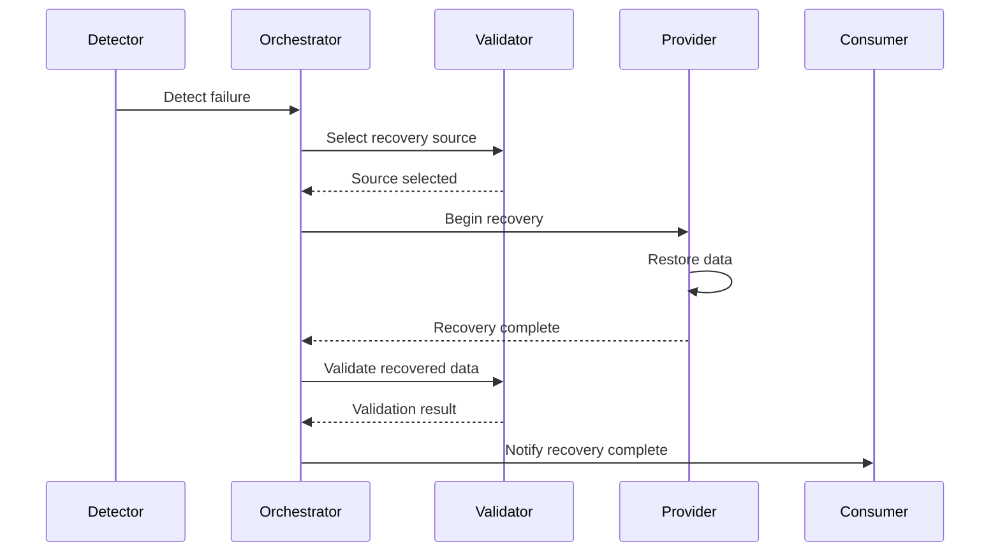
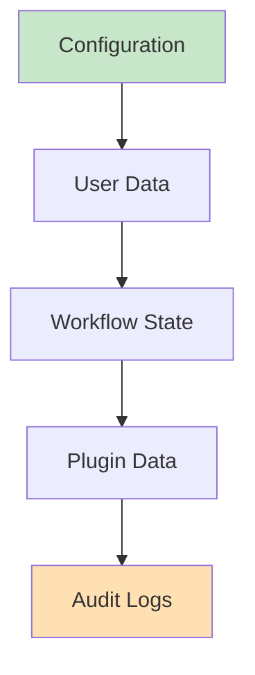

# RFC-0412: Storage Recovery

RFC: RFC-0412
Title: Storage Recovery
Status: Accepted
Category: Standard
Owner: Storage Team
Authors: Atlas Specification Committee
Created: 2026-07-01
Updated: 2026-07-01
ADS Version: 1.0.0
Spec Version: 0.1.0
Normative: YES
Depends On:
  - RFC-0401 Storage Overview
  - RFC-0402 Storage Architecture
Supersedes: None
Superseded By: None
Related ADR:
  - ADR-0010 Contract-First Specification
Related JSON Schema:
  - schemas/storage/recovery.json
Related Catalog:
  - catalog/storage-recovery.md
Layer: Core
Audience: Storage developers, architects, specification reviewers
Target Release: 1.0.0
Review Cycle: Quarterly
Compatibility: Compatible with Spec 1.x
Last Updated: 2026-07-01

---

## Normative Status
This specification is Normative. Every Atlas implementation MUST conform to the recovery procedures, Recovery Time Objective (RTO) requirements, data restoration guarantees, and recovery validation defined in this document. Any deviation MUST be approved through the formal Architecture Decision Record (ADR) process.

This specification is subordinate to the Atlas Development System (ADS) Constitution, ADR-0010, and ADR-0012.

---

## Authority
This RFC is the authoritative specification for the Storage Recovery domain.

Any implementation MUST conform to this document.

If an implementation conflicts with this RFC, this RFC takes precedence.

Conflicts between RFCs SHALL be resolved through the ADR process.

---

## Terminology

The following terms are defined with exact meanings consistent with the Atlas Master Glossary and RFC-0301.

| Term | Definition | Source |
|---|---|---|
| Recovery | The process of restoring data from backups or replicas after a failure. | RFC-0412 |
| Recovery Time Objective | The maximum acceptable time to restore service after failure. | RFC-0412 |
| Recovery Point Objective | The maximum acceptable data loss measured in time. | RFC-0412 |
| Restoration | The act of reconstructing data from a backup or replica. | RFC-0412 |
| Failover | The automatic or manual switching to a redundant system or data copy. | RFC-0412 |
| Disaster Recovery | The procedure for restoring Storage operations after a catastrophic failure. | RFC-0412 |
| Resource | A unit of data managed by Storage, identified by a unique resource identifier. | RFC-0401 |
| Workflow | A declarative directed graph specification expressing WHAT must happen, not HOW. | RFC-0301 |
| Execution | The process of evaluating a workflow graph and activating nodes to produce results. | RFC-0303 |
 RFC-0301 |
| Task | An atomic unit of work within a workflow, represented as a node. | RFC-0301 |
| Node | A graph element representing an atomic unit of work with defined inputs and outputs. | RFC-0301 |
| Context | The scoped data environment available to nodes during execution. | RFC-0307 |
| Frame | A discrete unit of visual data processed by vision nodes. | RFC-0301 |
| Tick | A single evaluation cycle of the workflow scheduler. | RFC-0301 |
| Scheduler | The component that determines WHEN and WHERE each node is executed. | RFC-0312 |
| Trigger | An event or condition that initiates workflow execution. | RFC-0311 |

---

## 1 Introduction

The Storage Recovery specification defines the procedures and guarantees for recovering stored data from various failure scenarios. Recovery is the counterpart to backup: while backup creates recoverable copies, recovery restores data from those copies.

Recovery is governed by two key objectives:
- **Recovery Point Objective (RPO)**: Maximum acceptable data loss measured in time.
- **Recovery Time Objective (RTO)**: Maximum acceptable time to restore service after failure.

---

## 2 Goals

1. **RPO Compliance**: Recovery MUST achieve the defined RPO for each resource type.
2. **RTO Compliance**: Recovery MUST complete within the defined RTO for each resource type.
3. **Data Integrity**: Recovered data MUST be verified for integrity before becoming available.
4. **Ordered Recovery**: Resources MUST be recovered in dependency order.
5. **Automated Recovery**: Common recovery scenarios MUST be automatable.
6. **Recovery Validation**: All recovered data MUST pass integrity checks.
7. **Recovery Rollback**: Failed recoveries MUST be rollbackable.

---

## 3 Non-Goals

- **Hardware Repair**: Physical hardware repair is outside the Storage subsystem scope.
- **Network Recovery**: Network infrastructure recovery is outside this specification.
- **Application Recovery**: Application-level recovery is the responsibility of consumers.

---

## 4 Recovery Philosophy

1. **Tested Recovery**: Recovery procedures are regularly tested and validated.
2. **Documented Procedures**: All recovery procedures are documented and accessible.
3. **Automated Where Possible**: Recovery is automated for common scenarios.
4. **Human Oversight**: Critical recovery decisions require human approval.
5. **Audit Trail**: All recovery operations are fully audited.

---

## 5 Recovery Types

### 5.1 Recovery Categories

| Type | Description | Source | RPO | RTO |
|---|---|---|---|---|
| Point-in-Time | Restore to specific moment | Backup | Backup interval | Minutes |
| Crash | Recover from system crash | WAL, snapshots | Last committed tx | Seconds |
| Disaster | Recover from catastrophic failure | Off-site backup | Hours to days | Hours |
| Partial | Restore specific resources | Backup | Backup interval | Minutes |
| Replica Failover | Switch to replica | Replication | Replication lag | Seconds |

### 5.2 Recovery Source Priority

When multiple recovery sources are available, the following priority is used:

1. **In-Memory**: Most recent cached data (if consistent).
2. **Replica**: Latest replica data (if within RPO).
3. **Snapshot**: Most recent snapshot.
4. **Incremental Backup**: Latest incremental backup chain.
5. **Full Backup**: Latest full backup.

---

## 6 Recovery Procedures

### 6.1 General Recovery Flow

### 6.2 Recovery Steps

1. **Detection**: Failure is detected through health monitoring or consumer report.
2. **Assessment**: Recovery type and source are determined.
3. **Preparation**: Recovery prerequisites are verified.
4. **Execution**: Data is restored from the selected source.
5. **Validation**: Recovered data is verified for integrity.
6. **Activation**: Recovered data is made available to consumers.
7. **Notification**: Recovery completion is announced.

---

## 7 Recovery Ordering

### 7.1 Dependency-Based Ordering

Resources are recovered in dependency order:

### 7.2 Recovery Priority Matrix

| Priority | Resource Types | Recovery Order |
|---|---|---|
| 1 (Highest) | Configuration, system state | First |
| 2 | User authentication data | Second |
| 3 | Workflow execution state | Third |
| 4 | Plugin state data | Fourth |
| 5 (Lowest) | Audit logs, temporary data | Last |

---

## 8 Recovery Validation

### 8.1 Validation Checks

| Check | Description | Method |
|---|---|---|
| Schema | Recovered data matches schema | Schema validation |
| Integrity | Data checksums match | Hash comparison |
| Completeness | All expected records present | Record count |
| Consistency | Referential integrity maintained | Reference validation |
| Accessibility | Data is readable | Read test |

### 8.2 Validation Failure Handling

If validation fails:

1. Recovery is aborted.
2. The recovery failure is logged.
3. An alternative recovery source is selected.
4. Recovery is retried up to the maximum number of attempts.

---

## 9 Recovery Rollback

### 9.1 Rollback Conditions

Recovery is rolled back when:

- Validation fails after maximum retries.
- Consumer reports data inconsistency.
- System detects corruption in recovered data.
- Manual intervention requests rollback.

### 9.2 Rollback Procedure

1. Identify the failed recovery operation.
2. Select the pre-recovery state.
3. Restore the pre-recovery state.
4. Verify pre-recovery state integrity.
5. Log the rollback event.
6. Notify stakeholders.

---

## 10 Recovery Monitoring

### 10.1 Recovery Metrics

| Metric | Description | Unit |
|---|---|---|
| recovery.duration | Time taken to complete recovery | seconds |
| recovery.data_restored | Amount of data restored | bytes |
| recovery.errors | Number of recovery errors | count |
| recovery.validation_pass | Validation pass/fail | boolean |
| rpo_compliance | Whether RPO was met | boolean |
| rto_compliance | Whether RTO was met | boolean |

### 10.2 Recovery Events

| Event | Description |
|---|---|
| recovery.started | Recovery initiated |
| recovery.source_selected | Recovery source identified |
| recovery.data_restored | Data restoration complete |
| recovery.validation_passed | Validation succeeded |
| recovery.completed | Recovery finished successfully |
| recovery.failed | Recovery failed |
| recovery.rolled_back | Recovery was rolled back |

---

## 11 Recovery Automation

### 11.1 Automated Recovery Triggers

| Trigger | Action |
|---|---|
| Provider health check failure | Automatic failover to replica |
| Backup integrity failure | Automatic restore from secondary backup |
| Data corruption detected | Automatic recovery from last known good state |
| Disk space critical | Automatic cleanup of old backups |

### 11.2 Manual Recovery Triggers

| Trigger | Action |
|---|---|
| Disaster scenario | Manual recovery procedure initiation |
| Schema migration failure | Manual rollback and investigation |
| Regulatory requirement | Manual recovery for audit purposes |
| Data loss investigation | Manual forensic recovery |

---

## 12 Recovery Testing

### 12.1 Test Types

| Test | Frequency | Scope |
|---|---|---|
| Unit Recovery | Weekly | Single resource type |
| Integration Recovery | Monthly | All resource types |
| Disaster Recovery | Quarterly | Complete environment |
| Chaos Recovery | Ad hoc | Random failure injection |

### 12.2 Test Metrics

| Metric | Target | Description |
|---|---|---|
| recovery_success_rate | > 99% | Percentage of successful recovery tests |
| avg_recovery_time | < RTO | Average time to complete recovery |
| data_loss_detected | 0 | Number of undetected data losses |

---

## 13 Recovery Scenarios

### 13.1 Scenario Definitions

| Scenario | Description | Recovery Type |
|---|---|---|
| Single Provider Failure | One provider becomes unavailable | Replica failover |
| Data Corruption | Data integrity violation detected | Point-in-time recovery |
| Complete Storage Loss | All storage media lost | Disaster recovery |
| Migration Failure | Migration operation fails | Rollback recovery |
| Selective Data Loss | Specific resources deleted | Partial recovery |

### 13.2 Scenario Response

For each scenario, the Recovery Orchestrator selects the appropriate recovery procedure based on:

1. The type and extent of the failure.
2. Available recovery sources.
3. Defined RPO and RTO targets.
4. Resource dependency ordering.

---

## 14 Acceptance Criteria

### AC-0412-01: RPO Compliance
- **Requirement**: Recovery MUST achieve the defined RPO for each resource type.
- **Verification**: Measure data loss window during recovery tests.
- **Expected Result**: Data loss window <= defined RPO for all resource types.

### AC-0412-02: RTO Compliance
- **Requirement**: Recovery MUST complete within the defined RTO for each resource type.
- **Verification**: Measure recovery duration during recovery tests.
- **Expected Result**: Recovery duration <= defined RTO for all resource types.

### AC-0412-03: Data Integrity
- **Requirement**: All recovered data MUST pass integrity validation.
- **Verification**: Validate recovered data against checksums and schema.
- **Expected Result**: 100% of recovered data passes validation.

### AC-0412-04: Recovery Ordering
- **Requirement**: Resources MUST be recovered in dependency order.
- **Verification**: Monitor recovery sequence during tests.
- **Expected Result**: Recovery order respects all dependency relationships.

### AC-0412-05: Automation Coverage
- **Requirement**: Automated recovery MUST handle all defined failure triggers.
- **Verification**: Inject each failure type and verify automated response.
- **Expected Result**: All automated triggers produce correct recovery actions.

---

## 15 References

- [RFC-0401 Storage Overview](RFC-0401-storage-overview.md)
- [RFC-0402 Storage Architecture](RFC-0402-storage-architecture.md)
- [RFC-0411 Storage Backup](RFC-0411-storage-backup.md)
- [RFC-0413 Storage Events](RFC-0413-storage-events.md)
- [RFC-0418 Storage Replication](RFC-0418-storage-replication.md)

---

## 16 Future Evolution

Future specifications will address:
- **Predictive Recovery**: ML-driven failure prediction and pre-emptive recovery.
- **Cross-Region Recovery**: Automatic recovery across geographic regions.
- **Immutable Recovery**: Recovery from tamper-proof backup sources.
- **Recovery Orchestration API**: External recovery orchestration interface.

---

## Layer Boundaries

### Responsibilities
This specification IS responsible for:
- Defining recovery procedures for different failure scenarios (partial, full, catastrophic).
- Specifying Recovery Time Objective (RTO) and Recovery Point Objective (RPO) requirements.
- Defining data restoration validation and integrity verification after recovery.
- Establishing failover and disaster recovery protocols.

### Non-Responsibilities
This specification IS NOT responsible for:
- Creating backups (delegated to RFC-0411).
- Managing infrastructure failover (delegated to the infrastructure subsystem).
- Defining data content (delegated to consuming subsystems).

### Dependencies
| Dependency | Direction | Description |
|---|---|---|
| RFC-0401 | Consumed | Storage Overview (recovery context) |
| RFC-0402 | Consumed | Storage Architecture (layer placement) |
| RFC-0411 | Consumed | Storage Backup (recovery from backups) |
| RFC-0418 | Consumed | Storage Replication (failover from replicas) |
| RFC-0407 | Consumed | Storage Versioning (version-aware recovery) |

### Consumers
- RFC-0411 Storage Backup (paired with backup for full durability)
- RFC-0418 Storage Replication (replication-based recovery)
- All Storage consumers requiring durability guarantees

### Providers
- schemas/storage/recovery.json (recovery schema)
- catalog/storage-recovery.md (recovery catalog)

### Forbidden Dependencies
- This specification MUST NOT depend on any specific recovery infrastructure.
- This specification MUST NOT assume any specific failover mechanism.

---

## Security

This specification defines security requirements for recovery:

- **Recovery Integrity**: Recovered data MUST pass the same integrity checks as primary data.
- **Recovery Authorization**: Recovery operations MUST be subject to elevated authorization requirements.
- **Post-Recovery Audit**: All recovery operations MUST be recorded in the audit log with full details.

---

## Performance

This specification defines performance requirements for recovery:

- **Recovery Time**: Recovery operations MUST complete within the defined Recovery Time Objective.
- **Data Restoration Throughput**: Data restoration MUST proceed at rates sufficient to meet RTO under worst-case failure scenarios.
- **Validation Efficiency**: Post-recovery integrity validation MUST complete within bounded time.

---

## Compatibility

This specification defines compatibility requirements:

- **Recovery Compatibility**: Recovery procedures MUST work with backups from previous minor versions.
- **Failover Compatibility**: Failover to a secondary system MUST maintain operational compatibility.

---

## Compliance

This specification requires compliance with:

- The Atlas Development System (ADS) Constitution.
- ADR-0010 (Contract-First Specification-Driven Development).
- ADR-0012 (Security Architecture).
- All normative requirements defined in this RFC and its dependent RFCs.

---

## Future Evolution

Future specifications will address:
- **Automated Recovery Orchestration**: Automated recovery workflow execution triggered by failure detection.
- **Chaos Engineering**: Regular automated failure injection testing to validate recovery procedures.
- **Recovery Simulation**: Pre-execution simulation of recovery procedures to estimate RTO.

---

## Runtime Independence

This specification is completely independent of any runtime implementation platform. Specifically, this specification MUST NOT assume:

- Any programming language (Rust, Node.js, TypeScript, Go, Python, etc.)
- Any runtime environment (Electron, Tauri, Browser, Desktop, Server)
- Any storage backend (SQLite, PostgreSQL, MongoDB, Redis, etc.)
- Any operating system (Windows, Linux, macOS, etc.)
- Any hardware architecture (CPU, GPU, FPGA, etc.)
- Any threading model (single-threaded, multi-threaded, actor-based, etc.)
- Any cloud provider (AWS, Azure, GCP, etc.)
- Any container platform (Docker, containerd, etc.)

---

## Acceptance Criteria

### AC-0412-01: Recovery Compliance

| # | Criterion | Verification Method |
|---|---|---|
| AC-01 | Recovery operations MUST complete within the defined Recovery Time Objective. | Recovery time test. |
| AC-02 | Recovered data MUST pass all integrity checks. | Data integrity verification test. |
| AC-03 | Recovery MUST be authorized through elevated access controls. | Authorization test. |
| AC-04 | All recovery operations MUST be recorded in the audit log. | Audit log verification test. |
| AC-05 | Recovery MUST restore data to a state consistent with the selected backup. | Consistency verification test. |
| AC-06 | Failover operations MUST maintain operational compatibility. | Failover compatibility test. |

---

## References

| Reference | Description |
|---|---|
| RFC-0401 | Storage Overview |
| RFC-0402 | Storage Architecture |
| RFC-0407 | Storage Versioning |
| RFC-0411 | Storage Backup |
| RFC-0418 | Storage Replication |
| ADR-0010 | Contract-First Specification |
| ADR-0012 | Security Architecture |
| schemas/storage/recovery.json | Recovery Schema Definition |
| catalog/storage-recovery.md | Recovery Catalog |
| Glossary | Atlas Master Glossary |
| Constitution | Atlas AI Constitution |

---

## Compliance Matrix

| Category | Value |
|---|---|
| Related RFC | RFC-0401, RFC-0402, RFC-0407, RFC-0411, RFC-0418 |
| Related ADR | ADR-0010, ADR-0012 |
| Related JSON Schema | schemas/storage/recovery.json |
| Related Catalog | catalog/storage-recovery.md |

---

## Revision History

| Version | Status | Date | Author | Notes |
|---|---|---|---|---|
| 0.1.0 | Proposed | 2026-07-01 | Atlas Specification Committee | Initial publication |
| 1.0.0 | Accepted | 2026-07-01 | Atlas Specification Committee | Added Authority, Terminology, Layer Boundaries, Security, Performance, Compatibility, Compliance, Runtime Independence, Acceptance Criteria, References, Compliance Matrix, Revision History |

