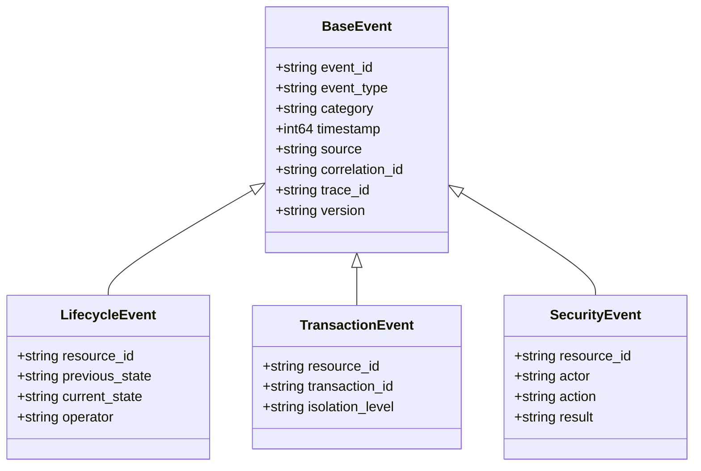
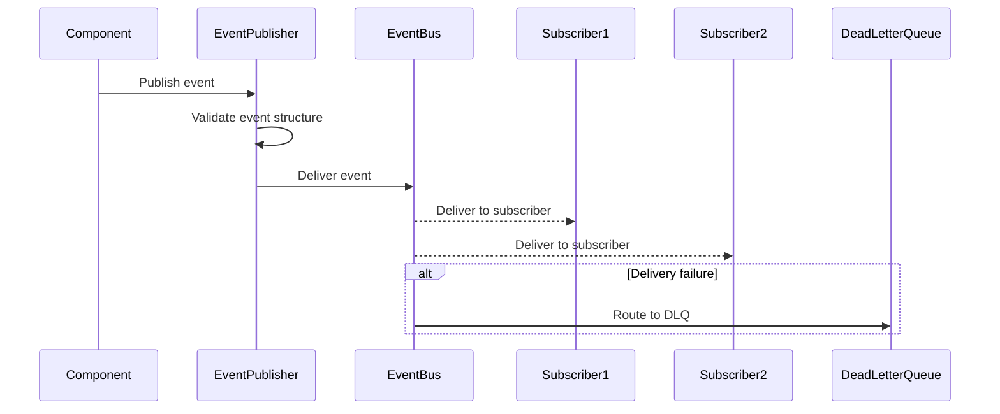
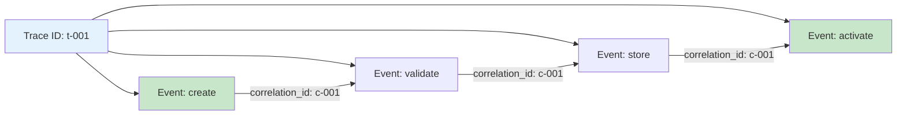

# RFC-0413: Storage Events

RFC: RFC-0413
Title: Storage Events
Status: Accepted
Category: Standard
Owner: Storage Team
Authors: Atlas Specification Committee
Created: 2026-07-01
Updated: 2026-07-01
ADS Version: 1.0.0
Spec Version: 0.1.0
Normative: YES
Depends On:
  - RFC-0401 Storage Overview
  - RFC-0402 Storage Architecture
Supersedes: None
Superseded By: None
Related ADR:
  - ADR-0010 Contract-First Specification
Related JSON Schema:
  - schemas/storage/events.json
Related Catalog:
  - catalog/storage-events.md
Layer: Core
Audience: Storage developers, architects, specification reviewers
Target Release: 1.0.0
Review Cycle: Quarterly
Compatibility: Compatible with Spec 1.x
Last Updated: 2026-07-01

---

## Normative Status
This specification is Normative. Every Atlas implementation MUST conform to the event model, event emission requirements, event schema, and event delivery guarantees defined in this document. Any deviation MUST be approved through the formal Architecture Decision Record (ADR) process.

This specification is subordinate to the Atlas Development System (ADS) Constitution, ADR-0010, and ADR-0012.

---

## Authority
This RFC is the authoritative specification for the Storage Events domain.

Any implementation MUST conform to this document.

If an implementation conflicts with this RFC, this RFC takes precedence.

Conflicts between RFCs SHALL be resolved through the ADR process.

---

## Terminology

The following terms are defined with exact meanings consistent with the Atlas Master Glossary and RFC-0301.

| Term | Definition | Source |
|---|---|---|
| Event | A structured notification emitted by Storage to record an operation or state change. | RFC-0413 |
| Event Schema | The formal definition of the structure and fields of a Storage event. | RFC-0413 |
| Event Emission | The act of producing and publishing an event to the event system. | RFC-0413 |
| Event Delivery | The guarantee that an emitted event reaches its intended consumers. | RFC-0413 |
| Event Ordering | The guarantee that events are delivered to consumers in the order they were produced. | RFC-0413 |
| Event Bus | The subsystem responsible for routing events between producers and consumers. | RFC-0413 |
| Resource | A unit of data managed by Storage, identified by a unique resource identifier. | RFC-0401 |
| Workflow | A declarative directed graph specification expressing WHAT must happen, not HOW. | RFC-0301 |
| Execution | The process of evaluating a workflow graph and activating nodes to produce results. | RFC-0303 |
 RFC-0301 |
| Task | An atomic unit of work within a workflow, represented as a node. | RFC-0301 |
| Node | A graph element representing an atomic unit of work with defined inputs and outputs. | RFC-0301 |
| Context | The scoped data environment available to nodes during execution. | RFC-0307 |
| Frame | A discrete unit of visual data processed by vision nodes. | RFC-0301 |
| Tick | A single evaluation cycle of the workflow scheduler. | RFC-0301 |
| Scheduler | The component that determines WHEN and WHERE each node is executed. | RFC-0312 |
| Trigger | An event or condition that initiates workflow execution. | RFC-0311 |

---

## 1 Introduction

The Storage Events specification defines the event model for the Storage subsystem. Every significant storage operation produces a standardized event that is published to the Event Bus. Events enable observability, audit trails, cross-subsystem communication, and reactive processing.

All events follow the Common Event Model (RFC-1001) and extend it with Storage-specific event types and structures.

---

## 2 Goals

1. **Completeness**: Every significant storage operation MUST produce an event.
2. **Consistency**: Event structure MUST be uniform across all event types.
3. **Ordering**: Events MUST preserve causal ordering within a resource.
4. **Correlation**: Related events MUST be linkable through correlation identifiers.
5. **Filtering**: Subscribers MUST be able to filter events by type, resource, and attributes.
6. **Reliability**: Failed event delivery MUST be retried with dead letter queue fallback.
7. **Security**: Sensitive event data MUST be protected through classification.

---

## 3 Non-Goals

- **Event Processing Logic**: How subscribers process events is outside this specification.
- **Event Bus Implementation**: The Event Bus itself is governed by RFC-1001.
- **Event UI**: Event visualization is outside this specification.

---

## 4 Event Taxonomy

### 4.1 Event Categories

| Category | Prefix | Description | RFC Reference |
|---|---|---|---|
| Lifecycle | STG-LCF | Resource lifecycle transitions | RFC-0404 |
| Transaction | STG-TX | Transaction begin, commit, rollback | RFC-0406 |
| Security | STG-SEC | Access control, encryption, audit | RFC-0409 |
| Performance | STG-PERF | Cache operations, latency metrics | RFC-0410, RFC-0415 |
| Migration | STG-MIG | Schema and data migrations | RFC-0408 |
| Backup | STG-BKP | Backup creation and verification | RFC-0411 |
| Recovery | STG-RCV | Recovery operations and results | RFC-0412 |
| Versioning | STG-VER | Version creation and resolution | RFC-0407 |
| Provider | STG-PVD | Provider lifecycle and health | RFC-0403 |
| Schema | STG-SCH | Schema registration and evolution | RFC-0405 |

### 4.2 Event Type Enumeration

Each category contains specific event types:

**Lifecycle Events**: resource.created, resource.stored, resource.active, resource.updated, resource.archived, resource.deleted, resource.purged, resource.restored, resource.failed

**Transaction Events**: transaction.begin, transaction.commit, transaction.rollback, transaction.prepare, transaction.abort, transaction.conflict

**Security Events**: access.granted, access.denied, encryption.key_rotated, audit.entry_created, threat.detected, secure_deletion.completed

**Backup Events**: backup.started, backup.completed, backup.failed, backup.verified, backup.retention_expired, backup.integrity_failed

**Recovery Events**: recovery.started, recovery.completed, recovery.failed, recovery.rolled_back, recovery.rpo_missed, recovery.rto_missed

---

## 5 Event Structure

### 5.1 Required Fields

| Field | Type | Description |
|---|---|---|
| event_id | string | Globally unique event identifier |
| event_type | string | Event type identifier (e.g., STG-LCF-0001) |
| category | string | Event category |
| timestamp | int64 | Unix epoch nanoseconds |
| source | string | Component that published the event |
| resource_id | string | Affected resource identifier |
| correlation_id | string | Links related events |
| trace_id | string | Distributed tracing identifier |
| version | string | Event schema version |

### 5.2 Optional Fields

| Field | Type | Description |
|---|---|---|
| metadata | map | Event-specific context data |
| previous_state | string | State before the event |
| current_state | string | State after the event |
| operator | string | Entity that caused the event |
| severity | enum | Event severity level |
| retry_count | int | Number of delivery retries |

### 5.3 Event Class Diagram

---

## 6 Event Publishing

### 6.1 Publishing Flow

### 6.2 Publishing Guarantees

| Guarantee | Description |
|---|---|
| At-Least-Once | Every event is delivered at least once |
| Ordered Per Resource | Events for the same resource are ordered |
| Causal Ordering | Causally related events preserve order |
| Delivery Confirmation | Publishers receive delivery confirmation |

---

## 7 Event Ordering

### 7.1 Ordering Dimensions

| Dimension | Guarantee | Scope |
|---|---|---|
| Causal | Causally related events preserve order | Global |
| Resource | Events for the same resource preserve order | Per resource |
| Category | Events in the same category preserve order | Per category |
| Temporal | Events are time-ordered within configurable tolerance | Global |

### 7.2 Ordering Enforcement

Event ordering is enforced through:

1. Monotonically increasing sequence numbers per resource.
2. Causal vector clocks for cross-resource ordering.
3. Timestamp-based ordering for approximate temporal ordering.

---

## 8 Event Filtering

### 8.1 Filter Types

| Filter | Description | Example |
|---|---|---|
| Type | Filter by event type | STG-LCF-* |
| Resource | Filter by resource ID | resource_id = "wf-123" |
| Category | Filter by category | category = "lifecycle" |
| Severity | Filter by severity | severity >= "warning" |
| Time Range | Filter by timestamp | timestamp > 1700000000 |
| Attribute | Filter by metadata attribute | metadata.status = "success" |

### 8.2 Filter Expression

Filters use a simple expression language:

- Comparison operators: =, !=, <, >, <=, >=
- Logical operators: AND, OR, NOT
- Wildcard: * matches any sequence of characters

---

## 9 Event Retry

### 9.1 Retry Policy

| Parameter | Default | Description |
|---|---|---|
| max_retries | 5 | Maximum retry attempts |
| initial_delay_ms | 100 | Initial retry delay |
| max_delay_ms | 30000 | Maximum retry delay |
| backoff_multiplier | 2 | Exponential backoff factor |

### 9.2 Retry Conditions

Retries are attempted for:

- Network timeouts
- Subscriber unavailability
- Temporary subscriber errors

Retries are NOT attempted for:

- Invalid event structure
- Authentication failures
- Authorization denials

---

## 10 Event Dead Letter Queue

### 10.1 DLQ Behavior

Events that fail all retry attempts are routed to the Dead Letter Queue:

- DLQ events are preserved for investigation.
- DLQ events can be replayed manually.
- DLQ events expire after a configurable retention period.

### 10.2 DLQ Operations

| Operation | Description |
|---|---|
| Inspect | View DLQ event contents |
| Replay | Re-publish DLQ event to subscribers |
| Discard | Permanently remove DLQ event |
| Export | Export DLQ event for analysis |

---

## 11 Event Retention

### 11.1 Retention Periods

| Event Category | Retention | Description |
|---|---|---|
| Lifecycle | 90 days | Resource state changes |
| Transaction | 365 days | Transaction audit trail |
| Security | 365 days | Security audit trail |
| Performance | 30 days | Performance metrics |
| Migration | 365 days | Migration history |
| Backup | 365 days | Backup operations |
| Recovery | 365 days | Recovery operations |

---

## 12 Event Correlation

### 12.1 Correlation Model

Events are correlated through:

1. **Correlation ID**: Links events belonging to the same operation.
2. **Trace ID**: Links events across distributed operations.
3. **Resource ID**: Links events for the same resource.
4. **Parent Event ID**: Links child events to parent events.

### 12.2 Correlation Chain

---

## 13 Event Sampling

### 13.1 Sampling Policy

For high-frequency events, sampling MAY be applied:

| Sampling Type | Description | Use Case |
|---|---|---|
| Rate Limiting | Maximum events per second | Performance metrics |
| Percentage | Sample N% of events | Debugging |
| Critical Only | Only sample critical events | Production monitoring |

### 13.2 Sampling Configuration

Sampling is configured per-event-category:

| Category | Default Sample Rate |
|---|---|
| Lifecycle | 100% |
| Transaction | 100% |
| Security | 100% |
| Performance | 10% |
| Provider | 100% |

---

## 14 Event Security

### 14.1 Event Classification

Events containing sensitive data are classified:

| Classification | Handling |
|---|---|
| PUBLIC | No restrictions |
| INTERNAL | Logged but not forwarded externally |
| SENSITIVE | Redacted before forwarding |
| RESTRICTED | Never published as events |

### 14.2 Redaction

Sensitive fields are automatically redacted from events:

- Encryption keys
- Passwords
- Personal identification data
- Cryptographic secrets

---

## 15 Event Schema

### 15.1 Schema Versioning

Event schemas are versioned:

- Schema version is included in every event.
- Subscribers MUST declare supported schema versions.
- Backward-compatible schema changes are propagated automatically.
- Breaking schema changes require subscriber notification.

---

## 16 Acceptance Criteria

### AC-0413-01: Event Completeness
- **Requirement**: Every significant storage operation MUST produce an event.
- **Verification**: Audit all storage operations against event log.
- **Expected Result**: 100% event coverage for all operation categories.

### AC-0413-02: Event Ordering
- **Requirement**: Events MUST preserve causal and resource ordering.
- **Verification**: Inject concurrent operations and verify event order.
- **Expected Result**: No ordering violations detected.

### AC-0413-03: Event Reliability
- **Requirement**: Failed event delivery MUST be retried and routed to DLQ.
- **Verification**: Simulate subscriber failures.
- **Expected Result**: All failed events retried and eventually delivered or placed in DLQ.

### AC-0413-04: Event Filtering
- **Requirement**: Subscribers MUST be able to filter events by all filter types.
- **Verification**: Test each filter type with sample events.
- **Expected Result**: Correct event subsets delivered for each filter.

### AC-0413-05: Event Security
- **Requirement**: Sensitive event data MUST be redacted.
- **Verification**: Publish events with sensitive fields and inspect output.
- **Expected Result**: All sensitive fields redacted in published events.

---

## 17 References

- [RFC-0401 Storage Overview](RFC-0401-storage-overview.md)
- [RFC-1001 Common Event Model](../common/RFC-1001-event-model.md)
- [RFC-0404 Storage Lifecycle](RFC-0404-storage-lifecycle.md)
- [RFC-0406 Storage Transactions](RFC-0406-storage-transactions.md)
- [RFC-0409 Storage Security](RFC-0409-storage-security.md)
- [RFC-0414 Storage Observability](RFC-0414-storage-observability.md)

---

## 18 Future Evolution

Future specifications will address:
- **Event Streaming**: Real-time event streaming to external systems.
- **Event Search**: Full-text search across event history.
- **Event Analytics**: Real-time event pattern detection and analytics.
- **Event Mesh**: Distributed event mesh across Atlas clusters.

---

## Layer Boundaries

### Responsibilities
This specification IS responsible for:
- Defining the Storage event model including event types, structure, and semantics.
- Specifying event emission requirements for all Storage operations.
- Defining event delivery guarantees and ordering semantics.
- Establishing the relationship between Storage events and the common event model.

### Non-Responsibilities
This specification IS NOT responsible for:
- Implementing the event bus infrastructure (delegated to the Runtime Event Bus).
- Consuming events (delegated to consuming subsystems).
- Defining event retention policies (delegated to infrastructure).

### Dependencies
| Dependency | Direction | Description |
|---|---|---|
| RFC-0401 | Consumed | Storage Overview (event context) |
| RFC-0402 | Consumed | Storage Architecture (event emission points) |
| RFC-1001 | Consumed | Common Event Model (event schema alignment) |

### Consumers
- RFC-0414 Storage Observability (consumes events for metrics and tracing)
- RFC-0404 Storage Lifecycle (lifecycle events)
- RFC-0410 Storage Cache (cache invalidation events)
- RFC-0411 Storage Backup (backup completion events)
- RFC-0412 Storage Recovery (recovery event notifications)

### Providers
- schemas/storage/events.json (event schema)
- catalog/storage-events.md (events catalog)

### Forbidden Dependencies
- This specification MUST NOT depend on any specific event bus implementation.
- This specification MUST NOT assume any specific event delivery protocol.

---

## Security

This specification defines security requirements for events:

- **Event Integrity**: Events MUST include tamper-evident integrity metadata.
- **Event Confidentiality**: Events containing sensitive data MUST be subject to the same encryption requirements as the underlying data.
- **Event Access Control**: Event emission and consumption MUST be subject to authorization checks.

---

## Performance

This specification defines performance requirements for events:

- **Event Emission Latency**: Event production MUST complete within bounded time without blocking the primary operation.
- **Event Throughput**: The event system MUST handle the combined event rate of all Storage operations.
- **Event Ordering**: Events MUST be delivered to consumers in the order they were produced, within defined tolerances.

---

## Compatibility

This specification defines compatibility requirements:

- **Event Schema Stability**: Event schemas MUST remain stable within a major version.
- **Common Event Model Alignment**: Storage events MUST conform to the Common Event Model defined in RFC-1001.

---

## Compliance

This specification requires compliance with:

- The Atlas Development System (ADS) Constitution.
- ADR-0010 (Contract-First Specification-Driven Development).
- ADR-0012 (Security Architecture).
- All normative requirements defined in this RFC and its dependent RFCs.

---

## Future Evolution

Future specifications will address:
- **Event Correlation**: Cross-operation event correlation for complex audit trails.
- **Event Filtering**: Consumer-selectable event filtering to reduce event processing overhead.
- **Event Replay**: Support for replaying historical events for debugging and forensics.

---

## Runtime Independence

This specification is completely independent of any runtime implementation platform. Specifically, this specification MUST NOT assume:

- Any programming language (Rust, Node.js, TypeScript, Go, Python, etc.)
- Any runtime environment (Electron, Tauri, Browser, Desktop, Server)
- Any storage backend (SQLite, PostgreSQL, MongoDB, Redis, etc.)
- Any operating system (Windows, Linux, macOS, etc.)
- Any hardware architecture (CPU, GPU, FPGA, etc.)
- Any threading model (single-threaded, multi-threaded, actor-based, etc.)
- Any cloud provider (AWS, Azure, GCP, etc.)
- Any container platform (Docker, containerd, etc.)

---

## Acceptance Criteria

### AC-0413-01: Event Compliance

| # | Criterion | Verification Method |
|---|---|---|
| AC-01 | All Storage operations MUST emit events as defined in this RFC. | Event emission coverage test. |
| AC-02 | Events MUST conform to the Common Event Model schema. | Schema validation test. |
| AC-03 | Event delivery MUST maintain ordering guarantees. | Ordering verification test. |
| AC-04 | Event emission MUST not block the primary storage operation. | Non-blocking emission test. |
| AC-05 | Event integrity metadata MUST be present and verifiable. | Integrity verification test. |
| AC-06 | Event throughput MUST handle peak Storage operation rates. | Stress test. |

---

## References

| Reference | Description |
|---|---|
| RFC-0401 | Storage Overview |
| RFC-0402 | Storage Architecture |
| RFC-0404 | Storage Lifecycle |
| RFC-0410 | Storage Cache |
| RFC-0411 | Storage Backup |
| RFC-0412 | Storage Recovery |
| RFC-0414 | Storage Observability |
| RFC-1001 | Common Event Model |
| ADR-0010 | Contract-First Specification |
| ADR-0012 | Security Architecture |
| schemas/storage/events.json | Event Schema Definition |
| catalog/storage-events.md | Events Catalog |
| Glossary | Atlas Master Glossary |
| Constitution | Atlas AI Constitution |

---

## Compliance Matrix

| Category | Value |
|---|---|
| Related RFC | RFC-0401, RFC-0402, RFC-0404, RFC-0410, RFC-0411, RFC-0412, RFC-0414, RFC-1001 |
| Related ADR | ADR-0010, ADR-0012 |
| Related JSON Schema | schemas/storage/events.json |
| Related Catalog | catalog/storage-events.md |

---

## Revision History

| Version | Status | Date | Author | Notes |
|---|---|---|---|---|
| 0.1.0 | Proposed | 2026-07-01 | Atlas Specification Committee | Initial publication |
| 1.0.0 | Accepted | 2026-07-01 | Atlas Specification Committee | Added Authority, Terminology, Layer Boundaries, Security, Performance, Compatibility, Compliance, Runtime Independence, Acceptance Criteria, References, Compliance Matrix, Revision History |

