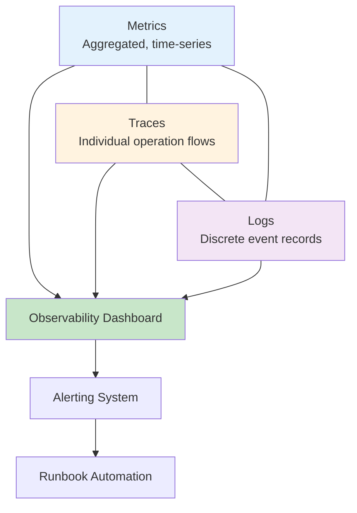
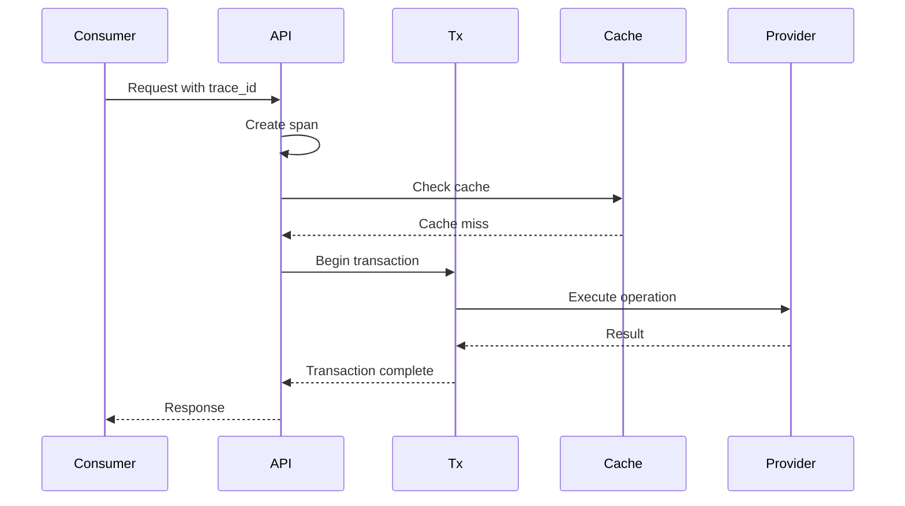

# RFC-0414: Storage Observability

RFC: RFC-0414
Title: Storage Observability
Status: Accepted
Category: Standard
Owner: Storage Team
Authors: Atlas Specification Committee
Created: 2026-07-01
Updated: 2026-07-01
ADS Version: 1.0.0
Spec Version: 0.1.0
Normative: YES
Depends On:
  - RFC-0401 Storage Overview
  - RFC-0402 Storage Architecture
Supersedes: None
Superseded By: None
Related ADR:
  - ADR-0010 Contract-First Specification
Related JSON Schema:
  - schemas/storage/observability.json
Related Catalog:
  - catalog/storage-observability.md
Layer: Core
Audience: Storage developers, architects, specification reviewers
Target Release: 1.0.0
Review Cycle: Quarterly
Compatibility: Compatible with Spec 1.x
Last Updated: 2026-07-01

---

## Normative Status
This specification is Normative. Every Atlas implementation MUST conform to the observability model, metric definitions, tracing requirements, and dashboard specifications defined in this document. Any deviation MUST be approved through the formal Architecture Decision Record (ADR) process.

This specification is subordinate to the Atlas Development System (ADS) Constitution, ADR-0010, and ADR-0012.

---

## Authority
This RFC is the authoritative specification for the Storage Observability domain.

Any implementation MUST conform to this document.

If an implementation conflicts with this RFC, this RFC takes precedence.

Conflicts between RFCs SHALL be resolved through the ADR process.

---

## Terminology

The following terms are defined with exact meanings consistent with the Atlas Master Glossary and RFC-0301.

| Term | Definition | Source |
|---|---|---|
| Observability | The ability to understand system internal state through external outputs including metrics, traces, and logs. | RFC-0414 |
| Metric | A quantitative measurement of Storage behavior, such as latency, throughput, or error rate. | RFC-0414 |
| Trace | A record of a single operation as it traverses multiple Storage components. | RFC-0414 |
| Dashboard | A visual representation of Storage metrics and operational status. | RFC-0414 |
| Alert | A notification triggered when a metric exceeds a defined threshold. | RFC-0414 |
| Gauge | A metric type that represents a single numerical value that can arbitrarily go up and down. | RFC-0414 |
| Counter | A metric type that represents a monotonically increasing value. | RFC-0414 |
| Histogram | A metric type that samples observations and counts them in configurable buckets. | RFC-0414 |
| Resource | A unit of data managed by Storage, identified by a unique resource identifier. | RFC-0401 |
| Workflow | A declarative directed graph specification expressing WHAT must happen, not HOW. | RFC-0301 |
| Execution | The process of evaluating a workflow graph and activating nodes to produce results. | RFC-0303 |
 RFC-0301 |
| Task | An atomic unit of work within a workflow, represented as a node. | RFC-0301 |
| Node | A graph element representing an atomic unit of work with defined inputs and outputs. | RFC-0301 |
| Context | The scoped data environment available to nodes during execution. | RFC-0307 |
| Frame | A discrete unit of visual data processed by vision nodes. | RFC-0301 |
| Tick | A single evaluation cycle of the workflow scheduler. | RFC-0301 |
| Scheduler | The component that determines WHEN and WHERE each node is executed. | RFC-0312 |
| Trigger | An event or condition that initiates workflow execution. | RFC-0311 |

---

## 1 Introduction

The Storage Observability specification defines how the Storage subsystem exposes metrics, traces, and logs for monitoring, debugging, and operational awareness. Observability is a first-class concern in the Storage architecture, ensuring that every operation is measurable and traceable.

---

## 2 Goals

1. **Complete Coverage**: Every storage operation MUST produce measurable signals.
2. **Actionable Metrics**: Metrics MUST enable operators to identify and diagnose issues.
3. **End-to-End Tracing**: Operations MUST be traceable across all Storage layers.
4. **Structured Logging**: All logs MUST follow a structured format for machine parsing.
5. **Health Visibility**: Provider and component health MUST be continuously visible.
6. **Alerting**: Threshold-based alerts MUST be configurable for all critical metrics.

---

## 3 Non-Goals

- **Log Storage**: Where logs are stored is outside this specification.
- **Metric Storage**: Where metrics are persisted is outside this specification.
- **Visualization**: How dashboards are rendered is outside this specification.

---

## 4 Observability Pillars

### 4.1 The Three Pillars

| Pillar | Purpose | Example |
|---|---|---|
| Metrics | Quantitative measurements of system behavior | Request rate, latency, error rate |
| Traces | End-to-end visibility of individual operations | Request flow through layers |
| Logs | Discrete event records for debugging | Error messages, state transitions |

### 4.2 Pillar Integration

---

## 5 Metrics

### 5.1 Metric Categories

| Category | Description | Example Metrics |
|---|---|---|
| Operation Count | Number of operations | storage.operations.total |
| Latency | Operation duration | storage.latency.p99 |
| Throughput | Operations per second | storage.throughput.ops_sec |
| Error Rate | Failed operations | storage.errors.total |
| Cache Hit Rate | Cache effectiveness | storage.cache.hit_rate |
| Transaction Rate | Transaction throughput | storage.transactions.rate |
| Lock Contention | Lock wait times | storage.locks.wait_time |
| Replication Lag | Replica synchronization delay | storage.replication.lag_ms |

### 5.2 Metric Types

| Type | Description | Use Case |
|---|---|---|
| Counter | Monotonically increasing value | Operation counts, error counts |
| Gauge | Value that can go up or down | Cache size, connection count |
| Histogram | Value distribution | Latency percentiles, operation sizes |
| Summary | Pre-computed percentiles | Latency summaries |

### 5.3 Metric Labels

All metrics include standard labels:

| Label | Description |
|---|---|
| resource_type | Type of resource affected |
| provider_id | Provider handling the operation |
| operation | Operation type (read, write, delete) |
| isolation_level | Transaction isolation level |
| consistency_model | Consistency model used |

---

## 6 Distributed Tracing

### 6.1 Trace Context

Every storage operation carries a trace context:

| Field | Description |
|---|---|
| trace_id | Unique identifier for the entire operation |
| span_id | Unique identifier for each component step |
| parent_span_id | ID of the parent span (if nested) |
| sampling_decision | Whether the trace is sampled |

### 6.2 Span Lifecycle

---

## 7 Structured Logging

### 7.1 Log Format

All logs follow a structured format:

| Field | Type | Required | Description |
|---|---|---|---|
| timestamp | int64 | YES | Unix epoch nanoseconds |
| level | enum | YES | debug, info, warn, error, fatal |
| component | string | YES | Component that generated the log |
| message | string | YES | Human-readable message |
| resource_id | string | NO | Affected resource |
| trace_id | string | NO | Associated trace identifier |
| metadata | map | NO | Additional context |

### 7.2 Log Levels

| Level | Description | Example |
|---|---|---|
| debug | Detailed diagnostic information | Field validation steps |
| info | Normal operational events | Transaction committed |
| warn | Unexpected but handled situations | Cache miss rate high |
| error | Operation failed but system continues | Write failed, retried |
| fatal | System cannot continue | Provider connection lost |

---

## 8 Health Checks

### 8.1 Liveness Probe

Liveness probe determines if the Storage component is running:

| Check | Description | Interval |
|---|---|---|
| Process Alive | Process is responding | 10 seconds |
| Service Ready | All services initialized | 30 seconds |
| Provider Reachable | At least one provider is reachable | 60 seconds |

### 8.2 Readiness Probe

Readiness probe determines if the Storage component can serve requests:

| Check | Description | Interval |
|---|---|---|
| API Available | API endpoints are responding | 10 seconds |
| Provider Healthy | All providers are healthy | 30 seconds |
| Cache Available | Cache layer is operational | 60 seconds |
| Disk Space | Sufficient disk space available | 300 seconds |

---

## 9 Alerting

### 9.1 Alert Thresholds

| Metric | Warning Threshold | Critical Threshold |
|---|---|---|
| Error Rate | > 1% of operations | > 5% of operations |
| Latency p99 | > 100ms | > 500ms |
| Cache Hit Rate | < 80% | < 50% |
| Provider Health | 1 provider degraded | All providers degraded |
| Disk Usage | > 80% | > 95% |
| Replication Lag | > 1 second | > 10 seconds |

### 9.2 Alert Actions

| Severity | Action |
|---|---|
| Warning | Log and notify operations team |
| Critical | Page on-call engineer, auto-remediate if possible |
| Emergency | Emergency response procedure, executive notification |

---

## 10 Dashboards

### 10.1 Required Dashboard Views

| View | Metrics Displayed | Audience |
|---|---|---|
| Overview | All key metrics summary | All |
| Operations | Read/write/delete rates | Operators |
| Performance | Latency, throughput, cache hit rate | Performance engineers |
| Reliability | Error rates, provider health, replication lag | Reliability engineers |
| Security | Access denials, encryption events, audit log | Security team |
| Capacity | Disk usage, cache size, provider capacity | Capacity planners |

---

## 11 Acceptance Criteria

### AC-0414-01: Metric Coverage
- **Requirement**: All nine metric categories defined in Section 5.1 MUST be exposed.
- **Verification**: Check metric registry for all categories.
- **Expected Result**: All categories present with correct metric names.

### AC-0414-02: Trace Propagation
- **Requirement**: Trace context MUST propagate through all Storage layers.
- **Verification**: Inject trace and follow through layers.
- **Expected Result**: Complete trace with all span IDs connected.

### AC-0414-03: Structured Logging
- **Requirement**: All logs MUST follow the structured format defined in Section 7.
- **Verification**: Parse 1000 log entries for structure compliance.
- **Expected Result**: 100% of logs parseable with all required fields.

### AC-0414-04: Health Check Availability
- **Requirement**: Both liveness and readiness probes MUST be available.
- **Verification**: Call health check endpoints.
- **Expected Result**: Both probes return correct status.

### AC-0414-05: Alert Thresholds
- **Requirement**: All alert thresholds defined in Section 9.1 MUST be configurable.
- **Verification**: Adjust thresholds and verify alert behavior.
- **Expected Result**: Alerts fire at configured thresholds.

---

## 12 References

- [RFC-0401 Storage Overview](RFC-0401-storage-overview.md)
- [RFC-0413 Storage Events](RFC-0413-storage-events.md)
- [RFC-0415 Storage Performance](RFC-0415-storage-performance.md)

---

## 13 Future Evolution

Future specifications will address:
- **Custom Metrics**: User-defined metric registration.
- **Anomaly Detection**: ML-based anomaly detection in metrics.
- **Log Aggregation**: Built-in log aggregation across clusters.
- **Observability API**: External API for querying observability data.

---

## Layer Boundaries

### Responsibilities
This specification IS responsible for:
- Defining the observability model including metrics, traces, and logs for all Storage operations.
- Specifying metric definitions, units, and collection intervals.
- Defining trace propagation requirements across Storage component boundaries.
- Establishing dashboard specifications and alerting thresholds.

### Non-Responsibilities
This specification IS NOT responsible for:
- Implementing the observability backend infrastructure (delegated to infrastructure).
- Defining business logic for alert response (delegated to operational procedures).
- Storing historical metric data (delegated to the metrics backend).

### Dependencies
| Dependency | Direction | Description |
|---|---|---|
| RFC-0401 | Consumed | Storage Overview (observability context) |
| RFC-0402 | Consumed | Storage Architecture (observability integration points) |
| RFC-0409 | Consumed | Storage Security (security event observability) |
| RFC-0413 | Consumed | Storage Events (event-based observability) |

### Consumers
- Operational dashboards and monitoring systems
- RFC-0420 Storage Compliance (compliance reporting from observability data)
- Incident response systems

### Providers
- schemas/storage/observability.json (observability schema)
- catalog/storage-observability.md (observability catalog)

### Forbidden Dependencies
- This specification MUST NOT depend on any specific observability backend.
- This specification MUST NOT assume any specific dashboard technology.

---

## Security

This specification defines security requirements for observability:

- **Metric Confidentiality**: Metrics MUST not expose sensitive data content. Only aggregate statistics are permitted.
- **Trace Privacy**: Traces MUST not include plaintext sensitive data. Sensitive fields MUST be masked.
- **Alert Integrity**: Alert configurations MUST be tamper-evident and subject to access control.

---

## Performance

This specification defines performance requirements for observability:

- **Observation Overhead**: Metrics collection and trace sampling MUST not degrade Storage performance beyond defined thresholds.
- **Metric Collection Interval**: Metrics MUST be collected at intervals sufficient for real-time operational awareness.
- **Dashboard Load Time**: Operational dashboards MUST render within bounded time.

---

## Compatibility

This specification defines compatibility requirements:

- **Metric Schema Stability**: Metric definitions MUST remain stable within a major version.
- **Trace Format Stability**: Trace formats MUST remain compatible across minor versions.

---

## Compliance

This specification requires compliance with:

- The Atlas Development System (ADS) Constitution.
- ADR-0010 (Contract-First Specification-Driven Development).
- ADR-0012 (Security Architecture).
- All normative requirements defined in this RFC and its dependent RFCs.

---

## Future Evolution

Future specifications will address:
- **Anomaly Detection**: Automated statistical anomaly detection in Storage metrics.
- **Predictive Alerting**: Machine learning-based predictive alerts for impending failures.
- **Observability Correlation**: Cross-system observability correlation linking Storage events to workflow outcomes.

---

## Runtime Independence

This specification is completely independent of any runtime implementation platform. Specifically, this specification MUST NOT assume:

- Any programming language (Rust, Node.js, TypeScript, Go, Python, etc.)
- Any runtime environment (Electron, Tauri, Browser, Desktop, Server)
- Any storage backend (SQLite, PostgreSQL, MongoDB, Redis, etc.)
- Any operating system (Windows, Linux, macOS, etc.)
- Any hardware architecture (CPU, GPU, FPGA, etc.)
- Any threading model (single-threaded, multi-threaded, actor-based, etc.)
- Any cloud provider (AWS, Azure, GCP, etc.)
- Any container platform (Docker, containerd, etc.)

---

## Acceptance Criteria

### AC-0414-01: Observability Compliance

| # | Criterion | Verification Method |
|---|---|---|
| AC-01 | All Storage operations MUST produce observable metrics. | Metric coverage test. |
| AC-02 | Traces MUST span all Storage component boundaries. | Trace completeness test. |
| AC-03 | Metrics MUST not expose sensitive data content. | Data privacy verification test. |
| AC-04 | Observation overhead MUST not degrade Storage performance beyond thresholds. | Performance impact test. |
| AC-05 | Dashboards MUST render operational status within bounded time. | Dashboard load time test. |
| AC-06 | Alert thresholds MUST be configurable and verifiable. | Alert configuration test. |

---

## References

| Reference | Description |
|---|---|
| RFC-0401 | Storage Overview |
| RFC-0402 | Storage Architecture |
| RFC-0409 | Storage Security |
| RFC-0413 | Storage Events |
| RFC-0420 | Storage Compliance |
| ADR-0010 | Contract-First Specification |
| ADR-0012 | Security Architecture |
| schemas/storage/observability.json | Observability Schema Definition |
| catalog/storage-observability.md | Observability Catalog |
| Glossary | Atlas Master Glossary |
| Constitution | Atlas AI Constitution |

---

## Compliance Matrix

| Category | Value |
|---|---|
| Related RFC | RFC-0401, RFC-0402, RFC-0409, RFC-0413, RFC-0420 |
| Related ADR | ADR-0010, ADR-0012 |
| Related JSON Schema | schemas/storage/observability.json |
| Related Catalog | catalog/storage-observability.md |

---

## Revision History

| Version | Status | Date | Author | Notes |
|---|---|---|---|---|
| 0.1.0 | Proposed | 2026-07-01 | Atlas Specification Committee | Initial publication |
| 1.0.0 | Accepted | 2026-07-01 | Atlas Specification Committee | Added Authority, Terminology, Layer Boundaries, Security, Performance, Compatibility, Compliance, Runtime Independence, Acceptance Criteria, References, Compliance Matrix, Revision History |

