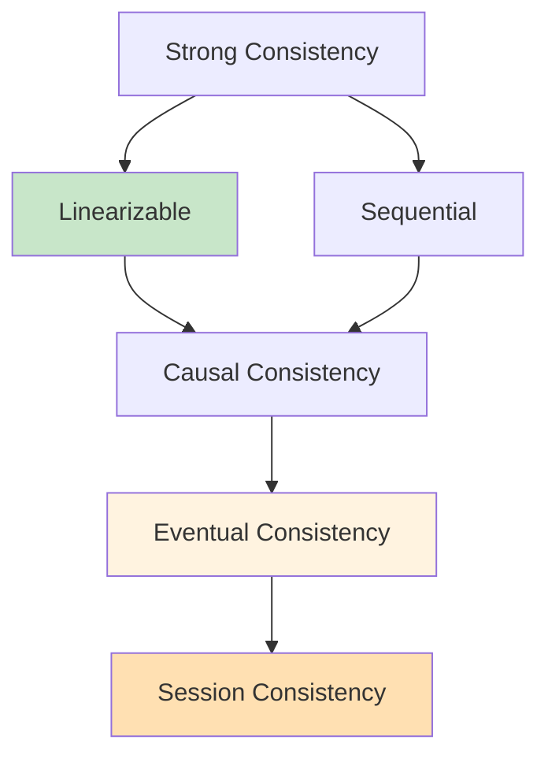

# RFC-0416: Storage Consistency

RFC: RFC-0416
Title: Storage Consistency
Status: Accepted
Category: Standard
Owner: Storage Team
Authors: Atlas Specification Committee
Created: 2026-07-01
Updated: 2026-07-01
ADS Version: 1.0.0
Spec Version: 0.1.0
Normative: YES
Depends On:
  - RFC-0401 Storage Overview
  - RFC-0402 Storage Architecture
Supersedes: None
Superseded By: None
Related ADR:
  - ADR-0010 Contract-First Specification
Related JSON Schema:
  - schemas/storage/consistency.json
Related Catalog:
  - catalog/storage-consistency.md
Layer: Core
Audience: Storage developers, architects, specification reviewers
Target Release: 1.0.0
Review Cycle: Quarterly
Compatibility: Compatible with Spec 1.x
Last Updated: 2026-07-01

---

## Normative Status
This specification is Normative. Every Atlas implementation MUST conform to the consistency models, isolation guarantees, conflict resolution strategies, and consistency verification procedures defined in this document. Any deviation MUST be approved through the formal Architecture Decision Record (ADR) process.

This specification is subordinate to the Atlas Development System (ADS) Constitution, ADR-0010, and ADR-0012.

---

## Authority
This RFC is the authoritative specification for the Storage Consistency domain.

Any implementation MUST conform to this document.

If an implementation conflicts with this RFC, this RFC takes precedence.

Conflicts between RFCs SHALL be resolved through the ADR process.

---

## Terminology

The following terms are defined with exact meanings consistent with the Atlas Master Glossary and RFC-0301.

| Term | Definition | Source |
|---|---|---|
| Consistency Model | The contractual guarantee about the visibility of writes to subsequent reads. | RFC-0416 |
| Strong Consistency | A consistency model where every read returns the most recent write. | RFC-0416 |
| Eventual Consistency | A consistency model where reads eventually return the most recent write, after a bounded delay. | RFC-0416 |
| Linearizability | The strongest consistency guarantee where operations appear to execute atomically in some total order. | RFC-0416 |
| Serializable Isolation | The highest isolation level where concurrent transactions produce the same result as serial execution. | RFC-0416 |
| Conflict Resolution | The procedure for resolving conflicting updates to the same resource. | RFC-0416 |
| Read Coordinator | The component responsible for ensuring consistency guarantees for read operations. | RFC-0416 |
| Resource | A unit of data managed by Storage, identified by a unique resource identifier. | RFC-0401 |
| Workflow | A declarative directed graph specification expressing WHAT must happen, not HOW. | RFC-0301 |
| Execution | The process of evaluating a workflow graph and activating nodes to produce results. | RFC-0303 |
 RFC-0301 |
| Task | An atomic unit of work within a workflow, represented as a node. | RFC-0301 |
| Node | A graph element representing an atomic unit of work with defined inputs and outputs. | RFC-0301 |
| Context | The scoped data environment available to nodes during execution. | RFC-0307 |
| Frame | A discrete unit of visual data processed by vision nodes. | RFC-0301 |
| Tick | A single evaluation cycle of the workflow scheduler. | RFC-0301 |
| Scheduler | The component that determines WHEN and WHERE each node is executed. | RFC-0312 |
| Trigger | An event or condition that initiates workflow execution. | RFC-0311 |

---

This specification is subordinate to the Atlas Development System (ADS) Constitution, ADR-0010, and RFC-0401.

---

## Table of Contents
1. [Introduction](#1-introduction)
2. [Goals](#2-goals)
3. [Non-Goals](#3-non-goals)
4. [Consistency Models](#4-consistency-models)
5. [Consistency Guarantees](#5-consistency-guarantees)
6. [Consistency Selection](#6-consistency-selection)
7. [Conflict Detection](#7-conflict-detection)
8. [Conflict Resolution](#8-conflict-resolution)
9. [Consistency Verification](#9-consistency-verification)
10. [Acceptance Criteria](#10-acceptance-criteria)
11. [References](#11-references)
12. [Future Evolution](#12-future-evolution)

---

- RFC-0324 Workflow Storage

## 2 Goals

1. **Explicit Consistency**: Every resource MUST have a declared consistency model.
2. **Model Flexibility**: Multiple consistency models MUST be supported for different use cases.
3. **Guarantee Enforcement**: Consistency guarantees MUST be enforced at the Storage layer.
4. **Conflict Management**: Concurrent modifications MUST be detected and resolved.
5. **Verification**: Consistency MUST be verifiable through automated checks.

---

- RFC-0324 Workflow Storage

## 4 Consistency Models

### 4.1 Model Definitions

| Model | Description | Read Guarantee | Write Guarantee |
|---|---|---|---|
| Strong | All reads see the latest write | Latest written value | Immediately visible |
| Linearizable | Strongest consistency | Latest committed value | Ordered globally |
| Sequential | Total order of operations | Latest in sequence | Total order |
| Causal | Causally related reads see writes | Causal predecessors | Causal ordering |
| Eventual | Reads eventually see all writes | May be stale | Eventually consistent |
| Session | Client sees its own writes | Own writes visible | Session-scoped |

### 4.2 Consistency Model Hierarchy

---

## Layer Boundaries

### Responsibilities

This specification IS responsible for:

- Defining the architectural contract for this domain.
- Specifying behavioral requirements that all implementations MUST satisfy.
- Establishing extension points and their contracts.

### Non-Responsibilities

This specification IS NOT responsible for:

- Implementation details (see related RFCs for implementation guidance).
- Runtime platform specifics.
- User-facing UI behavior.

### Dependencies

| Dependency | Direction | Description |
|---|---|---|
| RFC-0001 | Consumed | Runtime Overview — foundational runtime architecture |

### Consumers

- See related RFCs for consumer listings.

### Providers

- This specification provides domain-specific contracts and behavioral models.

### Forbidden Dependencies

- This specification MUST NOT depend on any specific programming language.
- This specification MUST NOT depend on any specific storage backend.
- This specification MUST NOT depend on any specific operating system.

---

## Security

This specification defines security requirements for consistency:

- **Consistency Integrity**: Consistency guarantees MUST not be weakened for security reasons.
- **Conflict Detection**: Unauthorized concurrent modifications MUST be detected and handled according to the selected consistency model.

---

## Performance

This specification defines performance requirements for consistency:

- **Consistency Overhead**: Stronger consistency models MUST impose bounded performance overhead.
- **Scalability**: The consistency model MUST scale with the number of concurrent consumers within defined bounds.
- **Conflict Resolution Latency**: Conflict resolution MUST complete within bounded time.

---

## Compatibility

This specification defines compatibility requirements:

- **Consistency Model Stability**: The defined consistency model hierarchy MUST remain stable within a major version.
- **Isolation Level Semantics**: Isolation level guarantees MUST remain consistent across minor versions.

---

## Compliance

This specification requires compliance with:

- The Atlas Development System (ADS) Constitution.
- ADR-0010 (Contract-First Specification-Driven Development).
- ADR-0012 (Security Architecture).
- All normative requirements defined in this RFC and its dependent RFCs.

---

## Future Evolution

Future specifications will address:
- **Adaptive Consistency**: Dynamic consistency level selection based on workload characteristics.
- **Cross-Region Consistency**: Consistency guarantees across geographically distributed deployments.
- **Formal Verification**: Mathematical proof of consistency model correctness.

---

## Runtime Independence

This specification is completely independent of any runtime implementation platform. Specifically, this specification MUST NOT assume:

- Any programming language (Rust, Node.js, TypeScript, Go, Python, etc.)
- Any runtime environment (Electron, Tauri, Browser, Desktop, Server)
- Any storage backend (SQLite, PostgreSQL, MongoDB, Redis, etc.)
- Any operating system (Windows, Linux, macOS, etc.)
- Any hardware architecture (CPU, GPU, FPGA, etc.)
- Any threading model (single-threaded, multi-threaded, actor-based, etc.)
- Any cloud provider (AWS, Azure, GCP, etc.)
- Any container platform (Docker, containerd, etc.)

---

## Acceptance Criteria

### AC-0416-01: Consistency Compliance

| # | Criterion | Verification Method |
|---|---|---|
| AC-01 | Strong consistency guarantees MUST be enforced for operations requiring it. | Consistency verification test. |
| AC-02 | Isolation levels MUST prevent interference between concurrent transactions. | Isolation test suite. |
| AC-03 | Conflict resolution MUST produce deterministic outcomes. | Conflict resolution determinism test. |
| AC-04 | Consistency verification procedures MUST detect violations. | Violation detection test. |
| AC-05 | Consistency overhead MUST remain within defined performance bounds. | Performance overhead test. |
| AC-06 | Eventual consistency MUST converge within defined time bounds. | Convergence timing test. |

---

## References

| Reference | Description |
|---|---|
| RFC-0401 | Storage Overview |
| RFC-0402 | Storage Architecture |
| RFC-0406 | Storage Transactions |
| RFC-0410 | Storage Cache |
| RFC-0417 | Storage Locking |
| RFC-0418 | Storage Replication |
| ADR-0010 | Contract-First Specification |
| ADR-0012 | Security Architecture |
| schemas/storage/consistency.json | Consistency Schema Definition |
| catalog/storage-consistency.md | Consistency Catalog |
| Glossary | Atlas Master Glossary |
| Constitution | Atlas AI Constitution |

---

## Compliance Matrix

| Category | Value |
|---|---|
| Related RFC | RFC-0401, RFC-0402, RFC-0406, RFC-0410, RFC-0417, RFC-0418 |
| Related ADR | ADR-0010, ADR-0012 |
| Related JSON Schema | schemas/storage/consistency.json |
| Related Catalog | catalog/storage-consistency.md |

---

## Revision History

| Version | Status | Date | Author | Notes |
|---|---|---|---|---|
| 0.1.0 | Proposed | 2026-07-01 | Atlas Specification Committee | Initial publication |
| 1.0.0 | Accepted | 2026-07-01 | Atlas Specification Committee | Added Authority, Terminology, Layer Boundaries, Security, Performance, Compatibility, Compliance, Runtime Independence, Acceptance Criteria, References, Compliance Matrix, Revision History |

