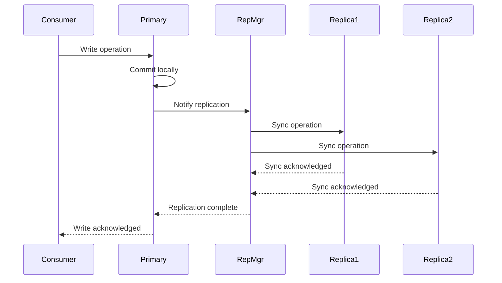

# RFC-0418: Storage Replication

RFC: RFC-0418
Title: Storage Replication
Status: Accepted
Category: Standard
Owner: Storage Team
Authors: Atlas Specification Committee
Created: 2026-07-01
Updated: 2026-07-01
ADS Version: 1.0.0
Spec Version: 0.1.0
Normative: YES
Depends On:
  - RFC-0401 Storage Overview
  - RFC-0402 Storage Architecture
Supersedes: None
Superseded By: None
Related ADR:
  - ADR-0010 Contract-First Specification
Related JSON Schema:
  - schemas/storage/replication.json
Related Catalog:
  - catalog/storage-replication.md
Layer: Core
Audience: Storage developers, architects, specification reviewers
Target Release: 1.0.0
Review Cycle: Quarterly
Compatibility: Compatible with Spec 1.x
Last Updated: 2026-07-01

---

## Normative Status
This specification is Normative. Every Atlas implementation MUST conform to the replication model, consistency guarantees, failover procedures, and data synchronization requirements defined in this document. Any deviation MUST be approved through the formal Architecture Decision Record (ADR) process.

This specification is subordinate to the Atlas Development System (ADS) Constitution, ADR-0010, and ADR-0012.

---

## Authority
This RFC is the authoritative specification for the Storage Replication domain.

Any implementation MUST conform to this document.

If an implementation conflicts with this RFC, this RFC takes precedence.

Conflicts between RFCs SHALL be resolved through the ADR process.

---

## Terminology

The following terms are defined with exact meanings consistent with the Atlas Master Glossary and RFC-0301.

| Term | Definition | Source |
|---|---|---|
| Replication | The process of maintaining copies of data across multiple storage locations. | RFC-0418 |
| Primary | The authoritative storage location that accepts writes. | RFC-0418 |
| Replica | A secondary storage location that maintains a copy of primary data. | RFC-0418 |
| Failover | The automatic or manual switching of operations from a primary to a replica. | RFC-0418 |
| Replication Lag | The time difference between a write on the primary and its appearance on a replica. | RFC-0418 |
| Data Synchronization | The process of ensuring replica data matches primary data. | RFC-0418 |
| Resource | A unit of data managed by Storage, identified by a unique resource identifier. | RFC-0401 |
| Workflow | A declarative directed graph specification expressing WHAT must happen, not HOW. | RFC-0301 |
| Execution | The process of evaluating a workflow graph and activating nodes to produce results. | RFC-0303 |
 RFC-0301 |
| Task | An atomic unit of work within a workflow, represented as a node. | RFC-0301 |
| Node | A graph element representing an atomic unit of work with defined inputs and outputs. | RFC-0301 |
| Context | The scoped data environment available to nodes during execution. | RFC-0307 |
| Frame | A discrete unit of visual data processed by vision nodes. | RFC-0301 |
| Tick | A single evaluation cycle of the workflow scheduler. | RFC-0301 |
| Scheduler | The component that determines WHEN and WHERE each node is executed. | RFC-0312 |
| Trigger | An event or condition that initiates workflow execution. | RFC-0311 |

---

This specification is Normative. Every Atlas implementation MUST conform to the replication topology, synchronization protocol, failover procedure, and consistency guarantees defined in this document. Any deviation MUST be approved through the formal Architecture Decision Record (ADR) process.

This specification is subordinate to the Atlas Development System (ADS) Constitution, ADR-0010, and RFC-0401.

---

## Table of Contents
1. [Introduction](#1-introduction)
2. [Goals](#2-goals)
3. [Non-Goals](#3-non-goals)
4. [Replication Architecture](#4-replication-architecture)
5. [Replication Topologies](#5-replication-topologies)
6. [Synchronization Protocol](#6-synchronization-protocol)
7. [Failover](#7-failover)
8. [Replication Monitoring](#8-replication-monitoring)
9. [Acceptance Criteria](#9-acceptance-criteria)
10. [References](#10-references)
11. [Future Evolution](#11-future-evolution)

---

- RFC-0324 Workflow Storage

## 2 Goals

1. **Data Durability**: Replicated data MUST survive the failure of any single node.
2. **High Availability**: Replication MUST enable continuous operation during node failures.
3. **Geographic Distribution**: Data MUST be replicable across geographic regions.
4. **Consistency**: Replicas MUST maintain defined consistency guarantees.
5. **Automatic Failover**: Primary failure MUST trigger automatic replica promotion.
6. **Monitoring**: Replication health MUST be continuously monitored.

---

- RFC-0324 Workflow Storage

## 4 Replication Architecture

### 4.1 Replication Components

| Component | Description | Responsibility |
|---|---|---|
| Primary | The authoritative data source | Write operations, version assignment |
| Replica | A copy of primary data | Read operations, failover candidate |
| Replication Manager | Coordinates replication | Topology, sync, failover |
| Consistency Checker | Verifies replica consistency | Periodic verification |
| Failover Controller | Manages failover procedures | Primary replacement |

### 4.2 Replication Data Flow

---

| RFC-0401 | Consumed | Storage Overview (replication context) |
| RFC-0402 | Consumed | Storage Architecture (replication layer placement) |
| RFC-0406 | Consumed | Storage Transactions (transactional replication) |
| RFC-0412 | Consumed | Storage Recovery (replication-based recovery) |
| RFC-0416 | Consumed | Storage Consistency (replication consistency) |

## Layer Boundaries

### Responsibilities

This specification IS responsible for:

- Defining the architectural contract for this domain.
- Specifying behavioral requirements that all implementations MUST satisfy.
- Establishing extension points and their contracts.

### Non-Responsibilities

This specification IS NOT responsible for:

- Implementation details (see related RFCs for implementation guidance).
- Runtime platform specifics.
- User-facing UI behavior.

### Dependencies

| Dependency | Direction | Description |
|---|---|---|
| RFC-0001 | Consumed | Runtime Overview — foundational runtime architecture |

### Consumers

- See related RFCs for consumer listings.

### Providers

- This specification provides domain-specific contracts and behavioral models.

### Forbidden Dependencies

- This specification MUST NOT depend on any specific programming language.
- This specification MUST NOT depend on any specific storage backend.
- This specification MUST NOT depend on any specific operating system.

---

## Security

This specification defines security requirements for replication:

- **Replication Channel Security**: Data transmitted between primary and replica MUST be encrypted in transit.
- **Replica Integrity**: Replica data MUST be verified against primary data integrity checksums.
- **Failover Authorization**: Failover operations MUST be subject to elevated authorization requirements.

---

## Performance

This specification defines performance requirements for replication:

- **Replication Lag**: Replication lag MUST remain within defined bounds under normal operating conditions.
- **Failover Time**: Failover operations MUST complete within defined time bounds.
- **Write Throughput**: Replication MUST not degrade write throughput beyond acceptable thresholds.

---

## Compatibility

This specification defines compatibility requirements:

- **Replication Protocol Stability**: Replication protocols MUST remain stable within a major version.
- **Failover Compatibility**: Failover to a replica MUST maintain operational compatibility.

---

## Compliance

This specification requires compliance with:

- The Atlas Development System (ADS) Constitution.
- ADR-0010 (Contract-First Specification-Driven Development).
- ADR-0012 (Security Architecture).
- All normative requirements defined in this RFC and its dependent RFCs.

---

## Future Evolution

Future specifications will address:
- **Multi-Region Replication**: Automated replication across geographic regions with conflict resolution.
- **Active-Active Replication**: Multi-primary replication with bidirectional data synchronization.
- **Replication Monitoring**: Real-time replication health monitoring and predictive lag forecasting.

---

## Runtime Independence

This specification is completely independent of any runtime implementation platform. Specifically, this specification MUST NOT assume:

- Any programming language (Rust, Node.js, TypeScript, Go, Python, etc.)
- Any runtime environment (Electron, Tauri, Browser, Desktop, Server)
- Any storage backend (SQLite, PostgreSQL, MongoDB, Redis, etc.)
- Any operating system (Windows, Linux, macOS, etc.)
- Any hardware architecture (CPU, GPU, FPGA, etc.)
- Any threading model (single-threaded, multi-threaded, actor-based, etc.)
- Any cloud provider (AWS, Azure, GCP, etc.)
- Any container platform (Docker, containerd, etc.)

---

## Acceptance Criteria

### AC-0418-01: Replication Compliance

| # | Criterion | Verification Method |
|---|---|---|
| AC-01 | Replica data MUST converge with primary data within defined replication lag bounds. | Replication lag test. |
| AC-02 | Failover operations MUST complete within defined time bounds. | Failover time test. |
| AC-03 | Replication channels MUST encrypt all transmitted data. | Encryption verification test. |
| AC-04 | Replica integrity MUST be verifiable against primary checksums. | Integrity verification test. |
| AC-05 | Replication MUST not degrade write throughput beyond acceptable thresholds. | Throughput impact test. |
| AC-06 | Failover MUST maintain operational compatibility. | Failover compatibility test. |

---

## References

| Reference | Description |
|---|---|
| RFC-0401 | Storage Overview |
| RFC-0402 | Storage Architecture |
| RFC-0406 | Storage Transactions |
| RFC-0411 | Storage Backup |
| RFC-0412 | Storage Recovery |
| RFC-0416 | Storage Consistency |
| RFC-0420 | Storage Compliance |
| ADR-0010 | Contract-First Specification |
| ADR-0012 | Security Architecture |
| schemas/storage/replication.json | Replication Schema Definition |
| catalog/storage-replication.md | Replication Catalog |
| Glossary | Atlas Master Glossary |
| Constitution | Atlas AI Constitution |

---

## Compliance Matrix

| Category | Value |
|---|---|
| Related RFC | RFC-0401, RFC-0402, RFC-0406, RFC-0411, RFC-0412, RFC-0416, RFC-0420 |
| Related ADR | ADR-0010, ADR-0012 |
| Related JSON Schema | schemas/storage/replication.json |
| Related Catalog | catalog/storage-replication.md |

---

## Revision History

| Version | Status | Date | Author | Notes |
|---|---|---|---|---|
| 0.1.0 | Proposed | 2026-07-01 | Atlas Specification Committee | Initial publication |
| 1.0.0 | Accepted | 2026-07-01 | Atlas Specification Committee | Added Authority, Terminology, Layer Boundaries, Security, Performance, Compatibility, Compliance, Runtime Independence, Acceptance Criteria, References, Compliance Matrix, Revision History |

