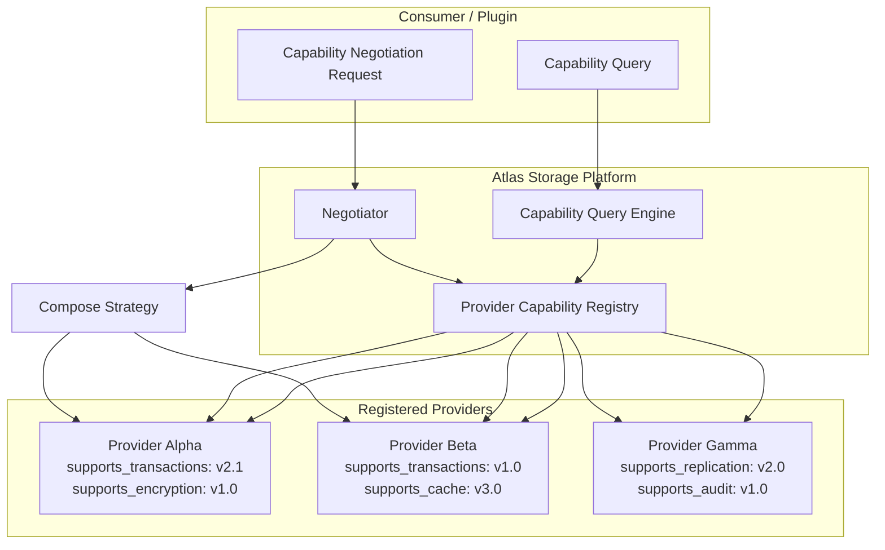
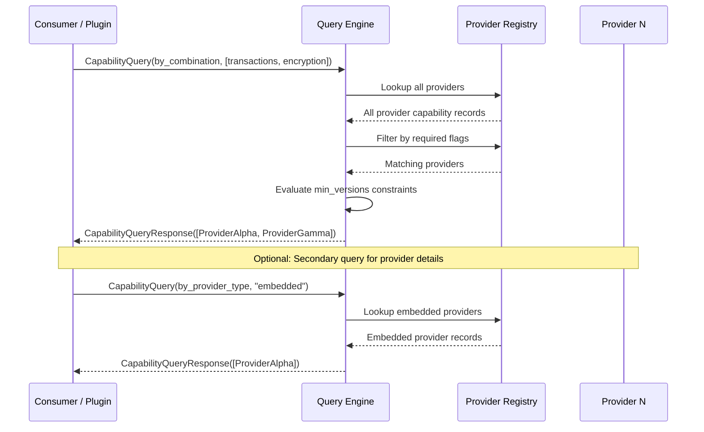
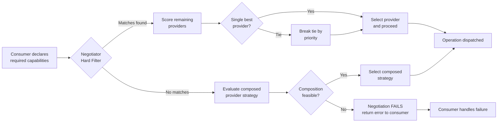

# RFC-0425: Storage Capability Discovery

RFC: RFC-0425
Title: Storage Capability Discovery
Status: Accepted
Category: Standard
Owner: Storage Team
Authors: Atlas Specification Committee
Created: 2026-07-01
Updated: 2026-07-01
ADS Version: 1.0.0
Spec Version: 0.1.0
Normative: YES
Depends On:
  - RFC-0401 Storage Overview
  - RFC-0402 Storage Architecture
  - RFC-0403 Storage Provider
Supersedes: None
Superseded By: None
Related ADR:
  - ADR-0010 Contract-First Specification
Related JSON Schema:
  - schemas/storage/capabilities.json
Related Catalog:
  - catalog/storage-capability-discovery.md
Layer: Core
Audience: Storage developers, architects, specification reviewers
Target Release: 1.0.0
Review Cycle: Quarterly
Compatibility: Compatible with Spec 1.x
Last Updated: 2026-07-01

---

## Normative Status
This specification is Normative. Every Atlas implementation MUST conform to the capability discovery model, capability registration, capability query semantics, and capability negotiation protocols defined in this document. Any deviation MUST be approved through the formal Architecture Decision Record (ADR) process.

This specification is subordinate to the Atlas Development System (ADS) Constitution, ADR-0010, and ADR-0012.

---

## Authority
This RFC is the authoritative specification for the Storage Capability Discovery domain.

Any implementation MUST conform to this document.

If an implementation conflicts with this RFC, this RFC takes precedence.

Conflicts between RFCs SHALL be resolved through the ADR process.

---

## Terminology

The following terms are defined with exact meanings consistent with the Atlas Master Glossary and RFC-0301.

| Term | Definition | Source |
|---|---|---|
| Capability | A discrete function or service exposed by a Storage provider. | RFC-0425 |
| Capability Discovery | The process by which a consumer determines which capabilities a provider supports. | RFC-0425 |
| Capability Registry | The subsystem that stores and serves provider capability information. | RFC-0425 |
| Capability Query | A request to retrieve the set of capabilities supported by a provider or resource. | RFC-0425 |
| Capability Negotiation | The process of agreeing on which capabilities to use for a specific operation. | RFC-0425 |
| Capability Descriptor | A structured definition of a capability including its requirements, constraints, and interface. | RFC-0425 |
| Resource | A unit of data managed by Storage, identified by a unique resource identifier. | RFC-0401 |
| Workflow | A declarative directed graph specification expressing WHAT must happen, not HOW. | RFC-0301 |
| Execution | The process of evaluating a workflow graph and activating nodes to produce results. | RFC-0303 |
 RFC-0301 |
| Task | An atomic unit of work within a workflow, represented as a node. | RFC-0301 |
| Node | A graph element representing an atomic unit of work with defined inputs and outputs. | RFC-0301 |
| Context | The scoped data environment available to nodes during execution. | RFC-0307 |
| Frame | A discrete unit of visual data processed by vision nodes. | RFC-0301 |
| Tick | A single evaluation cycle of the workflow scheduler. | RFC-0301 |
| Scheduler | The component that determines WHEN and WHERE each node is executed. | RFC-0312 |
| Trigger | An event or condition that initiates workflow execution. | RFC-0311 |

---

Any implementation MUST conform to this document.

If an implementation conflicts with this RFC, this RFC takes precedence.

Conflicts between RFCs SHALL be resolved through the ADR process.

---


The following terms are defined with exact meanings consistent with the Atlas Master Glossary.

| Term | Definition | Source |
|---|---|---|
| Storage Domain | A logical partition of storage resources with independent lifecycle and policy. | Glossary |
| Storage Namespace | A hierarchical addressing scheme for storage entities. | Glossary |
| State | The persistent snapshot of a system component at a point in time. | Glossary |
| Provider | Infrastructure adapters implementing storage backends. | Glossary |

---
This specification is Normative. Every Atlas implementation MUST conform to the capability discovery, flag definitions, query protocol, negotiation procedures, versioning rules, deprecation policies, and reporting requirements defined in this document. Any deviation MUST be approved through the formal Architecture Decision Record (ADR) process.

This specification is subordinate to the Atlas Development System (ADS) Constitution, ADR-0001, ADR-0010, and all active ADRs.

---

## Table of Contents
1. [Introduction](#1-introduction)
2. [Goals](#2-goals)
3. [Non-Goals](#3-non-goals)
4. [Capability Discovery Architecture](#4-capability-discovery-architecture)
5. [Capability Flags](#5-capability-flags)
6. [Capability Query Protocol](#6-capability-query-protocol)
7. [Capability Negotiation](#7-capability-negotiation)
8. [Capability Versioning](#8-capability-versioning)
9. [Capability Deprecation](#9-capability-deprecation)
10. [Capability Reporting](#10-capability-reporting)
11. [Acceptance Criteria](#11-acceptance-criteria)
12. [References](#12-references)
13. [Future Evolution](#13-future-evolution)

---

- Runtime core lifecycle (covered by RFC-0002).
- Plugin loading (covered by RFC-0201).


## 2 Goals

The Capability Discovery specification MUST achieve the following goals:

**G-0425-01: Pre-Operational Suitability Determination.** Consumers MUST be able to determine whether a storage provider supports a required capability before attempting the corresponding operation, eliminating runtime failures due to unsupported operations.

**G-0425-02: Uniform Capability Interface.** All storage providers MUST expose capabilities through the same set of canonical flags, enabling consumers to write generic capability-aware logic without provider-specific code paths.

**G-0425-03: Intelligent Provider Selection.** The Storage platform MUST use capability information to select the best matching provider for a given operation, preferring providers that support all required capabilities and degrading gracefully when no single provider satisfies all requirements.

**G-0425-04: Forward Compatibility.** New capabilities MUST be additive and backwards-compatible. Providers supporting newer capability flags MUST remain functional when queried by consumers that do not recognize those flags.

**G-0425-05: Deprecation Awareness.** Consumers MUST receive advance warning when a capability they depend on is deprecated, allowing migration planning before the capability is removed.

**G-0425-06: Auditability.** All capability advertisements, queries, and negotiation outcomes MUST be logged to the Storage audit log as defined in RFC-0414, enabling post-hoc analysis of capability usage patterns.

---


## 4 Capability Discovery Architecture

The Capability Discovery system consists of three primary components: the Provider Capability Registry, the Capability Query Engine, and the Capability Negotiator. These components interact with the Storage Provider interface defined in RFC-0403 and the Plugin Registry defined in RFC-0201.

### 4.1 Provider Capability Registry

Each registered storage provider maintains a `ProviderCapabilities` record that enumerates all capabilities the provider supports. The registry is populated during provider initialization and is immutable thereafter until provider restart.

```
type ProviderCapabilities struct {
    ProviderID      string                      `json:"provider_id"`
    ProviderType    string                      `json:"provider_type"`
    ProviderVersion string                      `json:"provider_version"`
    Timestamp       int64                       `json:"timestamp"`
    Flags           map[string]CapabilityInfo   `json:"flags"`
}

type CapabilityInfo struct {
    Version    string            `json:"version"`
    Enabled    bool              `json:"enabled"`
    Deprecated bool              `json:"deprecated"`
    Metadata   map[string]string `json:"metadata,omitempty"`
}
```

The `ProviderCapabilities` record MUST be persisted to the Provider Registry as defined in RFC-0403 upon provider initialization. The registry MUST serve as the single source of truth for all capability queries.

### 4.2 Capability Query Engine

The Capability Query Engine receives query requests from consumers and plugins, evaluates them against the Provider Capability Registry, and returns matching provider records. The engine supports three query modes: by provider type, by capability flag, and by combination of flags.

The query engine MUST operate synchronously with a response time of less than 10 milliseconds for queries against registries containing fewer than 100 providers. For larger registries, response time MUST scale linearly with the number of registered providers.

### 4.3 Capability Negotiator

The Capability Negotiator evaluates consumer capability requirements against available provider capabilities and selects the optimal provider. If no single provider satisfies all requirements, the negotiator evaluates composed provider strategies as described in Section 7.4.

The negotiator MUST follow a deterministic selection algorithm:
1. Filter providers that support all required capabilities at the required version.
2. Among remaining providers, prefer those with the highest number of supported optional capabilities.
3. Break ties by provider priority as configured in the provider registry.
4. If no provider satisfies all requirements, evaluate composed strategies.

### 4.4 Architecture Diagram



### 4.5 Component Responsibilities

| Component | Responsibility |
|-----------|---------------|
| Provider Capability Registry | Store and serve provider capability records. |
| Capability Query Engine | Process queries and return matching providers. |
| Capability Negotiator | Select optimal provider based on capability requirements. |
| Deprecation Monitor | Track deprecated capabilities and generate warnings. |
| Audit Logger | Record all capability queries and negotiation outcomes. |

---

| `supports_multi_tenancy` | Boolean | Provider isolates data between logical tenants with access controls. | v1.0 |

### 5.4 Performance Capabilities

| Flag | Type | Description | Default Version |
|------|------|-------------|----------------|
| `supports_cache` | Boolean | Provider supports configurable caching layers with coherence protocols. | v1.0 |
| `supports_streaming` | Boolean | Provider supports incremental data streaming for large result sets. | v1.0 |
| `supports_index` | Boolean | Provider supports index creation, maintenance, and optimization. | v1.0 |
| `supports_batch` | Boolean | Provider supports bulk insert, update, and delete operations. | v1.0 |
| `supports_scan` | Boolean | Provider supports range scans and full-table scans with pagination. | v1.0 |

### 5.5 Operational Capabilities

| Flag | Type | Description | Default Version |
|------|------|-------------|----------------|
| `supports_compression` | Boolean | Provider supports transparent data compression. | v1.0 |
| `supports_replication` | Boolean | Provider supports synchronous or asynchronous data replication. | v1.0 |
| `supports_backup` | Boolean | Provider supports scheduled or on-demand data backup. | v1.0 |
| `supports_recovery` | Boolean | Provider supports point-in-time or crash recovery procedures. | v1.0 |
| `supports_schema_evolution` | Boolean | Provider supports declarative schema migrations with compatibility guarantees. | v1.0 |
| `supports_query` | Boolean | Provider supports query execution (filtering, projection, aggregation). | v1.0 |

### 5.6 Canonical Flag Set

The complete canonical set of capability flags consists of the following twenty flags:

1. `supports_transactions`
2. `supports_snapshot`
3. `supports_compression`
4. `supports_encryption`
5. `supports_replication`
6. `supports_cache`
7. `supports_streaming`
8. `supports_index`
9. `supports_versioning`
10. `supports_locking`
11. `supports_backup`
12. `supports_recovery`
13. `supports_schema_evolution`
14. `supports_multi_tenancy`
15. `supports_audit`
16. `supports_query`
17. `supports_scan`
18. `supports_batch`
19. `supports_nested_transactions`
20. `supports_distributed_commit`

No other flags MAY be advertised by a provider as a core capability. Providers MAY extend with proprietary flags under the `x_` namespace prefix (e.g., `x_custom_feature`), but these flags MUST NOT participate in capability negotiation or provider selection decisions performed by the Storage platform.

### 5.7 Flag Semantics

A flag value of `true` in a provider's `ProviderCapabilities` record indicates that the provider fully implements the corresponding capability at the version specified in the `CapabilityInfo.Version` field. A flag value of `false` or omission indicates the provider does not support the capability.

Providers MUST NOT set a flag to `true` unless the capability is fully functional in all operational modes supported by the provider. Partial or degraded implementations MUST be documented in the `CapabilityInfo.Metadata` field with a key of `implementation_status` and a value of `partial`, `degraded`, or `full`.

---

    ByProviderType   QueryType = "by_provider_type"
    ByCapabilityFlag QueryType = "by_capability_flag"
    ByCombination    QueryType = "by_combination"
)
```

### 6.3 Response Message Format

```
type CapabilityQueryResponse struct {
    Providers       []ProviderCapabilityResult `json:"providers"`
    TotalCount      int                        `json:"total_count"`
    QueryTimeMs     float64                    `json:"query_time_ms"`
    DeprecatedWarnings []DeprecatedWarning    `json:"deprecated_warnings,omitempty"`
}

type ProviderCapabilityResult struct {
    ProviderID        string                      `json:"provider_id"`
    ProviderType      string                      `json:"provider_type"`
    ProviderVersion   string                      `json:"provider_version"`
    Flags             map[string]bool             `json:"flags"`
    CapabilityDetails map[string]CapabilityInfo   `json:"capability_details"`
}
```

### 6.4 Query Flow



### 6.5 Query Constraints

- Queries MUST NOT return provider capability records that contain deprecated flags unless the query explicitly sets `ExcludeDeprecated` to `false`.
- Queries MUST include the `QueryTimeMs` field in the response for performance monitoring.
- Queries with empty flag lists and no provider type MUST return all registered providers.
- Queries MUST be idempotent: identical queries MUST produce identical responses within the same provider registration state.

### 6.6 Error Responses

The query protocol MUST return errors as defined in RFC-1006. The following error codes are defined for capability queries:

| Error Code | Condition |
|------------|-----------|
| `CAPABILITY_QUERY_INVALID_FLAG` | A requested flag is not a recognized canonical flag. |
| `CAPABILITY_QUERY_PROVIDER_NOT_FOUND` | No providers match the query criteria. |
| `CAPABILITY_QUERY_REGISTRY_UNAVAILABLE` | The Provider Capability Registry is unreachable. |
| `CAPABILITY_QUERY_TIMEOUT` | The query exceeded the configured timeout (default: 5 seconds). |

---


**Phase 4 — Composition Check:** If no provider passes the hard filter, the negotiator evaluates composed provider strategies. A composed strategy combines two or more providers, each responsible for a subset of the required capabilities.

### 7.3 Negotiation Flow



### 7.4 Composed Provider Strategy

When no single provider satisfies all mandatory capabilities, the negotiator evaluates composed strategies. A composed strategy assigns subsets of required capabilities to individual providers and coordinates their interactions.

For example, if a consumer requires both `supports_encryption` and `supports_cache`, and no single provider offers both, the negotiator MAY compose a provider that supports encryption as the primary storage backend with a separate caching provider that sits in front of it.

Composed strategies MUST be explicitly declared by the Storage platform configuration. Ad-hoc composition at negotiation time is NOT permitted, as it introduces unpredictable behavior. The configuration specifies which capability combinations are eligible for composition and which providers participate in each composition pattern.

### 7.5 Negotiation Failure

Negotiation fails when no provider (or composed strategy) can satisfy the consumer's mandatory capability requirements. On negotiation failure, the Storage platform MUST return a `CAPABILITY_NEGOTIATION_FAILED` error as defined in RFC-1006, including in the error detail the list of mandatory flags that could not be satisfied.

Consumers receiving a negotiation failure MAY:
- Retry with relaxed requirements (demoting a mandatory flag to optional).
- Request installation of a different provider.
- Proceed with an alternative operation that has lower capability requirements.

### 7.6 Negotiation Audit

All negotiation outcomes MUST be recorded in the audit log with the following fields:

| Field | Description |
|-------|-------------|
| `negotiation_id` | Unique identifier for the negotiation event. |
| `consumer_id` | Identifier of the requesting consumer. |
| `mandatory_flags` | List of required capability flags. |
| `matching_providers` | Count of providers passing the hard filter. |
| `selected_provider` | ID of the selected provider, or `null` if composition was used. |
| `composition_pattern` | Name of the composition pattern, or `null` if no composition. |
| `outcome` | `success` or `failure`. |
| `duration_ms` | Time taken to complete negotiation. |

---

    ProviderType    string                      `json:"provider_type"`
    ProviderVersion string                      `json:"provider_version"`
    Timestamp       int64                       `json:"timestamp"`
    Flags           map[string]CapabilityInfo   `json:"flags"`
}

type CapabilityInfo struct {
    Version    string            `json:"version"`
    Enabled    bool              `json:"enabled"`
    Deprecated bool              `json:"deprecated"`
    Metadata   map[string]string `json:"metadata,omitempty"`
}
```

### 8.4 Version Compatibility Matrix

| Consumer Requires | Provider Advertises | Result |
|-------------------|---------------------|--------|
| `v1.0` | `v1.0` | Compatible |
| `v1.0` | `v1.2` | Compatible (higher minor) |
| `v1.0` | `v1.2.3` | Compatible (higher patch) |
| `v1.0` | `v2.0` | Incompatible (higher major) |
| `v2.0` | `v1.0` | Incompatible (lower major) |
| `v1.5` | `v1.3` | Incompatible (lower minor) |

---


```
type CapabilityQueryResponse struct {
    Providers          []ProviderCapabilityResult `json:"providers"`
    TotalCount         int                        `json:"total_count"`
    QueryTimeMs        float64                    `json:"query_time_ms"`
    DeprecatedWarnings []DeprecatedWarning        `json:"deprecated_warnings,omitempty"`
}

type DeprecatedWarning struct {
    ProviderID       string `json:"provider_id"`
    Flag             string `json:"flag"`
    CurrentVersion   string `json:"current_version"`
    RemovalVersion   string `json:"removal_version"`
    MigrationPath    string `json:"migration_path"`
}
```

### 9.4 Deprecation Policy

- Providers MUST NOT remove a capability without completing the full deprecation lifecycle.
- Consumers SHOULD treat deprecated capability warnings as actionable and plan migration.
- Consumers MUST NOT depend on deprecated capabilities in production configurations beyond the sunset deadline.
- The Core Architecture Board MAY grant exceptions to the deprecation timeline for critical infrastructure capabilities.

---

    FlagCoverage      map[string]int `json:"flag_coverage"`
    DeprecatedCount   int            `json:"deprecated_count"`
}
```

### 10.2 Capability Usage Report

The Capability Usage Report tracks which capabilities are actually exercised by consumers over time. This report is derived from the audit log entries produced by the Capability Negotiator as defined in Section 7.6.

```
type CapabilityUsageReport struct {
    GeneratedAt  int64               `json:"generated_at"`
    PeriodStart  int64               `json:"period_start"`
    PeriodEnd    int64               `json:"period_end"`
    UsageStats   map[string]UsageStat `json:"usage_stats"`
}

type UsageStat struct {
    QueryCount       int   `json:"query_count"`
    NegotiationCount int   `json:"negotiation_count"`
    SuccessfulOps    int   `json:"successful_ops"`
    FailedOps        int   `json:"failed_ops"`
    LastUsed         int64 `json:"last_used"`
}
```

### 10.3 Capability Health Report

The Capability Health Report identifies providers with capability mismatches, deprecated capabilities in active use, and negotiation failures. This report is designed for operational dashboards and alerting systems.

```
type CapabilityHealthReport struct {
    GeneratedAt    int64               `json:"generated_at"`
    HealthScore    float64             `json:"health_score"`
    ActiveWarnings []HealthWarning     `json:"active_warnings"`
    ActiveErrors   []HealthError       `json:"active_errors"`
}

type HealthWarning struct {
    ProviderID string `json:"provider_id"`
    Flag       string `json:"flag"`
    Message    string `json:"message"`
    Severity   string `json:"severity"`
}

type HealthError struct {
    ProviderID string `json:"provider_id"`
    Message    string `json:"message"`
    Timestamp  int64  `json:"timestamp"`
}
```

### 10.4 Report Access

Reports are accessible through the Storage observability interface defined in RFC-0414. Access to reports follows the same authorization model as other observability data: platform administrators MAY access all reports; plugin developers MAY access reports for providers they register; consumers MAY access reports for providers they query.

### 10.5 Report Refresh Policy

- **Inventory reports** refresh on provider registration, deregistration, or restart events, and on a scheduled basis.
- **Usage reports** refresh at the end of each reporting period with a configurable window (default: 1 hour).
- **Health reports** refresh continuously as audit log entries are processed.

---

### AC-0425-06: Deprecation Warning Propagation
- **Requirement**: Queries returning providers with deprecated capabilities MUST include `DeprecatedWarning` entries in the response. Deprecated capabilities MUST follow the three-stage lifecycle (Deprecated, Sunset, Removed) with the minimum durations specified in Section 9.2.
- **Verification**: Register a provider with a deprecated flag. Query for that flag and verify the response includes a `DeprecatedWarning`. Advance the provider through the deprecation stages and verify that the flag is eventually removed from the registry.
- **Expected Result**: Warning present during Deprecated and Sunset stages; flag absent from registry after Removed stage; minimum durations enforced.

---

- [RFC-1001 Common Event Model](../common/RFC-1001-event-model.md)
- [RFC-1006 Common Error Model](../common/RFC-1006-error-model.md)
- [Semantic Versioning 2.0.0](https://semver.org/)
- [RFC 2119: Key words for use in RFCs to Indicate Requirement Levels](https://www.rfc-editor.org/rfc/rfc2119)

---

This specification IS NOT responsible for:
- Implementing individual capabilities (delegated to the Provider interface).
- Managing capability distribution (delegated to the marketplace subsystem).
- Defining capability security policies (delegated to RFC-0409).


## Layer Boundaries

### Responsibilities

This specification IS responsible for:

- Defining the architectural contract for this domain.
- Specifying behavioral requirements that all implementations MUST satisfy.
- Establishing extension points and their contracts.

### Non-Responsibilities

This specification IS NOT responsible for:

- Implementation details (see related RFCs for implementation guidance).
- Runtime platform specifics.
- User-facing UI behavior.

### Dependencies

| Dependency | Direction | Description |
|---|---|---|
| RFC-0001 | Consumed | Runtime Overview — foundational runtime architecture |

### Consumers

- See related RFCs for consumer listings.

### Providers

- This specification provides domain-specific contracts and behavioral models.

### Forbidden Dependencies

- This specification MUST NOT depend on any specific programming language.
- This specification MUST NOT depend on any specific storage backend.
- This specification MUST NOT depend on any specific operating system.

---

## Security

This specification defines security requirements for capabilities:

- **Capability Integrity**: Capability descriptors MUST be tamper-evident. Unauthorized modifications MUST be detected.
- **Capability Access Control**: Capability discovery and negotiation MUST be subject to authorization checks.
- **Privilege Escalation Prevention**: Capability exposure MUST NOT grant privileges beyond the operator's authorization.

---

## Performance

This specification defines performance requirements for capabilities:

- **Discovery Latency**: Capability queries MUST complete within bounded time.
- **Caching Efficiency**: Capability information MUST be cacheable to reduce repeated discovery overhead.
- **Negotiation Overhead**: Capability negotiation MUST add bounded overhead relative to the operation being performed.

---

## Compatibility

This specification defines compatibility requirements:

- **Capability Schema Stability**: Capability descriptor schemas MUST remain stable within a major version.
- **Discovery Protocol Stability**: Capability discovery protocols MUST remain consistent across minor versions.

---

## Compliance

This specification requires compliance with:

- The Atlas Development System (ADS) Constitution.
- ADR-0010 (Contract-First Specification-Driven Development).
- ADR-0012 (Security Architecture).
- All normative requirements defined in this RFC and its dependent RFCs.

---

## Future Evolution

Future specifications will address:
- **Capability Versioning**: Support for multiple capability versions with backward compatibility.
- **Capability Composition**: Support for composing multiple capabilities into complex operations.
- **Capability Marketplace**: Automated discovery and selection of third-party capabilities.

---

## Runtime Independence

This specification is completely independent of any runtime implementation platform. Specifically, this specification MUST NOT assume:

- Any programming language (Rust, Node.js, TypeScript, Go, Python, etc.)
- Any runtime environment (Electron, Tauri, Browser, Desktop, Server)
- Any storage backend (SQLite, PostgreSQL, MongoDB, Redis, etc.)
- Any operating system (Windows, Linux, macOS, etc.)
- Any hardware architecture (CPU, GPU, FPGA, etc.)
- Any threading model (single-threaded, multi-threaded, actor-based, etc.)
- Any cloud provider (AWS, Azure, GCP, etc.)
- Any container platform (Docker, containerd, etc.)

---

## Acceptance Criteria

### AC-0425-01: Capability Discovery Compliance

| # | Criterion | Verification Method |
|---|---|---|
| AC-01 | All provider capabilities MUST be discoverable through the capability discovery protocol. | Discovery coverage test. |
| AC-02 | Capability descriptors MUST be tamper-evident. | Integrity verification test. |
| AC-03 | Capability queries MUST complete within bounded time. | Query latency test. |
| AC-04 | Capability negotiation MUST not add unacceptable overhead. | Negotiation overhead test. |
| AC-05 | Capability access MUST be subject to authorization checks. | Authorization test. |
| AC-06 | Capability information MUST be cacheable to reduce discovery overhead. | Caching efficiency test. |

---

## References

| Reference | Description |
|---|---|
| RFC-0401 | Storage Overview |
| RFC-0402 | Storage Architecture |
| RFC-0403 | Storage Provider |
| RFC-0409 | Storage Security |
| RFC-0419 | Storage Extension |
| ADR-0010 | Contract-First Specification |
| ADR-0012 | Security Architecture |
| schemas/storage/capabilities.json | Capability Schema Definition |
| catalog/storage-capability-discovery.md | Capability Catalog |
| Glossary | Atlas Master Glossary |
| Constitution | Atlas AI Constitution |

---

## Compliance Matrix

| Category | Value |
|---|---|
| Related RFC | RFC-0401, RFC-0402, RFC-0403, RFC-0409, RFC-0419 |
| Related ADR | ADR-0010, ADR-0012 |
| Related JSON Schema | schemas/storage/capabilities.json |
| Related Catalog | catalog/storage-capability-discovery.md |

---

## Revision History

| Version | Status | Date | Author | Notes |
|---|---|---|---|---|
| 0.1.0 | Proposed | 2026-07-01 | Atlas Specification Committee | Initial publication |
| 1.0.0 | Accepted | 2026-07-01 | Atlas Specification Committee | Added Authority, Terminology, Layer Boundaries, Security, Performance, Compatibility, Compliance, Runtime Independence, Acceptance Criteria, References, Compliance Matrix, Revision History |


