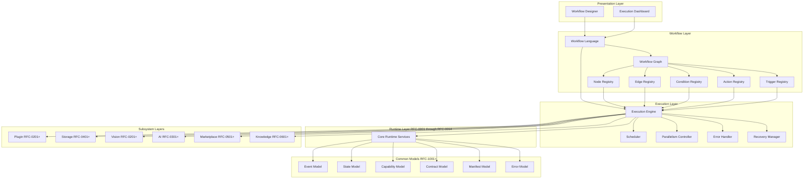
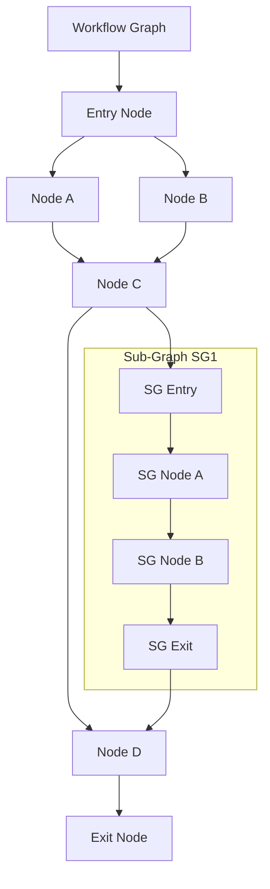

RFC: RFC-0301
Title: Workflow Overview
Status: Proposed
Version: 1.0.0
Author: Atlas Specification Committee
Created: 2026-01-01
Updated: 2026-07-01
ADS Version: 1.0
Spec Version: 1.0
Normative: YES
Depends On: None
Supersedes: None
Superseded By: None
Related ADR: ADR-0001, ADR-0012
Related JSON Schema: specs/workflow/json-schema/workflow-overview.md
Related Catalog: catalog/workflow-manifest.md, catalog/workflow-lifecycle.md, catalog/workflow-node-types.md
Audience: All Subsystem Teams

## Terminology

The following terms are defined in the Atlas Master Glossary (RFC-0301) and are used throughout this specification with the exact meanings given below. Where this specification refines a term from RFC-0301, the refinement is noted.

| Term | Definition |
|---|---|
| Workflow | A declarative graph of interconnected nodes representing a sequence of operations to be executed by the Workflow Runtime. |
| Execution | The process of running a Workflow through the Workflow Runtime, producing a sequence of Node activations and state transitions. |
| Run | A single invocation of a Workflow execution, identified by a unique Run ID. |
| Task | The smallest unit of work within a Workflow execution, associated with a single Node. |
| Node | A vertex in the Workflow graph representing a discrete unit of work or decision point. |
| Context | The mutable state bag associated with an Execution, containing variables, metadata, and transient data. |
| Frame | A scoped execution context within a Node's execution, containing local variables and evaluation state. |
| Tick | A single iteration of the Workflow scheduler's execution loop. |
| Scheduler | The component responsible for determining which Nodes execute next based on graph topology, conditions, and policies. |
| Trigger | An event or condition that initiates or influences Workflow execution. |
| Condition | A boolean expression evaluated during execution to determine control flow between nodes. | RFC-0310 |
| State | The persistent snapshot of a Workflow's execution at a point in time, including Node statuses and Context values. |
| Checkpoint | A durable snapshot of State used for recovery, containing all data necessary to resume execution. |
| Recovery | The process of restoring a Workflow from a Checkpoint after a failure. |
| Manifest | The declarative definition of a Workflow, including its graph, nodes, edges, conditions, and metadata. |
| Version | The semantic version of a Workflow, Manifest, or specification, used for compatibility tracking. |
| Workflow Graph | The directed acyclic graph (DAG) or directed graph structure defining Workflow topology. |
| Node Type | A classification of Node that determines its execution semantics and available capabilities. |
| Edge | A connection between two Nodes in the Workflow graph, defining execution flow direction. |
| Sub-Graph | A contained Workflow graph nested within a parent Workflow for modularity. |
| Orchestration | The coordination of multiple Workflow executions to achieve a higher-level goal. |
| Scheduling Policy | The rule set determining Node execution order and parallelism. |
| Parallelism Strategy | The approach to concurrent Node execution (fan-out, fan-in, pipeline). |
| Error Category | A classification of Workflow execution errors (Transient, Permanent, Recoverable, Fatal). |
| Recovery Strategy | The approach to handling failures (Retry, Skip, Compensate, Abort). |
| Debug Operation | An action performed through the debugging interface for inspection or intervention. |
| Validation Rule | A constraint checked during Workflow manifest validation. |
| Compliance Category | A classification of regulatory or policy requirements applied to Workflow execution. |

---07-01
Depends On:
  - RFC-0001 Runtime Overview
  - RFC-0002 Runtime Lifecycle
  - RFC-0003 Runtime Service Model
  - RFC-0004 Runtime Scheduler
  - RFC-0005 Runtime Event Bus
  - RFC-0006 Runtime State Management
  - RFC-1001 Common Event Model
  - RFC-1002 Common State Model
  - RFC-1003 Common Capability Model
  - RFC-1004 Common Contract Model
  - RFC-1005 Common Manifest Model
  - RFC-1006 Common Error Model
Supersedes: RFC-0101
Superseded By: None
Category: Workflow
Layer: Core
Normative: YES
Audience: All Subsystem Teams
ADR References:
  - ADR-0012
Constitution References:
  - Section 1 (Workflow Philosophy)
Related RFCs:
  - RFC-0302 Workflow Language
  - RFC-0303 Workflow Execution
  - RFC-0304 Workflow Runtime
  - RFC-0305 Workflow Lifecycle
  - RFC-0306 Workflow State
  - RFC-0307 Workflow Context
  - RFC-0308 Workflow Events
  - RFC-0309 Workflow Actions
  - RFC-0310 Workflow Conditions
  - RFC-0311 Workflow Triggers
  - RFC-0312 Workflow Scheduler
  - RFC-0313 Workflow Parallelism
  - RFC-0314 Workflow Error Handling
  - RFC-0315 Workflow Recovery
  - RFC-0316 Workflow Debugging
  - RFC-0317 Workflow Validation
  - RFC-0318 Workflow Versioning
  - RFC-0319 Workflow Security
  - RFC-0320 Workflow Performance
  - RFC-0321 Workflow Observability
  - RFC-0322 Workflow Extension
  - RFC-0323 Workflow Plugin Integration
  - RFC-0324 Workflow Storage
  - RFC-0325 Workflow AI
  - RFC-0326 Workflow Vision
  - RFC-0327 Workflow IPC
  - RFC-0328 Workflow Serialization
  - RFC-0329 Workflow Compatibility
  - RFC-0330 Workflow Compliance
Target Release: 1.0.0
Review Cycle: Specification Committee
Compatibility: Compatible with Spec 1.x

Related ADR:
  - ADR-0012 Contract-First Specification-Driven Development
Related JSON Schema:
  - schemas/workflow/definition.json
  - schemas/workflow/graph-model.json
  - schemas/workflow/instance.json
Related Catalog:
  - catalog/workflow-actions.md
  - catalog/workflow-action-types.md
  - catalog/workflow-capabilities.md
  - catalog/workflow-conditions.md
  - catalog/workflow-context.md
  - catalog/workflow-debug-events.md
  - catalog/workflow-error-codes.md
  - catalog/workflow-errors.md
  - catalog/workflow-events.md
  - catalog/workflow-extension-points.md
  - catalog/workflow-hooks.md
  - catalog/workflow-lifecycle.md
  - catalog/workflow-manifest.md
  - catalog/workflow-metrics.md
  - catalog/workflow-node-types.md
  - catalog/workflow-observability.md
  - catalog/workflow-operators.md
  - catalog/workflow-permissions.md
  - catalog/workflow-recovery-types.md
  - catalog/workflow-resource-types.md
  - catalog/workflow-result-types.md
  - catalog/workflow-schedulers.md
  - catalog/workflow-state-types.md
  - catalog/workflow-status.md
  - catalog/workflow-time-model.md
  - catalog/workflow-triggers.md
  - catalog/workflow-validation-rules.md
  - catalog/workflow-variable-types.md
  - catalog/workflow-versioning.md
---

## Normative Status
This specification is Normative. Every Atlas subsystem MUST conform to the requirements defined in this document.

The Workflow specification defines the declarative orchestration language and execution framework of Atlas. Workflow is the central abstraction through which all Atlas subsystems coordinate their activities, manage their lifecycles, and achieve their objectives.

Workflow is NOT scripting. Workflow is NOT automation. Workflow is NOT macros. Workflow is NOT programming. Workflow is the declarative orchestration language of Atlas.

Workflow defines the structure, semantics, execution model, scheduling model, orchestration model, runtime contract, event model, state model, validation model, debugging model, and extension model for Atlas. Everything in Atlas is driven by workflows.

Every Atlas subsystem -- Runtime, Plugin, Storage, Vision, AI, Marketplace, and Knowledge -- expresses its operational intent through workflows. Workflows serve as the universal coordination mechanism that binds these subsystems into a coherent, deterministic, resolvable, observable, and debuggable execution fabric.

The Workflow specification defines a directed graph model where nodes represent atomic units of work and edges represent data flow, control flow, and dependency relationships between nodes. The graph is evaluated deterministically, executed in a manner that preserves state across restarts, emits events that are observable by all subsystems, and supports comprehensive debugging and recovery capabilities.

---
---

## Authority

This RFC is the authoritative specification for the RFC 0301 workflow overview.

Any implementation MUST conform to this document.

If an implementation conflicts with this RFC, this RFC takes precedence.

Conflicts between RFCs SHALL be resolved through the ADR process.


## 2 Workflow Philosophy

The Workflow philosophy rests upon five foundational principles:

### Principle 1: Declarative Over Imperative

Workflow definitions express WHAT must happen, not HOW it happens. The execution engine determines the optimal strategy for achieving the declared objectives. Users declare nodes, edges, conditions, and constraints; the engine resolves execution order, resource allocation, and parallelism.

### Principle 2: Graph Over Sequence

Workflow is fundamentally a graph, not a sequence. While linear execution paths are a valid subset of graph execution, the graph model enables branching, looping, fan-out, fan-in, conditional execution, and arbitrary topological structures that sequences cannot express.

### Principle 3: Stateful Over Stateless

Workflow execution maintains explicit state throughout the lifecycle of every workflow instance. State transitions are deterministic, observable, and recoverable. The state model ensures that execution can be paused, inspected, resumed, restarted, or rolled back at any point.

### Principle 4: Observable Over Opaque

Every aspect of workflow execution is observable. Execution state, node status, variable values, event emissions, resource utilization, timing characteristics, and error conditions are all exposed through standardized observability interfaces. No workflow execution is opaque to monitoring, debugging, or auditing.

### Principle 5: Extensible Over Closed

The workflow model provides well-defined extension points through which subsystems can register custom node types, condition evaluators, action handlers, trigger sources, and recovery strategies. The extension model ensures that the workflow language evolves alongside the Atlas ecosystem without requiring core specification changes.

---

## 3 Goals

The Workflow specification pursues the following goals:

| Goal | Description | Verification Method |
|---|---|---|
| Deterministic Execution | Given identical inputs and conditions, workflow execution MUST produce identical outcomes. | Reproducibility testing |
| Resumable Execution | Workflow instances MUST be pausable and resumable from any checkpoint. | Interruption and resumption testing |
| Observable Execution | Every execution state change MUST be emitted as an observable event. | Event emission verification |
| Debuggable Execution | Every execution point MUST be inspectable for variables, state, and context. | Debug session testing |
| Extensible Architecture | New node types, conditions, actions, triggers, and recovery strategies MUST be registrable without core changes. | Extension registration testing |
| Cross-Subsystem Coordination | Workflows MUST coordinate activities across Runtime, Plugin, Storage, Vision, AI, Marketplace, and Knowledge. | Cross-subsystem integration testing |
| Security Isolation | Workflow execution MUST respect resource boundaries, permission constraints, and sandboxing policies. | Security audit |
| Performance Efficiency | Workflow execution MUST minimize latency, maximize throughput, and bound resource consumption. | Performance benchmarking |
| Version Compatibility | Workflow definitions MUST support backward and forward compatibility across specification versions. | Compatibility matrix testing |
| Compliance Enforcement | Workflow execution MUST enforce organizational, regulatory, and operational compliance requirements. | Compliance audit |

---

## 4 Non-Goals

The Workflow specification explicitly does NOT define:

| Non-Goal | Reason |
|---|---|
| Concrete implementation languages | Implementation is orthogonal to specification |
| Specific workflow engine architectures | Engines MAY implement the model in any architecture |
| Programming language bindings | Workflow definitions are declarative, not programmatic |
| UI/UX design | User interface concerns belong to the Presentation layer |
| Network protocol specifics | IPC concerns are defined in RFC-0101 through RFC-0112 |
| Database schema details | Storage concerns are defined in RFC-0401 through RFC-0425 |
| Plugin API signatures | Plugin concerns are defined in RFC-0201 through RFC-0230 |
| AI model training procedures | AI concerns are defined in RFC-0301 through RFC-0307 |
| Vision algorithm implementations | Vision concerns are defined in RFC-0201 through RFC-0206 |
---

## 5 Workflow Architecture

The Workflow architecture comprises seven interconnected layers:



The Workflow architecture is layered:

1. **Workflow Layer** defines the declarative language, graph model, and registry of nodes, edges, conditions, actions, and triggers.
2. **Execution Layer** interprets the workflow graph, manages execution state, coordinates scheduling, handles errors, and manages recovery.
3. **Runtime Layer** provides the foundational execution substrate (lifecycle, services, IPC, resources, manifest, capabilities).
4. **Subsystem Layers** provide domain-specific node types and capabilities (Plugin, Storage, Vision, AI, Marketplace, Knowledge).
5. **Common Models** provide cross-cutting concerns (events, state, capabilities, contracts, manifest, errors).
---

## 6 Workflow Graph Model

### 6.1 Graph Definition

A Workflow Graph is a directed graph G = (V, E) where:

- V is a finite set of vertices (nodes) representing atomic units of work.
- E is a finite set of directed edges representing data flow, control flow, and dependency relationships.

The graph MAY contain cycles in the form of loop constructs, but the execution graph (the graph of actual execution steps) MUST be acyclic at any given point in time.

### 6.2 Graph Properties

| Property | Constraint | Description |
|---|---|---|
| Acyclicity | Execution graph MUST be acyclic | Prevents infinite execution loops |
| Connectivity | Graph MUST be weakly connected | All nodes are reachable from entry points |
| Entry Points | Graph MUST have at least one entry node | Defines where execution begins |
| Exit Points | Graph SHOULD have at least one exit node | Defines where execution concludes |
| Determinism | Same graph + same inputs = same execution | Execution is fully determined by inputs and conditions |
| Finite State | Each node has a finite set of states | Enables state enumeration and traversal |
| Bounded Depth | Graph depth MUST be finite | Prevents unbounded nesting |
| Bounded Fan-Out | Fan-out per node is bounded by resource constraints | Prevents resource exhaustion |

### 6.3 Graph Types

| Graph Type | Description | Usage |
|---|---|---|
| Workflow Graph | Static definition of nodes and edges | Design-time representation |
| Execution Graph | Dynamic instantiation of workflow graph | Runtime representation |
| State Machine | Node state transitions | Lifecycle management |
| Data Flow Graph | Variable and parameter propagation | Data dependency tracking |
| Control Flow Graph | Conditional and loop execution paths | Execution ordering |
| Dependency Graph | Inter-node dependency relationships | Scheduling and parallelism |

### 6.4 Sub-Graphs

Workflows MAY contain sub-graphs (sub-workflows), which are themselves complete workflow graphs. Sub-graphs enable hierarchical workflow composition:

- A sub-graph MAY be referenced by a composite node.
- Sub-graph execution inherits the parent context.
- Sub-graph results propagate to the parent context.
- Sub-graphs MAY be executed in parallel with sibling sub-graphs.
- Sub-graphs MAY be versioned independently from the parent workflow.


---

## 7 Execution Model

### 7.1 Execution Principles

Workflow execution MUST adhere to the following principles:

1. **Determinism**: Given identical inputs, conditions, and environment, workflow execution MUST produce identical results. Non-deterministic operations MUST be explicitly declared and bounded.
2. **Resumability**: Workflow execution MUST be resumable from any checkpoint. Checkpoint state MUST include all variables, node states, edge evaluations, and pending actions.
3. **Observability**: Every execution state change MUST be emitted as an observable event through the event bus (RFC-0005, RFC-1001).
4. **Debuggability**: Every execution point MUST be inspectable. Debuggers MUST be able to pause, step, inspect variables, and resume execution.

### 7.2 Execution Phases

| Phase | Description | State Transition |
|---|---|---|
| Parsing | Workflow definition is parsed and validated | Draft to Parsed |
| Validation | Workflow graph is validated against constraints | Parsed to Validated |
| Compilation | Validated graph is compiled into executable form | Validated to Compiled |
| Queuing | Compiled workflow is queued for execution | Compiled to Queued |
| Initialization | Execution context is created, resources acquired | Queued to Initializing |
| Execution | Nodes are executed according to graph topology | Initializing to Executing |
| Completion | All exit nodes are reached | Executing to Completed |
| Termination | Resources are released, final state persisted | Completed to Terminated |

### 7.3 Execution Context

The execution context is a snapshot of all state relevant to a single workflow execution instance. It includes:

- Variables and their current values
- Parameters bound to each node
- Resource allocations
- Event subscriptions
- Error handlers
- Timing information
- Security context
- Observability hooks

The execution context is created during the Initialization phase and destroyed during the Termination phase. It is persisted at every checkpoint.

### 7.4 Execution Determinism

Execution determinism is achieved through:

1. **Ordered Input Resolution**: Inputs to each node are resolved in a deterministic order.
2. **Condition Evaluation Order**: Conditions are evaluated in a deterministic order.
3. **Parallelism Bounding**: Parallel execution is bounded by deterministic scheduling policies.
4. **Non-Deterministic Operation Isolation**: Non-deterministic operations (external API calls, random number generation) are isolated and explicitly declared.
5. **State Checkpointing**: State is checkpointed at deterministic points, enabling reproducible recovery.

### 7.5 Execution Resumption

Execution resumption operates on the principle of idempotent state restoration:

1. Upon resumption, the execution engine loads the most recent checkpoint.
2. All nodes that completed successfully are marked as completed.
3. Nodes that were running at checkpoint time are retried (assuming idempotent semantics).
4. Nodes that had not yet started are executed normally.
5. Edge evaluations are recomputed from restored variable values.

---

## 8 Scheduling Model

### 8.1 Scheduler Overview

The Workflow Scheduler is responsible for determining WHEN and WHERE each node is executed. The scheduler operates on the execution graph and considers:

- Node dependencies (data and control)
- Resource availability
- Priority levels
- Execution budgets
- Time constraints
- Parallelism constraints
- Error handling policies

### 8.2 Scheduling Policies

| Policy | Description | Application |
|---|---|---|
| Topological | Execute nodes in topological order | Default scheduling |
| Priority | Higher-priority nodes execute first | Priority-ordered execution |
| Resource-Aware | Schedule based on resource availability | Resource-constrained environments |
| Time-Bounded | Schedule within time constraints | Deadline-sensitive workflows |
| Cost-Optimized | Minimize resource cost | Cost-sensitive executions |
| Parallel-Optimized | Maximize parallel execution | Throughput-sensitive workflows |

### 8.3 Scheduling Queue

The scheduling queue is a priority-ordered collection of nodes ready for execution. Nodes enter the queue when all their dependencies are satisfied. The scheduler dequeues nodes according to the active scheduling policy.

### 8.4 Execution Budget

Each workflow instance has an execution budget that constrains:

- Maximum execution time
- Maximum resource consumption
- Maximum number of node executions
- Maximum event emissions
- Maximum data transfer volume

Budget violations cause the workflow to enter a terminated state with an appropriate error code.
---

## 9 Orchestration Model

### 9.1 Orchestration Overview

Orchestration is the coordination of multiple nodes, subsystems, and resources to achieve a workflow objective. The orchestration model defines HOW nodes are coordinated.

### 9.2 Coordination Mechanisms

| Mechanism | Description | RFC Reference |
|---|---|---|
| Data Flow | Variables and parameters propagate along edges | RFC-0307 |
| Control Flow | Conditions determine execution paths | RFC-0310 |
| Event Flow | Events trigger node execution | RFC-0311 |
| Resource Flow | Resources are acquired and released along edges | RFC-0309 |
| State Flow | State transitions coordinate node execution | RFC-0306 |
| IPC Flow | Inter-process coordination for distributed nodes | RFC-0327 |
| AI Coordination | AI agents coordinate through workflow nodes | RFC-0325 |
| Vision Coordination | Vision operations coordinate through workflow nodes | RFC-0326 |
| Plugin Coordination | Plugin nodes coordinate through workflow actions | RFC-0323 |
| Storage Coordination | Storage operations coordinate through workflow nodes | RFC-0324 |
| Knowledge Coordination | Knowledge pack operations coordinate through workflow nodes | Knowledge RFC-0601 |
| Marketplace Coordination | Marketplace operations coordinate through workflow nodes | Marketplace RFC-0501 |

### 9.3 Orchestration Patterns

| Pattern | Description | Use Case |
|---|---|---|
| Pipeline | Sequential node execution with data flow | Data processing pipelines |
| Fan-Out | Single node triggers multiple parallel nodes | Batch processing |
| Fan-In | Multiple nodes converge to a single node | Result aggregation |
| Branch | Conditional execution of alternative paths | Decision making |
| Loop | Iterative execution of a node or sub-graph | Repetitive processing |
| Retry | Automatic re-execution on failure | Transient error handling |
| Compensation | Rollback of completed actions | Transaction management |
| Parallel | Concurrent execution of independent nodes | Throughput optimization |
| Sequential | Ordered execution of dependent nodes | Dependency management |

---

## 10 Node Types

### 10.1 Node Type Catalog

| Node Type | Description | RFC Reference |
|---|---|---|
| AI Node | Executes AI model inference or agent operations | RFC-0325 |
| Vision Node | Executes vision operations (frame capture, OCR, detection) | RFC-0326 |
| Plugin Node | Executes plugin-provided functionality | RFC-0323 |
| Storage Node | Executes storage operations (read, write, query) | RFC-0324 |
| IPC Node | Executes inter-process coordination | RFC-0327 |
| Manual Node | Requires human intervention or approval | RFC-0309 |
| Human Approval Node | Waits for explicit human approval | RFC-0309 |
| Resource Node | Manages resource allocation and deallocation | RFC-0309 |
| Condition Node | Evaluates conditions without side effects | RFC-0310 |
| Action Node | Performs an action with side effects | RFC-0309 |
| Trigger Node | Monitors for trigger events | RFC-0311 |
| Scheduler Node | Manages scheduled execution | RFC-0312 |
| Error Handler Node | Handles error conditions | RFC-0314 |
| Recovery Node | Manages recovery operations | RFC-0315 |
| Debug Node | Provides debugging instrumentation | RFC-0316 |
| Observation Node | Emits observability data | RFC-0321 |
| Validation Node | Validates data or state | RFC-0317 |
| Serialization Node | Manages serialization and deserialization | RFC-0328 |
| Version Node | Manages version compatibility | RFC-0329 |
| Compliance Node | Enforces compliance requirements | RFC-0330 |
| Extension Node | Provides extension point functionality | RFC-0322 |
| Composite Node | Contains a sub-graph | RFC-0302 |
| Entry Node | Marks workflow entry point | RFC-0302 |
| Exit Node | Marks workflow exit point | RFC-0302 |

### 10.2 Node Attributes

Every node MUST have the following attributes:

| Attribute | Type | Required | Description |
|---|---|---|---|
| id | String | YES | Unique identifier within the workflow graph |
| type | String | YES | Node type (from the catalog above) |
| label | String | NO | Human-readable label |
| description | String | NO | Human-readable description |
| inputs | Variable List | NO | Input variables bound to this node |
| outputs | Variable List | NO | Output variables produced by this node |
| parameters | Parameter Map | NO | Configuration parameters |
| conditions | Condition List | NO | Conditions that gate execution |
| actions | Action List | NO | Actions performed during execution |
| triggers | Trigger List | NO | Triggers that activate this node |
| resources | Resource List | NO | Resources required by this node |
| budget | Budget Spec | NO | Execution budget constraints |
| priority | Integer | NO | Execution priority (higher = earlier) |
| timeout | Duration | NO | Maximum execution duration |
| retry | Retry Policy | NO | Retry policy for failures |
| error_handlers | Error Handler List | NO | Custom error handlers |
| recovery_policy | Recovery Policy | NO | Recovery strategy |
| observability | Observability Config | NO | Observability settings |
| security_context | Security Context | NO | Security constraints |
| version | String | NO | Node type version |
---

## 11 Node Lifecycle

### 11.1 Node States

Every node transitions through the following states:

```stateDiagram-v2
    [*] --> Draft
    Draft --> Validated: Validation passes
    Draft --> Invalid: Validation fails
    Validated --> Queued: Ready for execution
    Queued --> Pending: Scheduler dispatches
    Pending --> Running: Execution begins
    Running --> Completed: Execution succeeds
    Running --> Failed: Execution fails
    Running --> Skipped: Condition evaluates false
    Running --> Cancelled: Execution cancelled
    Failed --> Retrying: Retry policy allows
    Failed --> Compensating: Compensation required
    Failed --> Terminated: Retry exhausted
    Retrying --> Pending: Retry scheduled
    Compensating --> Compensated: Compensation succeeds
    Compensating --> CompensationFailed: Compensation fails
    Compensated --> Terminated
    CompensationFailed --> Terminated
    Completed --> Terminated: Final state reached
    Skipped --> Terminated: Final state reached
    Cancelled --> Terminated: Final state reached
    Terminated --> [*]
```

### 11.2 State Descriptions

| State | Description | Transitions From | Transitions To |
|---|---|---|---|
| Draft | Node is defined but not validated | Initial | Validated, Invalid |
| Invalid | Node failed validation | Draft | Draft (after fix) |
| Validated | Node passed validation | Draft | Queued |
| Queued | Node is waiting for scheduling | Validated | Pending |
| Pending | Node is scheduled but not yet running | Queued | Running, Skipped, Cancelled |
| Running | Node is actively executing | Pending | Completed, Failed, Skipped, Cancelled |
| Completed | Node executed successfully | Running | Terminated |
| Failed | Node execution failed | Running | Retrying, Compensating, Terminated |
| Skipped | Node was skipped due to condition | Running | Terminated |
| Cancelled | Node execution was cancelled | Running | Terminated |
| Retrying | Node is being retried | Failed | Pending, Terminated |
| Compensating | Compensation is in progress | Failed | Compensated, CompensationFailed |
| Compensated | Compensation succeeded | Compensating | Terminated |
| CompensationFailed | Compensation failed | Compensating | Terminated |
| Terminated | Node lifecycle is complete | All terminal states | Final |

---

## 12 Edge Semantics

### 12.1 Edge Types

| Edge Type | Description | Semantics |
|---|---|---|
| Data Edge | Carries variable values between nodes | Output of source node becomes input of target node |
| Control Edge | Carries execution signals between nodes | Source completion triggers target readiness |
| Condition Edge | Carries condition evaluation results | Target executes only if condition is true |
| Event Edge | Carries event data between nodes | Target reacts to emitted events |
| Resource Edge | Carries resource references between nodes | Target acquires resources from source |
| Signal Edge | Carries control signals (cancel, pause, resume) | Target responds to signals |

### 12.2 Edge Attributes

| Attribute | Type | Required | Description |
|---|---|---|---|
| id | String | YES | Unique identifier within the workflow graph |
| source | Node ID | YES | Source node identifier |
| target | Node ID | YES | Target node identifier |
| type | Edge Type | YES | Edge type (data, control, condition, event, resource, signal) |
| Condition | A boolean expression evaluated during execution to determine control flow between nodes. | RFC-0310 | NO | Condition that gates edge traversal |
| transformation | Transformation | NO | Data transformation applied along the edge |
| cardinality | Cardinality | NO | Edge cardinality (one-to-one, one-to-many, many-to-one, many-to-many) |
| timeout | Duration | NO | Maximum time for edge data transfer |
| buffer_size | Integer | NO | Maximum buffer size for edge data |
---

## 13 Condition Model

### 13.1 Condition Overview

Conditions are boolean expressions that evaluate to true or false. Conditions gate the execution of nodes and the traversal of edges.

### 13.2 Condition Types

| Condition Type | Description | Example |
|---|---|---|
| Boolean | Simple true/false expression | flag equals true |
| Comparison | Value comparison | count greater than 10 |
| Temporal | Time-based condition | now is after scheduled_time |
| State-based | Node state condition | node_a state equals completed |
| Event-based | Event occurrence condition | event_type equals approval |
| Resource-based | Resource availability condition | resource.available equals true |
| Data-based | Data content condition | data.length greater than 0 |
| Composite | Combination of conditions | a AND b OR c |

### 13.3 Condition Operators

| Operator | Description | Type |
|---|---|---|
| AND | Logical conjunction | Boolean |
| OR | Logical disjunction | Boolean |
| NOT | Logical negation | Boolean |
| EQUALS | Equality | Comparison |
| NOT_EQUALS | Inequality | Comparison |
| LESS_THAN | Less than | Comparison |
| LESS_EQUAL | Less than or equal | Comparison |
| GREATER_THAN | Greater than | Comparison |
| GREATER_EQUAL | Greater than or equal | Comparison |
| IN | Membership | Set |
| NOT_IN | Non-membership | Set |
| EXISTS | Existence check | Data |
| EMPTY | Emptiness check | Data |
| BEFORE | Temporal ordering | Temporal |
| AFTER | Temporal ordering | Temporal |
| BETWEEN | Range check | Temporal |

---

## 14 Action Model

### 14.1 Action Overview

Actions are operations performed by nodes during execution. Actions MAY have side effects and MAY produce results.

### 14.2 Action Types

| Action Type | Description | Idempotent |
|---|---|---|
| Invoke | Invokes a capability or service | No |
| Transform | Transforms data | Yes |
| Validate | Validates data or state | Yes |
| Emit | Emits an event | Yes |
| Wait | Waits for a condition or event | Yes |
| Approve | Requests human approval | No |
| Reject | Requests human rejection | No |
| Compensate | Performs compensation | No |
| Notify | Sends a notification | Yes |
| Store | Stores data | No |
| Retrieve | Retrieves data | Yes |
| Delete | Deletes data | No |
| Query | Queries data | Yes |
| Schedule | Schedules a future action | No |
| Cancel | Cancels a pending action | No |
| Resume | Resumes a paused action | No |
| Pause | Pauses an active action | No |

---

## 15 Event Model

### 15.1 Event Overview

Workflow events are emitted during execution to signal state changes, errors, completions, and other significant occurrences. The event model is defined in RFC-1001 and extended by RFC-0308.

### 15.2 Event Categories

| Category | Description | Examples |
|---|---|---|
| Execution | Node execution state changes | NodeStarted, NodeCompleted, NodeFailed |
| Scheduling | Scheduling decisions and queue changes | NodeQueued, NodeDispatched, PriorityChanged |
| Error | Error conditions and handling | NodeFailed, RetryExhausted, CompensationFailed |
| Recovery | Recovery operations | CheckpointCreated, RecoveryStarted, RecoveryCompleted |
| Debug | Debugging instrumentation | DebugBreakpoint, DebugStep, DebugInspect |
| Observability | Performance and metric data | MetricEmitted, ResourceUtilized, TimingRecorded |
| Security | Security-related events | PermissionDenied, SandboxViolation, AuditLogged |
| Version | Version-related events | VersionChecked, CompatibilityChecked, MigrationApplied |
| Compliance | Compliance-related events | ComplianceChecked, ComplianceViolation, AuditTrailGenerated |
---

## 16 Trigger Model

### 16.1 Trigger Overview

Triggers are external events or conditions that initiate workflow execution. Triggers are defined in RFC-0311.

### 16.2 Trigger Types

| Trigger Type | Description | Source |
|---|---|---|
| Manual | Initiated by user action | User interface |
| Scheduled | Initiated at a specific time or interval | Scheduler |
| Event-based | Initiated by an external event | Event bus |
| API | Initiated by an API call | External system |
| Webhook | Initiated by a webhook callback | HTTP endpoint |
| File | Initiated by file system changes | File system watcher |
| Timer | Initiated by a timer expiration | Internal timer |
| Dependency | Initiated by another workflow completion | Parent workflow |
| Resource | Initiated by resource availability | Resource manager |

---

## 17 Parallelism Model

### 17.1 Parallelism Overview

Parallel execution is managed through the parallelism model defined in RFC-0313. Key principles:

- Independent nodes MAY execute in parallel.
- Dependent nodes MUST execute in the specified order.
- Parallel execution is bounded by resource constraints and scheduling policies.
- Race conditions are prevented through deterministic variable resolution.

### 17.2 Parallelism Strategies

| Strategy | Description | Use Case |
|---|---|---|
| Fork-Join | Split work into parallel branches, join results | Batch processing |
| Pipeline | Stages process data concurrently | Streaming processing |
| Map-Reduce | Distribute computation, aggregate results | Large-scale computation |
| Fan-Out/Fan-In | Distribute to many nodes, collect results | Parallel API calls |
| Parallel Loop | Iterate with parallel iterations | Array processing |

---

## 18 Error Handling Model

### 18.1 Error Handling Overview

Error handling is defined in RFC-0314. Key principles:

- Every node execution MAY declare error handlers.
- Errors are categorized by type, severity, and recoverability.
- Recovery strategies include retry, compensation, skip, and abort.
- Error events are emitted for all error conditions.

### 18.2 Error Categories

| Category | Description | Recoverable |
|---|---|---|
| Transient | Temporary failure (network, timeout) | Yes |
| Permanent | Unrecoverable failure (invalid data, missing resource) | No |
| Resource | Resource exhaustion (memory, CPU, disk) | Conditional |
| Security | Security violation (permission denied, sandbox breach) | No |
| Validation | Data validation failure | Conditional |
| Compliance | Compliance requirement violation | No |
| Version | Version incompatibility | Conditional |

---

## 19 Recovery Model

### 19.1 Recovery Overview

Recovery is defined in RFC-0315. Key principles:

- Workflow instances are checkpointed at deterministic points.
- Checkpoints contain full execution state for resumption.
- Recovery strategies include restart, resume, rollback, and compensate.
- Recovery is transparent to the workflow definition.

### 19.2 Recovery Strategies

| Strategy | Description | When Used |
|---|---|---|
| Restart | Restart from the beginning | Catastrophic failure |
| Resume | Resume from last checkpoint | Normal recovery |
| Rollback | Rollback to a previous state | Data corruption detected |
| Compensate | Execute compensating actions | Partial failure |
| Skip | Skip failed node and continue | Non-critical node failure |
| Abort | Terminate workflow | Unrecoverable failure |

---

## 20 Debugging Model

### 20.1 Debugging Overview

Debugging is defined in RFC-0316. Key principles:

- Debuggers can attach to running workflow instances.
- Breakpoints can be set on nodes, edges, conditions, and events.
- Variable values can be inspected at any execution point.
- Execution can be stepped through node by node.
- Debug sessions are recorded for replay.

### 20.2 Debug Operations

| Operation | Description |
|---|---|
| Attach | Connect debugger to workflow instance |
| Detach | Disconnect debugger |
| Breakpoint | Set breakpoint on node, edge, condition, or event |
| Step Over | Execute current node, stop at next |
| Step Into | Enter sub-graph or called node |
| Step Out | Complete current node, stop at caller |
| Continue | Resume execution until next breakpoint |
| Inspect | View variable values at current execution point |
| Modify | Change variable values at current execution point |
| Replay | Re-execute from a checkpoint with debugger attached |
---

## 21 Validation Model

### 21.1 Validation Overview

Validation is defined in RFC-0317. Key principles:

- Workflow definitions are validated before execution.
- Validation covers syntax, semantics, constraints, and policies.
- Validation errors prevent execution.
- Validation warnings allow execution with caution.

### 21.2 Validation Rules

| Rule | Description | Severity |
|---|---|---|
| Syntax | Workflow definition is syntactically valid | Error |
| Type | Variable and parameter types are correct | Error |
| Reference | Node and edge references are valid | Error |
| Cycle | Execution graph is acyclic | Error |
| Connectivity | All nodes are reachable from entry | Error |
| Completeness | All required attributes are present | Error |
| Uniqueness | Node and edge IDs are unique | Error |
| Budget | Execution budget is sufficient | Warning |
| Security | Security constraints are satisfied | Error |
| Version | Version compatibility is maintained | Warning |
| Compliance | Compliance requirements are met | Error |

---

## 22 Versioning Model

### 22.1 Versioning Overview

Versioning is defined in RFC-0318. Key principles:

- Workflow definitions have semantic versions.
- Backward-compatible changes MAY be applied to existing instances.
- Forward-compatible changes require migration.
- Version compatibility is enforced at execution time.

### 22.2 Version Compatibility Matrix

| Change Type | Backward Compatible | Forward Compatible | Requires Migration |
|---|---|---|---|
| Adding optional fields | Yes | Yes | No |
| Removing optional fields | Yes | No | No |
| Changing required field type | No | No | Yes |
| Adding new node types | Yes | Yes | No |
| Removing node types | No | No | Yes |
| Adding new edges | Yes | Conditional | Conditional |
| Removing edges | Conditional | No | Yes |
| Changing edge direction | No | No | Yes |
| Adding conditions | Yes | Yes | No |
| Removing conditions | Yes | No | No |
| Changing condition semantics | No | No | Yes |

---

## 23 Security Model

### 23.1 Security Overview

Security is defined in RFC-0319. Key principles:

- Workflow execution respects permission constraints.
- Nodes operate within sandbox boundaries.
- Data is protected at rest and in transit.
- Audit trails record all security-relevant actions.

### 23.2 Security Controls

| Control | Description | Enforcement Point |
|---|---|---|
| Authentication | Verify identity of workflow initiator | Workflow creation |
| Authorization | Verify permissions for workflow operations | Every operation |
| Sandboxing | Isolate node execution from host | Node execution |
| Data Encryption | Encrypt data at rest and in transit | Storage, IPC |
| Audit Logging | Record all security-relevant actions | All operations |
| Resource Limits | Bound resource consumption | Scheduling |
| Input Validation | Validate all inputs before execution | Validation |
| Output Sanitization | Sanitize all outputs before emission | Action completion |

---

## 24 Performance Model

### 24.1 Performance Overview

Performance is defined in RFC-0320. Key principles:

- Workflow execution latency is bounded.
- Resource utilization is optimized.
- Throughput is maximized within constraints.
- Performance degradation is graceful.

### 24.2 Performance Metrics

| Metric | Description | Target |
|---|---|---|
| Latency | Time from trigger to completion | Bounded by timeout |
| Throughput | Nodes executed per unit time | Maximized |
| Resource Utilization | CPU, memory, I/O usage | Optimized |
| Checkpoint Overhead | Time to create a checkpoint | Minimized |
| Recovery Time | Time to recover from failure | Minimized |
| Parallelism Efficiency | Ratio of parallel to sequential execution | Maximized |
---

## 25 Observability Model

### 25.1 Observability Overview

Observability is defined in RFC-0321. Key principles:

- Every workflow execution emits observability data.
- Observability data includes metrics, traces, and logs.
- Observability is non-invasive (does not affect execution semantics).
- Observability data is queryable and aggregatable.

### 25.2 Observability Data Types

| Type | Description | Collection Point |
|---|---|---|
| Metrics | Numerical measurements (duration, count, rate) | Every node execution |
| Traces | End-to-end execution paths | Workflow instance |
| Logs | Human-readable execution records | Every state transition |
| Spans | Execution segments within traces | Every node |
| Events | State change notifications | Every state transition |
| Profiles | Resource usage profiles | Every execution |

---

## 26 Extension Model

### 26.1 Extension Overview

Extension is defined in RFC-0322. Key principles:

- New node types can be registered without core changes.
- New condition evaluators can be registered.
- New action handlers can be registered.
- New trigger sources can be registered.
- New recovery strategies can be registered.
- Extensions are versioned independently.

### 26.2 Extension Points

| Extension Point | Description | Registration Method |
|---|---|---|
| Node Type | Register a new node type | Node type registry |
| Condition Evaluator | Register a new condition evaluator | Condition registry |
| Action Handler | Register a new action handler | Action registry |
| Trigger Source | Register a new trigger source | Trigger registry |
| Recovery Strategy | Register a new recovery strategy | Recovery registry |
| Error Handler | Register a new error handler | Error handler registry |
| Transformation | Register a new data transformation | Transformation registry |
| Validator | Register a new validator | Validator registry |

---

## 27 Plugin Integration Model

### 27.1 Plugin Integration Overview

Plugin integration is defined in RFC-0323. Key principles:

- Plugin nodes execute plugin-provided functionality.
- Plugin capabilities are discovered through the plugin registry.
- Plugin nodes inherit plugin security and sandboxing policies.
- Plugin nodes are versioned with their plugins.

### 27.2 Integration Points

| Point | Description | RFC Reference |
|---|---|---|
| Node Registration | Plugins register node types | RFC-0206 |
| Capability Discovery | Workflow discovers plugin capabilities | RFC-0212 |
| Security Inheritance | Workflow inherits plugin sandboxing | RFC-0207 |
| Lifecycle Coordination | Plugin and workflow lifecycles are coordinated | RFC-0203 |
| Event Routing | Plugin events are routed through workflow | RFC-0210 |
| Resource Sharing | Plugins share resources with workflow | RFC-0221 |

---

## 28 Storage Integration Model

### 28.1 Storage Integration Overview

Storage integration is defined in RFC-0324. Key principles:

- Storage nodes execute storage operations (read, write, query, delete).
- Storage operations are transactional and atomic.
- Storage state is persisted through the workflow state model.
- Storage operations respect storage domain and namespace policies.

### 28.2 Integration Points

| Point | Description | RFC Reference |
|---|---|---|
| Storage Nodes | Nodes that perform storage operations | RFC-0401 |
| Transaction Support | Atomic storage operations | RFC-0405 |
| Domain Isolation | Storage domain boundaries | RFC-0421 |
| Namespace Management | Storage namespace resolution | RFC-0422 |
| Resource Model | Storage resource declarations | RFC-0423 |
| Quota Enforcement | Storage quota limits | RFC-0424 |

---

## 29 AI Integration Model

### 29.1 AI Integration Overview

AI integration is defined in RFC-0325. Key principles:

- AI nodes execute AI model inference or agent operations.
- AI operations are bounded by execution budgets and timeouts.
- AI results are propagated through the data flow model.
- AI nodes support retry and recovery for transient failures.

### 29.2 Integration Points

| Point | Description | RFC Reference |
|---|---|---|
| AI Nodes | Nodes that perform AI inference | RFC-0301 |
| Provider Selection | AI provider selection through capability registry | RFC-0302 |
| Context Management | AI context and prompt management | RFC-0303 |
| Agent Coordination | Multi-agent coordination through workflow | RFC-0304 |
| Memory Integration | AI memory through storage nodes | RFC-0305 |
| Tool Calling | AI tool calling through action nodes | RFC-0307 |

---

## 30 Vision Integration Model

### 30.1 Vision Integration Overview

Vision integration is defined in RFC-0326. Key principles:

- Vision nodes execute vision operations (frame capture, OCR, detection, segmentation).
- Vision operations are bounded by resource constraints (GPU, memory).
- Vision results are propagated through the data flow model.
- Vision nodes support template matching and pattern recognition.

### 30.2 Integration Points

| Point | Description | RFC Reference |
|---|---|---|
| Vision Nodes | Nodes that perform vision operations | RFC-0201 |
| Frame Capture | Screen and window frame capture | RFC-0202 |
| Template Matching | Visual template matching | RFC-0203 |
| OCR | Optical character recognition | RFC-0204 |
| Object Detection | Object detection and segmentation | RFC-0205 |
| Video Processing | Video frame processing pipeline | RFC-0206 |
---

## 31 IPC Integration Model

### 31.1 IPC Integration Overview

IPC integration is defined in RFC-0327. Key principles:

- IPC nodes coordinate across process boundaries.
- IPC messages follow the common event model (RFC-1001).
- IPC channels are typed and versioned.
- IPC security respects sandbox boundaries.

### 31.2 Integration Points

| Point | Description | RFC Reference |
|---|---|---|
| IPC Nodes | Nodes that perform IPC coordination | RFC-0101 |
| Message Routing | IPC message routing through workflow edges | RFC-0104 |
| Channel Management | IPC channel lifecycle management | RFC-0105 |
| Serialization | IPC message serialization | RFC-0106 |
| Security | IPC security enforcement | RFC-0107 |
| Reliability | IPC reliability guarantees | RFC-0108 |

---

## 32 Serialization Model

### 32.1 Serialization Overview

Serialization is defined in RFC-0328. Key principles:

- Workflow definitions are serializable to a canonical form.
- Execution state is serializable for checkpointing.
- Serialization is version-aware and compatible.
- Serialized workflows are portable across implementations.

### 32.2 Serialization Formats

| Format | Description | Use Case |
|---|---|---|
| Canonical | Canonical representation for comparison | Validation, versioning |
| Exchange | Exchange format for portability | Cross-platform transfer |
| Checkpoint | Checkpoint format for recovery | State persistence |
| Archive | Archive format for distribution | Distribution, storage |

---

## 33 Compatibility Model

### 33.1 Compatibility Overview

Compatibility is defined in RFC-0329. Key principles:

- Workflow definitions are compatible across specification versions according to the compatibility matrix.
- Incompatible changes require migration.
- Compatibility is verified at validation time.
- Compatibility violations are reported as errors or warnings.

### 33.2 Compatibility Levels

| Level | Description | Enforcement |
|---|---|---|
| Full | Fully compatible across all versions | No enforcement needed |
| Backward | Compatible with previous version | Validation warning |
| Forward | Compatible with next version | Validation warning |
| Conditional | Compatible under specific conditions | Runtime check |
| Incompatible | Not compatible | Validation error |

---

## 34 Compliance Model

### 34.1 Compliance Overview

Compliance is defined in RFC-0330. Key principles:

- Workflow execution enforces organizational and regulatory compliance requirements.
- Compliance rules are declarative and extensible.
- Compliance violations are reported and logged.
- Compliance audit trails are maintained.

### 34.2 Compliance Categories

| Category | Description | Enforcement |
|---|---|---|
| Operational | Operational procedure compliance | Pre-execution check |
| Regulatory | Regulatory requirement compliance | Pre-execution check |
| Security | Security policy compliance | Continuous monitoring |
| Data Privacy | Data privacy requirement compliance | Continuous monitoring |
| Audit | Audit trail requirement compliance | Post-execution verification |
| Quality | Quality assurance requirement compliance | Post-execution verification |
---

## 35 Relationship to Runtime

The Workflow layer sits atop the Runtime layer (RFC-0001 through RFC-0014). The relationship is:

- **Runtime Lifecycle** (RFC-0002): Workflow instances are managed as runtime entities.
- **Runtime Services** (RFC-0003): Workflow nodes are registered as runtime services.
- **Runtime Scheduler** (RFC-0004): The workflow scheduler integrates with the runtime scheduler.
- **Runtime Event Bus** (RFC-0005): Workflow events flow through the runtime event bus.
- **Runtime State** (RFC-0006): Workflow state is persisted through the runtime state store.
- **Runtime IPC** (RFC-0007): Workflow IPC operations use the runtime IPC infrastructure.
- **Runtime Plugin Host** (RFC-0008): Workflow plugin nodes are loaded through the runtime plugin host.
- **Runtime Resources** (RFC-0009): Workflow resource requirements are managed by the runtime resource manager.
- **Runtime Manifest** (RFC-0010): Workflow manifests extend the runtime manifest model.
- **Runtime Errors** (RFC-0011): Workflow errors use the runtime error taxonomy.
- **Runtime Capabilities** (RFC-0012): Workflow capabilities are declared through the runtime capability registry.
- **Runtime Contracts** (RFC-0013): Workflow contracts extend the runtime contract model.

---

## 36 Relationship to Plugin

The Workflow layer integrates with the Plugin system (RFC-0201 through RFC-0230):

- **Plugin Nodes**: Plugins register node types that become available in workflow graphs.
- **Plugin Capabilities**: Plugin capabilities are discovered and used by workflow nodes.
- **Plugin Security**: Workflow nodes inherit plugin sandboxing and permission policies.
- **Plugin Lifecycle**: Plugin and workflow lifecycles are coordinated through the runtime.
- **Plugin Events**: Plugin events are routed through the workflow event model.
- **Plugin Resources**: Plugin nodes declare and acquire resources through the workflow resource model.

---

## 37 Relationship to Storage

The Workflow layer integrates with the Storage system (RFC-0401 through RFC-0425):

- **Storage Nodes**: Workflow nodes perform storage operations (read, write, query, delete).
- **Transaction Support**: Storage operations within workflows are transactional.
- **Domain Isolation**: Storage operations respect domain boundaries.
- **Namespace Management**: Storage operations use namespace resolution.
- **Quota Enforcement**: Storage operations are bounded by quotas.

---

## 38 Relationship to Knowledge

The Workflow layer integrates with the Knowledge system (RFC-0601 through RFC-0604):

- **Knowledge Nodes**: Workflow nodes access knowledge packs for context and reference.
- **Search Integration**: Workflow operations can invoke knowledge search.
- **Index Management**: Workflow operations can update knowledge indexes.
- **Context Propagation**: Knowledge context propagates through workflow execution.

---

## 39 Relationship to Marketplace

The Workflow layer integrates with the Marketplace system (RFC-0501 through RFC-0504):

- **Package Distribution**: Workflow packages are distributed through the marketplace.
- **Version Resolution**: Marketplace version resolution applies to workflow dependencies.
- **Signature Verification**: Marketplace cryptographic signatures verify workflow integrity.
- **Discovery**: Workflow nodes and plugins are discoverable through the marketplace.
---

## 40 Acceptance Criteria

### 40.1 Architecture

| # | Criterion | Verification Method |
|---|---|---|
| AC-01 | The workflow graph model MUST support directed graphs with nodes and edges. | Graph construction and traversal test |
| AC-02 | The workflow architecture MUST define seven distinct layers. | Architecture review |
| AC-03 | Sub-graphs MUST be supported as nested workflow graphs. | Nested workflow test |
| AC-04 | The graph model MUST support at least 24 distinct node types. | Node type enumeration test |
| AC-05 | Edge types MUST include at least six categories. | Edge type enumeration test |

### 40.2 Execution

| # | Criterion | Verification Method |
|---|---|---|
| AC-06 | Workflow execution MUST be deterministic given identical inputs. | Reproducibility test suite |
| AC-07 | Workflow execution MUST be resumable from any checkpoint. | Interruption and resumption test |
| AC-08 | Every execution state change MUST emit an observable event. | Event emission verification |
| AC-09 | Execution context MUST include all required attributes. | Context inspection test |
| AC-10 | Execution determinism MUST be achievable through all five mechanisms. | Determinism test suite |

### 40.3 Scheduling

| # | Criterion | Verification Method |
|---|---|---|
| AC-11 | Six distinct scheduling policies MUST be supported. | Policy enumeration test |
| AC-12 | Execution budgets MUST constrain all resource consumption. | Budget enforcement test |
| AC-13 | The scheduling queue MUST be priority-ordered. | Queue ordering test |
| AC-14 | Budget violations MUST cause workflow termination. | Budget violation test |

### 40.4 State

| # | Criterion | Verification Method |
|---|---|---|
| AC-15 | Node state machine MUST include at least 16 states. | State enumeration test |
| AC-16 | All state transitions MUST be defined and valid. | State transition table verification |
| AC-17 | Terminal states MUST be reachable from all non-terminal states. | Reachability analysis |

### 40.5 Lifecycle

| # | Criterion | Verification Method |
|---|---|---|
| AC-18 | Seven execution phases MUST be supported. | Phase enumeration test |
| AC-19 | Execution resumption MUST restore full state from checkpoints. | Checkpoint restoration test |

### 40.6 Events

| # | Criterion | Verification Method |
|---|---|---|
| AC-20 | Nine event categories MUST be supported. | Event category enumeration test |

### 40.7 Conditions

| # | Criterion | Verification Method |
|---|---|---|
| AC-21 | Eight condition types MUST be supported. | Condition type enumeration test |
| AC-22 | Fifteen condition operators MUST be supported. | Operator enumeration test |

### 40.8 Parallelism

| # | Criterion | Verification Method |
|---|---|---|
| AC-23 | Five parallelism strategies MUST be supported. | Strategy enumeration test |
| AC-24 | Race conditions MUST be prevented through deterministic resolution. | Race condition test |

### 40.9 Recovery

| # | Criterion | Verification Method |
|---|---|---|
| AC-25 | Six recovery strategies MUST be supported. | Strategy enumeration test |
| AC-26 | Checkpoints MUST contain full execution state. | Checkpoint content verification |

### 40.10 Performance

| # | Criterion | Verification Method |
|---|---|---|
| AC-27 | Six performance metrics MUST be measurable. | Metric enumeration test |
| AC-28 | Execution latency MUST be bounded by timeout. | Timeout enforcement test |

### 40.11 Security

| # | Criterion | Verification Method |
|---|---|---|
| AC-29 | Eight security controls MUST be enforced. | Control enforcement test |
| AC-30 | Security violations MUST prevent execution. | Violation test |

### 40.12 Compatibility

| # | Criterion | Verification Method |
|---|---|---|
| AC-31 | Five compatibility levels MUST be defined. | Level enumeration test |
| AC-32 | Version compatibility matrix MUST be enforced. | Matrix enforcement test |

### 40.13 Validation

| # | Criterion | Verification Method |
|---|---|---|
| AC-33 | Eleven validation rules MUST be implemented. | Rule enumeration test |
| AC-34 | Validation errors MUST prevent execution. | Error prevention test |

### 40.14 Serialization

| # | Criterion | Verification Method |
|---|---|---|
| AC-35 | Four serialization formats MUST be supported. | Format enumeration test |
| AC-36 | Serialized workflows MUST be portable across implementations. | Portability test |

### 40.15 Compliance

| # | Criterion | Verification Method |
|---|---|---|
| AC-37 | Six compliance categories MUST be supported. | Category enumeration test |
| AC-38 | Compliance violations MUST be reported and logged. | Violation logging test |

---

## 41 References

| Reference | Description |
|---|---|
| RFC-0001 | Runtime Overview |
| RFC-0002 | Runtime Lifecycle |
| RFC-0003 | Runtime Service Model |
| RFC-0004 | Runtime Scheduler |
| RFC-0005 | Runtime Event Bus |
| RFC-0006 | Runtime State Management |
| RFC-0007 | Runtime IPC Architecture |
| RFC-0008 | Runtime Plugin Host |
| RFC-0009 | Runtime Resource Management |
| RFC-0010 | Runtime Manifest Specification |
| RFC-0011 | Runtime Error Taxonomy |
| RFC-0012 | Runtime Capability Registry |
| RFC-0013 | Runtime Contracts |
| RFC-0014 | Runtime Reference Architecture |
| RFC-0201 | Plugin System Overview |
| RFC-0401 | Storage System Overview |
| RFC-0501 | Marketplace Protocol Overview |
| RFC-0601 | Knowledge Pack Protocol Overview |
| RFC-1001 | Common Event Model |
| RFC-1002 | Common State Model |
| RFC-1003 | Common Capability Model |
| RFC-1004 | Common Contract Model |
| RFC-1005 | Common Manifest Model |
| RFC-1006 | Common Error Model |
| RFC-0302 | Workflow Language |
| RFC-0303 | Workflow Execution |
| RFC-0304 | Workflow Runtime |
| RFC-0305 | Workflow Lifecycle |
| RFC-0306 | Workflow State |
| RFC-0307 | Workflow Context |
| RFC-0308 | Workflow Events |
| RFC-0309 | Workflow Actions |
| RFC-0310 | Workflow Conditions |
| RFC-0311 | Workflow Triggers |
| RFC-0312 | Workflow Scheduler |
| RFC-0313 | Workflow Parallelism |
| RFC-0314 | Workflow Error Handling |
| RFC-0315 | Workflow Recovery |
| RFC-0316 | Workflow Debugging |
| RFC-0317 | Workflow Validation |
| RFC-0318 | Workflow Versioning |
| RFC-0319 | Workflow Security |
| RFC-0320 | Workflow Performance |
| RFC-0321 | Workflow Observability |
| RFC-0322 | Workflow Extension |
| RFC-0323 | Workflow Plugin Integration |
| RFC-0324 | Workflow Storage |
| RFC-0325 | Workflow AI |
| RFC-0326 | Workflow Vision |
| RFC-0327 | Workflow IPC |
| RFC-0328 | Workflow Serialization |
| RFC-0329 | Workflow Compatibility |
| RFC-0330 | Workflow Compliance |
| ADR-0012 | Contract-First Specification-Driven Development |
| Glossary | Atlas Master Glossary |
| Constitution | Atlas AI Constitution |

---

## 42 Terminology

The following terms are defined with exact meanings. Every occurrence of these terms in ALL Workflow RFCs carries the same definition. Implementations MUST use these exact definitions.

| Term | Definition | Authoritative RFC |
|---|---|---|
| Workflow | A declarative directed graph specification expressing WHAT must happen, not HOW it happens. | RFC-0301 |
| Execution | The process of evaluating a workflow graph and activating nodes to produce results. | RFC-0303 |
| Run | A single invocation of a workflow definition producing a workflow instance. | RFC-0301 |
| Task | An atomic unit of work within a workflow, represented as a node. | RFC-0301 |
| Node | A graph element representing an atomic unit of work with defined inputs and outputs. | RFC-0301 |
| Context | The scoped data environment available to nodes during execution, including variables, parameters, and secrets. | RFC-0307 |
| Frame | A discrete unit of visual data processed by vision nodes. | RFC-0326 |
| Tick | A single evaluation cycle of the workflow scheduler. | RFC-0312 |
| Scheduler | The component that determines WHEN and WHERE each node is executed. | RFC-0312 |
| Trigger | An event or condition that initiates workflow execution. | RFC-0311 |
| Condition | A boolean expression evaluated during execution to determine control flow between nodes. | RFC-0310 | RFC-0310 |
| State | The current snapshot of a workflow instance's execution position and data. | RFC-0306 |
| Checkpoint | A serialized snapshot of execution state used for recovery. | RFC-0315 |
| Recovery | The process of restoring workflow execution from a checkpoint after failure. | RFC-0315 |
| Manifest | A structured document declaring workflow metadata, dependencies, and capabilities. | RFC-1005 |
| Version | A semantic identifier (MAJOR.MINOR.PATCH) for a specific snapshot of a workflow definition. | RFC-0318 |

## 43 Layer Boundaries

### 43.1 Responsibilities

This specification IS responsible for:
- Defining the canonical terminology for the Workflow domain.
- Establishing the workflow philosophy and foundational principles.
- Providing the cross-reference matrix for all Workflow RFCs.
- Maintaining the catalog alignment table.
- Defining the overall architecture and subsystem relationships.

### 43.2 Non-Responsibilities

This specification IS NOT responsible for:
- Defining the workflow language syntax (RFC-0302).
- Defining execution semantics (RFC-0303).
- Defining the runtime contract (RFC-0304).
- Defining any individual workflow subsystem (see respective RFCs).

### 43.3 Dependencies

| Dependency | Direction | Description |
|---|---|---|
| RFC-1001 | Consumed | Common Event Model |
| RFC-1002 | Consumed | Common State Model |
| RFC-1003 | Consumed | Common Capability Model |
| RFC-1004 | Consumed | Common Contract Model |
| RFC-1005 | Consumed | Common Manifest Model |
| RFC-1006 | Consumed | Common Error Model |
| RFC-0302 through RFC-0330 | Consumed | All Workflow sub-RFCs |

### 43.4 Consumers
- All Workflow RFCs (RFC-0302 through RFC-0330): Reference this specification for terminology and architecture.
- All Atlas subsystems: Use this specification for workflow domain understanding.

### 43.5 Providers
- This specification PROVIDES the canonical Terminology section.
- This specification PROVIDES the cross-reference matrix.
- This specification PROVIDES the catalog alignment table.

### 43.6 Forbidden Dependencies
- This specification MUST NOT assume any platform-specific implementation.
- This specification MUST NOT contradict any other Workflow RFC.

## 44 Cross-Reference Matrix

The following matrix shows which Workflow RFCs reference which other Workflow RFCs. "X" indicates a normative reference.

| RFC | 0302 | 0303 | 0304 | 0305 | 0306 | 0307 | 0308 | 0309 | 0310 | 0311 | 0312 | 0313 | 0314 | 0315 | 0316 | 0317 | 0318 | 0319 | 0320 | 0321 | 0322 | 0323 | 0324 | 0325 | 0326 | 0327 | 0328 | 0329 | 0330 |
|---|---|---|---|---|---|---|---|---|---|---|---|---|---|---|---|---|---|---|---|---|---|---|---|---|---|---|---|---|---|
| 0301 | X | X | X | X | X | X | X | X | X | X | X | X | X | X | X | X | X | X | X | X | X | X | X | X | X | X | X | X | X |
| 0302 |  | X | X | X | X | X | X | X | X |  | X |  |  |  |  | X |  |  | X |  |  |  |  |  |  |  | X |  |  |
| 0303 | X |  | X | X | X | X | X | X |  |  | X | X | X | X |  | X |  | X | X | X |  | X | X |  |  |  |  |  |  |
| 0304 |  | X |  | X |  |  |  |  |  |  | X |  |  |  |  |  |  | X | X |  |  | X | X |  |  |  |  |  |  |
| 0305 |  |  | X |  | X | X | X |  |  |  | X |  | X | X | X | X | X | X | X | X |  | X |  |  |  |  |  |  |  |
| 0306 |  |  | X | X |  | X | X |  |  |  | X |  | X | X |  | X |  | X | X |  |  | X | X |  |  |  |  |  |  |
| 0307 |  |  | X | X | X |  | X | X | X | X | X |  | X | X | X | X |  | X | X | X | X | X |  |  |  |  |  |  |  |
| 0308 |  |  | X | X | X | X |  | X | X | X | X | X | X | X | X | X |  | X | X | X | X | X | X |  |  |  |  |  |  |
| 0309 |  |  | X |  |  | X | X |  |  |  | X |  | X | X |  | X |  | X | X | X |  | X | X |  |  |  |  |  |  |
| 0310 |  |  | X |  |  | X | X | X |  |  | X |  | X |  |  | X |  | X | X | X |  | X |  |  |  |  |  |  |  |
| 0311 |  |  | X |  |  | X | X | X | X |  | X |  | X |  |  | X |  | X | X | X |  | X |  |  |  |  |  |  |  |
| 0312 |  |  | X |  |  |  |  |  |  |  |  | X | X | X |  | X | X | X | X |  |  | X | X |  |  |  |  |  |  |
| 0313 |  |  | X |  |  |  |  |  |  |  | X |  | X |  |  | X |  | X | X |  |  | X |  |  |  |  |  |  |  |
| 0314 |  |  | X |  |  |  |  |  |  |  | X | X |  | X | X | X |  | X | X | X | X | X | X |  |  |  |  |  |  |
| 0315 |  |  | X |  |  |  |  |  |  |  | X | X | X |  | X | X | X | X | X | X | X | X | X |  |  |  |  |  |  |
| 0316 |  |  | X |  |  |  |  |  |  |  | X |  | X | X |  | X |  | X | X | X |  | X |  |  |  |  |  |  |  |
| 0317 |  |  | X |  |  |  |  |  |  |  | X |  | X | X |  |  | X | X | X | X |  | X | X |  |  |  |  |  | X |
| 0318 |  |  | X |  |  |  |  |  |  |  | X |  |  | X |  | X |  | X | X |  |  | X | X |  |  |  |  | X |  |
| 0319 |  |  | X |  |  |  |  |  |  |  | X | X | X | X | X | X |  |  | X | X | X | X | X |  |  |  |  |  | X |
| 0320 |  |  | X |  |  |  |  |  |  |  | X | X | X | X |  | X |  | X |  | X |  | X | X |  |  |  |  | X | X |
| 0321 |  |  | X |  |  |  |  |  |  |  | X |  | X | X | X | X |  | X | X |  | X | X | X |  |  |  |  |  | X |
| 0322 |  |  | X |  |  |  |  |  |  |  | X |  | X | X | X | X | X | X | X | X |  | X |  |  |  |  |  | X | X |
| 0323 |  |  | X |  |  |  |  |  |  |  | X |  | X | X |  | X |  | X | X | X | X |  | X |  |  |  |  |  |  |
| 0324 |  |  | X |  |  |  |  |  |  |  | X |  | X | X |  | X |  | X | X | X | X | X |  |  |  |  |  |  |  |
| 0325 |  |  | X |  |  |  |  |  |  |  | X |  | X | X |  |  |  | X | X | X | X | X | X |  |  |  |  |  |  |
| 0326 |  |  | X |  |  |  |  |  |  |  | X |  | X | X |  |  |  | X | X | X | X | X | X |  |  |  |  |  |  |
| 0327 |  |  | X |  |  |  |  |  |  |  | X |  | X | X | X | X |  | X | X | X |  | X | X |  |  |  |  |  |  |
| 0328 |  |  | X |  |  |  |  |  |  |  | X |  | X | X |  | X |  | X | X |  | X | X | X |  |  |  |  |  |  |
| 0329 |  |  | X |  |  |  |  |  |  |  | X |  |  | X |  | X | X | X | X |  | X | X | X |  |  |  |  |  | X |
| 0330 |  |  | X |  |  |  |  |  |  |  | X |  | X | X | X | X | X | X | X | X | X | X | X |  |  |  |  | X |  |

## 45 Catalog Alignment Table

Every concept introduced in this specification or any Workflow RFC is cataloged below. No RFC introduces concepts absent from the catalog.

| Catalog Entry | Defining RFC | Description |
|---|---|---|
| workflow-actions.md | RFC-0309 | Action type catalog |
| workflow-action-types.md | RFC-0309 | Action type taxonomy |
| workflow-capabilities.md | RFC-0304 | Capability registry |
| workflow-conditions.md | RFC-0310 | Condition type catalog |
| workflow-context.md | RFC-0307 | Context structure |
| workflow-debug-events.md | RFC-0316 | Debug event catalog |
| workflow-error-codes.md | RFC-0314 | Error code catalog |
| workflow-errors.md | RFC-0314 | Error category catalog |
| workflow-events.md | RFC-0308 | Event category catalog |
| workflow-extension-points.md | RFC-0322 | Extension point catalog |
| workflow-hooks.md | RFC-0305 | Lifecycle hook catalog |
| workflow-lifecycle.md | RFC-0305 | Lifecycle state catalog |
| workflow-manifest.md | RFC-0302 | Manifest field catalog |
| workflow-metrics.md | RFC-0320 | Metric catalog |
| workflow-node-types.md | RFC-0309 | Node type catalog |
| workflow-observability.md | RFC-0321 | Observability data catalog |
| workflow-operators.md | RFC-0310 | Operator catalog |
| workflow-permissions.md | RFC-0319 | Permission catalog |
| workflow-recovery-types.md | RFC-0315 | Recovery type catalog |
| workflow-resource-types.md | RFC-0304 | Resource type catalog |
| workflow-result-types.md | RFC-0303 | Result type catalog |
| workflow-schedulers.md | RFC-0312 | Scheduler policy catalog |
| workflow-state-types.md | RFC-0306 | State type catalog |
| workflow-status.md | RFC-0303 | Status code catalog |
| workflow-time-model.md | RFC-0312 | Time model catalog |
| workflow-triggers.md | RFC-0311 | Trigger type catalog |
| workflow-validation-rules.md | RFC-0317 | Validation rule catalog |
| workflow-variable-types.md | RFC-0302 | Variable type catalog |
| workflow-versioning.md | RFC-0318 | Versioning model catalog |

## 46 Future Evolution

Assuming Atlas will exist for at least 10 years, the Workflow specification MUST support the following future capabilities WITHOUT requiring changes to existing RFCs:

- **Cloud-Native Workflows**: Execution on cloud infrastructure with auto-scaling, load balancing, and multi-region deployment.
- **Cluster-Distributed Workflows**: Execution across multiple Atlas clusters with cross-cluster coordination.
- **Distributed Runtime**: Runtime spanning multiple physical or virtual machines with transparent coordination.
- **Remote Execution**: Workflow execution initiated and managed from remote clients.
- **Headless Execution**: Workflow execution without any user interface or interactive component.
- **AI Agent Workflows**: Workflows that incorporate autonomous AI agents as first-class nodes.
- **Multiple Workflow Engines**: Support for pluggable workflow engine implementations with interoperable contracts.
- **Serverless Workflows**: Ephemeral workflow execution triggered by events with pay-per-execution economics.
- **Multi-Tenant Workflows**: Isolated workflow execution for multiple organizations on shared infrastructure.
- **Quantum-Resistant Workflows**: Workflow execution that incorporates post-quantum cryptographic operations.

Stability Guarantee: The core concepts defined in this specification (Workflow, Execution, Run, Node, Context, State, Scheduler, Trigger, Condition, Checkpoint, Recovery, Manifest, Version) are stable and will NOT change within any major version of the Atlas specification.

## 47 Runtime Independence

This specification is completely independent of any runtime implementation platform. Specifically, this specification MUST NOT assume:

- Any programming language (a systems programming language, a JavaScript runtime, a typed programming language, Go, Python, etc.)
- Any runtime environment (a desktop application framework, a desktop application framework, Browser, Desktop, Server)
- Any storage backend (an embedded database engine, a relational database, a document database, an in-memory data store, etc.)
- Any operating system (Windows, Linux, macOS, etc.)
- Any hardware architecture (CPU, GPU, FPGA, etc.)
- Any threading model (single-threaded, multi-threaded, actor-based, etc.)
- Any cloud provider (AWS, Azure, GCP, etc.)
- Any container platform (a container platform, containerd, etc.)

All workflow contracts are defined as abstract behavioral interfaces.

## 48 References

| Reference | Description |
|---|---|
| RFC-0302 | Workflow Language |
| RFC-0303 | Workflow Execution |
| RFC-0304 | Workflow Runtime |
| RFC-0305 | Workflow Lifecycle |
| RFC-0306 | Workflow State |
| RFC-0307 | Workflow Context |
| RFC-0308 | Workflow Events |
| RFC-0309 | Workflow Actions |
| RFC-0310 | Workflow Conditions |
| RFC-0311 | Workflow Triggers |
| RFC-0312 | Workflow Scheduler |
| RFC-0313 | Workflow Parallelism |
| RFC-0314 | Workflow Error Handling |
| RFC-0315 | Workflow Recovery |
| RFC-0316 | Workflow Debugging |
| RFC-0317 | Workflow Validation |
| RFC-0318 | Workflow Versioning |
| RFC-0319 | Workflow Security |
| RFC-0320 | Workflow Performance |
| RFC-0321 | Workflow Observability |
| RFC-0322 | Workflow Extension |
| RFC-0323 | Workflow Plugin Integration |
| RFC-0324 | Workflow Storage |
| RFC-0325 | Workflow AI |
| RFC-0326 | Workflow Vision |
| RFC-0327 | Workflow IPC |
| RFC-0328 | Workflow Serialization |
| RFC-0329 | Workflow Compatibility |
| RFC-0330 | Workflow Compliance |
| RFC-0001 through RFC-0014 | Runtime Overview through Runtime Reference Architecture |
| RFC-0201 | Plugin System Overview |
| RFC-1001 | Common Event Model |
| RFC-1002 | Common State Model |
| RFC-1003 | Common Capability Model |
| RFC-1004 | Common Contract Model |
| RFC-1005 | Common Manifest Model |
| RFC-1006 | Common Error Model |
| ADR-0012 | Contract-First Specification-Driven Development |
| schemas/workflow/definition.json | Workflow Definition JSON Schema |
| schemas/workflow/graph-model.json | Graph Model JSON Schema |
| schemas/workflow/instance.json | Workflow Instance JSON Schema |
| catalog/workflow-actions.md through catalog/workflow-versioning.md | All 29 Workflow Catalog Entries |
| Glossary | Atlas Master Glossary |
| Constitution | Atlas AI Constitution |
| See Also | RFC-0301 (this document, the canonical reference), all RFC-03xx documents |
---

## Revision History

| Version | Status | Date | Author | Notes |
|---|---|---|---|---|
| 1.0.0 | Proposed | 2026-07-01 | Atlas Specification Committee | Initial publication |
| 1.1.0 | Proposed | 2026-07-01 | Atlas Specification Committee | Enterprise specification upgrade: added Authority, Terminology, Layer Boundaries, Runtime Independence, Future Evolution, Compliance Matrix, and verifiable Acceptance Criteria |


## Compliance Matrix

| Category | Value |
|---|---|
| Related RFC | See References section |
| Related ADR | ADR-0010, ADR-0012 |
| Related JSON Schema | N/A |
| Related Catalog | N/A |
