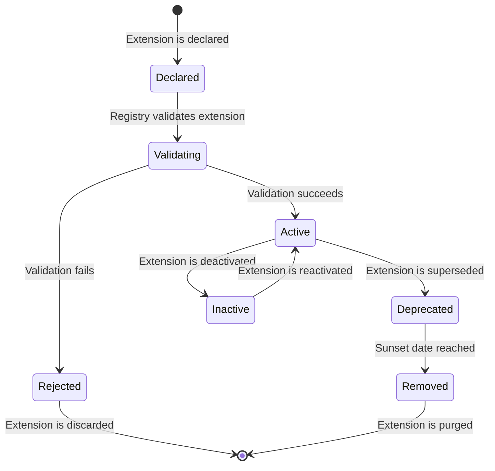

---
title: Workflow Extension Points Reference
category: Workflow
layer: Core
normative: YES
version: 1.0.0
lastUpdated: 2026-07-01
---

# Workflow Extension Points Reference

## Overview

This document defines the extension point reference for the Atlas Development System (ADS) workflow engine. Extension points are the predefined locations in the engine architecture where custom behavior MAY be injected without modifying core engine code. The extension point model enables platform extensibility while preserving system stability and upgrade compatibility.

Extensions MUST conform to the registration model and lifecycle defined herein. Non-conforming extensions are rejected at registration time.

## Extension Point Categories

The workflow engine defines nine extension point categories. Each category corresponds to a distinct area of engine extensibility.

| Extension Point | Category | Registration Type | Lifecycle Scope |
|----------------|----------|------------------|----------------|
| Node Types | Node extension | Static | Engine lifetime |
| Condition Types | Condition extension | Static | Engine lifetime |
| Action Types | Action extension | Static | Engine lifetime |
| Trigger Types | Trigger extension | Static | Engine lifetime |
| Error Handlers | Error extension | Dynamic | Workflow lifetime |
| Recovery Strategies | Recovery extension | Dynamic | Workflow lifetime |
| Serializers | Data extension | Static | Engine lifetime |
| Validators | Validation extension | Static | Engine lifetime |
| Observers | Monitoring extension | Dynamic | Event lifetime |

## Extension Point Definitions

### Node Types Extension Point

Allows registration of custom node types beyond the standard taxonomy.

| Attribute | Type | Description |
|-----------|------|-------------|
| `type_name` | String | Unique name for the custom node type |
| `base_type` | Enum | Standard node type this extends |
| `schema` | Object | Node definition schema for the custom type |
| `executor_ref` | EntityReference | Executor entity for the custom node |
| `capabilities_required` | Array | Capability types required by the custom node |

**Registration Requirements:**
1. The custom node type MUST declare all attributes defined in `workflow-node-types.md`.
2. The executor entity MUST implement the standard node execution interface.
3. The custom type MUST be registered before any workflow using it is parsed.

### Condition Types Extension Point

Allows registration of custom condition types beyond the standard eight types.

| Attribute | Type | Description |
|-----------|------|-------------|
| `type_name` | String | Unique name for the custom condition type |
| `evaluation_engine_ref` | EntityReference | Engine that evaluates the custom condition |
| `operand_types` | Array | Allowed operand types for the custom condition |
| `result_type` | Enum | `Boolean` or `Enum` |

**Registration Requirements:**
1. The custom condition MUST produce a Boolean result (or an Enum that is convertible to Boolean).
2. The evaluation engine MUST be deterministic and side-effect-free.
3. The custom condition MUST declare its operand type requirements.

### Action Types Extension Point

Allows registration of custom action types beyond the standard taxonomy.

| Attribute | Type | Description |
|-----------|------|-------------|
| `type_name` | String | Unique name for the custom action type |
| `base_semantics` | Enum | Semantic category the action belongs to |
| `input_schema` | Object | Required input schema |
| `output_schema` | Object | Produced output schema |
| `lifecycle_hooks` | Array | Lifecycle hook points for the custom action |

**Registration Requirements:**
1. The custom action MUST conform to the action entity reference in `workflow-actions.md`.
2. The action MUST declare its lifecycle hooks for proper integration.
3. The action MUST be compatible with the result type taxonomy.

### Trigger Types Extension Point

Allows registration of custom trigger types beyond the standard eight types.

| Attribute | Type | Description |
|-----------|------|-------------|
| `type_name` | String | Unique name for the custom trigger type |
| `activation_engine_ref` | EntityReference | Engine that evaluates trigger activation |
| `source_type` | Enum | Type of activation source |
| `cooldown` | Duration | Minimum time between activations |

**Registration Requirements:**
1. The custom trigger MUST conform to the trigger entity reference in `workflow-triggers.md`.
2. The activation engine MUST be thread-safe for concurrent trigger evaluation.
3. The cooldown prevents trigger flooding.

### Error Handlers Extension Point

Allows registration of custom error handling strategies.

| Attribute | Type | Description |
|-----------|------|-------------|
| `handler_name` | String | Unique name for the custom error handler |
| `error_categories` | Array | Error categories the handler processes |
| `recovery_ref` | EntityReference | Recovery strategy entity |
| `priority` | Integer | Handler priority among competing handlers |

**Registration Requirements:**
1. The custom handler MUST conform to the error category model in `workflow-errors.md`.
2. The recovery entity MUST implement the standard recovery interface.
3. Handler priority determines invocation order among competing handlers.

### Recovery Strategies Extension Point

Allows registration of custom recovery strategies beyond the standard six types.

| Attribute | Type | Description |
|-----------|------|-------------|
| `strategy_name` | String | Unique name for the custom recovery strategy |
| `strategy_type` | Enum | Category of recovery strategy |
| `guarantee_level` | Enum | `best_effort`, `at_least_once`, or `exactly_once` |
| `checkpoint_required` | Boolean | Whether the strategy requires checkpoints |

**Registration Requirements:**
1. The custom strategy MUST conform to the recovery taxonomy in `workflow-recovery-types.md`.
2. The guarantee level determines the strategy's consistency semantics.
3. Checkpoint requirements are validated at planning time.

### Serializers Extension Point

Allows registration of custom data serializers for variable types.

| Attribute | Type | Description |
|-----------|------|-------------|
| `serializer_name` | String | Unique name for the custom serializer |
| `supported_types` | Array | Variable types the serializer handles |
| `format` | String | Serialization format (e.g., JSON, Protocol Buffers) |
| `compression` | Boolean | Whether compression is applied |

**Registration Requirements:**
1. The custom serializer MUST produce lossless round-trip serialization.
2. The serializer MUST declare all supported variable types.
3. Compression is optional; compressed serializers MUST declare the algorithm.

### Validators Extension Point

Allows registration of custom validation rules beyond the standard eleven rules.

| Attribute | Type | Description |
|-----------|------|-------------|
| `rule_name` | String | Unique name for the custom validation rule |
| `rule_category` | Enum | Category of validation |
| `severity` | Enum | Rule severity: `critical`, `error`, `warning`, or `informational` |
| `evaluation_order` | Integer | Position in the validation sequence |

**Registration Requirements:**
1. The custom validator MUST conform to the validation rule framework in `workflow-validation-rules.md`.
2. The severity determines the impact of rule violations.
3. Evaluation order ensures deterministic validation sequencing.

### Observers Extension Point

Allows registration of custom observation hooks for workflow events.

| Attribute | Type | Description |
|-----------|------|-------------|
| `observer_name` | String | Unique name for the custom observer |
| `event_categories` | Array | Event categories the observer subscribes to |
| `filter` | ConditionEntity | Events filtered by this condition |
| `async` | Boolean | Whether the observer runs asynchronously |

**Registration Requirements:**
1. The custom observer MUST conform to the event model in `workflow-events.md`.
2. Async observers do not block the event emission path.
3. Filters reduce the event volume received by the observer.

## Extension Registration Model

Extensions are registered through a centralized registry that enforces schema compliance and conflict detection.

### Registration Process

1. **Declaration**: The extension declares its type, schema, and dependencies.
2. **Validation**: The registry validates the extension against the target extension point's schema.
3. **Conflict Detection**: The registry checks for name collisions and compatibility conflicts.
4. **Indexing**: The extension is indexed for runtime lookup.
5. **Activation**: The extension becomes available for workflow use.

### Registration Attributes

| Attribute | Type | Required | Description |
|-----------|------|----------|-------------|
| `extension_id` | String | YES | Unique extension identifier |
| `extension_point` | Enum | YES | The extension point being registered |
| `name` | String | YES | Human-readable extension name |
| `version` | String | YES | Semantic version of the extension |
| `schema` | Object | YES | Extension-specific schema definition |
| `dependencies` | Array | NO | Extensions this extension depends on |
| `status` | Enum | YES | `active`, `inactive`, or `deprecated` |

### Conflict Resolution

| Conflict Type | Resolution Strategy |
|--------------|-------------------|
| Name collision | Registration rejected; name must be unique |
| Version incompatibility | Registration rejected; versions must be compatible |
| Dependency missing | Registration deferred until dependency is available |
| Schema violation | Registration rejected with validation error details |

## Extension Lifecycle

Extensions transition through a well-defined lifecycle.

### Lifecycle States

| State | Description | Transitions |
|-------|-------------|------------|
| `Declared` | Extension has been submitted for registration | `Validating`, `[*]` |
| `Validating` | Extension is undergoing schema validation | `Active`, `Rejected` |
| `Active` | Extension is registered and available | `Inactive`, `Deprecated` |
| `Inactive` | Extension is temporarily disabled | `Active` |
| `Deprecated` | Extension is scheduled for removal | `Removed` |
| `Rejected` | Extension failed validation | `[*]` |
| `Removed` | Extension has been purged | `[*]` |

### Lifecycle Management

| Operation | Description | Effect |
|-----------|-------------|--------|
| Register | Submit extension for registration | Transition: Declared -> Validating |
| Activate | Enable an inactive extension | Transition: Inactive -> Active |
| Deactivate | Disable an active extension | Transition: Active -> Inactive |
| Deprecate | Mark extension for future removal | Transition: Active -> Deprecated |
| Remove | Purge a deprecated extension | Transition: Deprecated -> Removed |
| Validate | Re-validate an active extension | No state change; schema re-checked |

## Extension Versioning

Extensions are versioned independently using the scheme defined in `workflow-versioning.md`.

### Version Constraints

1. Extensions MUST declare the minimum engine version they require.
2. Extensions MAY declare compatibility ranges for their dependencies.
3. Major version changes in extensions require engine restart.
4. Minor and patch version changes are hot-reloadable.

### Extension Compatibility

| Extension Version | Engine Version | Compatible |
|------------------|---------------|-----------|
| 1.x.x | 1.x.x | YES |
| 1.x.x | 2.x.x | NO (requires engine upgrade) |
| 2.x.x | 1.x.x | NO (requires engine upgrade) |
| 1.y.x | 1.x.x | YES (minor compatible) |
| 1.x.z | 1.x.x | YES (patch compatible) |
