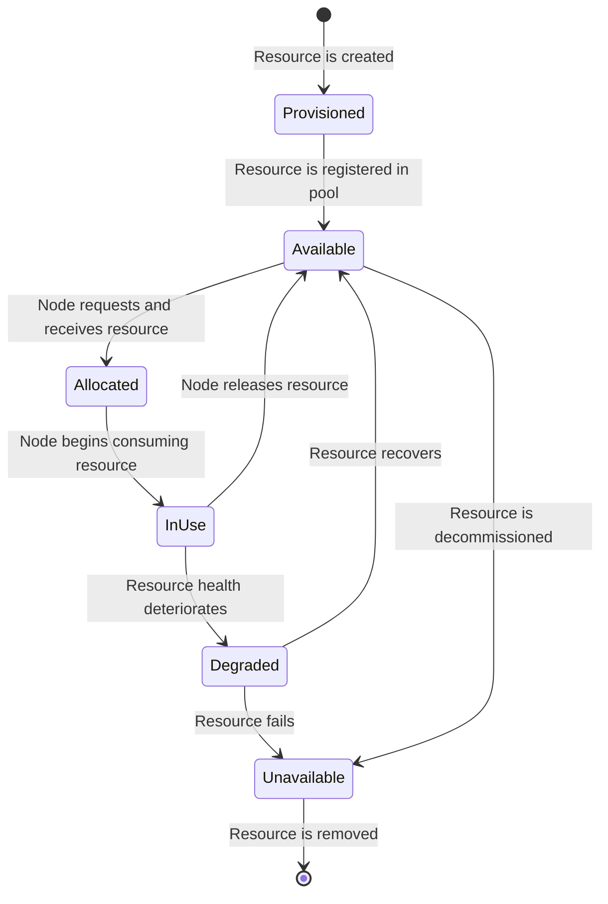

---
title: Workflow Resource Types Taxonomy
category: Workflow
layer: Core
normative: YES
version: 1.0.0
lastUpdated: 2026-07-01
---

# Workflow Resource Types Taxonomy

## Overview

This document defines the resource type taxonomy for the Atlas Development System (ADS) workflow engine. Resources are the consumable assets that workflow nodes require to perform their operations. The resource model provides a unified abstraction for hardware, software, and service capacities.

Resources MUST be treated as abstract entities. Concrete resource provisioning is implementation-defined, but the resource type structure and allocation rules described herein are normative.

## Resource Type Categories

The workflow engine defines six resource types. Each type represents a distinct category of consumable capacity.

| Resource Type | Unit of Measurement | Allocation Granularity | Replenishable |
|--------------|--------------------|----------------------|--------------|
| CPU | Processor cycles | Per node | Yes |
| Memory | Bytes | Per action | Yes |
| Disk | Storage blocks | Per storage node | No (until freed) |
| Network | Bytes transferred | Per edge | Yes |
| GPU | Processing cores | Per compute node | Yes |
| Custom | Application-defined | Per resource pool | Depends on type |

## Detailed Resource Type Definitions

### CPU

Processor capacity for computational workloads.

| Attribute | Type | Description |
|-----------|------|-------------|
| `total_cycles` | Integer | Total available processor cycles |
| `used_cycles` | Integer | Cycles currently consumed |
| `frequency` | Float | Processor frequency in gigahertz |
| `core_count` | Integer | Number of processing cores |
| `thread_count` | Integer | Number of hardware threads |
| `affinity` | Array | Processor core affinity mask |
| `governor` | Enum | Power management mode: `performance`, `balanced`, `powersave` |

| Constraint | Description |
|------------|-------------|
| Overcommit | CPU overcommitment is configurable; default is disabled |
| Burst | Short-duration CPU bursts above the committed level are permitted |
| Throttling | Nodes exceeding their CPU allocation are throttled, not preempted |

### Memory

Random-access memory for data storage during execution.

| Attribute | Type | Description |
|-----------|------|-------------|
| `total_bytes` | Integer | Total available memory |
| `used_bytes` | Integer | Memory currently consumed |
| `swap_available` | Boolean | Whether swap space is available |
| `swap_bytes` | Integer | Available swap space |
| `cache_bytes` | Integer | Memory reserved for caching |
| `allocation_policy` | Enum | `best_fit`, `first_fit`, or `worst_fit` |

| Constraint | Description |
|------------|-------------|
| OOM | Nodes exceeding memory limits are terminated with a Resource error |
| Fragmentation | Memory fragmentation is tracked; defragmentation MAY be triggered |
| Sharing | Memory MAY be shared between nodes with compatible access patterns |

### Disk

Persistent storage capacity for data at rest.

| Attribute | Type | Description |
|-----------|------|-------------|
| `total_blocks` | Integer | Total available storage blocks |
| `used_blocks` | Integer | Blocks currently allocated |
| `block_size` | Integer | Size of each block in bytes |
| `iops_limit` | Integer | Maximum input/output operations per second |
| `throughput_mbps` | Float | Maximum sequential throughput |
| `mount_point` | String | Filesystem mount point reference |
| `fs_type` | String | Filesystem type |

| Constraint | Description |
|------------|-------------|
| Durability | Writes are durable across node failures |
| Quota | Per-workflow disk quotas are enforced |
| Encryption | Encryption-at-rest is configurable per resource pool |

### Network

Communication bandwidth for data transfer between nodes.

| Attribute | Type | Description |
|-----------|------|-------------|
| `bandwidth_mbps` | Float | Total available bandwidth |
| `used_bandwidth_mbps` | Float | Bandwidth currently consumed |
| `latency_ms` | Float | Network latency |
| `packet_loss_rate` | Float | Observed packet loss rate |
| `protocols` | Array | Supported network protocols |
| `encryption` | Boolean | Whether network traffic is encrypted |

| Constraint | Description |
|------------|-------------|
| Congestion | Congested networks trigger backpressure, not drops |
| QoS | Quality-of-service classes are configurable per edge |
| Isolation | Network namespaces isolate workflow traffic |

### GPU

Graphics processing unit capacity for parallel and AI workloads.

| Attribute | Type | Description |
|-----------|------|-------------|
| `total_cores` | Integer | Total available GPU cores |
| `used_cores` | Integer | Cores currently allocated |
| `memory_gb` | Float | GPU memory capacity |
| `compute_capability` | String | Hardware compute capability version |
| `precision_modes` | Array | Supported precision modes: `float32`, `float16`, `int8` |
| `nvlink` | Boolean | Whether NVLink interconnect is available |

| Constraint | Description |
|------------|-------------|
| Preemption | GPU allocations are non-preemptive; nodes wait for release |
| Sharing | Time-sliced GPU sharing is configurable |
| Cooling | Thermal limits are monitored; overheating triggers throttling |

### Custom

Application-defined resource types for domain-specific capacities.

| Attribute | Type | Description |
|-----------|------|-------------|
| `type_name` | String | Unique custom resource type name |
| `unit` | String | Unit of measurement |
| `total` | Float | Total available quantity |
| `used` | Float | Currently consumed quantity |
| `schema` | Object | Custom attribute schema definition |
| `allocator` | EntityReference | Custom allocator algorithm reference |

| Constraint | Description |
|------------|-------------|
| Validation | Custom resources MUST pass schema validation |
| Discovery | Custom resources are registered through the extension point system |
| Monitoring | Custom resources are included in metrics collection |

## Resource Attributes

All resource types share the following common attributes:

| Attribute | Type | Description |
|-----------|------|-------------|
| `id` | String | Unique resource identifier |
| `type` | Enum | One of the six resource types |
| `pool_id` | String | Resource pool to which this resource belongs |
| `capacity` | Float | Total available capacity |
| `allocated` | Float | Currently allocated capacity |
| `reserved` | Float | Capacity reserved for specific workflows |
| `utilization` | Float | Current utilization as a fraction of capacity |
| `health` | Enum | `healthy`, `degraded`, or `unhealthy` |
| `tags` | Array | Metadata tags for classification |
| `metadata` | Object | Arbitrary key-value pairs |

## Resource Constraints

Resources are subject to constraints that govern their allocation and usage.

### Constraint Types

| Constraint | Type | Description |
|-----------|------|-------------|
| `max_allocation` | Float | Maximum allocatable quantity |
| `min_reservation` | Float | Minimum reserved quantity |
| `burst_limit` | Float | Maximum short-term over-allocation |
| `quota` | Float | Per-workflow usage quota |
| `priority_floor` | Float | Minimum guaranteed allocation |
| `preemption_eligible` | Boolean | Whether this resource may be preempted |
| `affinity_group` | String | Resource affinity group identifier |

### Constraint Enforcement

1. Constraints are enforced at allocation time. Requests exceeding constraints are rejected.
2. Runtime utilization is monitored; sustained over-utilization triggers throttling.
3. Quota violations cause the offending workflow to enter a resource-constrained state.
4. Constraint changes are applied atomically; partial updates are rolled back.

## Resource Allocation Rules

Resource allocation follows a deterministic set of rules that ensure fairness and predictability.

### Allocation Algorithm

1. **Request**: A node declares its resource requirements in its definition.
2. **Matching**: The allocator searches resource pools for resources satisfying the requirements.
3. **Ranking**: Matching resources are ranked by utilization, proximity, and priority.
4. **Assignment**: The highest-ranked resource is assigned to the node.
5. **Reservation**: Allocated capacity is reserved for the node's lifetime.
6. **Release**: Capacity is released when the node reaches a terminal state.

### Allocation Strategies

| Strategy | Description | Use Case |
|----------|-------------|----------|
| Greedy | Allocate the first available resource | Low-contention environments |
| Best-Fit | Allocate the resource with the least excess capacity | High-utilization environments |
| First-Fit | Allocate the first resource that meets requirements | Predictable allocation patterns |
| Worst-Fit | Allocate the resource with the most excess capacity | Load balancing across pools |
| Spread | Distribute allocations across available resources | Fault tolerance |

### Resource Pooling

Resources are organized into pools for collective management.

| Pool Attribute | Type | Description |
|---------------|------|-------------|
| `id` | String | Unique pool identifier |
| `resource_types` | Array | Types of resources in the pool |
| `allocation_strategy` | Enum | Strategy used for this pool |
| `overflow_policy` | Enum | `reject`, `queue`, or `borrow` |
| `cross_pool_borrowing` | Boolean | Whether resources may be borrowed from other pools |

### Allocation Guarantees

| Guarantee | Description |
|-----------|-------------|
| Bounded Wait | Allocation requests complete within a bounded time |
| Fair Share | No workflow monopolizes shared resources |
| Isolation | Allocated resources are exclusive to the allocating node |
| Predictability | Given the same resource state, allocation results are deterministic |

## Resource Lifecycle

### Lifecycle States

| State | Description | Transitions |
|-------|-------------|------------|
| `Provisioned` | Resource is physically or logically created | `Available`, `Unavailable` |
| `Available` | Resource is registered and ready for allocation | `Allocated`, `Unavailable` |
| `Allocated` | Resource is assigned to a node | `InUse` |
| `InUse` | Resource is actively consumed by a node | `Available`, `Degraded` |
| `Degraded` | Resource health has deteriorated | `Available`, `Unavailable` |
| `Unavailable` | Resource is removed from service | `[*]` |

## Resource Monitoring

Resources are monitored for the following metrics:

| Metric | Collection Method | Reporting Interval |
|--------|------------------|-------------------|
| Utilization | Ratio of used to total capacity | Per allocation event |
| Allocation Rate | New allocations per time unit | Per reporting interval |
| Release Rate | Released allocations per time unit | Per reporting interval |
| Contention | Number of blocked allocation requests | Per reporting interval |
| Health | Diagnostic checks | Per health-check interval |

Resource metrics feed into the workflow metrics system defined in `workflow-metrics.md` and are exposed through the observability pillars defined in `workflow-observability.md`.
