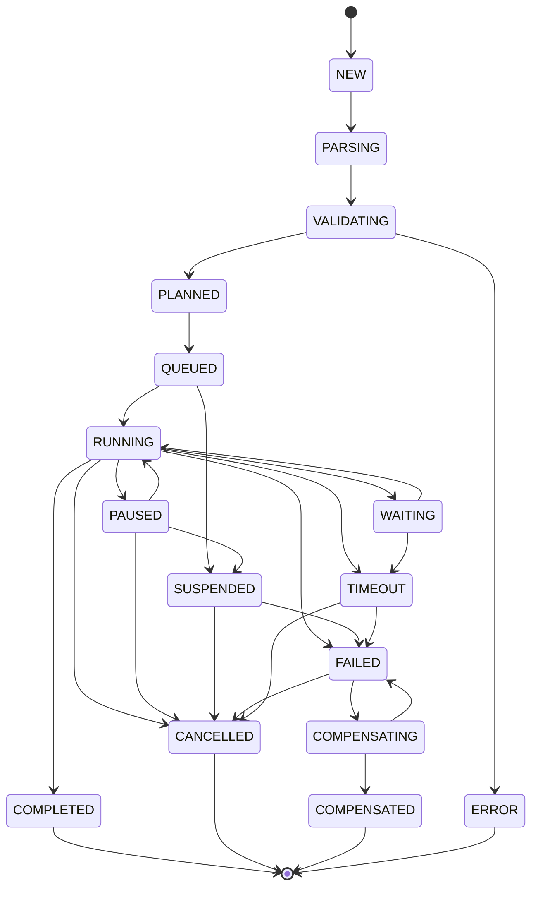

---
title: Workflow Status Reference
category: Workflow
layer: Core
normative: YES
version: 1.0.0
lastUpdated: 2026-07-01
---

# Workflow Status Reference

## Overview

This document defines the status reference for the Atlas Development System (ADS) workflow engine. Status codes provide a standardized, machine-readable representation of workflow and node execution states. Statuses are distinct from states defined in `workflow-state-types.md`; statuses are the observable reporting format, while states are the internal lifecycle conditions.

Statuses MUST be stable across engine versions. New statuses MAY be added but MUST NOT alter the meaning of existing statuses. Status transitions are deterministic and governed by the state machine defined in `workflow-lifecycle.md`.

## Status Codes

The workflow engine defines the following status codes. Each code is a three-character alphanumeric identifier.

| Status Code | Symbol | Meaning | Category |
|-------------|--------|---------|----------|
| `NEW` | N/A | Workflow or node has been created but not yet started | Creation |
| `PARSING` | P | Manifest is being parsed | Parsing |
| `VALIDATING` | V | Workflow is undergoing validation | Validation |
| `PLANNED` | PL | Execution plan has been built | Planning |
| `RUNNING` | R | Workflow or node is actively executing | Execution |
| `WAITING` | W | Workflow or node is blocked on an external event | Execution |
| `PAUSED` | PA | Workflow execution has been voluntarily paused | Suspension |
| `SUSPENDED` | S | Workflow execution has been forcibly stopped | Suspension |
| `COMPLETED` | OK | Workflow or node has completed successfully | Completion |
| `FAILED` | FAIL | Workflow or node has terminated with an error | Failure |
| `CANCELLED` | CANC | Workflow or node has been explicitly cancelled | Termination |
| `TIMEOUT` | TO | Workflow or node has exceeded its timeout | Failure |
| `COMPENSATING` | COMP | Compensation is in progress | Recovery |
| `COMPENSATED` | COK | Compensation completed successfully | Recovery |
| `SKIPPED` | SKIP | Action was bypassed by conditional logic | Completion |
| `PARTIAL` | PART | Action completed with incomplete output | Partial |
| `QUEUED` | Q | Workflow is waiting for scheduling resources | Execution |
| `ERROR` | ERR | A processing error occurred | Error |

## Status Meanings

Each status code carries a specific semantic meaning that determines engine behavior.

### Creation Statuses

| Status | Description | Engine Behavior |
|--------|-------------|----------------|
| `NEW` | Workflow entity exists but has not been processed | Engine queues for parsing |
| `PARSING` | Manifest is being deserialized | Engine blocks further input |
| `VALIDATING` | Manifest is being validated | Engine blocks execution |
| `PLANNED` | Execution plan is ready | Engine queues for scheduling |

### Execution Statuses

| Status | Description | Engine Behavior |
|--------|-------------|----------------|
| `RUNNING` | Actively executing | Engine monitors progress |
| `WAITING` | Blocked on external trigger | Engine holds resources |
| `QUEUED` | Waiting for scheduling | Engine waits for resources |

### Suspension Statuses

| Status | Description | Engine Behavior |
|--------|-------------|----------------|
| `PAUSED` | Voluntarily suspended | Resources held; no execution |
| `SUSPENDED` | Forcibly stopped | Resources may be released |

### Completion Statuses

| Status | Description | Engine Behavior |
|--------|-------------|----------------|
| `COMPLETED` | Successfully finished | Workflow enters completion phase |
| `SKIPPED` | Bypassed by condition | No further action required |
| `PARTIAL` | Incomplete success | Downstream nodes check tolerance |

### Failure Statuses

| Status | Description | Engine Behavior |
|--------|-------------|----------------|
| `FAILED` | Terminated with error | Error handling initiated |
| `TIMEOUT` | Exceeded time budget | Timeout action applied |
| `ERROR` | Processing error | Diagnostic collection initiated |

### Recovery Statuses

| Status | Description | Engine Behavior |
|--------|-------------|----------------|
| `COMPENSATING` | Reversing prior actions | Compensation in progress |
| `COMPENSATED` | Reversal complete | Workflow proceeds or terminates |

### Termination Statuses

| Status | Description | Engine Behavior |
|--------|-------------|----------------|
| `CANCELLED` | Explicitly terminated | Cleanup initiated |

## Status Transitions

Status transitions follow a directed graph that mirrors the lifecycle state machine.

### Workflow Status Transitions

### Node Status Transitions

| From Status | To Status | Condition |
|------------|-----------|-----------|
| `NEW` | `RUNNING` | Node is scheduled |
| `NEW` | `SKIPPED` | Condition evaluates to skip |
| `RUNNING` | `COMPLETED` | Action succeeds |
| `RUNNING` | `FAILED` | Action fails with unhandled error |
| `RUNNING` | `WAITING` | Action blocks on external event |
| `RUNNING` | `PARTIAL` | Action completes partially |
| `RUNNING` | `TIMEOUT` | Action exceeds timeout |
| `RUNNING` | `CANCELLED` | Workflow is cancelled |
| `WAITING` | `RUNNING` | External event received |
| `WAITING` | `TIMEOUT` | Wait timeout elapses |
| `PAUSED` | `RUNNING` | Resume requested |
| `PAUSED` | `CANCELLED` | Cancellation during pause |
| `SUSPENDED` | `CANCELLED` | Administrative termination |
| `SUSPENDED` | `FAILED` | Suspension cannot be resolved |
| `COMPENSATING` | `COMPENSATED` | All compensations succeed |
| `COMPENSATING` | `FAILED` | Any compensation fails |

## Status Reporting Format

Statuses are reported through a standardized format that enables consistent consumption by monitoring systems.

### Report Structure

| Field | Type | Description |
|-------|------|-------------|
| `entity_id` | String | ID of the workflow or node |
| `entity_type` | Enum | `workflow` or `node` |
| `status_code` | String | Three-character status code |
| `status_meaning` | String | Human-readable status description |
| `entered_at` | Timestamp | Time when the status was entered |
| `previous_status` | String | Status code before the transition |
| `duration_in_status` | Duration | Time spent in the current status |
| `metadata` | Object | Additional status-specific data |

### Report Delivery

| Channel | Frequency | Use Case |
|---------|----------|----------|
| Event stream | Per status change | Real-time monitoring |
| REST API | On-demand | Status queries |
| WebSocket | Continuous | Dashboard updates |
| Audit log | Per terminal status | Compliance |

## Status Aggregation Rules

Statuses aggregate from nodes to workflows according to well-defined rules.

### Aggregation Logic

| Workflow Status | Node Status Conditions |
|----------------|----------------------|
| `RUNNING` | At least one node is `RUNNING` or `WAITING`; no node is `FAILED`, `CANCELLED`, or `TIMEOUT` |
| `COMPLETED` | All nodes are `COMPLETED`, `SKIPPED`, or `PARTIAL` |
| `FAILED` | At least one node is `FAILED` and no on-error hook handled it |
| `CANCELLED` | At least one node is `CANCELLED` and cancellation propagated |
| `PARTIAL` | At least one node is `PARTIAL`; no node is `FAILED` or `TIMEOUT` |
| `TIMEOUT` | At least one node is `TIMEOUT` and timeout action is `fail` |
| `COMPENSATING` | At least one node is `COMPENSATING` |
| `COMPENSATED` | All compensable nodes are `COMPENSATED` |
| `QUEUED` | All nodes are `NEW`; workflow is waiting for scheduling |

### Aggregation Precedence

1. Terminal statuses (`COMPLETED`, `FAILED`, `CANCELLED`) take precedence over non-terminal statuses.
2. Among non-terminal statuses, `RUNNING` takes precedence over `WAITING` and `QUEUED`.
3. `PARTIAL` takes precedence over `RUNNING` only when the workflow manifest declares partial tolerance.
4. `TIMEOUT` and `COMPENSATING` are treated as non-terminal; they resolve to terminal statuses based on their outcomes.

## Status Code Registry

The status code registry is the authoritative source for all status codes. Changes to the registry follow these rules:

1. **Adding Codes**: New codes are added by updating the registry; existing codes are unaffected.
2. **Deprecating Codes**: Codes are deprecated, not removed; deprecated codes retain their meaning.
3. **Renaming Codes**: Codes are never renamed; aliases are used for backward compatibility.
4. **Meaning Changes**: Status meanings are never changed; new codes are introduced for new semantics.

### Registry Maintenance

| Activity | Frequency | Responsible Party |
|----------|----------|------------------|
| Code addition | As needed | Engine maintainers |
| Deprecation notice | At deprecation | Engine maintainers |
| Meaning audit | Per major version | Engine maintainers |
| Consumer compatibility check | Per engine release | Consumer teams |
