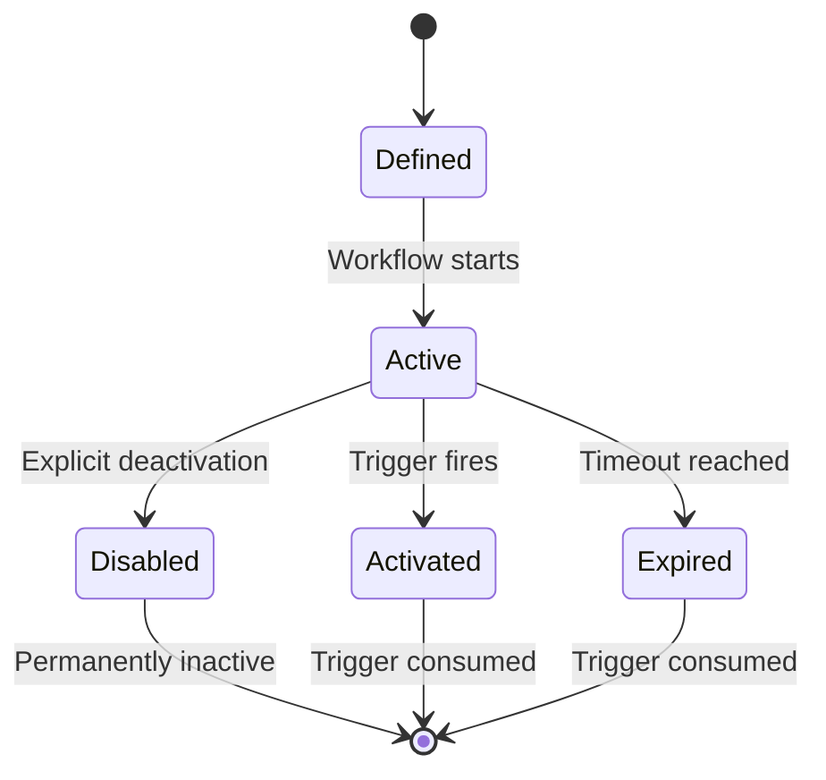

---
title: Workflow Triggers Entity Reference
category: Workflow
layer: Core
normative: YES
version: 1.0.0
lastUpdated: 2026-07-01
---

# Workflow Triggers Entity Reference

## Overview

This document defines the trigger entity reference for the Atlas Development System (ADS) workflow engine. Triggers are the activation mechanisms that cause workflow nodes, edges, and entire workflows to begin execution. Triggers decouple the condition for execution from the execution itself, enabling reactive, scheduled, and event-driven workflow orchestration.

Triggers MUST be treated as abstract activation predicates. They declare WHEN and UNDER WHAT CONDITIONS execution begins, but NOT HOW execution proceeds. The how is determined by the target node and the execution plan.

## Trigger Types

The workflow engine defines eight trigger types. Each type represents a distinct activation mechanism.

| Trigger Type | Activation Basis | Typical Use Case | Latency |
|-------------|-----------------|------------------|---------|
| Event | Receipt of a specific event | Event-driven workflows | Low |
| Schedule | Calendar or recurring time | Periodic workflows | Deterministic |
| Manual | Human operator action | Human-in-the-loop workflows | Variable |
| Dependency | Satisfaction of upstream nodes | DAG execution | Zero |
| Data | Availability or change of data | Data-driven workflows | Low |
| External | Signal from outside the engine | Integration workflows | Variable |
| Composite | Combination of multiple triggers | Complex activation logic | Low |
| Timer | Elapsed time since reference point | Delayed execution | Zero |

### Event Trigger

Activated by the arrival of a specific event in the event stream.

| Attribute | Type | Description |
|-----------|------|-------------|
| `event_type` | String | Category of event that activates the trigger |
| `event_filter` | Object | Predicate that filters events |
| `event_source` | EntityReference | Origin of the triggering event |
| `deduplication_window` | Duration | Window for deduplicating identical events |

**Activation Rules:**
1. The engine monitors the event stream for matching events.
2. When an event matches the type and filter, the trigger activates.
3. Deduplication prevents multiple activations from identical events within the window.
4. Events that arrive before the target node is ready are queued.

### Schedule Trigger

Activated by a calendar schedule or recurring time pattern.

| Attribute | Type | Description |
|-----------|------|-------------|
| `schedule_type` | Enum | `cron`, `interval`, or `absolute` |
| `schedule_expression` | String | Cron expression, interval, or absolute time |
| `timezone` | String | Timezone for schedule interpretation |
| `max_lateness` | Duration | Maximum allowable delay from scheduled time |

**Activation Rules:**
1. The engine evaluates the schedule expression against the current time.
2. When the expression matches, the trigger activates.
3. Lateness is tracked; activations beyond max_lateness are flagged.
4. Missed schedules (engine downtime) are not retroactively activated.

### Manual Trigger

Activated by a human operator's explicit action.

| Attribute | Type | Description |
|-----------|------|-------------|
| `operator_ref` | EntityReference | Authorized operator |
| `approval_required` | Boolean | Whether explicit approval is needed |
| `timeout` | Duration | Time before the trigger expires |
| `fallback_action` | Enum | Action on timeout: `activate`, `skip`, or `fail` |

**Activation Rules:**
1. The trigger waits for an operator action.
2. The operator must have the permissions defined in `workflow-permissions.md`.
3. If the operator action arrives before timeout, the trigger activates.
4. If the timeout elapses, the fallback_action is applied.

### Dependency Trigger

Activated when all upstream dependency nodes reach a specified state.

| Attribute | Type | Description |
|-----------|------|-------------|
| `dependency_nodes` | Array | IDs of upstream nodes |
| `required_states` | Array | States that satisfy the dependency |
| `evaluation_mode` | Enum | `all` or `any` of the dependencies |

**Activation Rules:**
1. The engine monitors the states of all dependency nodes.
2. When the required condition is met, the trigger activates.
3. Dependency triggers are the primary mechanism for DAG execution ordering.
4. Circular dependencies are detected at validation time.

### Data Trigger

Activated by the availability or change of data entity references.

| Attribute | Type | Description |
|-----------|------|-------------|
| `data_source` | EntityReference | Source of the triggering data |
| `change_type` | Enum | `arrival`, `update`, or `deletion` |
| `data_condition` | ConditionEntity | Predicate that data must satisfy |
| `schema_requirement` | Object | Schema that data must conform to |

**Activation Rules:**
1. The engine monitors the data source for changes.
2. When a change occurs, the data_condition is evaluated.
3. If the condition is satisfied and the schema requirement is met, the trigger activates.
4. Data triggers support both push and pull monitoring modes.

### External Trigger

Activated by a signal from outside the workflow engine.

| Attribute | Type | Description |
|-----------|------|-------------|
| `external_source` | EntityReference | External system sending the signal |
| `signal_format` | String | Expected signal format |
| `authentication` | EntityReference | Credentials for signal verification |
| `response_action` | Enum | Action upon signal receipt |

**Activation Rules:**
1. The engine listens for signals from the declared external source.
2. Signals are authenticated using the declared credentials.
3. Upon successful authentication, the trigger activates.
4. Unauthenticated or malformed signals are rejected with an error.

### Composite Trigger

Activated by a logical combination of multiple trigger types.

| Attribute | Type | Description |
|-----------|------|-------------|
| `component_triggers` | Array | IDs of constituent triggers |
| `logic` | Enum | `AND`, `OR`, or `XOR` |
| `timeout` | Duration | Maximum wait for all components |
| `partial_activation` | Boolean | Whether partial component satisfaction activates |

**Activation Rules:**
1. All component triggers are monitored concurrently.
2. The logic determines which combination of component activations causes composite activation.
3. AND logic requires all components to activate.
4. OR logic activates on the first component activation.
5. XOR logic activates when exactly one component activates.

### Timer Trigger

Activated by the passage of a specified duration since a reference point.

| Attribute | Type | Description |
|-----------|------|-------------|
| `duration` | Duration | Time to wait before activation |
| `reference_point` | Enum | `workflow_start`, `node_entry`, or `explicit_timestamp` |
| `reference_value` | EntityReference | Reference value for explicit mode |
| `repeat` | Boolean | Whether the timer repeats |
| `repeat_interval` | Duration | Interval for repeated timers |

**Activation Rules:**
1. The engine starts the timer at the reference point.
2. When the duration elapses, the trigger activates.
3. Repeating timers reset after each activation.
4. Timer triggers are independent of node state; they activate regardless of readiness.

## Trigger Attributes

Every trigger instance possesses the following attributes:

| Attribute | Type | Required | Description |
|-----------|------|----------|-------------|
| `id` | String | YES | Unique trigger identifier |
| `type` | Enum | YES | One of the eight trigger types |
| `target` | EntityReference | YES | Node, edge, or workflow activated by this trigger |
| `enabled` | Boolean | NO | Whether the trigger is active (default: true) |
| `priority` | Integer | NO | Activation priority among competing triggers |
| `condition` | EntityReference | NO | Additional condition that must evaluate to true |
| `metadata` | Object | NO | Arbitrary metadata |

## Trigger Activation Rules

Triggers activate according to the following universal rules:

1. **Precedence**: Among competing triggers for the same target, the highest-priority trigger activates first.
2. **Mutual Exclusion**: If a target is already activated by one trigger, competing triggers are suppressed.
3. **Ordering**: Dependency triggers activate before timer triggers for the same target.
4. **Idempotency**: Repeated activation of the same trigger is a no-op.
5. **Suppression**: Enabled = false suppresses all activation attempts.

## Trigger Lifecycle States

Triggers transition through the following lifecycle states:

| State | Description | Transitions |
|-------|-------------|------------|
| `Defined` | Trigger is declared but not yet active | `Active`, `Disabled` |
| `Active` | Trigger is monitoring for activation | `Activated`, `Disabled`, `Expired` |
| `Activated` | Trigger has fired and activated its target | `[*]` |
| `Disabled` | Trigger is deactivated | `Active`, `[*]` |
| `Expired` | Trigger's timeout elapsed without activation | `[*]` |

## Trigger Registration

Triggers are registered with the engine through the following process:

1. **Declaration**: Triggers are declared in the workflow manifest or node definition.
2. **Validation**: The engine validates trigger references, conditions, and compatibility.
3. **Indexing**: The engine indexes triggers by target and type for efficient lookup.
4. **Monitoring**: Active triggers begin monitoring their activation conditions.
5. **Firing**: Upon activation, the trigger signals the target node to begin execution.

Trigger registration is subject to the extension point system defined in `workflow-extension-points.md` for custom trigger types.
