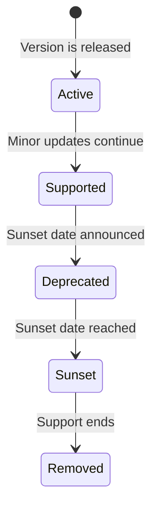

---
title: Workflow Versioning Reference
category: Workflow
layer: Core
normative: YES
version: 1.0.0
lastUpdated: 2026-07-01
---

# Workflow Versioning Reference

## Overview

This document defines the versioning reference for the Atlas Development System (ADS) workflow engine. Versioning provides a standardized scheme for managing the evolution of workflow definitions, entity schemas, and interface contracts across their lifetimes. The versioning model ensures backward compatibility, enables safe migrations, and supports long-term system stability.

All versioned entities in the workflow engine follow the semantic versioning scheme defined herein. Version numbers are immutable once assigned; modifications produce new version numbers.

## Semantic Versioning Scheme

The workflow engine uses a three-component semantic versioning scheme: Major.Minor.Patch.

| Component | Increment Condition | Compatibility Impact |
|-----------|-------------------|---------------------|
| Major | Breaking changes to the entity contract | Incompatible with previous major version |
| Minor | New features or attributes added | Backward-compatible with previous minor versions |
| Patch | Bug fixes or corrections to existing behavior | Fully compatible; no behavioral change |

### Version Format

The version string follows the pattern: `MAJOR.MINOR.PATCH`

Examples:
- `1.0.0` - Initial release
- `1.1.0` - Minor feature addition
- `1.1.1` - Patch correction
- `2.0.0` - Major breaking change

### Pre-release and Build Metadata

Versions MAY include pre-release and build metadata for development tracking:

| Component | Format | Example |
|-----------|--------|---------|
| Pre-release | Hyphen-separated identifiers | `1.0.0-alpha.1` |
| Build metadata | Plus-separated identifiers | `1.0.0+build.123` |

Pre-release versions MUST sort before the associated normal version. Build metadata is ignored for version comparison.

## Version Compatibility Rules

Version compatibility determines whether two versions of an entity can interoperate.

### Compatibility Matrix

| Consumer Version | Provider Version | Compatible | Migration Required |
|-----------------|-----------------|-----------|-------------------|
| 1.x.x | 1.x.x | YES | NO |
| 1.x.x | 1.(y).x where y > x | YES | NO |
| 1.x.x | 2.x.x | NO | YES |
| 1.x.x | 0.x.x | NO | YES |
| 0.x.x | 1.x.x | NO | YES |

### Compatibility Principles

1. **Backward Compatibility**: A newer provider version MUST accept requests from an older consumer version.
2. **Forward Compatibility**: An older provider version MUST ignore fields it does not understand from a newer consumer version.
3. **Symmetric Compatibility**: Both directions (consumer-to-provider and provider-to-consumer) MUST be compatible for full interoperability.
4. **Transitive Compatibility**: If A is compatible with B, and B is compatible with C, then A is compatible with C.

## Version Migration Strategies

When upgrading between incompatible versions, the following migration strategies are available.

### Strategy 1: Big Bang

All entities are migrated simultaneously to the new version.

| Attribute | Description |
|-----------|-------------|
| Risk | High; downtime required during migration |
| Complexity | Low; single migration event |
| Rollback | Full rollback to previous version is possible |
| Use Case | Small-scale deployments with acceptable downtime |

### Strategy 2: Parallel Run

Both old and new versions run concurrently during transition.

| Attribute | Description |
|-----------|-------------|
| Risk | Low; old version remains as fallback |
| Complexity | High; dual-version management required |
| Rollback | Instant rollback to old version |
| Use Case | Large-scale deployments requiring zero downtime |

### Strategy 3: Strangler Fig

Entities are migrated incrementally, one at a time.

| Attribute | Description |
|-----------|-------------|
| Risk | Low; each entity migrates independently |
| Complexity | Medium; migration ordering must be managed |
| Rollback | Per-entity rollback is possible |
| Use Case | Gradual transitions with complex dependency graphs |

### Strategy 4: Adapter Pattern

An adapter layer translates between old and new versions.

| Attribute | Description |
|-----------|-------------|
| Risk | Low; adapter handles incompatibilities |
| Complexity | Medium; adapter must cover all incompatibilities |
| Rollback | Adapter can revert to old format |
| Use Case | Long transition periods with mixed-version environments |

## Version Deprecation Policy

Versions follow a structured deprecation lifecycle.

### Deprecation Lifecycle

### Deprecation Timeline

| Phase | Duration | Actions |
|-------|----------|---------|
| Active | Indefinite | Full support; all features available |
| Supported | Indefinite | Bug fixes only; no new features |
| Deprecated | 2 major releases | Migration guide published; warnings emitted |
| Sunset | End of deprecated phase | Support ends; entities using deprecated version are blocked |
| Removed | After sunset | Version is purged from the system |

### Deprecation Notices

Deprecation notices include:

1. The deprecated version range.
2. The replacement version.
3. A detailed changelog of breaking differences.
4. A migration guide with step-by-step instructions.
5. The sunset date for the deprecated version.
6. Contact information for migration support.

## Version Selection Rules

When multiple versions of an entity are available, the engine selects the appropriate version using the following rules.

### Selection Algorithm

1. **Exact Match**: If an exact version match exists, it is selected.
2. **Compatible Range**: If no exact match exists, the highest compatible version within the declared range is selected.
3. **Latest Minor**: If multiple minor versions are compatible, the latest minor version is selected.
4. **Latest Patch**: If multiple patch versions are compatible, the latest patch version is selected.
5. **Fallback**: If no compatible version exists, the engine reports a VersionMismatch error per `workflow-errors.md`.

### Version Range Declaration

Entities MAY declare acceptable version ranges using the following syntax:

| Syntax | Meaning | Example |
|--------|---------|---------|
| `=` | Exact version | `=1.2.3` matches only 1.2.3 |
| `>=` | Minimum version | `>=1.0.0` matches 1.0.0 and above |
| `<=` | Maximum version | `<=2.0.0` matches up to 2.0.0 |
| `^` | Compatible major | `^1.2.0` matches 1.x.x where x >= 2 |
| `~` | Compatible minor | `~1.2.0` matches 1.2.x |
| Range | Inclusive range | `>=1.0.0, <=2.0.0` |

### Version Pinning

Specific versions MAY be pinned to prevent automatic upgrades:

| Pin Type | Behavior | Use Case |
|----------|----------|----------|
| Hard Pin | Exactly the specified version | Stability-critical workflows |
| Soft Pin | Latest patch of the specified minor | Bug fix updates only |
| No Pin | Latest compatible version | Maximum feature availability |

## Version Documentation Requirements

Every versioned entity MUST be documented with the following information:

1. Version number and release date.
2. Summary of changes from the previous version.
3. Detailed changelog of all modifications.
4. Migration instructions for breaking changes.
5. Compatibility matrix with related entities.
6. Deprecation status and sunset date, if applicable.
7. Known issues and limitations.

Documentation is stored alongside the entity and is accessible through the workflow registry API.

## Version Auditing

All version changes are recorded in the version audit log:

| Log Entry | Field | Description |
|-----------|-------|-------------|
| Version | String | The version number |
| Change Type | Enum | `creation`, `update`, `deprecation`, `removal` |
| Author | EntityReference | The entity that made the change |
| Timestamp | Timestamp | Time of the change |
| Previous Version | String | The prior version number |
| Change Summary | String | Brief description of the change |
| Impact Assessment | Object | Compatibility and migration impact |

The audit log is immutable and subject to the retention policies defined in `workflow-metrics.md`.
